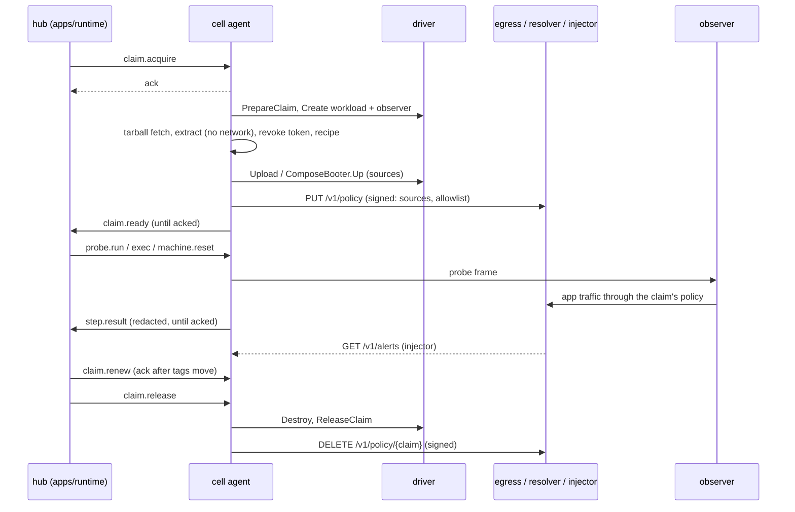

# Kody Runtime cell

The cell runs one side of a Run, base or PR, for a customer's app. It boots the app's environment in an isolated machine, runs the hub's probes and commands against it, and sends back evidence. The gate in `apps/runtime` makes the verdict; the cell decides nothing about the PR.

The cell is Go (`go.mod` here); the hub and the gate are TypeScript (`apps/runtime`, `libs/runtime`). The two share one protocol, defined in `libs/runtime/protocol`.

## Binaries (`cmd/`)

| Binary | Runs where | What it does |
|---|---|---|
| `cell` | the cell host | The agent: holds the outbound WebSocket to the hub, prepares and releases claims, keeps leases and the dead-man switch. Subcommands: `cell register` and `cell renew` (enrollment), and `cell extract` (the tarball extraction child, no network). |
| `kody-exec` | inside the workload VM | Reads one JSON request on stdin, runs it with `sh -c`, prints the result. Enforces the timeout on the whole process tree. Its output is evidence, never a verdict. |
| `observer` | the claim's observer machine | Runs typed HTTP and read-only SQL probes against the claim's exposed ports, outside the VM, and keeps the request log the gate uses for coverage. |
| `egress` | the egress host | Transparent proxy: the claim's only way out (ports 80/443 redirected by nftables). Reads SNI or Host, never terminates TLS, holds no credential. With `-dns-listen` it also runs the resolver. |
| `resolver` | the egress host | The only DNS of the VMs and the observer: `app.kody.internal` and the claim's exact allowlist. Every other name is NXDOMAIN without asking anyone. |
| `injector` | the egress host | The only holder of a claim's test credential. The proxy sends it the credentialed hosts; it adds the header and serves exfiltration alerts on its control port. |
| `injector-admin` | the injector's OS owner | Reads one write-only management request from stdin and calls the running injector's optional private Unix socket. It never opens the ciphertext/key or returns a credential. |
| `reaper` | outside the cell (EventBridge, CronJob, systemd timer) | Destroys every machine of the cell past `kodus:hard-expires`, with its own list-and-destroy credential. Drivers: `aws-ec2`, `k8s-sandbox`, `docker-gvisor` (on the host, from Docker labels and the cell's work directory only: `deploy/docker-gvisor`). |

`docker/Dockerfile.runtime-cell` builds all eight into one distroless image.

## Package map (`internal/`)

Control side (the agent and what it talks to):

- `agent`: the orchestrator. `handle.go` maps each hub frame to a handler and never does I/O on the read loop. `acquire.go`, `steps.go` and `release.go` cover a claim's life. `egress_sync.go`, `image_policy.go` (S-52 taint, bake, pool), `hold.go`, `bundle.go`, `redaction.go` and `alerts.go` cover the rest.
- `agent/claims`: each claim's state machine (acquiring, ready, failed, held, released), behind the claim's lock, and the registry that bounds how many claims a cell holds. Claim ids are validated here (`id.go`).
- `agent/outbox`: claim frames (`claim.ready`, `claim.failed`, `step.result`, `blocked`) resent until the hub acks them.
- `hubclient`: the mTLS WebSocket, ack/nack within 5 s, and `Later` for answers that need I/O.
- `protocol`: the envelope and bodies generated from the TS JSON Schema, plus a strict decoder that refuses what the TS decoder refuses, with the same codes.
- `lease`: leases, the tag-based sweep, and the dead-man switch.
- `dedup`: at-most-once execution of steps, by `stepId`, for an hour.
- `enrollment`: the cell's key and short client certificate (register, renew, `CertHolder`, `Renewer`).
- `tarball`: download through the Git API, extraction in a child with no network, token revocation on every path.
- `gitsource`: tarball URLs built from validated parts on the one configured Git API, and token revocation.
- `transport`: commands to a machine (SSH with per-claim keys and a pinned host key; a local directory for the fake driver; `Compose` for a driver that boots the checkout itself, where exec runs in the service container's working directory).
- `kodyexec`: the command runner behind `kody-exec`.
- `driver`: the `MachineDriver` port, tags, `ComposeBooter`, claim id rules. `driver/fake` is in-memory, tests only.
- `reaper`: the reaper's pass and loop.
- `metrics`: counters and gauges in the Prometheus text format.
- `clock`: the time source; `clock.Fake` makes retries and expiries instant in tests.
- `tlsutil`: loading PEM keys and pools.
- `testpki`: throwaway CAs for tests. `testing/hubstub`: a minimal hub for tests.

Data plane (what enforces a claim's network and secrets):

- `egress`: the proxy (see above). Every refusal is an event on its control port; live connections are cut when a new policy no longer allows them.
- `resolver`: the resolver (see above). Every query is logged by claim, every answer is recorded for the proxy, and each source is rate limited.
- `injector`: credential injection, response masking, exfiltration alerts.
- `observer`: probe runner, request log, and the config server that binds an observer to one claim.
- `observerauth`: private claim-local SQL credential and fixed provisioning data; no control/driver dependency.
- `observerclient`: authenticated configuration binding, generation/fingerprint verification and redirect refusal.
- `browser`: browser probes (ADR-071). Checks the closed step list, hands the job to a `Runner` (a container per round), reads its tar stream to the design's bounds, redacts the HAR and the trace's text with the claim's redactor, and diffs each screenshot against the baseline round's in Go (`pixeldiff.go`). The runner image is `browser-runner/` (Playwright, its own `package.json`).
- `policy`: the per-claim policy the agent signs (ed25519) and the components verify.
- `policy/control`: the control protocol: signed `PUT /v1/policy` and `DELETE /v1/policy/{claim}`, and the agent's `Pusher` with named endpoints.
- `netguard`: the network rules every data-plane piece applies alike: allowed addresses, the Kodus deny list, the answers the resolver handed out.
- `eventlog`: the bounded, sequenced log that the proxy's denials and the injector's alerts are long-polled from.
- `redact`: the last pass over everything that leaves the cell. Exact known values in every spelling, then token patterns. Replacement is one-way.

Environment (how a checkout boots):

- `recipe`: `.kodus/workspace.yaml`: format and the rules every cell enforces. Among them: no secrets in `services.compose.env`, and no name there that changes what runs instead of configuring the app (`PATH`, `LD_*`, `DYLD_*`, `NODE_OPTIONS`, `JAVA_TOOL_OPTIONS`, `BASH_ENV`, `DOCKER_*`, `COMPOSE_*` and the like).
- `compose`: reads and adapts a checkout's compose project, as data.
- `compose/sandbox`: the gVisor compose allowlist. `Apply` checks and rewrites the PR's file; `VerifyCanonical` checks what compose will really run.
- `checkoutfs`: the only way the cell writes its own files into a checkout. Nothing it writes follows a name the PR planted.
- `drivers/*`: the drivers below; `drivers/dockercli` is the one adapter to the docker binary.
- `buildprogress`: reads BuildKit's plain progress into per-step durations (`build.steps`: the slowest steps, cached and failed counts). Names are redacted and bounded; no step output is kept.

## Executable recipe additions

Declared, digest-pinned Stripe/Mailpit [local fakes](../../experiments/kody-runtime/recipe-fakes/README.md) are materialized before the normal Compose sandbox transformation. The [seeded PostgreSQL observer](../../experiments/kody-runtime/seeded-sql/README.md) is an optional docker-gvisor capability with private claim-local authentication and conservative schema/query gates. Both features are negotiated; unsupported cells refuse instead of ignoring the recipe. These initial subsets do not complete EC2 bake, arbitrary integrations, flags/LLM/UI configuration or corpus acceptance.

## Browser evidence

The existing browser executor uses Playwright/Chromium in a separate runner container. `Probe.evidence: 'lean'` retains measured steps, direct network/console observations and required screenshots/pixel diffs without starting video, trace or HAR recording. `'full'`, and an omitted value for compatibility, request the full recording set. The worker signs only the artifact types the mode asks for.

Required missing/incomplete measurements fail closed. PNG decoded dimensions, ZIP inflation and container cleanup are bounded. HAR exports metadata only; optional traces carrying recognized credentials are dropped. Images/video/opaque page data remain restricted to seed data, not arbitrary customer data. The inner Chromium sandbox remains off under the driver's outer gVisor boundary.

This build's measured scope, privacy limits and reproduction are in [BROWSER-EVIDENCE-DELIVERY.md](../../experiments/kody-runtime/BROWSER-EVIDENCE-DELIVERY.md). The replay adapter is currently docker-gvisor and uses Playwright directly. Obscura and Lightpanda are not included. Local `agent-browser` exploration is a separate operation, described below.

## Local UI exploration

`-browser-explore` is off by default. It requires docker-gvisor and a compatible pinned `-gvisor-browser-image`; startup checks the image's exploration protocol/version labels. Upgrade the product planner API before enabling it. The separate `browserExplore` hello capability does not follow from ordinary `browser` replay support.

The cell accepts `browser.explore` only for an active base-side Runtime claim and a hub that negotiated the feature. A fresh runner executes at most ten closed CSS actions with local agent-browser/Chromium, returns a bounded redacted snapshot and selector candidates, then exits. It shares the claim's step/container resource limits. It never returns a replay `ProbeResult` or decides a verdict.

A blocked navigation or failed native command ends that job; no daemon/session recovery is attempted. Redirects, WebSockets, service workers and iframe selector conversion are unsupported. No external browser provider, account, token or engine selection is exposed. See [validation and rollout notes](../../experiments/kody-runtime/agent-browser/README.md).

## Aggregate container budgets

`-gvisor-claim-limits required -gvisor-claim-cgroup-root <exclusive-delegated-root>` enables one physical CPU/memory/host-task ceiling across a docker-gvisor claim's container tree. It defaults off and requires memory admission, Linux and local rootful Docker cgroupfs v2. The cell never changes daemon configuration or delegates an ancestor. Other platforms/drivers fail closed in required mode.

Pool adoption keeps the physical parent, required-mode boot/ready reservations equal the actual ceiling, and asynchronous bake work retains its memory through logical release. Uncertain physical cleanup quarantines capacity. A lifetime lock excludes overlapping controllers; required startup refuses surviving managed groups until drained/reaped, rather than starting with an empty memory ledger over live old work.

See [CLAIM-LIMITS-DELIVERY.md](../../experiments/kody-runtime/CLAIM-LIMITS-DELIVERY.md) for exact kernel/runsc proof, configuration, cleanup and remaining recovery/packing gates. Host tasks are not gVisor guest PIDs; dockerd/image loading and trusted Go processing remain separate overhead.

## Drivers and isolation

| `-driver` | Isolation reported | Use | Notes |
|---|---|---|---|
| `aws-ec2` | `vm` | production | One VM per claim side plus an observer VM. Per-claim security groups. The org's KMS key. Exec over SSH. |
| `docker-gvisor` | `sandboxed-container` | self-hosted | The PR's compose project under `runsc`, after `compose/sandbox`. Booted by the agent through `ComposeBooter.Up`; the containers' addresses join the claim's policy Sources. The claim network is `--internal` in a /24 of its own; `-gvisor-egress-container` joins the cell egress to it, every machine mounts a resolv.conf naming the cell resolver alone, and services get fixed addresses with their names in `extra_hosts` (Docker's resolver forwards nothing on an internal network). A project's `build:` sections (checked by `sandbox.Builds`: context and Dockerfile inside the checkout, no remote context, ssh, secrets or caches) build with rootless BuildKit (`-gvisor-builder-image`, by digest) under runsc on the claim network, at a fixed address the policy names from the start, so `RUN` steps fetch only what the claim may; the image replaces the build section and goes with the machine. `test/gvisoregress` proves it on a Linux Docker with runsc (`KODY_E2E_GVISOR=1`). |
| `k8s-sandbox` | `sandboxed-container` | skeleton | Namespace per claim, default-deny NetworkPolicy, gVisor or Kata RuntimeClass. Only the reaper selects it today; `cmd/cell` does not. |
| `local-docker` | `none` | development only | The developer's own Docker, with no isolation. Needs `-dev-insecure-local-docker` and `KODY_RUNTIME_DEV=1`, and a hub started with `RUNTIME_DEV_ALLOW_INSECURE_CELLS=1`. |
| `fake` | `none` | tests and `-dev` | In-memory machines. Needs `-dev`. |

The agent refuses any isolation that is not `vm`, `microvm` or `sandboxed-container` unless the driver's development gate passed (`agent.New`). `-driver` has no default.

Every driver keeps one contract, written on `driver.MachineDriver` and checked by `drivertest.Run` against each driver's in-memory backend:
- it refuses a spec nobody could reap, and a claim id it could not use as a name;
- it stamps the reserved tags;
- it never lists, renews, destroys or releases another cell's machine or network;
- it renews under the ceiling the machine carries, not the one the caller sends;
- it destroys idempotently;
- it fails what it cannot do with `ErrUnsupported`.

A new driver is done when it passes the suite.

Only `docker-gvisor` bakes (`Capabilities.Bake`). On any other driver the agent refuses `image.bake` with `bake_unsupported` when it arrives, and the setup records the refusal instead of an image that was never made.

**Warm pool** (`internal/agent/pool.go`, `driver.Pooler`; docker-gvisor only, others answer `pool_unsupported`). `pool.target` only takes an image this cell baked (S-52) and asks the cell to keep `size` machines ready for the environment, at most `PoolMax` (4).
- A pool machine is what a claim would make before its project comes up: its own network wired to the egress, a holder tagged `kodus:role=pool` with a ceiling `PoolTTL` (4h) away, and every baked data volume of the environment already copied into its project volumes.
- `claim.acquire` of the same org and environment, asking for `latest` or the pool's image, with a ceiling no later than the machine's, adopts one (`Pooler.Adopt`) instead of making its network and workload. The machine keeps its pool tags; the cell keeps the claim → machine binding, moves its expiry with the claim's lease, and lets the claim's observer join the adopted network. A PR claim taints it like any machine.
- An adopted machine is destroyed on release and never goes back to the pool. The pool refills after each adoption, after a failed fill on the next sweep tick (never in a loop of its own), and moves to the new image when the environment is baked again, discarding the old machines.
- Pool holders are cleanup-only after restart. Bake recovery refuses surviving holders rather than recreating leases or memory reservations; reap them before starting the cell. Pool targets are not restored: the control plane must send them again.
- Metrics: `cell_pool_machines_total{outcome=created|failed|adopted|discarded}`, `cell_pool_ready`. Logs: `pool.target`, `pool.fill.done`, `pool.fill.failed`, `pool.discarded`, `claim.pool.adopted`, `claim.pool.adopt_failed`, `pool.created` (driver).
- `test/gvisoregress` proves it under runsc: the pool machine is ready in under a second with the setup's data, a claim adopts it, its observer joins the adopted network, the project boots on the setup's data, and nothing of it is left after release.
- `imageId: latest` (what the worker sends after a setup) is the environment's last bake in this cell; asked before that bake is done, the target waits for it and fills once it is.
- The size comes from the product: the plan's default and ceiling (`RUNTIME_POOL_DEFAULT_SIZE`, `RUNTIME_POOL_MAX_SIZE`), the admin's choice in the environment's settings under that ceiling, and `PoolMax` here on top.
- The worker reserves a claim's cell preferring the one of the environment's last setup, which holds its pool, when that cell is eligible for the org and has a free slot (`reserveCellFor`'s `prefer`); otherwise the order is the usual one.
- Not yet: a pool on awsec2.

**Baking on docker-gvisor.** A bake keeps what the clean setup claim's build sections produced; the agent has already checked that the claim booted the default-branch head and never ran PR code (S-52).
- The agent pins the setup machine's images (`driver.BakeSourcePinner`, `Config.BakePinner`) before it acks `image.bake`, so the release the worker sends next cannot remove them. `Bake` consumes the pin either way.
- Each bake gets a fresh generation, even at the same commit. The public ID is `kodus-bake/<scope-hash>@<sha>.<generation>`; images use `kodus-bake/<cell>/<org>/<env>:<generation>-<fingerprint>`. The fingerprint hashes the build's whole context (path, type, mode, content or link target; nothing followed, FIFOs never opened), Dockerfile, target, args and builder image. A context over 200k entries or 4 GiB has none and is always built.
- A matching build reuses only images declared in its selected generation manifest. A declared image that disappeared fails closed instead of being rebuilt under the old identity. Setup/unpinned builds do not reuse mutable legacy bake tags; ordinary BuildKit caches remain separate.
- Active machines and copy/tag operations retain their generation. Publishing a newer bake preserves retained generations; publication acknowledgement follows the agent's latest-pointer update. Same-environment concurrent bake is refused as `bake_in_progress` before pinning or reserving resources; other environments remain independent.
- Logs: `build.done` (with `reused`), `build.fingerprint.failed`, `bake.named`, `bake.service.skipped`, `bake.prune.failed`. `test/gvisoregress` proves the flow under runsc: a claim at the baked input boots with no builder and no egress; a changed Dockerfile builds and runs its own image; the environment's bake stays the setup's.
- Data (`data.reset: snapshot`) is copied into generation-specific volumes recorded in the exact manifest, with cell/org/environment, source-SHA and generation labels. Source helpers are created before provenance inspection, holding Docker's volume reference; the trusted marker is checked inside the readonly mount before copying. An auto-created empty source, symlink/FIFO/directory marker or missing member cannot become a successful restore. Partial copies are removed and errors preserved.
- A private version-1 catalog keeps eligible/current and staged/retired cleanup records. Atomic publication, an exclusive controller lock and bounded recovery protect the catalog: at most 1024 generations, 128 images and 128 volumes per generation, 4 MiB metadata. The CLI stores it in `<state-dir>/bakes` (driver default: `<WorkDir>/bake-catalog`); never mount it into a workload. Preserve this directory across upgrades. Legacy SHA-only IDs require fresh setup.
- Startup restores only backend-validated bake eligibility, with a caller-cancellable 30-second ceiling. It never restores claims, leases, keys, step execution or claim-local snapshots. The [physical generation test](test/gvisoregress/generation_recovery_linux_test.go) passed under runsc for same-SHA distinct seeds, retained old-claim reset and driver restart; zero scoped containers/networks/volumes remained. Image-build/browser/full-Run and installed-service restart acceptance remain separate. See [evidence](../../experiments/kody-runtime/observability/bake-generation-validation.json).
- Every copy of an org's data runs a helper (`-gvisor-helper-image`, `busybox:1.36` when empty) under runsc with no network (`dockercli.CopyVolumeIn`).
- `test/gvisoregress` proves the data path too: a service seeds its volume with a value no later boot can repeat, and the later claim finds the setup's.
- Build cache, one way like the images: every build reads its environment's BuildKit cache (`--import-cache type=local`, mounted read-only); only the builds of a setup's workload (`driver.MachineSpec.Setup`, set by the agent for a setup claim that is not a PR) write their own (`--export-cache mode=max`) into a directory of the machine's, and a bake of that machine makes it the environment's, replacing the older one. A PR build can never put a layer where a later setup or bake would read it. A machine's cache goes with it unless a bake takes it. `test/gvisoregress` proves it: a PR that changes a file copied after the `RUN` that installs packages builds with the package mirror blocked, and the same build with no cache fails at that `RUN`.
- A setup never adopts a pool machine: it boots the default branch from nothing, not from the last bake's data.

### Resetting between rounds (local-docker)

`data.reset` in the recipe picks how a `machine.reset` puts the workload back:

| `data.reset` | Reset | Use |
|---|---|---|
| `recreate` (default) | `down -v`, `up`, migrate, seed, health check | any project; slow when the app migrates and seeds on boot |
| `reseed` | seed and health check only | a seed that cleans up after itself |
| `snapshot` | stop every service, copy each named volume back from its snapshot, `up` (no build, migrate or seed), health check | a project whose data lives in named volumes (kodus-ai) |

With `snapshot`, the first boot that reaches ready stops the services that mount named volumes (a service behind a profile does not count), copies each volume into `<volume>-kodus-snapshot` with a helper container (`busybox`, `cp -a`, no network), and starts them again. Copies are only made with the services stopped. Base and PR are separate projects, so each has its own snapshots. Snapshot volumes carry `kodus.machine`, `kodus.cell` and `kodus.snapshot-of`, never compose's project label, so a `down -v` keeps them; destroy and the sweep remove them. When there is no snapshot or a copy fails, the reset recreates instead and logs `localdocker.reset.snapshot_fallback` with the reason; the boot after that takes a new snapshot. `BootReport` times the copies as `snapshotMs` (boot) and `restoreMs` (reset).

A snapshot is one machine's first ready state, taken before any probe runs, and it is removed with the machine; every claim gets new machines, so it never reaches another claim or another Run. No credential is in it: the injector adds credentials on the way out of the machine, so none reaches a volume. What the boot itself wrote (keys a setup generated, users a seed created) is the same in every round of that side, which is what a reset is for. Whatever must differ per round is not made before the snapshot.

On docker-gvisor a reset is `down -v` and the same `Up` as the boot, and `machine.reset` logs its phases (`downMs`, `buildMs`, `upMs`, then `seedMs`: the services that depend on others waiting for those to pass their healthcheck, where a database's init and seed run; `readyMs`: the last ones passing theirs). Both probe a starting service's healthcheck every 200 ms until it first passes (`start_interval`, with `start_period` its own interval × retries, at most 30 s), instead of the file's interval: under runsc that wait was half of each reset of the sample app. A healthcheck that sets either key keeps its own; `-gvisor-health-start-interval` changes the cadence or, negative, turns it off, and a daemon below API 1.44 never gets it.

The health check (`services.compose.health`) passes when the public service answers below 400, or with 401, 403 or 429: an app whose every route sits behind a sign-in is up when its auth answers, so its recipe needs no route opened only for the cell. A 404 or a 5xx is not up.

kodus-ai's recipe (`.kodus/workspace.runtime.yaml`) runs the API, the worker and webhooks from the production targets of `docker/Dockerfile` (`.kodus/runtime/compose.yml`), so a restart starts compiled code instead of a `nest build --watch`.

Not implemented yet:
- image baking on awsec2 and k8ssandbox: `awsec2.Bake` returns `ErrBakeOutsideDriver`. Snapshots they make must carry `driver.SnapshotTags`.
- exec on docker-gvisor: it answers `unreachable`.
- pool fill and handing pool machines to claims: every claim gets new machines.

## Life of a claim

1. **Enroll.** `cell register` makes the key on the cell and sends a CSR with a one-time token. It writes `key.pem` (the key with its certificate), `cert.pem`, `ca.pem` (the operator's hub CA, which pins the hub) and `issuer.pem`. The agent renews over mTLS when a third of the validity is left; every renewal must chain to `issuer.pem`. The cell id is the certificate's CN.
2. **Hello.** The agent dials the hub and offers its protocol versions, driver, isolation and regions; the hub's ack picks the version. Heartbeats report each claim and the free slots.
3. **`claim.acquire`.** The claim is refused unless:
   - the claim id is a plain path segment;
   - the cell is accepting;
   - `hardExpiresAt` is within the consumer's ceiling: `runtime` 60 min, `mcp` 4 h, others 45 min;
   - a diagnostic hold is on a setup claim.

   The ack comes at once; the preparation runs in the background, under a context that ends at the ceiling or at release.
4. **Prepare** (each phase logs `claim.phase`):
   1. the claim network;
   2. the workload and observer machines (a PR side's workload is tainted: never baked, snapshotted or pooled);
   3. the tarball at the SHA, extracted in a no-network child (links, devices, `..` and `.git` refused), then the download token revoked;
   4. the default branch's recipe written over the PR's copy;
   5. the upload (local-docker boots here);
   6. `ComposeBooter.Up` (docker-gvisor), with the claim's policy already pushed: a build fetches through the proxy during Up;
   7. the signed egress policy pushed to every component (again on docker-gvisor, now with the containers' addresses).
5. **`claim.ready` or `claim.failed`.** Either is resent until acked. A failure carries a Blocker kind and signature. A failed setup claim carries a redacted failure bundle and, when asked, stays held for diagnosis until its ceiling.
6. **Steps.**
   - Every step is admitted only after every other check passes, then recorded for at-most-once.
   - A claim admits at most 4 active exec, probe (including browser), and reset steps, including work awaiting preparation. `-max-claim-steps`, config `maxClaimSteps`, or `KODUS_CELL_MAX_CLAIM_STEPS` sets 1–64; precedence is flag, config file, environment, default. A full claim nacks `step_capacity` immediately without queuing work or recording a new dedup entry. Identical retries still ack and conflicting IDs still nack. Capacity is released when execution and evidence capture finish, before result delivery waits for its ACK; cancellation alone does not release running work. This is a step concurrency bound, separate from container memory/CPU/PID limits and claim-memory accounting.
   - `probe.run` goes to the observer. The cell sets the result's step, executor and image itself. On docker-gvisor the observer machine runs `-gvisor-observer-image` (`cmd/observer` at `/observer`) under runsc on the claim network, with `-gvisor-observer-tls-dir` mounted read-only. The claim network has no address on the host, so the observer also joins the cell's observer network (`kodus-observers-<cell>`: internal, the host on it, no traffic between its containers, never a workload); the cell dials it there over mTLS (`-observer http`, `-observer-server-name`, since its address is known only once it runs) and points each exposed port at its compose service's fixed address (`Driver.Targets`). Without the image the cell refuses `-observer http` on docker-gvisor.
   - A browser `probe.run` (with the `browser` capture, from a hub that accepts `browser`) does not go to the observer: the agent plays it in the browser runner (`agent/browser.go`). On docker-gvisor that is `-gvisor-browser-image`, by digest, one container per round under runsc on the claim network only, uid 10001, read-only root, no capability, the app as `app.kody.internal` (`Driver` side: `BrowserRunner`). Without the image a browser probe goes to the observer, which refuses it (`browser_unavailable`).
   - `exec` goes to `kody-exec`: `cwd` stays inside the workspace, and the deadline is `timeoutMs` plus a grace. On docker-gvisor it runs in the workload's public service container (the recipe's `public`, or the project's only service), under runsc, in that container's working directory; nothing of it reaches a shell on the cell host, and `timeout(1)` inside the sandbox stops the command at its deadline (`Driver.Exec`).
   - `machine.reset` resets the machine, and docker-gvisor's compose project comes up again. On local-docker the recipe's `data.reset` picks how (below).
   - Every `step.result` is redacted and resent until acked. A cancelled step sends none.
7. **Renew.** `claim.renew` is acked only after every machine's `kodus:expires` tag moved; otherwise the nack is `renew_failed`.
8. **End.** The claim's machines, network, egress policy, SSH keys and slot are all released when any of these happens:
   - `claim.release` arrives;
   - the lease ends;
   - the hold expires;
   - the dead-man fires: after 5 min without the hub no new work and expired machines go; after 15 min every machine goes.

   The reaper destroys whatever passes `kodus:hard-expires`, whatever anyone renews.

An injector exfiltration alert compromises its claim: running steps stop, new ones are refused, and an unsolicited `blocked` frame goes out through the outbox (`claimId`, no `re`) with kind `security_violation` and the alert kind as signature (`internal/agent/alerts.go`). The hub marks the claim compromised and the Run halts as a failing check. The machines stay as evidence until the hub releases the claim.



## Egress, resolver, injector, observer

- **Policy path.** The agent signs a `policy.ClaimPolicy` with `-policy-key`: the claim, org, Sources (workload, observer and compose container addresses), the exact allowlist (the `-egress-allow` base plus the hub's `egress.policy`), phase and expiry. `control.Pusher` sends it to each endpoint of `-egress-control` over mTLS with the cell identity. Each component checks it against the agent's public key (`-agent-pub`) and holds nothing else.
- **What enforcement guarantees.** A connection leaves only when all hold:
  - its source is a claim's;
  - its name is on that claim's allowlist and not on the deny list;
  - its address is one the resolver handed that claim, or one the proxy resolves for the name now.

  Credentialed hosts go only through the injector, which reaches exactly the address the proxy validated.
- **Deny list.** No allowlist, recipe or admin approval reaches a host on it (`netguard.DenyList`):
  - the Kodus entries: storage and paste sites, tunnels, LLM APIs, DNS over HTTPS;
  - the operator's own, given to the proxy and the resolver with the same `-deny-hosts` value (an exact host, or `.domain` for every name under it);
  - `-owned-hosts` lets the cell's own hosts through the Kodus entries only.

  Its zero value is the Kodus list, so a proxy or resolver nobody configured still refuses it. The agent leaves a denied host out of the policy it signs (`policy.Build`), logs `egress.policy.denied_hosts` and counts `cell_egress_hosts_denied_total`, so a policy never says a host is reachable when the proxy will refuse it.
- **Observer.** On aws-ec2 it is its own machine, configured over `PUT /v1/config` with the claim id it is bound to (`-observer http`). The fake and local-docker cells run it in-process (`-observer inprocess`).
- Not wired yet:
  - the proxy's refusals (`GET /v1/events`) are not polled by the agent, so the failure bundle has no denied egress in production;
  - the injector defaults to RefusingVault; optional owner-local management exists in the source candidate, but normal claim credential references/autogrants and product provisioning remain incomplete.

## Metrics

- The agent serves `/metrics` (Prometheus text, `internal/metrics`) on `-metrics-addr` (default `127.0.0.1:9466`, next to the hub's 9464 and the worker's 9465; `off` disables it). It covers:
  - claims by state, free slots and dead-man state;
  - frames refused, nacks sent and received;
  - deliveries and retries by kind;
  - steps by kind and outcome;
  - claims reaped, cleanup errors;
  - exfiltration alerts;
  - certificate renewals, failures and seconds left;
  - hosts left out of a claim's policy because the platform denies them;
  - driver calls by operation and outcome, and the time spent in them (`driver.Observed`). `cell_driver_not_owned_total` above zero is an alarm: something handed the cell another cell's machine or network.
- Browser exploration completions also have `cell_browser_explorations_total`, with the fixed `outcome` values `observed`, `blocked`, `timeout`, `unavailable` and `failed`. IDs, page content and error text never become labels. Cancellation remains in the unchanged legacy `cell_steps_total{kind="browser.explore",outcome="cancelled"}`; it is not a completed exploration. The legacy step counter continues to report VM health, so its `outcome="ok"` does not mean the browser observed the app successfully.
- The reaper's counters (`cell_reaper_*`) are in `internal/reaper`.
- The proxy serves its own counters on its control port (`GET /metrics`).

### Browser exploration diagnostics

The claim-scoped `step.result` completion event retains `cell`, `claim`, `run` and `step`, and adds status, duration, CLI-call/action/candidate counts and the truncation flag. It never logs the snapshot, candidate selectors/names or raw runner error. `durationMs` measures the cell-side operation before delivery/retry; `runnerDurationMs` is the reported runner duration and can be zero when no report arrived. Failed starts therefore still have a measured local duration.

A locally classified error uses only `runner_error`, `deadline_exceeded`, `job_refused` or `target_not_exposed` as its reason. Cancellation logs the standard context error rather than the runner's raw error. These diagnostic fields and counters change neither the delivered exploration result nor the replay gate/verdict. Driver per-call latency and event-log gap/epoch handling remain separate work; this increment does not claim to solve them.

## Protocol

The source of truth is the zod schema in `libs/runtime/protocol`. After changing it:

```sh
ts-node -r tsconfig-paths/register --transpile-only libs/runtime/protocol/scripts/dump-json-schema.ts
cd apps/runtime-cell && go generate ./internal/protocol
```

- `TestGeneratedTypesAreCurrent` fails when `types_gen.go` is stale.
- Rules zod expresses as refinements (read-only SQL, step result consistency, diagnostic hold only on setup claims, required `claimId`/`re`, reserved keys) are mirrored by hand in `internal/protocol/codec.go` and `strictjson.go`.
- The fixtures in `libs/runtime/protocol/fixtures` run on both sides: `go test ./internal/protocol/` and `API_NODE_ENV=test npx jest libs/runtime/protocol`. Both must accept and refuse the same frames with the same codes.

## Build and test

```sh
cd apps/runtime-cell
gofmt -l . && go vet ./... && go test -race -count=1 ./...
~/go/bin/staticcheck ./...
scripts/check-licenses.sh
```

- CI (`.github/workflows/runtime-cell.yml`) runs gofmt, vet, `go test -race` and govulncheck.
- `test/integration` runs the agent on the fake driver against `testing/hubstub` over a real mTLS WebSocket.
- Linux-only behavior (network namespaces, the child subreaper): `GOMODCACHE=$(go env GOMODCACHE) docker compose -f test/linux/docker-compose.yml run --rm go-test`.
- Real Docker (local-docker), behind the `dockersmoke` tag:

```sh
KODY_RUNTIME_DEV=1 go test -tags dockersmoke -run 'SmokeRealDocker|SmokeRecipe' -v ./internal/drivers/localdocker/
KODY_RUNTIME_SMOKE_DIR=/path/to/checkout KODY_RUNTIME_DEV=1 \
  go test -tags dockersmoke -run SmokeCheckout -timeout 60m -v ./internal/drivers/localdocker/
```

`TestSmokeCheckout` boots a real checkout from its recipe, checks its health path, resets it once and destroys it. It fails if any container or built image is left.

## Configuration that matters

Flags override `-config` (JSON or YAML; `deploy/local-docker.example.json`). The file holds paths, never secrets.

| Flag | Meaning |
|---|---|
| `-driver` | Required; see Drivers. `-dev` is required for `fake` and allows extraction without a network namespace off Linux. |
| `-hub-url` | `wss://host:port/...` of the hub. |
| `-cert`, `-key`, `-ca`, `-issuer` | Identity files from `cell register`. `-ca` pins the hub. |
| `-cell-id` | Optional; must equal the certificate CN. |
| `-auto-renew` | Renew the certificate (default true). |
| `-egress-control` | `egress=https://h:9443,resolver=https://h:9444,injector=https://h:9445`; all three required. |
| `-policy-key`, `-egress-allow` | The ed25519 key that signs policies; the base allowlist (a mirror). |
| `-observer` | `http` (observer machines) or `inprocess` (fake, local-docker). |
| `-git-api` | The one Git API tarballs come from (GitHub today). |
| `-workdir`, `-state-dir` | Scratch for tarballs and checkouts; driver state. |
| `-gvisor-holder-image` | Required by docker-gvisor. |
| `-aws-config` | aws-ec2: VPC, subnets, groups, launch template, org KMS keys. |
| `-metrics-addr` | `/metrics` listener. |

## OpenBao value reader (source candidate)

`internal/injector/secret_reader.go` separates versioned values from claim grants.
`OpenBaoReader` implements only `SecretVersionReader`, not `Vault` or `ManagedVault`.
It can now supply values to the source candidate's durable grant ledger through
explicit Go configuration. It is not wired into `cmd/injector`; the installed
injector and refusing defaults are unchanged. The local value store below remains
a prototype while this backend is evaluated.

The owner supplies an HTTPS origin, one KV v2 mount, one org/environment scope,
optional CA roots, and a context-aware function that supplies a current restricted
token. Endpoint/mount/identity never come from a recipe or claim. Tokens are fetched
per call; issuance, renewal and secure bootstrap still need an operational adapter.
The reader never uses an ambient proxy, redirects, a root-token fallback or a value cache.

Reads are pinned to `GET /v1/{mount}/data/runtime/{org}/{environment}/{secretId}?version=N`.
`N` must be positive and must equal the response metadata version. The KV document
has exactly `organizationId`, `environmentId`, `secretId`, `value` and `expiresAt`
(RFC3339). Identity must match the reference, and the bounded header-safe value must
still be valid after I/O. Deleted/destroyed versions are denied; a nonempty
`deletion_time`, including a scheduled deletion, is conservatively denied.

The default deadline is 3s (configurable from 100ms to 10s), including slot wait,
identity lookup and HTTP body. The identity function must honor its context.
There are at most eight active reads per reader, 16KiB response headers, 256KiB
response bodies and 32 JSON nesting levels. Duplicate/case-ambiguous JSON keys are
rejected. Backend error bodies/transport details are never returned to callers.
`CloseIdleConnections` releases idle sockets; it is not claim revocation or a
permanent shutdown operation. Clearing the raw response buffer is best effort;
decoded Go strings are not guaranteed to be erased from memory.

Tests use synthetic TLS servers. The opt-in
`TestOpenBaoRealKVVersionRevocationAndRestart` takes an operator-verified absolute
binary path in `KODY_OPENBAO_TEST_BINARY`, starts fresh loopback-only TLS/Raft
processes with a minimal environment, and removes its temporary state. It creates
a restricted read token separately from bootstrap, reads version3 while4 exists,
checks write/cross-org denial and token revocation, restarts sealed, unseals and
checks persistence and version deletion. The source integration also exercises
metadata-only grant recovery, the real signed-policy handler/authorizer, signed
durable removal and replay of the old policy against a healthy OpenBao. The policy
handler in that test is in-process; it does not substitute for an installed
injector/mTLS/upstream injection acceptance test. It never contacts an existing vault.
The observed bootstrap needed more than the initial test client's 2s deadline;
only that one-time fixture operation now has a separate 15s cap. Production reader
deadlines were not raised. This is not HA, backup/restore, installed injector,
installer, full tenant-boundary or capacity acceptance. See the
[reader checkpoint](../../experiments/kody-runtime/observability/openbao-reader-validation.json)
and [grant integration checkpoint](../../experiments/kody-runtime/observability/openbao-grants-validation.json).

### Injector review and safe diagnostics

The scoped [2026-11-10 review](../../experiments/kody-runtime/reviews/2026-11-10-secrets-review-1/REPORT.md)
fixed raw upstream parser errors leaking reflected credentials into logs and
credential-bearing response header names bypassing value-only masking. Such
header names now refuse the response before forwarding. Lookup/upstream/stream
failures use fixed diagnostic codes instead of raw provider errors. This protects
known credential forms, not arbitrary covert channels from an approved upstream.

Request slots count holders and waiters and retire a claim entry on its final
release/cancellation. Management uses its own five-operation `VaultAdmin` port;
metadata listing sorts a copied snapshot outside the grant gate. Entry retirement
is not measured RSS reclamation or a global waiter/connection limit.

The review suite passed118 top-level/265 cases. A subsequent fixture-stability
follow-up confirmed that core health/mount creation can precede KV initialization.
The fixture now probes the mount's read-only config before CAS writes, polling
only its exact initialization error within3s; other failures refuse immediately.
No production reader deadline/retry changed. Three disposable real cycles and the
latest affected race suite passed122 top-level/277 cases across5 packages, no skips.
See [stability evidence](../../experiments/kody-runtime/observability/openbao-stability-validation.json).
Installed operational acceptance remains open.

### External values and durable grants

`VaultConfig.ExternalValues` and `ExternalSourceID` select the external mode and
must be configured together alongside the private ledger directory/key/cell.
The ID is the owner's immutable mapping to backend origin/mount/auth scope, not
an automatic fingerprint of an arbitrary `SecretVersionReader`. Do not reuse it
with a different mapping. A new mapping needs a new profile/ledger and explicit
reprovisioning; no migration is performed here. The reader must honor cancellation
and implement I/O bounds; the OpenBao adapter supplies the limits above.

Local mode retains the exact format1 serialization/AAD. External mode uses format2,
distinct AAD, a persisted source ID and explicitly external version records whose
value is empty. Start it in a separate empty private ledger directory. Wrong mode,
profile, mixed record, populated external value or corrupt state refuses startup
without rewriting the file. Values returned by OpenBao never enter ledger state.

`ManagedVault.RegisterExternalVersion` accepts only immutable org/environment/ID/
version/expiry metadata. It does not fetch a value or bind a claim. Registering an
older existing remote version is allowed; changing an existing version's metadata
or reviving a revoked version is refused. External mode rejects `PutVersion`;
local mode rejects external registration. There is no local-value fallback or cache.

Each external lookup checks the grant and independent live authority before I/O,
then revalidates the returned identity/header-safe value, live authority and the
same binding/claim/version/expiry after I/O. Backend reads never hold the ledger
gate, so revoke, Close and unrelated claims continue. A completed durable
revocation cannot be undone by an old in-flight response or restart/policy replay.
The returned validity is capped by binding, registered metadata and remote expiry.
Policy and ledger are separate stores; this is not an atomic transaction across
them, and a previously authorized upstream request is not retroactively undone.

Deterministic tests cover revoked versions/claims, narrowed signed policy,
expiry/cancel/Close while reading, unrelated writes, malformed values and private
backend errors. A historical format1 fixture remains readable, and incompatible
format/profile opens leave its file unchanged. Management transport for external
registration, authenticated operational reader wiring, normal-claim eligibility,
customer provisioning/RBAC/UI, packaging and backup/restore remain incomplete.
Update ADR-048 for the separately operated MPL-2.0 service before distribution.

## Injector-local encrypted vault (prototype)

`injector` accepts `-vault-dir`, `-vault-key-file` and `-vault-cell-id` together.
The directory must already exist, be private `0700`, have the injector user's
ownership, and use a canonical path without symlinks. The key is an existing
regular `0600` file owned by that user, holding exactly 32 raw random bytes.
The key must be outside the ciphertext directory. Keep this key, the vault directory and their backups outside every workload,
image, build cache and guest mount. The injector never generates or exports the
owner's key. All three flags absent selects `RefusingVault`; partial or unsafe
configuration, corrupt ciphertext, another cell identity or a wrong key refuses
startup. Production never selects the in-memory test fixture.

The complete state, including scope and grants, is AES-256-GCM ciphertext in
`vault.json`, authenticated to the format and cell identity. One process owns a
lifetime file lock. Mutations atomically replace private ciphertext and fsync the
directory; a post-rename durability failure blocks all access until a verified
restart. Pending private ciphertext is reconciled only under that lock. Versions
are immutable and scoped to organization/environment/id/version; revocations
survive restart. Grant expiry cannot exceed the secret version or independently
authorized claim's hard expiry. Expired claim grants/tombstones are pruned on
mutations; live revocations remain. Claim IDs must be globally unique and never
reissued by the trusted claim authority.

A configured injector's signed policy DELETE drops live authority/connections
first and returns204 only after persisting revocation of any known vault claim.
A persistence failure returns a fixed503 and leaves live authority removed;
retry the same signed removal to finish durability even if the policy is gone.
In-flight Bind calls register a per-claim barrier before checking external
policy authority and recheck it under the vault gate before committing. Revoking
one claim cannot invalidate another claim's pending bind. Registrations exist
only while Bind is in flight, with a512-call ceiling and cleanup on failure,
cancellation and close. Unknown valid claim IDs are a no-op for durable state,
while their in-flight bindings are still fenced. This is not a permanent deny
list for unknown IDs; terminal claim IDs must never be reissued.

`ManagedVault` is an injector-local Go port: write a version, list metadata, bind
one version/header/host to a claim, and revoke a version or claim. `Bind` requires
an explicit `ClaimAuthorizer`; a caller's org/environment/claim fields do not
authorize themselves. The injector wires `PolicyClaimAuthorizer` to the same
store populated by the signed-policy control port. The signature covers the
organization, environment, claim, exact credential hosts and hard expiry.
Legacy policies without an environment still allow ordinary egress but cannot
authorize credentials. Every lookup revalidates current authority outside the
vault lock, then rechecks the stored binding, expiry and revocation before
releasing a value. A removed/narrowed policy refuses the next lookup, including
on an existing TLS connection; an already authorized in-flight upstream request
is not retroactively cancelled. Reserved transport headers are refused.

Owner-local management is optional: `-vault-admin-socket` selects an existing
canonical private `0700` parent directory; the injector creates a `0600` Unix
socket there. Both the listener and `injector-admin` verify the other process's
effective UID through the kernel. Existing paths, including stale sockets,
symlinks or non-private permissions, refuse startup; an owned socket is removed
only if its identity still matches at shutdown. All vault flags absent leaves
credentials refused; management also remains disabled unless explicitly enabled.
This grants the injector's OS owner local administrative access across its
configured scopes. It is not product RBAC or a network endpoint. Do not mount
the socket, its directory, vault or key into a workload, proxy or cell agent.

`injector-admin -socket /private/owner/admin.sock -operation <operation>` reads
exactly one JSON object from stdin, at most16 KiB. Never put a credential in an
argument, environment variable or shell history. Supply it from an approved
owner-side secret source over stdin. A30-second deadline covers stdin and the
request. Cancellation returns independently of a blocking inherited stdin read;
the one-shot command exits immediately afterward. This CLI adapter is not used
in any long-lived service. Requests use these exact fields:

| Operation | JSON fields |
| --- | --- |
| `put` | `organizationId`, `environmentId`, `id`, `version`, `value`, `expiresAt` |
| `list` | `organizationId`, `environmentId` |
| `bind` | `organizationId`, `environmentId`, `claimId`, `secretId`, `version`, `host`, `header`, `expiresAt` |
| `revoke-version` | `organizationId`, `environmentId`, `id`, `version` |
| `revoke-claim` | `organizationId`, `environmentId`, `claimId` |

Only `list` returns metadata; writes return no body, and there is no credential
read endpoint. Unknown/repeated/case-variant fields, trailing data and nested
values are refused. The client independently validates returned metadata and
rejects redirects, unexpected fields, other scopes and oversized responses.
Audits contain the closed operation/result code, status and elapsed time, never
request bodies or values. Local timeouts can leave a durable mutation committed;
repeat only the identical version/binding request, whose vault semantics are
idempotent. Do not retry with a different value under the same version.

Roll out the policy readers (proxy, resolver and injector) before the cell
writer, or as one coherent release: older strict readers reject the new optional
signed `environmentId` field. No new wire-protocol schema or secret value crosses
the hub. Normal claim policy wiring still does not declare credential hosts or
product secret references, so local provisioning alone cannot enable those
claims to inject a credential. That path deliberately remains refused.

Bounds are 256 version records, 512 live claim-authority records, 1,024 grants,
8 KiB per value, 2 MiB plaintext state and 4 MiB ciphertext envelope. Capacity
returns a typed refusal; versions are not silently evicted. Write/provision only
through the process that owns the vault, never by editing its file or opening a
second management process. Product CRUD/RBAC, authenticated remote provisioning,
normal claim secret references, key rotation/backup recovery, product UI,
private-registry two-stage bake and end-to-end customer acceptance remain open.
The owner-local transport is not a claim that these product paths are delivered.
