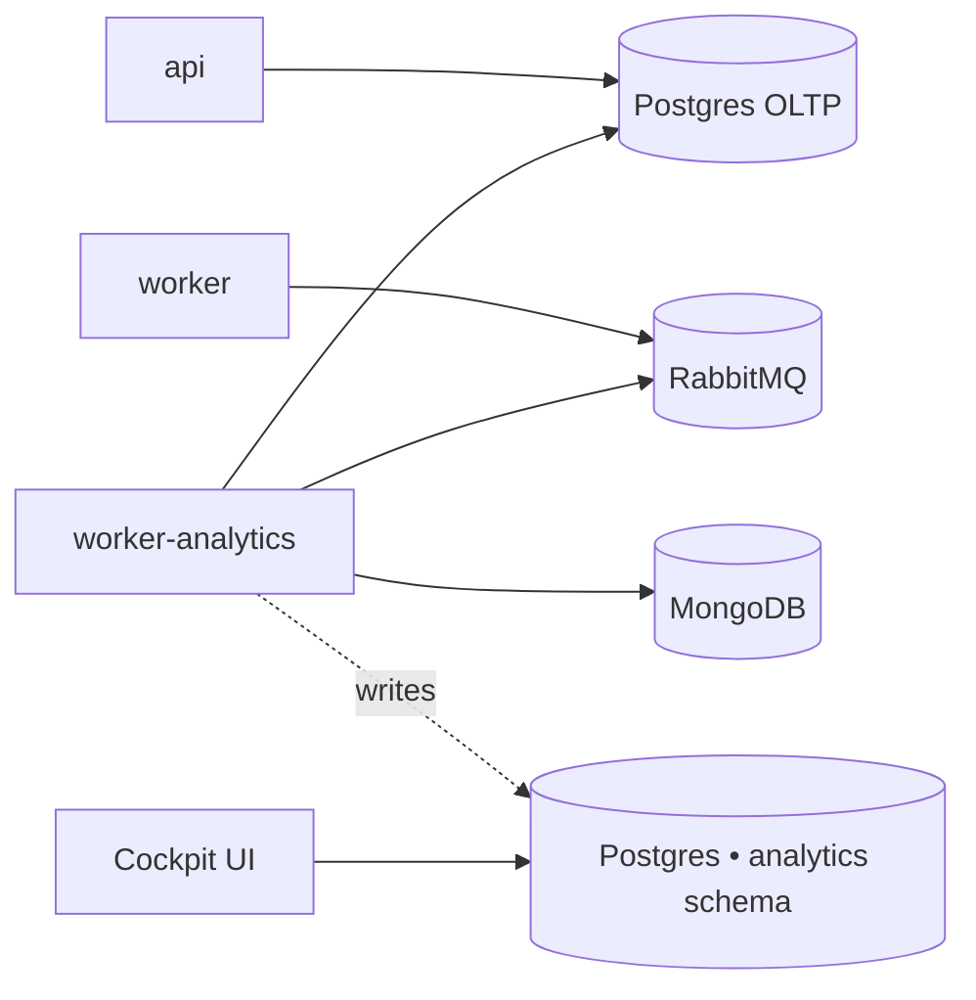

The analytics worker is an **Enterprise-only** add-on. It runs the ingestion cron that powers the [Cockpit](/en/how_to_use/cockpit/overview) dashboards (DORA-style metrics, PR lifecycle, LLM-based PR classifier).

Self-hosted Enterprise with an active license. With Docker Compose, start the `analytics` profile. The [Helm chart](/en/how_to_deploy/deploy_kodus/kubernetes) enables `worker-analytics` by default.

## What it does

A separate Node process running the **same image as `worker`** (`kodus-ai-worker`),
selected at boot via `WORKER_ROLE=analytics`. Two crons fire from this
process and only this process:

- **Ingestion** (`ANALYTICS_INGESTION_CRON`, default every 30 minutes) — reads
  pull requests and review sessions from Mongo + the OLTP Postgres, projects
  them into the `analytics` schema. It also runs once when the container starts.
- **Classifier** (`ANALYTICS_CLASSIFIER_CRON`, default every 30 minutes) — calls
  an LLM to tag each PR with a type (feature/bugfix/refactor/etc). It uses the model configured through the environment variables (see [LLM Provider Configuration](/en/how_to_deploy/deploy_kodus/generic_vm#llm-provider-configuration)), not a model connected on the **AI providers** page.

Isolating it from the main `worker` keeps the code-review event loop
unaffected by long-running ingestion queries.

## Topology

The analytics warehouse is a Postgres **schema**, not a separate database.
Two supported layouts:

- **Shared Postgres (recommended for self-hosted)** — leave
  `ANALYTICS_PG_DB_HOST` empty. The config loader falls back to the main
  `API_PG_DB_*` vars and creates an `analytics` schema in the same instance.
  One DB to back up and operate.
- **Dedicated Postgres** — set the full `ANALYTICS_PG_DB_*` block to point
  at a separate instance. Use this when you want analytical queries fully
  isolated from the OLTP write path.



## Enabling on self-hosted Enterprise

### 1. Activate your license

Set `KODUS_LICENSE_KEY` in `.env` before starting the stack, or activate the Enterprise key on the **Subscription** page. A key saved in the app takes precedence over the environment variable.

### 2. Add the analytics block to `.env`

**Shared Postgres (recommended):**

```bash
# Empty ANALYTICS_PG_DB_HOST → loader reuses API_PG_DB_* and creates the
# `analytics` schema in the main instance.
ANALYTICS_PG_DB_HOST=
ANALYTICS_PG_DB_SCHEMA=analytics

# Cron schedules (UTC).
ANALYTICS_INGESTION_CRON=*/30 * * * *
ANALYTICS_CLASSIFIER_CRON=*/30 * * * *
```

**Dedicated Postgres:**

```bash
ANALYTICS_PG_DB_HOST=your-analytics-host
ANALYTICS_PG_DB_PORT=5432
ANALYTICS_PG_DB_USERNAME=analytics
ANALYTICS_PG_DB_PASSWORD=...
ANALYTICS_PG_DB_DATABASE=kodus_analytics
ANALYTICS_PG_DB_SCHEMA=analytics

ANALYTICS_INGESTION_CRON=*/30 * * * *
ANALYTICS_CLASSIFIER_CRON=*/30 * * * *
```

### 3. Start the worker

The `analytics` profile is part of the installer's `docker-compose.yml`. Start the service from the `kodus-installer` directory:

```bash
docker compose --profile analytics up -d worker-analytics
```

The container is named `kodus-worker-analytics`. It uses the same image and `.env` as `worker`, with `WORKER_ROLE=analytics` set by Compose. After an upgrade, run the command again to recreate it on the new version.

### 4. Migrations run in the `api` container

Only the `api` container runs migrations. With `RUN_MIGRATIONS=true` (the default), it creates the `analytics` schema and runs the warehouse migrations on boot. The worker containers never migrate, so start `api` before `worker-analytics` on a fresh install.

## Reference

| Variable | Description | Default |
|---|---|---|
| `WORKER_ROLE` | Set to `analytics` on this container by Compose. | _required_ |
| `ANALYTICS_PG_DB_HOST` | Analytics Postgres host. Empty → reuse main Postgres. | _empty_ |
| `ANALYTICS_PG_DB_PORT` | Analytics Postgres port. Empty → `API_PG_DB_PORT`. | _empty_ |
| `ANALYTICS_PG_DB_USERNAME` | Analytics Postgres user. Empty → reuse `API_PG_DB_USERNAME`. | _empty_ |
| `ANALYTICS_PG_DB_PASSWORD` | Analytics Postgres password. Empty → reuse `API_PG_DB_PASSWORD`. | _empty_ |
| `ANALYTICS_PG_DB_DATABASE` | Analytics Postgres database. Empty → reuse `API_PG_DB_DATABASE`. | _empty_ |
| `ANALYTICS_PG_DB_SCHEMA` | Schema name for the warehouse tables. | `analytics` |
| `ANALYTICS_PG_POOL_MAX` | Upper bound on the analytics Postgres pool. | `5` |
| `ANALYTICS_INGESTION_CRON` | Cron schedule for the ingestion run (UTC). | every 30 minutes |
| `ANALYTICS_CLASSIFIER_CRON` | Cron schedule for the LLM PR-type classifier (UTC). | every 30 minutes |
| `ANALYTICS_INGESTION_RUN_ON_BOOT` | Set to `false` to skip the ingestion run at container start. | run on boot |

### Pausing ingestion (advanced)

To pause either analytics job, set `ANALYTICS_INGESTION_DISABLED=true` or `ANALYTICS_CLASSIFIER_DISABLED=true` (or both) in `.env` and apply the change with `docker compose --profile analytics up -d worker-analytics`.

## Verifying it's working

After boot, tail the analytics worker logs:

```bash
docker compose --profile analytics logs -f worker-analytics
```

You should see `analytics ingestion (startup) done in NNNms` right after boot, then
`analytics ingestion (cron) done ...` and `analytics classifier done ...` on each
schedule. These are info-level lines, and the installer's `.env` sets `API_LOG_LEVEL=error`, so set
`API_LOG_LEVEL=info` and recreate the container to see them. Only one replica runs a pass at a time. If you don't see these lines, check that
`WORKER_ROLE=analytics` is set on this container only (not on the main `worker`, which must
stay `code-review`). The worker also answers `GET /health` on port 3334 inside the container.
