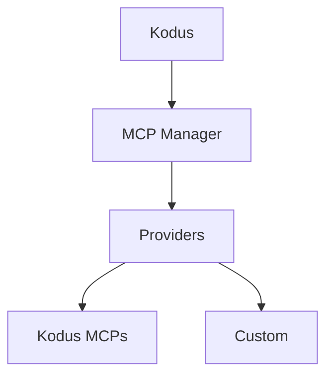

## What are MCPs?

Model Context Protocol (MCP) is an open standard that lets LLM apps connect to
external tools and data sources through a consistent server interface. MCP
servers publish tool schemas and endpoints so clients like Kodus/Kody can fetch
context or run actions during a workflow.

## MCP Manager Architecture

MCP Manager is the backend service that brokers those MCP connections for
Kodus. It keeps track of providers, integrations, and allowed tools per
workspace, then exposes that catalog to the Kodus API. It listens on port 3101,
answers `GET /health`, and keeps its data in the `mcp-manager` schema of your
PostgreSQL database. It creates and migrates that schema itself when it starts.

- Central registry for MCP providers (Kodus and custom)
- Stores integration metadata (connection status, MCP URL, allowed tools)
- Handles provider-specific authentication flows and tool discovery
- Exposes APIs used by Kodus to list and invoke MCP tools



## Enabling MCP Manager

MCP Manager is optional.

<Tabs>
  <Tab title="Docker Compose">
    Set these in `.env`, then run `./scripts/install.sh`. The installer starts the `kodus-mcp-manager` container when `API_MCP_SERVER_ENABLED` is `true`.

    ```env
    API_MCP_SERVER_ENABLED=true
    API_KODUS_SERVICE_MCP_MANAGER=http://kodus-mcp-manager:3101
    API_KODUS_MCP_SERVER_URL=https://kodus-api.yourdomain.com/mcp
    API_MCP_MANAGER_REDIRECT_URI=https://kodus-web.yourdomain.com/setup/mcp/oauth
    ```

    - `API_KODUS_SERVICE_MCP_MANAGER` is how the API and worker reach the service. Use the container name, not `localhost`.
    - `API_KODUS_MCP_SERVER_URL` is the public URL of the Kodus MCP server on your API.
    - `API_MCP_MANAGER_REDIRECT_URI` is where the browser returns after an OAuth sign-in. Use your public web URL.
    - `API_MCP_MANAGER_JWT_SECRET` and `API_MCP_MANAGER_ENCRYPTION_SECRET` are generated by `./scripts/generate-secrets.sh`.
  </Tab>
  <Tab title="Kubernetes">
    The chart deploys MCP Manager and enables the API’s `/mcp` endpoint by default. It derives `API_MCP_MANAGER_REDIRECT_URI` from your web host. To skip MCP Manager, set `services.mcp-manager.enabled=false`. To turn off the API endpoint too, set `global.config.API_MCP_SERVER_ENABLED` to `"false"`. See [Kubernetes & OpenShift](/en/how_to_deploy/deploy_kodus/kubernetes).
  </Tab>
</Tabs>

`API_MCP_SERVER_ENABLED=true` also turns on the Kodus MCP server on the API at `POST /mcp`. It accepts a team API key (`x-team-key: kodus_...` or `Authorization: Bearer kodus_...`) from MCP clients.

To connect a client such as Cursor or Claude Desktop to your instance, see [Kodus MCP server](/en/how_to_deploy/deploy_kodus/mcp_server).

## Plugins in Kodus

Everything registered in MCP Manager appears on the Kodus **Plugins** page
(sidebar → **Plugins**), so your team can install, manage, and enable the MCPs
available for each workspace. If the web app can't reach MCP Manager (for
example, it isn't deployed), the **Plugins** item is hidden from the sidebar.


## Providers

`API_MCP_MANAGER_MCP_PROVIDERS` lists the providers MCP Manager loads. It defaults to `kodusmcp,custom`, and those are the only two values it accepts.

### Kodus provider

The Kodus provider is the catalog of first-party and curated MCPs: Kodus Docs, Git Issues, Sentry, Exa Search, Kodus OSV, Linear, Atlassian Rovo, Notion and Fireflies. Git Issues is served by your own API. The others connect to the vendor's hosted MCP endpoint, so the worker needs outbound HTTPS access to them. Sign-in is OAuth, a token, or none, depending on the MCP.

### Custom providers

Add your own MCP server from the **Plugins** page with **Add Plugin** under **Add Custom Plugin**. Give it a name, the server URL and a protocol (`http` or `sse`), then pick how it authenticates: none, bearer token, basic, API key header, or OAuth 2.0. Custom plugins belong to your organization. See [Install a custom plugin](/en/cookbook/custom-plugin-install).
