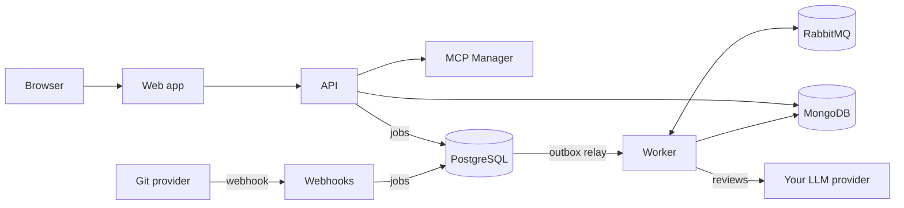

## Overview

Kodus runs as a set of containers: a web app, an API, a worker that runs reviews, a webhooks receiver, and three data stores (PostgreSQL, MongoDB and RabbitMQ). The same images run on Docker Compose and on Kubernetes.

## Services

| Service | Image | Port | What it does |
| --- | --- | --- | --- |
| `kodus-web` | `kodus-ai-web` | 3000 | The dashboard. Its server calls the API on behalf of the browser. |
| `api` | `kodus-ai-api` | 3001 | Authentication, settings, Kody Rules and integrations. On Docker Compose it also runs the database migrations and seeds on boot. |
| `worker` | `kodus-ai-worker` | 3334 (health, internal) | Consumes the job queues and runs code reviews. Needs `WORKER_ROLE=code-review`. |
| `webhooks` | `kodus-ai-webhook` | 3332 | Receives events from GitHub, GitLab, Bitbucket, Azure Repos and Forgejo and enqueues a job for each. |
| `kodus-mcp-manager` | `kodus-mcp-manager` | 3101 | Optional. Brokers MCP plugins. See [MCP Manager](/en/how_to_deploy/deploy_kodus/mcp_manager). |
| `worker-analytics` | `kodus-ai-worker` | 3334 (health, internal) | Optional, Enterprise. Same image as `worker` with `WORKER_ROLE=analytics`. See [Analytics Worker](/en/how_to_deploy/deploy_kodus/analytics_worker). |

Images are published as `ghcr.io/kodustech/<image>`. The five application images share one version tag per release; the RabbitMQ image (`kodus-rabbitmq`) has its own.

The worker is the only service that runs reviews, so it needs outbound access to your Git provider and your LLM provider. It parses repositories in a sandbox; see [Sandbox & AST Graph](/en/how_to_deploy/deploy_kodus/sandbox).

### Health endpoints

| Service | Endpoint |
| --- | --- |
| Web | `GET /api/health` |
| API | `GET /health` (checks RabbitMQ and PostgreSQL), `GET /health/simple` |
| Webhooks | `GET /health`, `/health/live`, `/health/ready` |
| Worker | `GET /health` on port 3334, not published by the installer |
| MCP Manager | `GET /health` |

## How a review starts

1. The Git provider calls the webhooks service. It checks the event and records a job and an outbox message in PostgreSQL, in one transaction.
2. The worker relays the outbox message to RabbitMQ, so an event is not lost if the broker is briefly unavailable.
3. The worker consumes the job from RabbitMQ, loads the pull request, runs the review with your LLM provider and posts the result on the pull request.

The worker creates the `workflow.jobs.*` queues on its first connection. If it has never started, for example because `WORKER_ROLE` is unset, webhooks and the API fail with `QueueBind 404` errors.

## Data stores

- **PostgreSQL** (with the pgvector extension): application data, workflow jobs and the outbox, the AST graph of each repository, and the schemas of the MCP Manager and the analytics warehouse.
- **MongoDB**: pull request and review data, Kody Rules and sandbox leases.
- **RabbitMQ**: the job queues the worker publishes to and consumes from. The Kodus RabbitMQ image ships the delayed message exchange plugin and creates the `kodus-ai` and `kodus-ast` virtual hosts. If you bring your own broker, enable the `rabbitmq_delayed_message_exchange` plugin, create both virtual hosts and set `consumer_timeout = 7200000`.

With Docker Compose you can point Kodus at your own PostgreSQL, MongoDB or RabbitMQ; see [Installation](/en/how_to_deploy/deploy_kodus/generic_vm#database-configuration).

## Networks

The installer creates three external Docker networks:

- `shared-network`: web, api, worker, webhooks, MCP Manager and RabbitMQ.
- `kodus-backend-services`: every Kodus service plus PostgreSQL and MongoDB.
- `monitoring-network`: RabbitMQ only.

PostgreSQL and MongoDB are attached to `kodus-backend-services` only. RabbitMQ exposes Prometheus metrics on port 15692; Kodus does not ship Prometheus or Grafana.

## Enterprise features

A license key unlocks the Enterprise features on a self-hosted instance. Set `KODUS_LICENSE_KEY` in `.env`, or paste the key on the **Subscription** page. Cockpit analytics and SSO need it.

## Next Steps
<CardGroup cols={2}>
  <Card title="Run Kodus Locally" icon="laptop" href="/en/how_to_deploy/local_quickstart/orchestrator">
    Ideal for local development and getting familiar with the full Kodus stack.
  </Card>
  <Card title="Deploy Kodus to Production" icon="rocket" href="/en/how_to_deploy/deploy_kodus/generic_vm">
    Perfect for production deployment and experiencing the full capabilities of Kodus.
  </Card>
</CardGroup>
