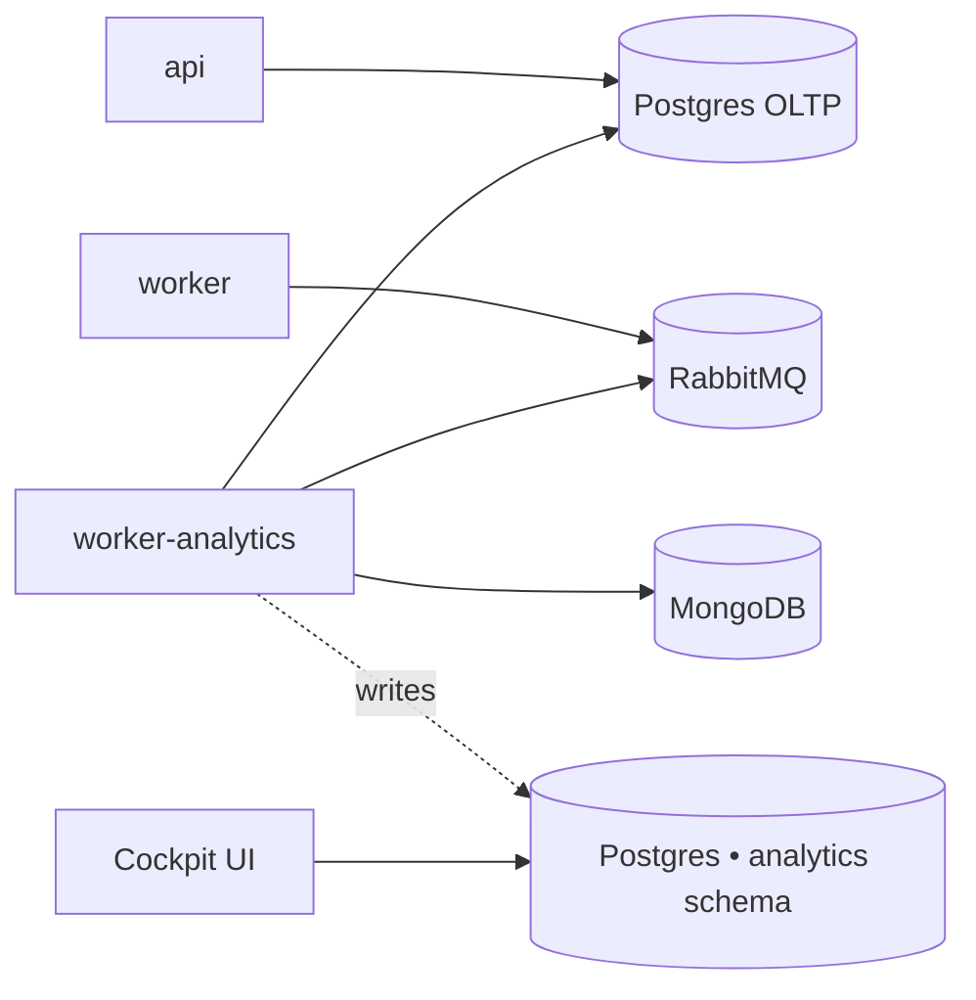

El analytics worker es un add-on **exclusivo de Enterprise**. Ejecuta el cron de ingestión que alimenta los dashboards del [Cockpit](/es/how_to_use/cockpit/overview) (métricas tipo DORA, ciclo de vida de PR, classifier de PR basado en LLM).

Enterprise autoalojado con una licencia activa. Con Docker Compose, inicia el perfil `analytics`. El [chart de Helm](/es/how_to_deploy/deploy_kodus/kubernetes) habilita `worker-analytics` por defecto.

## Qué hace

Un proceso Node separado ejecutando la **misma imagen del `worker`**
(`kodus-ai-worker`), seleccionado en el boot vía `WORKER_ROLE=analytics`.
Dos crons disparan desde este proceso y solo desde él:

- **Ingestión** (`ANALYTICS_INGESTION_CRON`, por defecto cada 30 minutos) — lee
  pull requests y sesiones de review desde Mongo + el Postgres OLTP, y los
  proyecta al schema `analytics`. También se ejecuta una vez cuando inicia el contenedor.
- **Classifier** (`ANALYTICS_CLASSIFIER_CRON`, por defecto cada 30 minutos) — llama
  a un LLM para etiquetar cada PR con un tipo (feature/bugfix/refactor/etc). Usa el modelo configurado mediante las variables de entorno (consulta [Configuración de proveedores de LLM](/es/how_to_deploy/deploy_kodus/generic_vm#configuración-de-proveedores-de-llm)), no un modelo conectado en la página **AI providers**.

Aislarlo del `worker` principal mantiene el event loop de code review
libre de queries de ingestión largas.

## Topología

El warehouse de analytics es un **schema** de Postgres, no una base de
datos separada. Dos layouts soportados:

- **Postgres compartido (recomendado para self-hosted)** — deja
  `ANALYTICS_PG_DB_HOST` vacío. El config loader cae en el fallback de
  las vars `API_PG_DB_*` y crea un schema `analytics` en la misma
  instancia. Una sola DB para respaldar y operar.
- **Postgres dedicado** — define el bloque `ANALYTICS_PG_DB_*` completo apuntando
  a otra instancia. Úsalo cuando quieras queries analíticas totalmente
  aisladas del write path del OLTP.



## Habilitando en self-hosted Enterprise

### 1. Activa tu licencia

Configura `KODUS_LICENSE_KEY` en `.env` antes de iniciar los servicios o activa la clave Enterprise en **Subscription**. La clave guardada en la aplicación tiene prioridad sobre la variable de entorno.

### 2. Agrega el bloque de analytics al `.env`

**Postgres compartido (recomendado):**

```bash
# Empty ANALYTICS_PG_DB_HOST → loader reuses API_PG_DB_* and creates the
# `analytics` schema in the main instance.
ANALYTICS_PG_DB_HOST=
ANALYTICS_PG_DB_SCHEMA=analytics

# Cron schedules (UTC).
ANALYTICS_INGESTION_CRON=*/30 * * * *
ANALYTICS_CLASSIFIER_CRON=*/30 * * * *
```

**Postgres dedicado:**

```bash
ANALYTICS_PG_DB_HOST=your-analytics-host
ANALYTICS_PG_DB_PORT=5432
ANALYTICS_PG_DB_USERNAME=analytics
ANALYTICS_PG_DB_PASSWORD=...
ANALYTICS_PG_DB_DATABASE=kodus_analytics
ANALYTICS_PG_DB_SCHEMA=analytics

ANALYTICS_INGESTION_CRON=*/30 * * * *
ANALYTICS_CLASSIFIER_CRON=*/30 * * * *
```

### 3. Inicia el worker

El perfil `analytics` es parte del `docker-compose.yml` del instalador. Inicia el servicio desde el directorio `kodus-installer`:

```bash
docker compose --profile analytics up -d worker-analytics
```

El contenedor se llama `kodus-worker-analytics`. Usa la misma imagen y el mismo `.env` que `worker`, con `WORKER_ROLE=analytics` definido por Compose. Después de una actualización, vuelve a ejecutar el comando para recrearlo en la nueva versión.

### 4. Las migrations corren en el contenedor `api`

Solo el contenedor `api` ejecuta migrations. Con `RUN_MIGRATIONS=true` (el valor por defecto), crea el schema `analytics` y ejecuta las migrations del warehouse al iniciar. Los contenedores worker nunca ejecutan migrations, así que inicia `api` antes de `worker-analytics` en una instalación nueva.

## Referencia

| Variable | Descripción | Default |
|---|---|---|
| `WORKER_ROLE` | Compose lo define en `analytics` en este contenedor. | _requerido_ |
| `ANALYTICS_PG_DB_HOST` | Host del Postgres de analytics. Vacío → reutiliza el Postgres principal. | _vacío_ |
| `ANALYTICS_PG_DB_PORT` | Puerto del Postgres de analytics. Vacío → `API_PG_DB_PORT`. | _vacío_ |
| `ANALYTICS_PG_DB_USERNAME` | Usuario del Postgres de analytics. Vacío → reutiliza `API_PG_DB_USERNAME`. | _vacío_ |
| `ANALYTICS_PG_DB_PASSWORD` | Contraseña del Postgres de analytics. Vacío → reutiliza `API_PG_DB_PASSWORD`. | _vacío_ |
| `ANALYTICS_PG_DB_DATABASE` | Base del Postgres de analytics. Vacío → reutiliza `API_PG_DB_DATABASE`. | _vacío_ |
| `ANALYTICS_PG_DB_SCHEMA` | Nombre del schema de las tablas del warehouse. | `analytics` |
| `ANALYTICS_PG_POOL_MAX` | Límite superior del pool del Postgres de analytics. | `5` |
| `ANALYTICS_INGESTION_CRON` | Cron schedule de la ejecución de ingestión (UTC). | cada 30 minutos |
| `ANALYTICS_CLASSIFIER_CRON` | Cron schedule del classifier de tipo de PR vía LLM (UTC). | cada 30 minutos |
| `ANALYTICS_INGESTION_RUN_ON_BOOT` | Define `false` para omitir la ejecución de ingestión al iniciar el contenedor. | se ejecuta al iniciar |

### Pausando la ingestión (avanzado)

Para pausar uno o ambos procesos, define `ANALYTICS_INGESTION_DISABLED=true` o `ANALYTICS_CLASSIFIER_DISABLED=true` en `.env` y aplica el cambio con `docker compose --profile analytics up -d worker-analytics`.

## Verificando que funciona

Después del boot, sigue los logs del analytics worker:

```bash
docker compose --profile analytics logs -f worker-analytics
```

Debes ver `analytics ingestion (startup) done in NNNms` justo después del boot, luego
`analytics ingestion (cron) done ...` y `analytics classifier done ...` en cada
schedule. Son líneas de nivel info, y el `.env` del instalador define `API_LOG_LEVEL=error`, así que define
`API_LOG_LEVEL=info` y recrea el contenedor para verlas. Solo una réplica ejecuta una pasada a la vez. Si no ves estas líneas, confirma que
`WORKER_ROLE=analytics` está definido solo en este contenedor (no en el `worker` principal, que debe
permanecer en `code-review`). El worker también responde `GET /health` en el puerto 3334 dentro del contenedor.
