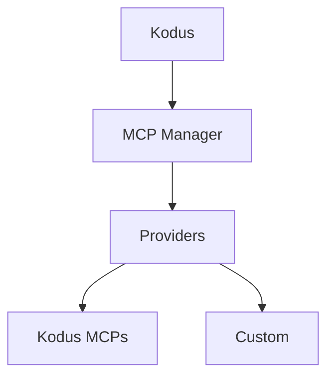

## ¿Qué son los MCPs?

Model Context Protocol (MCP) es un estándar abierto que permite a las aplicaciones de LLM conectarse a
herramientas externas y fuentes de datos a través de una interfaz de servidor consistente. Los servidores
MCP publican esquemas de herramientas y endpoints para que clientes como Kodus/Kody puedan obtener
contexto o ejecutar acciones durante un flujo de trabajo.

## Arquitectura de MCP Manager

MCP Manager es el servicio backend que gestiona esas conexiones MCP para
Kodus. Lleva un registro de los proveedores, integraciones y herramientas permitidas por
workspace, y luego expone ese catálogo a la API de Kodus. Escucha en el puerto 3101,
responde `GET /health` y guarda sus datos en el schema `mcp-manager` de tu
base de datos PostgreSQL. Crea y migra ese schema por sí mismo cuando inicia.

- Registro central de proveedores MCP (Kodus y personalizados)
- Almacena metadatos de integración (estado de conexión, URL MCP, herramientas permitidas)
- Gestiona los flujos de autenticación específicos de cada proveedor y el descubrimiento de herramientas
- Expone APIs que Kodus usa para listar e invocar herramientas MCP



## Habilitar MCP Manager

MCP Manager es opcional.

<Tabs>
  <Tab title="Docker Compose">
    Define esto en `.env` y luego ejecuta `./scripts/install.sh`. El instalador inicia el contenedor `kodus-mcp-manager` cuando `API_MCP_SERVER_ENABLED` es `true`.

    ```env
    API_MCP_SERVER_ENABLED=true
    API_KODUS_SERVICE_MCP_MANAGER=http://kodus-mcp-manager:3101
    API_KODUS_MCP_SERVER_URL=https://kodus-api.yourdomain.com/mcp
    API_MCP_MANAGER_REDIRECT_URI=https://kodus-web.yourdomain.com/setup/mcp/oauth
    ```

    - `API_KODUS_SERVICE_MCP_MANAGER` es cómo la API y el worker alcanzan el servicio. Usa el nombre del contenedor, no `localhost`.
    - `API_KODUS_MCP_SERVER_URL` es la URL pública del servidor MCP de Kodus en tu API.
    - `API_MCP_MANAGER_REDIRECT_URI` es adonde vuelve el navegador después de un inicio de sesión con OAuth. Usa tu URL web pública.
    - `./scripts/generate-secrets.sh` genera `API_MCP_MANAGER_JWT_SECRET` y `API_MCP_MANAGER_ENCRYPTION_SECRET`.
  </Tab>
  <Tab title="Kubernetes">
    El chart despliega MCP Manager y habilita el endpoint `/mcp` de la API por defecto. Deriva `API_MCP_MANAGER_REDIRECT_URI` de tu host web. Para desactivar MCP Manager, define `services.mcp-manager.enabled=false`. Para desactivar también el endpoint de la API, establece `global.config.API_MCP_SERVER_ENABLED` en `"false"`. Consulta [Kubernetes y OpenShift](/es/how_to_deploy/deploy_kodus/kubernetes).
  </Tab>
</Tabs>

`API_MCP_SERVER_ENABLED=true` también activa el servidor MCP de Kodus en la API en `POST /mcp`. Acepta una clave de API de equipo (`x-team-key: kodus_...` o `Authorization: Bearer kodus_...`) de los clientes MCP.

Para conectar un cliente como Cursor o Claude Desktop a tu instancia, consulta [Servidor MCP de Kodus](/es/how_to_deploy/deploy_kodus/mcp_server).

## Plugins en Kodus

Todo lo registrado en MCP Manager aparece en la página **Plugins** de Kodus
(barra lateral → **Plugins**), para que tu equipo pueda instalar, gestionar y habilitar
los MCPs disponibles para cada workspace. Si la aplicación web no puede acceder a MCP
Manager (por ejemplo, porque no está desplegado), el elemento **Plugins** se oculta de
la barra lateral.


## Proveedores

`API_MCP_MANAGER_MCP_PROVIDERS` lista los proveedores que MCP Manager carga. Por defecto es `kodusmcp,custom`, y esos son los únicos dos valores que acepta.

### Proveedor Kodus

El proveedor Kodus es el catálogo de MCPs de primera parte y curados: Kodus Docs, Git Issues, Sentry, Exa Search, Kodus OSV, Linear, Atlassian Rovo, Notion y Fireflies. Git Issues lo sirve tu propia API. Los demás se conectan al endpoint MCP alojado del proveedor, por lo que el worker necesita acceso HTTPS saliente a ellos. El inicio de sesión es OAuth, un token o ninguno, según el MCP.

### Proveedores personalizados

Agrega tu propio servidor MCP desde la página **Plugins** con **Add Plugin** en **Add Custom Plugin**. Dale un nombre, la URL del servidor y un protocolo (`http` o `sse`), y luego elige cómo se autentica: ninguna, bearer token, basic, header con API key u OAuth 2.0. Los plugins personalizados pertenecen a tu organización. Consulta [Instalar un plugin personalizado](/es/cookbook/custom-plugin-install).
