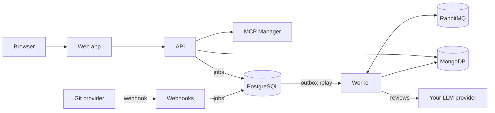

## Descripción general

Kodus se ejecuta como un conjunto de contenedores: una aplicación web, una API, un worker que ejecuta las revisiones, un receptor de webhooks y tres almacenes de datos (PostgreSQL, MongoDB y RabbitMQ). Las mismas imágenes se ejecutan en Docker Compose y en Kubernetes.

## Servicios

| Servicio | Imagen | Puerto | Qué hace |
| --- | --- | --- | --- |
| `kodus-web` | `kodus-ai-web` | 3000 | El dashboard. Su servidor llama a la API en nombre del navegador. |
| `api` | `kodus-ai-api` | 3001 | Autenticación, configuración, Kody Rules e integraciones. En Docker Compose también ejecuta las migraciones y los seeds de la base de datos al iniciar. |
| `worker` | `kodus-ai-worker` | 3334 (health, interno) | Consume las colas de jobs y ejecuta las revisiones de código. Requiere `WORKER_ROLE=code-review`. |
| `webhooks` | `kodus-ai-webhook` | 3332 | Recibe eventos de GitHub, GitLab, Bitbucket, Azure Repos y Forgejo y encola un job por cada uno. |
| `kodus-mcp-manager` | `kodus-mcp-manager` | 3101 | Opcional. Intermedia los plugins MCP. Consulta [MCP Manager](/es/how_to_deploy/deploy_kodus/mcp_manager). |
| `worker-analytics` | `kodus-ai-worker` | 3334 (health, interno) | Opcional, Enterprise. La misma imagen que `worker` con `WORKER_ROLE=analytics`. Consulta [Analytics Worker](/es/how_to_deploy/deploy_kodus/analytics_worker). |

Las imágenes se publican como `ghcr.io/kodustech/<image>`. Las cinco imágenes de aplicación comparten una misma etiqueta de versión por release; la imagen de RabbitMQ (`kodus-rabbitmq`) tiene la suya propia.

El worker es el único servicio que ejecuta revisiones, por lo que necesita acceso de salida a tu proveedor de Git y a tu proveedor de LLM. Analiza los repositorios en un sandbox; consulta [Sandbox & AST Graph](/es/how_to_deploy/deploy_kodus/sandbox).

### Endpoints de health

| Servicio | Endpoint |
| --- | --- |
| Web | `GET /api/health` |
| API | `GET /health` (verifica RabbitMQ y PostgreSQL), `GET /health/simple` |
| Webhooks | `GET /health`, `/health/live`, `/health/ready` |
| Worker | `GET /health` en el puerto 3334, no publicado por el instalador |
| MCP Manager | `GET /health` |

## Cómo se inicia una revisión

1. El proveedor de Git llama al servicio de webhooks. Este verifica el evento y registra un job y un mensaje de outbox en PostgreSQL, en una sola transacción.
2. El worker retransmite el mensaje de outbox a RabbitMQ, de modo que un evento no se pierde si el broker no está disponible por un momento.
3. El worker consume el job de RabbitMQ, carga el pull request, ejecuta la revisión con tu proveedor de LLM y publica el resultado en el pull request.

El worker crea las colas `workflow.jobs.*` en su primera conexión. Si nunca se ha iniciado, por ejemplo porque `WORKER_ROLE` no está definido, los webhooks y la API fallan con errores `QueueBind 404`.

## Almacenes de datos

- **PostgreSQL** (con la extensión pgvector): datos de la aplicación, jobs de workflow y el outbox, el AST graph de cada repositorio, y los schemas de MCP Manager y del warehouse de analytics.
- **MongoDB**: datos de pull requests y revisiones, Kody Rules y leases del sandbox.
- **RabbitMQ**: las colas de jobs en las que el worker publica y de las que consume. La imagen de RabbitMQ de Kodus incluye el plugin delayed message exchange y crea los virtual hosts `kodus-ai` y `kodus-ast`. Si usas tu propio broker, habilita el plugin `rabbitmq_delayed_message_exchange`, crea ambos virtual hosts y define `consumer_timeout = 7200000`.

Con Docker Compose puedes apuntar Kodus a tu propio PostgreSQL, MongoDB o RabbitMQ; consulta [Instalación](/es/how_to_deploy/deploy_kodus/generic_vm#configuración-de-base-de-datos).

## Redes

El instalador crea tres redes externas de Docker:

- `shared-network`: web, api, worker, webhooks, MCP Manager y RabbitMQ.
- `kodus-backend-services`: todos los servicios de Kodus más PostgreSQL y MongoDB.
- `monitoring-network`: solo RabbitMQ.

PostgreSQL y MongoDB están conectados únicamente a `kodus-backend-services`. RabbitMQ expone métricas de Prometheus en el puerto 15692; Kodus no incluye Prometheus ni Grafana.

## Funcionalidades Enterprise

Una clave de licencia desbloquea las funcionalidades Enterprise en una instancia self-hosted. Define `KODUS_LICENSE_KEY` en `.env`, o pega la clave en la página **Subscription**. Los analytics de Cockpit y SSO la requieren.

## Próximos pasos
<CardGroup cols={2}>
  <Card title="Ejecutar Kodus localmente" icon="laptop" href="/es/how_to_deploy/local_quickstart/orchestrator">
    Ideal para el desarrollo local y para familiarizarse con el stack completo de Kodus.
  </Card>
  <Card title="Desplegar Kodus en producción" icon="rocket" href="/es/how_to_deploy/deploy_kodus/generic_vm">
    Perfecto para el despliegue en producción y para experimentar todas las capacidades de Kodus.
  </Card>
</CardGroup>
