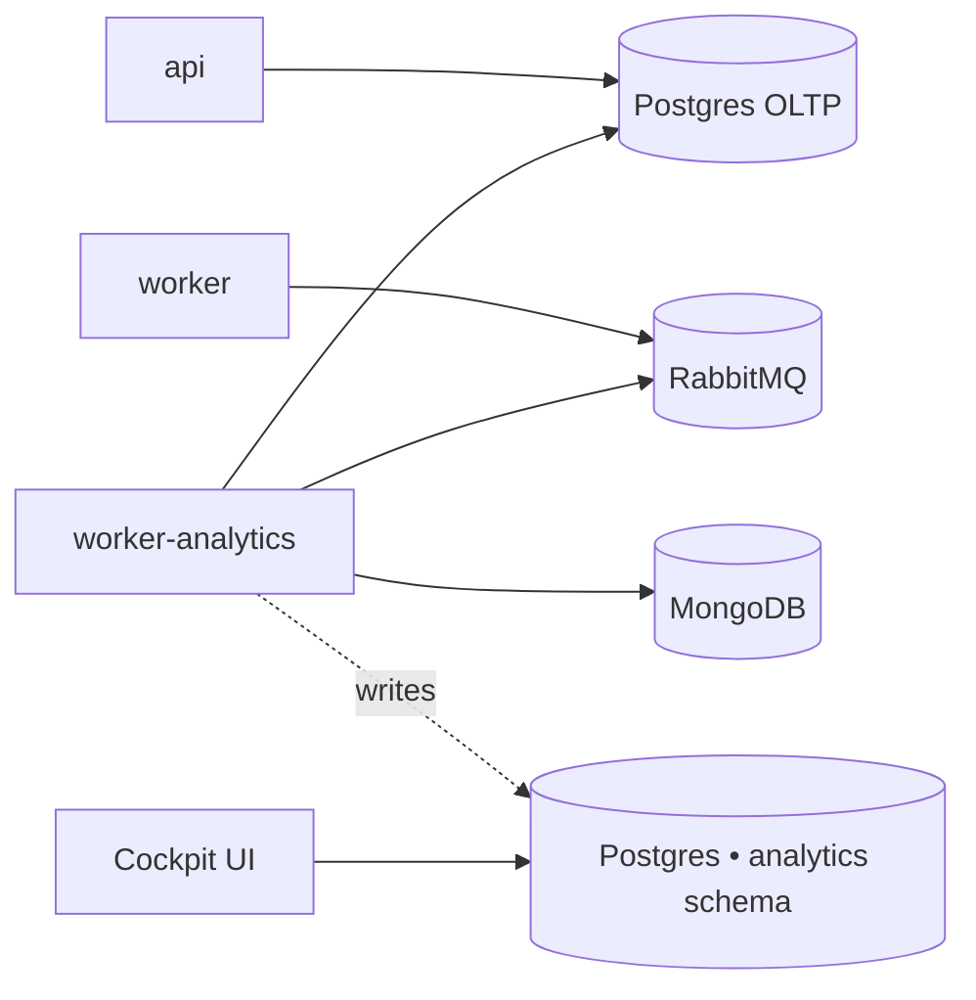

Analytics Worker は **Enterprise 専用**のアドオンです。[Cockpit](/ja/how_to_use/cockpit/overview) のダッシュボード（DORA 形式のメトリクス、PR ライフサイクル、LLM ベースの PR 分類器）を支える、データ取り込みの cron を実行します。

有効なライセンスを持つセルフホスト Enterprise が対象です。Docker Compose では `analytics` プロファイルを起動します。[Helm チャート](/ja/how_to_deploy/deploy_kodus/kubernetes)では `worker-analytics` がデフォルトで有効です。

## 役割

`worker` と**同じイメージ**（`kodus-ai-worker`）を実行する、別の Node プロセスです。
起動時に `WORKER_ROLE=analytics` で選択されます。このプロセスだけが、次の 2 つの cron を
実行します。

- **取り込み**（`ANALYTICS_INGESTION_CRON`、デフォルトは 30 分ごと）— Mongo と
  OLTP の Postgres からプルリクエストとレビューセッションを読み取り、
  `analytics` スキーマに投影します。コンテナの起動時にも 1 回実行されます。
- **分類器**（`ANALYTICS_CLASSIFIER_CRON`、デフォルトは 30 分ごと）— LLM を呼び出して、
  各 PR にタイプ（feature/bugfix/refactor など）のタグを付けます。使用するのは、環境変数で設定したモデル（[LLM プロバイダーの設定](/ja/how_to_deploy/deploy_kodus/generic_vm#llm-プロバイダーの設定)を参照）であり、**AI providers** ページで接続したモデルではありません。

メインの `worker` から分離することで、長時間実行される取り込みクエリが
コードレビューのイベントループに影響しません。

## トポロジー

分析ウェアハウスは別のデータベースではなく、Postgres の**スキーマ**です。
サポートされるレイアウトは 2 つあります。

- **共有 Postgres（セルフホストで推奨）** — `ANALYTICS_PG_DB_HOST` を
  空のままにします。設定ローダーはメインの `API_PG_DB_*` 変数にフォールバックし、
  同じインスタンスに `analytics` スキーマを作成します。
  バックアップと運用の対象は 1 つの DB だけです。
- **専用 Postgres** — `ANALYTICS_PG_DB_*` ブロック一式を設定して、
  別のインスタンスを指定します。分析クエリを OLTP の書き込み経路から
  完全に分離したい場合に使います。



## セルフホスト Enterprise での有効化

### 1. ライセンスを有効化する

サービス起動前に `.env` で `KODUS_LICENSE_KEY` を設定するか、**Subscription** で Enterprise ライセンスを有効化します。アプリに保存されたキーは環境変数より優先されます。

### 2. analytics ブロックを `.env` に追加する

**共有 Postgres（推奨）：**

```bash
# Empty ANALYTICS_PG_DB_HOST → loader reuses API_PG_DB_* and creates the
# `analytics` schema in the main instance.
ANALYTICS_PG_DB_HOST=
ANALYTICS_PG_DB_SCHEMA=analytics

# Cron schedules (UTC).
ANALYTICS_INGESTION_CRON=*/30 * * * *
ANALYTICS_CLASSIFIER_CRON=*/30 * * * *
```

**専用 Postgres：**

```bash
ANALYTICS_PG_DB_HOST=your-analytics-host
ANALYTICS_PG_DB_PORT=5432
ANALYTICS_PG_DB_USERNAME=analytics
ANALYTICS_PG_DB_PASSWORD=...
ANALYTICS_PG_DB_DATABASE=kodus_analytics
ANALYTICS_PG_DB_SCHEMA=analytics

ANALYTICS_INGESTION_CRON=*/30 * * * *
ANALYTICS_CLASSIFIER_CRON=*/30 * * * *
```

### 3. ワーカーを起動する

`analytics` プロファイルは、インストーラーの `docker-compose.yml` に含まれています。`kodus-installer` ディレクトリからサービスを起動します。

```bash
docker compose --profile analytics up -d worker-analytics
```

コンテナ名は `kodus-worker-analytics` です。`worker` と同じイメージと `.env` を使い、`WORKER_ROLE=analytics` は Compose が設定します。アップグレード後は、このコマンドをもう一度実行して、新しいバージョンでコンテナを再作成してください。

### 4. マイグレーションは `api` コンテナで実行される

マイグレーションを実行するのは `api` コンテナだけです。`RUN_MIGRATIONS=true`（デフォルト）の場合、起動時に `analytics` スキーマを作成し、ウェアハウスのマイグレーションを実行します。ワーカーコンテナはマイグレーションを実行しないため、新規インストールでは `worker-analytics` より先に `api` を起動してください。

## リファレンス

| 変数 | 説明 | デフォルト |
|---|---|---|
| `WORKER_ROLE` | このコンテナでは、Compose が `analytics` に設定します。 | _必須_ |
| `ANALYTICS_PG_DB_HOST` | Analytics Postgres のホスト。空の場合はメインの Postgres を再利用します。 | _空_ |
| `ANALYTICS_PG_DB_PORT` | Analytics Postgres のポート。空の場合は `API_PG_DB_PORT`。 | _空_ |
| `ANALYTICS_PG_DB_USERNAME` | Analytics Postgres のユーザー。空の場合は `API_PG_DB_USERNAME` を再利用します。 | _空_ |
| `ANALYTICS_PG_DB_PASSWORD` | Analytics Postgres のパスワード。空の場合は `API_PG_DB_PASSWORD` を再利用します。 | _空_ |
| `ANALYTICS_PG_DB_DATABASE` | Analytics Postgres のデータベース。空の場合は `API_PG_DB_DATABASE` を再利用します。 | _空_ |
| `ANALYTICS_PG_DB_SCHEMA` | ウェアハウステーブルのスキーマ名。 | `analytics` |
| `ANALYTICS_PG_POOL_MAX` | Analytics Postgres プールの上限。 | `5` |
| `ANALYTICS_INGESTION_CRON` | 取り込み実行の cron スケジュール（UTC）。 | 30 分ごと |
| `ANALYTICS_CLASSIFIER_CRON` | LLM による PR タイプ分類器の cron スケジュール（UTC）。 | 30 分ごと |
| `ANALYTICS_INGESTION_RUN_ON_BOOT` | `false` に設定すると、コンテナ起動時の取り込み実行をスキップします。 | 起動時に実行 |

### 取り込みの一時停止（上級）

取り込みや分類を一時停止するには、`.env` に `ANALYTICS_INGESTION_DISABLED=true`、`ANALYTICS_CLASSIFIER_DISABLED=true`、または両方を設定し、`docker compose --profile analytics up -d worker-analytics` で反映します。

## 動作の確認

起動後、analytics ワーカーのログを tail します。

```bash
docker compose --profile analytics logs -f worker-analytics
```

起動直後に `analytics ingestion (startup) done in NNNms` が表示され、その後は
スケジュールごとに `analytics ingestion (cron) done ...` と `analytics classifier done ...` が表示されるはずです。
これらは info レベルの行であり、インストーラーの `.env` は `API_LOG_LEVEL=error` を設定しているため、
表示するには `API_LOG_LEVEL=info` を設定してコンテナを再作成してください。一度に実行されるレプリカは 1 つだけです。これらの行が表示されない場合は、
`WORKER_ROLE=analytics` がこのコンテナにだけ設定されていることを確認してください（メインの `worker` では
`code-review` のままにする必要があります）。ワーカーは、コンテナ内のポート 3334 で `GET /health` にも応答します。
