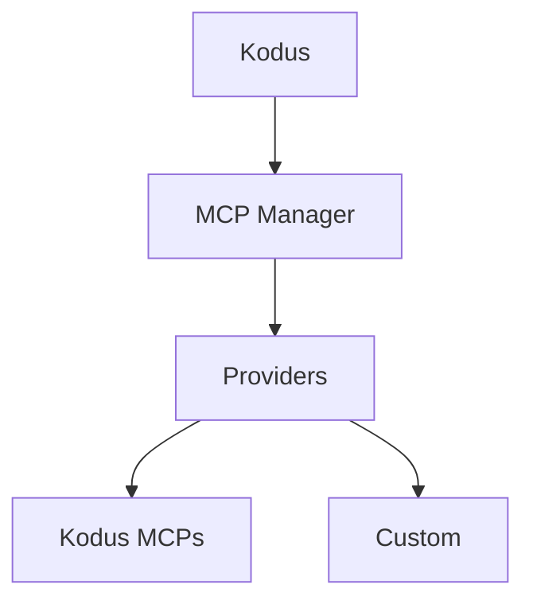

## MCP とは

Model Context Protocol（MCP）は、LLM アプリが一貫したサーバーインターフェースを通じて
外部のツールやデータソースに接続できるようにする、オープンスタンダードです。MCP
サーバーはツールのスキーマとエンドポイントを公開するため、Kodus/Kody のようなクライアントは、
ワークフローの中でコンテキストを取得したりアクションを実行したりできます。

## MCP Manager のアーキテクチャ

MCP Manager は、Kodus のためにそれらの MCP 接続を仲介するバックエンドサービスです。
ワークスペースごとにプロバイダー、連携、許可されたツールを管理し、
そのカタログを Kodus API に公開します。ポート 3101 で待ち受け、
`GET /health` に応答し、データを PostgreSQL データベースの `mcp-manager` スキーマに保持します。
このスキーマは、起動時にサービス自身が作成してマイグレーションします。

- MCP プロバイダー（Kodus とカスタム）の中央レジストリ
- 連携のメタデータ（接続ステータス、MCP URL、許可されたツール）を保存
- プロバイダー固有の認証フローとツールの検出を処理
- Kodus が MCP ツールを一覧取得および呼び出すために使う API を公開



## MCP Manager を有効にする

MCP Manager は任意です。

<Tabs>
  <Tab title="Docker Compose">
    `.env` に次を設定し、`./scripts/install.sh` を実行します。`API_MCP_SERVER_ENABLED` が `true` の場合、インストーラーは `kodus-mcp-manager` コンテナを起動します。

    ```env
    API_MCP_SERVER_ENABLED=true
    API_KODUS_SERVICE_MCP_MANAGER=http://kodus-mcp-manager:3101
    API_KODUS_MCP_SERVER_URL=https://kodus-api.yourdomain.com/mcp
    API_MCP_MANAGER_REDIRECT_URI=https://kodus-web.yourdomain.com/setup/mcp/oauth
    ```

    - `API_KODUS_SERVICE_MCP_MANAGER` は、API と worker がサービスに到達する方法です。`localhost` ではなく、コンテナ名を使用してください。
    - `API_KODUS_MCP_SERVER_URL` は、API 上の Kodus MCP サーバーのパブリック URL です。
    - `API_MCP_MANAGER_REDIRECT_URI` は、OAuth サインインの後にブラウザが戻る先です。パブリックな Web URL を使用してください。
    - `API_MCP_MANAGER_JWT_SECRET` と `API_MCP_MANAGER_ENCRYPTION_SECRET` は、`./scripts/generate-secrets.sh` が生成します。
  </Tab>
  <Tab title="Kubernetes">
    チャートは MCP Manager をデプロイし、API の `/mcp` エンドポイントもデフォルトで有効にします。`API_MCP_MANAGER_REDIRECT_URI` は Web ホストから導出されます。MCP Manager をオフにするには `services.mcp-manager.enabled=false` を設定します。API エンドポイントもオフにする場合は、`global.config.API_MCP_SERVER_ENABLED` を `"false"` に設定します。[Kubernetes & OpenShift](/ja/how_to_deploy/deploy_kodus/kubernetes)を参照してください。
  </Tab>
</Tabs>

`API_MCP_SERVER_ENABLED=true` を設定すると、API の `POST /mcp` にある Kodus MCP サーバーもオンになります。MCP クライアントからのチーム API キー（`x-team-key: kodus_...` または `Authorization: Bearer kodus_...`）を受け付けます。

Cursor や Claude Desktop などのクライアントを自分のインスタンスに接続する方法は、[Kodus MCP サーバー](/ja/how_to_deploy/deploy_kodus/mcp_server)を参照してください。

## Kodus の Plugins

MCP Manager に登録されたものはすべて、Kodus の **Plugins** ページ
（サイドバー → **Plugins**）に表示されるため、チームはワークスペースごとに利用可能な MCP を
インストール、管理、有効化できます。Web アプリが MCP Manager に到達できない場合
（たとえば、デプロイされていない場合）は、サイドバーから **Plugins** の項目が非表示になります。


## プロバイダー

`API_MCP_MANAGER_MCP_PROVIDERS` は、MCP Manager が読み込むプロバイダーを一覧にします。デフォルトは `kodusmcp,custom` で、受け付ける値はこの 2 つだけです。

### Kodus プロバイダー

Kodus プロバイダーは、ファーストパーティとキュレーションされた MCP のカタログです。Kodus Docs、Git Issues、Sentry、Exa Search、Kodus OSV、Linear、Atlassian Rovo、Notion、Fireflies が含まれます。Git Issues は、お客様自身の API が提供します。それ以外はベンダーがホストする MCP エンドポイントに接続するため、worker にはそれらへのアウトバウンド HTTPS アクセスが必要です。サインインは、MCP に応じて OAuth、トークン、またはなしです。

### カスタムプロバイダー

**Plugins** ページの **Add Custom Plugin** にある **Add Plugin** から、独自の MCP サーバーを追加します。名前、サーバー URL、プロトコル（`http` または `sse`）を入力し、認証方法（なし、bearer トークン、basic、API キーヘッダー、OAuth 2.0）を選びます。カスタムプラグインは、組織に属します。[カスタムプラグインのインストール](/ja/cookbook/custom-plugin-install) を参照してください。
