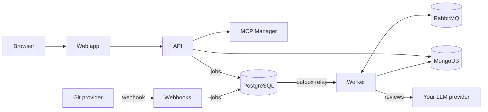

## 概要

Kodusは、Webアプリ、API、レビューを実行するworker、webhooksレシーバー、3つのデータストア（PostgreSQL、MongoDB、RabbitMQ）というコンテナ群として動作します。同じイメージがDocker ComposeとKubernetesの両方で動作します。

## サービス

| サービス | イメージ | ポート | 役割 |
| --- | --- | --- | --- |
| `kodus-web` | `kodus-ai-web` | 3000 | ダッシュボード。サーバーがブラウザの代わりにAPIを呼び出します。 |
| `api` | `kodus-ai-api` | 3001 | 認証、設定、Kody Rules、インテグレーション。Docker Composeでは、起動時にデータベースのマイグレーションとシードも実行します。 |
| `worker` | `kodus-ai-worker` | 3334（ヘルスチェック、内部） | ジョブキューを消費し、コードレビューを実行します。`WORKER_ROLE=code-review`が必要です。 |
| `webhooks` | `kodus-ai-webhook` | 3332 | GitHub、GitLab、Bitbucket、Azure Repos、Forgejoからのイベントを受信し、それぞれジョブをキューに登録します。 |
| `kodus-mcp-manager` | `kodus-mcp-manager` | 3101 | オプション。MCPプラグインを仲介します。[MCP Manager](/ja/how_to_deploy/deploy_kodus/mcp_manager)を参照してください。 |
| `worker-analytics` | `kodus-ai-worker` | 3334（ヘルスチェック、内部） | オプション、Enterprise。`worker`と同じイメージで`WORKER_ROLE=analytics`を指定します。[Analytics Worker](/ja/how_to_deploy/deploy_kodus/analytics_worker)を参照してください。 |

イメージは`ghcr.io/kodustech/<image>`として公開されています。5つのアプリケーションイメージはリリースごとに同じバージョンタグを共有します。RabbitMQイメージ（`kodus-rabbitmq`）は独自のバージョンを持ちます。

レビューを実行するのはworkerだけなので、GitプロバイダーとLLMプロバイダーへのアウトバウンドアクセスが必要です。リポジトリはサンドボックス内で解析されます。[Sandbox & AST Graph](/ja/how_to_deploy/deploy_kodus/sandbox)を参照してください。

### ヘルスエンドポイント

| サービス | エンドポイント |
| --- | --- |
| Web | `GET /api/health` |
| API | `GET /health`（RabbitMQとPostgreSQLを確認）、`GET /health/simple` |
| Webhooks | `GET /health`、`/health/live`、`/health/ready` |
| Worker | ポート3334の`GET /health`。インストーラーでは公開されません |
| MCP Manager | `GET /health` |

## レビューが開始される流れ

1. Gitプロバイダーがwebhooksサービスを呼び出します。webhooksサービスはイベントを検証し、ジョブとoutboxメッセージを1つのトランザクションでPostgreSQLに記録します。
2. workerがoutboxメッセージをRabbitMQに中継します。これにより、ブローカーが一時的に利用できなくてもイベントは失われません。
3. workerがRabbitMQからジョブを取り出し、プルリクエストを読み込み、LLMプロバイダーでレビューを実行して、結果をプルリクエストに投稿します。

workerは最初の接続時に`workflow.jobs.*`キューを作成します。たとえば`WORKER_ROLE`が未設定のために一度も起動していない場合、webhooksとAPIは`QueueBind 404`エラーで失敗します。

## データストア

- **PostgreSQL**（pgvector拡張機能付き）：アプリケーションデータ、ワークフローのジョブとoutbox、各リポジトリのASTグラフ、MCP Managerとアナリティクスウェアハウスのスキーマ。
- **MongoDB**：プルリクエストとレビューのデータ、Kody Rules、サンドボックスのリース。
- **RabbitMQ**：workerが発行および消費するジョブキュー。KodusのRabbitMQイメージには、delayed message exchangeプラグインが同梱されており、`kodus-ai`と`kodus-ast`の仮想ホストが作成されます。自前のブローカーを使う場合は、`rabbitmq_delayed_message_exchange`プラグインを有効にし、両方の仮想ホストを作成して、`consumer_timeout = 7200000`を設定してください。

Docker Composeでは、Kodusを自前のPostgreSQL、MongoDB、RabbitMQに向けることができます。[Installation](/ja/how_to_deploy/deploy_kodus/generic_vm#データベースの設定)を参照してください。

## ネットワーク

インストーラーは、3つの外部Dockerネットワークを作成します：

- `shared-network`：web、api、worker、webhooks、MCP Manager、RabbitMQ。
- `kodus-backend-services`：すべてのKodusサービスとPostgreSQL、MongoDB。
- `monitoring-network`：RabbitMQのみ。

PostgreSQLとMongoDBは`kodus-backend-services`にのみ接続されます。RabbitMQはポート15692でPrometheusメトリクスを公開します。KodusにはPrometheusもGrafanaも同梱されていません。

## Enterprise機能

ライセンスキーを使うと、セルフホスト型インスタンスでEnterprise機能が利用できます。`.env`に`KODUS_LICENSE_KEY`を設定するか、**Subscription**ページにキーを貼り付けてください。Cockpitのアナリティクスと SSOにはライセンスキーが必要です。

## 次のステップ
<CardGroup cols={2}>
  <Card title="Kodusをローカルで実行する" icon="laptop" href="/ja/how_to_deploy/local_quickstart/orchestrator">
    ローカル開発とKodusのフルスタックを理解するのに最適です。
  </Card>
  <Card title="Kodusを本番環境にデプロイする" icon="rocket" href="/ja/how_to_deploy/deploy_kodus/generic_vm">
    本番環境へのデプロイとKodusの全機能を体験するのに最適です。
  </Card>
</CardGroup>
