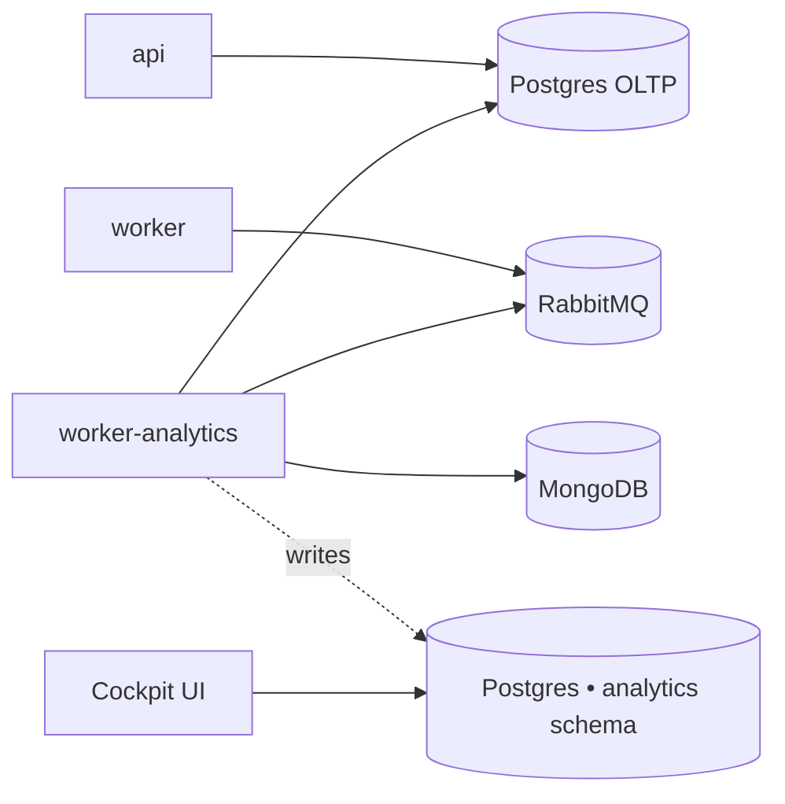

O analytics worker é um add-on **exclusivo do Enterprise**. Ele roda o cron de ingestão que alimenta os dashboards do [Cockpit](/pt-BR/how_to_use/cockpit/overview) (métricas no estilo DORA, ciclo de vida de PR, classifier de PR baseado em LLM).

Self-hosted Enterprise com licença ativa. No Docker Compose, inicie o perfil `analytics`. O [chart Helm](/pt-BR/how_to_deploy/deploy_kodus/kubernetes) habilita `worker-analytics` por padrão.

## O que ele faz

Um processo Node separado rodando a **mesma imagem do `worker`** (`kodus-ai-worker`),
selecionado no boot via `WORKER_ROLE=analytics`. Dois crons disparam desse
processo e somente dele:

- **Ingestão** (`ANALYTICS_INGESTION_CRON`, por padrão a cada 30 minutos) — lê
  pull requests e sessões de review do Mongo + do Postgres OLTP e as projeta
  no schema `analytics`. Também roda uma vez quando o container inicia.
- **Classifier** (`ANALYTICS_CLASSIFIER_CRON`, por padrão a cada 30 minutos) — chama
  uma LLM para marcar cada PR com um tipo (feature/bugfix/refactor/etc). Ele usa o modelo configurado pelas variáveis de ambiente (veja [Configuração de Provedor de LLM](/pt-BR/how_to_deploy/deploy_kodus/generic_vm#configuração-do-provedor-de-llm)), não um modelo conectado na página **AI providers**.

Isolá-lo do `worker` principal mantém o event loop do code review
livre de queries de ingestão demoradas.

## Topologia

O warehouse de analytics é um **schema** do Postgres, não um banco de dados
separado. Dois layouts suportados:

- **Postgres compartilhado (recomendado para self-hosted)** — deixe
  `ANALYTICS_PG_DB_HOST` vazio. O config loader cai no fallback das vars
  `API_PG_DB_*` e cria um schema `analytics` na mesma instância.
  Um banco só para fazer backup e operar.
- **Postgres dedicado** — preencha o bloco `ANALYTICS_PG_DB_*` completo para apontar
  para uma instância separada. Use quando quiser queries analíticas totalmente
  isoladas do caminho de escrita do OLTP.



## Habilitando no self-hosted Enterprise

### 1. Ative sua licença

Defina `KODUS_LICENSE_KEY` no `.env` antes de subir os serviços ou ative a licença Enterprise em **Subscription**. A chave salva no app tem prioridade sobre a variável de ambiente.

### 2. Adicione o bloco de analytics ao `.env`

**Postgres compartilhado (recomendado):**

```bash
# Empty ANALYTICS_PG_DB_HOST → loader reuses API_PG_DB_* and creates the
# `analytics` schema in the main instance.
ANALYTICS_PG_DB_HOST=
ANALYTICS_PG_DB_SCHEMA=analytics

# Cron schedules (UTC).
ANALYTICS_INGESTION_CRON=*/30 * * * *
ANALYTICS_CLASSIFIER_CRON=*/30 * * * *
```

**Postgres dedicado:**

```bash
ANALYTICS_PG_DB_HOST=your-analytics-host
ANALYTICS_PG_DB_PORT=5432
ANALYTICS_PG_DB_USERNAME=analytics
ANALYTICS_PG_DB_PASSWORD=...
ANALYTICS_PG_DB_DATABASE=kodus_analytics
ANALYTICS_PG_DB_SCHEMA=analytics

ANALYTICS_INGESTION_CRON=*/30 * * * *
ANALYTICS_CLASSIFIER_CRON=*/30 * * * *
```

### 3. Inicie o worker

O profile `analytics` faz parte do `docker-compose.yml` do instalador. Inicie o serviço a partir do diretório `kodus-installer`:

```bash
docker compose --profile analytics up -d worker-analytics
```

O container se chama `kodus-worker-analytics`. Ele usa a mesma imagem e o mesmo `.env` do `worker`, com `WORKER_ROLE=analytics` definido pelo Compose. Depois de um upgrade, rode o comando de novo para recriá-lo na nova versão.

### 4. As migrations rodam no container `api`

Só o container `api` roda migrations. Com `RUN_MIGRATIONS=true` (o padrão), ele cria o schema `analytics` e roda as migrations do warehouse no boot. Os containers de worker nunca rodam migrations, então inicie o `api` antes do `worker-analytics` em uma instalação nova.

## Referência

| Variável | Descrição | Padrão |
|---|---|---|
| `WORKER_ROLE` | Definida como `analytics` neste container pelo Compose. | _obrigatório_ |
| `ANALYTICS_PG_DB_HOST` | Host do Postgres de analytics. Vazio → reusa o Postgres principal. | _vazio_ |
| `ANALYTICS_PG_DB_PORT` | Porta do Postgres de analytics. Vazio → `API_PG_DB_PORT`. | _vazio_ |
| `ANALYTICS_PG_DB_USERNAME` | Usuário do Postgres de analytics. Vazio → reusa `API_PG_DB_USERNAME`. | _vazio_ |
| `ANALYTICS_PG_DB_PASSWORD` | Senha do Postgres de analytics. Vazio → reusa `API_PG_DB_PASSWORD`. | _vazio_ |
| `ANALYTICS_PG_DB_DATABASE` | Banco do Postgres de analytics. Vazio → reusa `API_PG_DB_DATABASE`. | _vazio_ |
| `ANALYTICS_PG_DB_SCHEMA` | Nome do schema das tabelas do warehouse. | `analytics` |
| `ANALYTICS_PG_POOL_MAX` | Limite superior do pool do Postgres de analytics. | `5` |
| `ANALYTICS_INGESTION_CRON` | Cron schedule da execução de ingestão (UTC). | a cada 30 minutos |
| `ANALYTICS_CLASSIFIER_CRON` | Cron schedule do classifier de tipo de PR via LLM (UTC). | a cada 30 minutos |
| `ANALYTICS_INGESTION_RUN_ON_BOOT` | Defina como `false` para pular a execução de ingestão quando o container inicia. | roda no boot |

### Pausando a ingestão (avançado)

Para pausar um ou ambos os jobs, defina `ANALYTICS_INGESTION_DISABLED=true` ou `ANALYTICS_CLASSIFIER_DISABLED=true` no `.env` e aplique a mudança com `docker compose --profile analytics up -d worker-analytics`.

## Verificando que está funcionando

Depois do boot, acompanhe os logs do analytics worker:

```bash
docker compose --profile analytics logs -f worker-analytics
```

Você deve ver `analytics ingestion (startup) done in NNNms` logo após o boot, depois
`analytics ingestion (cron) done ...` e `analytics classifier done ...` a cada
execução agendada. Essas são linhas de nível info, e o `.env` do instalador define `API_LOG_LEVEL=error`, então defina
`API_LOG_LEVEL=info` e recrie o container para vê-las. Só uma réplica roda uma passada por vez. Se você não vir essas linhas, confirme que
`WORKER_ROLE=analytics` está definido só neste container (não no `worker` principal, que deve
continuar `code-review`). O worker também responde `GET /health` na porta 3334 dentro do container.
