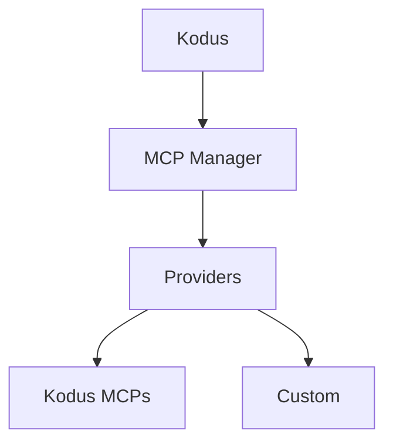

## O que são MCPs?

Model Context Protocol (MCP) é um padrão aberto que permite que aplicativos de LLM se conectem a
ferramentas externas e fontes de dados por meio de uma interface de servidor consistente. Os
servidores MCP publicam schemas de ferramentas e endpoints para que clientes como a Kodus/Kody possam buscar
contexto ou executar ações durante um fluxo de trabalho.

## Arquitetura do MCP Manager

O MCP Manager é o serviço de backend que intermedeia essas conexões MCP para
a Kodus. Ele registra provedores, integrações e ferramentas permitidas por
workspace, e então expõe esse catálogo para a API da Kodus. Ele escuta na porta 3101,
responde `GET /health` e guarda seus dados no schema `mcp-manager` do seu banco
PostgreSQL. Ele mesmo cria e migra esse schema quando inicia.

- Registro central de provedores MCP (Kodus e custom)
- Armazena metadados de integração (status de conexão, URL MCP, ferramentas permitidas)
- Gerencia fluxos de autenticação específicos de cada provedor e a descoberta de ferramentas
- Expõe APIs usadas pela Kodus para listar e invocar ferramentas MCP



## Habilitando o MCP Manager

O MCP Manager é opcional.

<Tabs>
  <Tab title="Docker Compose">
    Defina estas variáveis no `.env` e rode `./scripts/install.sh`. O instalador inicia o container `kodus-mcp-manager` quando `API_MCP_SERVER_ENABLED` é `true`.

    ```env
    API_MCP_SERVER_ENABLED=true
    API_KODUS_SERVICE_MCP_MANAGER=http://kodus-mcp-manager:3101
    API_KODUS_MCP_SERVER_URL=https://kodus-api.yourdomain.com/mcp
    API_MCP_MANAGER_REDIRECT_URI=https://kodus-web.yourdomain.com/setup/mcp/oauth
    ```

    - `API_KODUS_SERVICE_MCP_MANAGER` é como a API e o worker alcançam o serviço. Use o nome do container, não `localhost`.
    - `API_KODUS_MCP_SERVER_URL` é a URL pública do servidor MCP da Kodus na sua API.
    - `API_MCP_MANAGER_REDIRECT_URI` é para onde o navegador volta depois de um login OAuth. Use a URL pública do seu web.
    - `API_MCP_MANAGER_JWT_SECRET` e `API_MCP_MANAGER_ENCRYPTION_SECRET` são gerados pelo `./scripts/generate-secrets.sh`.
  </Tab>
  <Tab title="Kubernetes">
    O chart faz o deploy do MCP Manager e habilita o endpoint `/mcp` da API por padrão. Ele deriva `API_MCP_MANAGER_REDIRECT_URI` do host web. Para desativar o MCP Manager, defina `services.mcp-manager.enabled=false`. Para desligar também o endpoint da API, defina `global.config.API_MCP_SERVER_ENABLED` como `"false"`. Veja [Kubernetes e OpenShift](/pt-BR/how_to_deploy/deploy_kodus/kubernetes).
  </Tab>
</Tabs>

`API_MCP_SERVER_ENABLED=true` também liga o servidor MCP da Kodus na API, em `POST /mcp`. Ele aceita uma chave de API de time (`x-team-key: kodus_...` ou `Authorization: Bearer kodus_...`) vinda de clientes MCP.

Para conectar um cliente como Cursor ou Claude Desktop à sua instância, veja [Servidor MCP da Kodus](/pt-BR/how_to_deploy/deploy_kodus/mcp_server).

<span id="plugins-no-kodus" aria-hidden="true" />

## Plugins na Kodus

Tudo que está registrado no MCP Manager aparece na página **Plugins** da Kodus
(barra lateral → **Plugins**), para que seu time possa instalar, gerenciar e habilitar
os MCPs disponíveis para cada workspace. Se o web app não conseguir alcançar o MCP Manager
(por exemplo, porque ele não está implantado), o item **Plugins** fica oculto na barra lateral.


## Provedores

`API_MCP_MANAGER_MCP_PROVIDERS` lista os provedores que o MCP Manager carrega. O padrão é `kodusmcp,custom`, e esses são os únicos dois valores que ele aceita.

### Provedor Kodus

O provedor Kodus é o catálogo de MCPs próprios e selecionados: Kodus Docs, Git Issues, Sentry, Exa Search, Kodus OSV, Linear, Atlassian Rovo, Notion e Fireflies. O Git Issues é servido pela sua própria API. Os demais se conectam ao endpoint MCP hospedado pelo fornecedor, então o worker precisa de acesso HTTPS de saída a eles. O login é OAuth, um token ou nenhum, dependendo do MCP.

### Provedores Customizados

Adicione seu próprio servidor MCP na página **Plugins**, com **Add Plugin** em **Add Custom Plugin**. Dê a ele um nome, a URL do servidor e um protocolo (`http` ou `sse`), e depois escolha como ele se autentica: nenhum, bearer token, basic, header de API key ou OAuth 2.0. Plugins customizados pertencem à sua organização. Veja [Instalar um plugin personalizado](/pt-BR/cookbook/custom-plugin-install).
