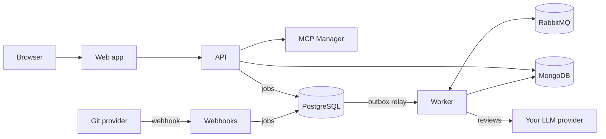

## Visão Geral

O Kodus roda como um conjunto de contêineres: um app web, uma API, um worker que executa os reviews, um receptor de webhooks e três armazenamentos de dados (PostgreSQL, MongoDB e RabbitMQ). As mesmas imagens rodam no Docker Compose e no Kubernetes.

## Serviços

| Serviço | Imagem | Porta | O que faz |
| --- | --- | --- | --- |
| `kodus-web` | `kodus-ai-web` | 3000 | O dashboard. O servidor dele chama a API em nome do navegador. |
| `api` | `kodus-ai-api` | 3001 | Autenticação, configurações, Kody Rules e integrações. No Docker Compose, também executa as migrações e os seeds do banco de dados na inicialização. |
| `worker` | `kodus-ai-worker` | 3334 (health, interna) | Consome as filas de jobs e executa os code reviews. Precisa de `WORKER_ROLE=code-review`. |
| `webhooks` | `kodus-ai-webhook` | 3332 | Recebe eventos do GitHub, GitLab, Bitbucket, Azure Repos e Forgejo e enfileira um job para cada um. |
| `kodus-mcp-manager` | `kodus-mcp-manager` | 3101 | Opcional. Intermedeia os plugins MCP. Veja [MCP Manager](/pt-BR/how_to_deploy/deploy_kodus/mcp_manager). |
| `worker-analytics` | `kodus-ai-worker` | 3334 (health, interna) | Opcional, Enterprise. Mesma imagem do `worker` com `WORKER_ROLE=analytics`. Veja [Analytics Worker](/pt-BR/how_to_deploy/deploy_kodus/analytics_worker). |

As imagens são publicadas como `ghcr.io/kodustech/<image>`. As cinco imagens de aplicação compartilham uma única tag de versão por release; a imagem do RabbitMQ (`kodus-rabbitmq`) tem a sua própria.

O worker é o único serviço que executa reviews, então ele precisa de acesso de saída ao seu provedor Git e ao seu provedor de LLM. Ele analisa os repositórios em um sandbox; veja [Sandbox & AST Graph](/pt-BR/how_to_deploy/deploy_kodus/sandbox).

### Endpoints de health

| Serviço | Endpoint |
| --- | --- |
| Web | `GET /api/health` |
| API | `GET /health` (verifica RabbitMQ e PostgreSQL), `GET /health/simple` |
| Webhooks | `GET /health`, `/health/live`, `/health/ready` |
| Worker | `GET /health` na porta 3334, não publicada pelo instalador |
| MCP Manager | `GET /health` |

## Como um review começa

1. O provedor Git chama o serviço de webhooks. Ele valida o evento e registra um job e uma mensagem de outbox no PostgreSQL, em uma única transação.
2. O worker repassa a mensagem de outbox para o RabbitMQ, para que um evento não seja perdido se o broker ficar indisponível por um breve período.
3. O worker consome o job do RabbitMQ, carrega o pull request, executa o review com o seu provedor de LLM e publica o resultado no pull request.

O worker cria as filas `workflow.jobs.*` na sua primeira conexão. Se ele nunca iniciou, por exemplo porque `WORKER_ROLE` não está definido, os webhooks e a API falham com erros `QueueBind 404`.

## Armazenamentos de dados

- **PostgreSQL** (com a extensão pgvector): dados da aplicação, jobs de workflow e o outbox, o AST graph de cada repositório, e os schemas do MCP Manager e do data warehouse de analytics.
- **MongoDB**: dados de pull requests e reviews, Kody Rules e leases de sandbox.
- **RabbitMQ**: as filas de jobs nas quais o worker publica e das quais consome. A imagem RabbitMQ do Kodus inclui o plugin delayed message exchange e cria os virtual hosts `kodus-ai` e `kodus-ast`. Se você usa seu próprio broker, habilite o plugin `rabbitmq_delayed_message_exchange`, crie os dois virtual hosts e defina `consumer_timeout = 7200000`.

Com o Docker Compose, você pode apontar o Kodus para o seu próprio PostgreSQL, MongoDB ou RabbitMQ; veja [Instalação](/pt-BR/how_to_deploy/deploy_kodus/generic_vm#configuração-do-banco-de-dados).

## Redes

O instalador cria três redes Docker externas:

- `shared-network`: web, api, worker, webhooks, MCP Manager e RabbitMQ.
- `kodus-backend-services`: todos os serviços do Kodus, além de PostgreSQL e MongoDB.
- `monitoring-network`: somente o RabbitMQ.

PostgreSQL e MongoDB ficam conectados apenas à `kodus-backend-services`. O RabbitMQ expõe métricas do Prometheus na porta 15692; o Kodus não inclui Prometheus nem Grafana.

## Recursos Enterprise

Uma chave de licença desbloqueia os recursos Enterprise em uma instância self-hosted. Defina `KODUS_LICENSE_KEY` no `.env` ou cole a chave na página **Subscription**. O analytics do Cockpit e o SSO precisam dela.

## Próximos Passos
<CardGroup cols={2}>
  <Card title="Executar o Kodus Localmente" icon="laptop" href="/pt-BR/how_to_deploy/local_quickstart/orchestrator">
    Ideal para desenvolvimento local e para se familiarizar com o stack completo do Kodus.
  </Card>
  <Card title="Implantar o Kodus em Produção" icon="rocket" href="/pt-BR/how_to_deploy/deploy_kodus/generic_vm">
    Perfeito para implantação em produção e para aproveitar todas as capacidades do Kodus.
  </Card>
</CardGroup>
