# Kody Runtime: the system map

One page for finding your way: which process does what, how a Run and a setup cross them, who writes each store, which pattern each package follows, and where new code goes. Each module's own `AGENTS.md` ([module-docs.md](module-docs.md)) says where it sits on this map; the package docs go deeper:

| Package | Read first |
| --- | --- |
| Product side (`libs/runtime`, its `api/` used by `apps/api` and `apps/worker`) | [`libs/runtime/README.md`](../../libs/runtime/README.md), [`AGENTS.md`](../../libs/runtime/AGENTS.md) |
| Publisher (`libs/runtime-publish`, in the product worker) | [`libs/runtime-publish/README.md`](../../libs/runtime-publish/README.md) |
| Control plane (`apps/runtime`: runtime-hub, runtime-worker, preview edge) | [`apps/runtime/README.md`](../../apps/runtime/README.md), [`AGENTS.md`](../../apps/runtime/AGENTS.md) |
| Data plane (`apps/runtime-cell`, Go: the cell and what runs inside machines) | [`apps/runtime-cell/README.md`](../../apps/runtime-cell/README.md), [`AGENTS.md`](../../apps/runtime-cell/AGENTS.md) |

## Processes and their boundaries

```mermaid
flowchart LR
    subgraph Product
        WH[apps/webhooks] --> API[apps/api<br/>libs/runtime/api]
        API --> PW[apps/worker<br/>trigger + libs/runtime-publish]
        WEB[apps/web<br/>Runtime screens] --> API
    end
    subgraph Control["Control plane (apps/runtime)"]
        RW[runtime-worker<br/>DBOS workflows]
        HUB[runtime-hub<br/>cells' WebSocket]
        EDGE[preview edge]
    end
    subgraph Cell["Cell host (apps/runtime-cell)"]
        AG[cell agent<br/>cmd/cell]
        EG[egress: proxy, resolver, mirror]
        INJ[injector]
        subgraph M["Machines: gVisor containers or Firecracker VMs"]
            APP[the claim's compose project]
            OBS[observer]
        end
    end
    PW -- "RuntimeRunRequested / EnvironmentSetupRequested (outbox, RabbitMQ)" --> RW
    RW -- "RuntimePublishRequested" --> PW
    RW -- "HTTP /internal (org-scoped)" --> HUB
    RW -- "LLM gateway, Run token" --> API
    HUB <-- "mTLS WebSocket, versioned envelope" --> AG
    AG --> M
    APP -- "every byte out" --> EG
    EG -- "inspected and credentialed hosts" --> INJ
    AG -- "probes over mTLS / vsock" --> OBS
    EDGE <-- "preview tunnel" --> AG
```

| Process | Code | Talks to | Never |
| --- | --- | --- | --- |
| Product API | `apps/api/src/controllers/runtime/`, `libs/runtime/api` | Runtime Postgres (read-only role), outbox, Git API | talks to a cell; holds a cell credential |
| Product worker | `apps/worker`, `libs/runtime/api` (trigger), `libs/runtime-publish` | Git platform (comments, checks), outbox | runs a Run |
| runtime-worker | `apps/runtime/src/worker` | the hub over HTTP, the API's LLM gateway, RabbitMQ, DBOS Postgres | dials a cell, a cloud API or SSH; holds the product's Git credentials |
| runtime-hub | `apps/runtime/src/hub` | cells (it terminates their mTLS WebSocket), Runtime Postgres (`runtime_claims` writer) | runs workflow logic |
| Cell agent | `apps/runtime-cell/cmd/cell`, `internal/agent` | the hub (dials out), its driver, egress control | lets a machine reach the hub, the Git API or the host |
| Egress, injector | `cmd/egress`, `cmd/injector`, `internal/egress`, `internal/injector` | the internet, by the claim's signed policy | let a secret's value into a machine; trust a machine's word about a host |
| Inside a machine | `cmd/kody-guest`, `internal/guest`, `internal/guestinit`, `cmd/observer` | the cell over vsock or mTLS only | reach the cell's control side |

The hub and its cells may run different releases. At hello the hub accepts a cell of a protocol no newer than its own and at most one older (`helloVersionRefusal`, `libs/runtime/protocol/envelope.ts`); it refuses the rest with `cell_too_new` or `cell_too_old`, and the cell waits its refused backoff before dialing again. So the hub is upgraded first. The rule and its gaps: [cell-distribution.md](cell-distribution.md) "Keeping hub, worker, API and cell compatible".

## Flows

- **A Run** (PR event or `@kody runtime` → verdict → check and comment): the sequence in [`apps/runtime/README.md`](../../apps/runtime/README.md) "A Run, end to end", the decisions in [`libs/runtime/README.md`](../../libs/runtime/README.md) "Flow of one Run". The workflow is `apps/runtime/src/worker/run/` (`run-orchestrator.ts`), the verdict `libs/runtime/gate` and `libs/runtime/run`.
- **An environment setup** (Set up → a recipe → an image the Runs boot from): the API requests it (`libs/runtime/api/application/runtime-setup-requester.service.ts`); the runtime-worker runs it as a DBOS workflow (`apps/runtime/src/worker/setup/`), with Kody's recipe author when the repository has no recipe (`libs/runtime/api/application/recipe-author/`); the cell boots it and bakes the image (`internal/agent`, the driver's `Bake`).
- **A claim on a cell** (acquire → network → machines → checkout → compose → egress policy → recipe steps → ready → probes and resets → release): [`apps/runtime-cell/README.md`](../../apps/runtime-cell/README.md) "Life of a claim", the steps in `internal/agent/prepare.go`.
- **A probe round**: the worker asks the hub (`/internal/claims/:id/reset`, `/probe`), the cell resets the machine (`machine.reset`, the driver's `Resetter`) and the observer replays the request (`internal/observer`); the gate compares base and PR (`libs/runtime/gate`).
- **Publication**: [`libs/runtime-publish/README.md`](../../libs/runtime-publish/README.md).
- **Egress**: a machine's TLS goes to the egress proxy, which checks the claim's signed policy (`internal/policy`); hosts the cell inspects or holds a credential for go to the injector, which ends TLS with a leaf of the cell CA (`internal/injector`). [`egress-allowlist.md`](egress-allowlist.md).

## Stores: who writes, who reads

| Store | Writer | Readers |
| --- | --- | --- |
| DBOS system tables | runtime-worker (DBOS) | runtime-worker |
| Runtime Postgres `runtime.*` (runs projection, setups, lessons, stream) | runtime-worker | API and product worker through `kodus_runtime_reader` (`scripts/runtime/runtime-reader-grants.sql`) |
| `runtime_claims`, cell directory | runtime-hub (`hub/hub-store.ts`) | runtime-worker (read-only) |
| Product Postgres Runtime tables (settings, environments, targets, publications, budgets) | API and product worker (TypeORM) | the same; the hub reads secret references through its own role |
| OpenBao | API (write-only role) | injector (read-only role) |
| Evidence object store | runtime-worker's evidence server | API (signed reads) |

## Patterns, by package

- **`libs/runtime/api`: hexagonal.** `domain/` holds rules and ports (`ports.ts`, every port org-scoped), `application/` the use cases (one per file in `use-cases/`), `infrastructure/` the adapters (Postgres readers, TypeORM stores, Git, LLM). A controller in `apps/api` calls a use case; nothing in `domain/` imports Nest or a driver.
- **`libs/runtime` (the rest): pure domain libraries.** `protocol` (zod, the single source for the cell protocol; JSON Schema and Go types are generated from it), `gate`, `run`, `probe`, `entry-points`, `blockers`, `contracts`. No I/O.
- **`apps/runtime`: durable workflows over ports.** DBOS workflows must be deterministic (I/O only inside `step(...)`, stable step ids); the worker reaches cells only through the `EnvironmentRuntime` port (`libs/runtime/environment`), whose implementation calls the hub. `shared/` is by concern; `hub/` and `worker/` never import each other.
- **`apps/runtime-cell`: ports and adapters in Go.** `internal/agent` is the application (a router over its parts), `internal/driver` the port, `internal/drivers/*` the adapters (docker-gvisor, microvm, k8s-sandbox, local-docker), pure rule packages (`recipe`, `netguard`, `machinetrust`, `buildmirror`, …) called by adapters, `cmd/*` the composition roots. `internal/archrules` tests the boundaries on the import graph.
- **Across the product and the Runtime: outbox and inbox.** Commands and results cross as messages through the outbox (`runtime-run-enqueuer.service.ts`); consumers are idempotent by key.

## Where new code goes

| You are adding | It goes in | And comes with |
| --- | --- | --- |
| A field or message between the hub and the cell | `libs/runtime/protocol` (zod) | `go generate ./internal/protocol`, a fixture in `libs/runtime/protocol/fixtures`, both test suites |
| A rule on what a Run decides (a verdict, a probe outcome) | `libs/runtime/gate` or `libs/runtime/run` | its unit tests; the publisher's wording in `libs/runtime-publish` if users see it |
| A product route or screen action | a use case in `libs/runtime/api/application/use-cases/`, the controller in `apps/api/src/controllers/runtime/`, the screen in `apps/web` | org scoping on every read and write |
| A step of a Run or setup | `apps/runtime/src/worker/run/` or `worker/setup/` | a new `RUNTIME_RELEASE_VERSION` (DBOS step order changed) |
| Something the hub does with a claim | `apps/runtime/src/hub/claims/` | the claim transition through `transitionClaim`, a `ClaimReason` |
| A stage of a claim on the cell | a step in `internal/agent/prepare.go` | its place in the order, never inside another step |
| Something only one driver does | that driver's package or a subpackage of it | nothing in `agent` that names the driver |
| Something two drivers share | a package outside `internal/drivers/` | a rule in `internal/archrules` if it is a new boundary |
| A rule on a recipe or egress host | `internal/recipe` or `internal/netguard` (pure) | the TS copy, when one exists, kept byte-identical by its test |
| What runs inside a machine | `internal/guest`, `internal/guestinit`, the kit (`microvm-kit/`) | nothing from the control side imported |
| A setting | `apps/runtime/src/shared/config.ts`, or a cell flag in `cmd/cell` (`flagOwners`) | the README table |
