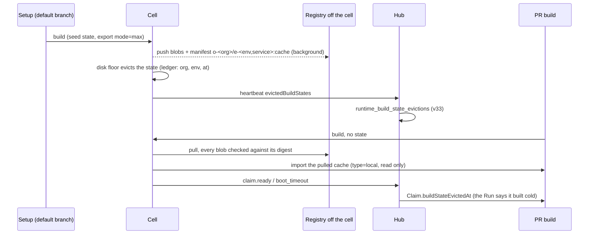

# Build cache off the cell

Status: built, not deployed. What it fixes: the dev cell's disk floor evicted every
environment's build state on 2026-11-13, their pull requests built cold, calcom's past the 30 min boot wait, and the
environments still read "active".

## 1. What the cell keeps today

- **The state** (`buildstate`, `-gvisor-build-state`): BuildKit's whole root per environment, `EnvKey(cell, org, env)`,
  layers and `RUN --mount=type=cache` directories. The default branch's setup writes it (seed); every other build reads
  a copy-on-write view. It is the fast path: demo-twenty's PR boot on it took 0 ms of view time.
  On a boat host the work directory is a FUSE disk restored lazily from the snapshot: no reflink, no overlay upper
  layer there. `-gvisor-build-state-views-dir` puts each build's view on the host's local disk (kernel overlay, the
  state as its lower directory) and leaves the state where the template's snapshot carries it. Without the state
  (`build.cache.input mode=exported`) each PR build imported the 4.5 GB exported cache inside gVisor: 140 to 420 s per
  service on a 4-service monorepo, with its build steps taking 3 to 19 s.
- **The exported cache** (`buildcache`, `cache/env/<key>/<service>`): a `type=local` BuildKit cache. Until P2 of the
  2026-11-14 review it was written only by a setup that could not hold the state; a setup that seeded the state
  exported none, to save minutes. Now every seeding setup exports it next to the state (`build.go`,
  `buildCacheInput`), so an evicted state leaves its environment's builds warm on layers
  (`build.cache.input mode=exported`, a new seed `state_seed_exported`), not cold. Cache mounts are never exported.
- **The disk floor** (`-gvisor-build-state-min-free-gb`, 20): below it, the states nobody holds that are cheapest to
  keep go first (`buildstate/cost.go`: the seconds the last build that made the state from none took, halved for each
  day unused; larger first on a tie), then, still below it, the exported caches no build reads, those whose state is
  still on the cell first (`build.state.evicted rebuildSeconds`, `build.cache.evicted`). Before P2 it was least
  recently used only, and nothing else held the layers, so the next PR build of that environment ran cold
  (`build.cache.input mode=cold`).

## 2. Research

BuildKit's own exporters ([README](https://github.com/moby/buildkit/blob/master/README.md),
[Docker cache backends](https://docs.docker.com/build/cache/backends/)):

| Exporter | Status | What matters here |
|---|---|---|
| `type=registry` | stable | `ref`, `mode=min|max`, `compression=zstd`, `image-manifest=true` (default since v0.21), `ignore-error`. Needs the builder to reach the registry |
| `type=local` | stable | an OCI image layout (`index.json`, `blobs/sha256`), `tag`; import takes `src`, `tag`, `digest` ([local](https://docs.docker.com/build/cache/backends/local/)) |
| `type=s3` | experimental | `bucket`, `region`, `prefix`, `name`, `endpoint_url`, `use_path_style`, `upload_parallelism`, `touch_refresh`. Credentials on the BuildKit daemon; no presigned mode |
| `type=gha` | beta | 10 GB per repository, evicted after 7 days unused, rate limits ([GitHub](https://docs.github.com/en/actions/reference/workflows-and-actions/dependency-caching), [Docker](https://docs.docker.com/build/cache/backends/gha/)) |
| `type=azblob` | experimental | Azure only |

- `mode=max` exports every intermediate layer, `mode=min` only the final image's; inline cache is min only.
- **Cache mounts are never exported** by any exporter: [moby/buildkit#1512](https://github.com/moby/buildkit/issues/1512)
  is open, and a maintainer declines to combine them with remote backends. Docker points to
  [buildkit-cache-dance](https://github.com/reproducible-containers/buildkit-cache-dance) (Apache-2.0)
  ([GitHub Actions cache](https://docs.docker.com/build/ci/github-actions/cache/)). So the state stays the only place a
  `--mount=type=cache` survives; the remote cache brings back layers (a `yarn install` layer whose lockfile did not
  change is a hit), not compiler caches.
- A local cache moved between hosts: Docker's own GitHub Actions example saves the `type=local` directory with
  `actions/cache` (a tar) and restores it on another runner. No primary doc guarantees it; the layout is
  content-addressed, so the cell checks every blob on the way back.

How others keep a build cache:

| Product | How | Isolation |
|---|---|---|
| Depot | the layer cache on a volume per project, moved from EBS to Ceph on NVMe ([cache v2](https://depot.dev/blog/cache-v2-faster-builds)); 50 GB default, 25 to 1000 GB | per project, "never shared across customers or projects" ([docs](https://depot.dev/docs/container-builds/overview)) |
| Blacksmith | a sticky disk per cache key holding the builder's whole state, layers and cache mounts, in Ceph; committed only when the job succeeds; evicted after 7 days idle; $0.50/GB-month ([docs](https://docs.blacksmith.sh/blacksmith-caching/docker-builds)) | per repository, runners get ephemeral tokens |
| Namespace | persistent cache volumes per workspace, generations, `nscloud-cache-allow-commit-from-{branch}` limits who writes ([runner configuration](https://namespace.so/docs/reference/github-actions/runner-configuration), [volumes](https://namespace.so/docs/caching/volumes)) | microVM builders private to a workspace |
| Docker Build Cloud | one EC2 instance and EBS cache volume per builder, shared by the org's team ([docs](https://docs.docker.com/build-cloud/)) | per org, no shared processes or data |
| Earthly | satellites and `--remote-cache` (a registry); Earthly Cloud shut down on 2025-07-16 ([post](https://earthly.dev/blog/shutting-down-earthfiles-cloud/)) | not current |

Security:

- Cache poisoning is a write-side problem. GitHub scopes restores to the branch, its base and the default branch, and
  gives low-trust triggers read-only cache tokens ([changelog](https://github.blog/changelog/2026-06-26-read-only-actions-cache-for-untrusted-triggers/),
  [cache-mode](https://github.blog/changelog/2026-09-10-control-github-actions-cache-access-with-cache-mode));
  attacks: [Monsters in your build cache](https://adnanthekhan.com/2024/05/06/the-monsters-in-your-build-cache-github-actions-cache-poisoning/),
  Nx CREEP ([CVE-2025-36852](https://nx.dev/blog/creep-vulnerability-build-cache-security)): only the trusted branch
  writes the tier others read.
- BuildKit's own advisory [GHSA-f2v9-hprr-32q3](https://github.com/moby/buildkit/security/advisories/GHSA-f2v9-hprr-32q3)
  (unvalidated layer DiffIDs, fixed in v0.33.1); Red Hat's mitigation is not to share a BuildKit cache across tenants
  ([CVE-2026-93318](https://access.redhat.com/security/cve/CVE-2026-93318)).
- A digest proves a blob is the one the manifest names, not that the manifest maps the right cache key to it: trust
  sits with who may write.

Licenses: BuildKit, distribution/registry, zot and buildkit-cache-dance are Apache-2.0. MinIO's server is AGPLv3 and
its repository was archived on 2026-04-25 ([minio/minio](https://github.com/minio/minio)): not used. No new Go module.

Size and cost: no primary benchmark of `mode=max` against `min` was found. One report shows a `type=local,mode=max`
export of 127 s ([build-push-action#1054](https://github.com/docker/build-push-action/issues/1054)). S3 transfer in
region is free and a GET costs $0.0004 per 1,000 ([pricing](https://aws.amazon.com/s3/pricing/)); at about
$0.023/GB-month (list price, not confirmed on the page), 20 GB per environment is about $0.50 a month.

## 3. Decision

1. **Now:** an evicted state is never silent. The cell keeps a ledger of whose state it evicted, the hub stores it, the
   environment needs a setup again, and a Run that built cold because of it says so.
2. **Target:** the build cache survives the disk floor by living off the cell, in an OCI registry, written only by the
   default branch's setup and moved by the cell, never by the builder. The state stays the fast path.

Not chosen: the builder exporting `type=registry` or `type=s3` itself. The builder runs the code under test with no
process sandbox inside BuildKit (`registry.go`, "Security model"): whatever credential or route it holds, the pull
request holds. Persisting the whole state off the cell (Blacksmith, Depot) carries cache mounts too, but needs a
network block device or a tree of hundreds of thousands of files per environment; left for when the remote cache is
measured.

## 4. What is built

**The ledger** (`buildstate/evicted.go`). Each build writes an owner mark (`.kodus-env`: org, environment) in the
state; eviction reads it from what it moved to the trash and records `buildkit/evicted/<EnvKey>` (newest 64, read back
on a restart). A seed of that environment clears it. A state evicted before it had a mark is logged
(`build.state.evicted reported=false`) and not reported. A build that finds its state evicted logs
`build.state.missing`, and `build.cache.input` carries `stateEvictedAt`.

**To the hub** (protocol feature `buildStateEvicted`, cell to hub). `heartbeat.evictedBuildStates` is the cell's whole
ledger each beat, sent only to a hub whose hello ack accepts the feature; from a cell that named it, none sent is none.
The hub writes `runtime.runtime_build_state_evictions` (Runtime schema v33) only when the list changed
(`cell-hub.ts`, `syncEvictedBuildStates`), and puts the eviction time on a claim's outcome
(`Claim.buildStateEvictedAt`, `Blocked.buildStateEvictedAt`; `claim.service.ts`).

**On the screen and in the PR comment.** The environment view carries `buildCache: { state: 'evicted', evictedAt,
cellId, reason: 'disk_floor' }` when the eviction is on the cell of the last setup and after it finished
(`environment-view.ts`, `buildCacheOf`); the screen shows "Needs setup again" with when and why, next to its "Set up
again" button. A Run's report carries `coldBuild` and its blockers a `cause`: the comment says "The build of this PR
ran with no cache: the build cache of this environment was removed to free disk (...); a new setup restores it. Set it
up again." A `boot_timeout` reads "the boot did not finish within its wait", never "the machine ran out of
resources", and the hub's message names the claim's own wait (a Run's), not the setup's.

**The remote cache** (`remotecache`, `cache_remote.go`, `-gvisor-build-cache-remote`):

- Store: an OCI distribution registry, `http(s)://host[:port]/<prefix>`, plain HTTP only on loopback, optional basic
  auth from `-gvisor-build-cache-remote-auth-file`. Pushed as one OCI image manifest per environment and service,
  `artifactType application/vnd.kodus.buildkit-cache.v1`: its config is the cache's `index.json`, its layers the
  cache's blobs as they are. Tag `cache`, the latest seed's.
- Push: a seeding setup exports `type=local,mode=max,compression=zstd` (on the state or not); when the build succeeds
  the cell promotes the export to the environment's exported cache on this cell and pushes that generation in the
  background (only the blobs the registry lacks), holding it while it goes. Nothing else pushes.
- Pull: a build with neither the state nor an exported cache on this cell, or a seed whose state is new, pulls into
  a generation of the environment's exported cache (one pull per environment and service at a time, 10 min at most),
  then imports it as before (`build.cache.input mode=remote`, or `state_seed_remote`). Every blob is checked against
  its digest and size as it streams; a cache that fails any check is dropped whole and the build runs cold.
- Isolation: repository `<prefix>/o-<h(org)>/e-<h(org, env, service)>`, hashes, the org a path segment of its own so a
  registry's access rule can grant one org's prefix and nothing more. Another org's key is another repository.
  The credential goes to the registry only, never to a host a blob read redirects to.

## 5. Dev and production

| | Dev (what the code was tested against) | Production needs |
|---|---|---|
| Store | the dev cell's own registry, `-gvisor-build-cache-remote http://localhost:5000/kodus-build-cache` (the one the browser runner image is pushed to). It survives the build state's eviction, not the cell's disk: on the same disk | a registry off the cell: distribution or zot (Apache-2.0) with its S3 storage driver behind TLS, a credential per cell, an access rule per org prefix, and a lifecycle rule (7 to 14 days unused). ECR works as an OCI registry but needs a token refresher, not built |
| Customer cells | n/a | their own registry only; never Kodus's |
| The evidence store | not used: its grants are single presigned PUTs per Run step, bounded in bytes, a poor fit for tens of GB per environment | — |

Tests: `go test -race` on `buildstate`, `remotecache` (an in-memory registry: round trip, another org finds nothing, a
tampered blob fails the pull, a manifest the cell did not push is refused, credentials stay off redirects) and the
driver (`cache_remote_test.go`: the evicted state's PR build imports the setup's cache, a seed on an evicted state
starts from it, only the seed pushes). Not measured: the export's added time on a seeding setup, the cache's size and
the pull time on calcom. Those are the first numbers to take with the flag on.

## 6. Open

- The export adds time to every seeding setup (mode=max); measure it on calcom before production.
- Cache mounts stay on the cell: a cold state still recompiles what a cache mount held.
- The hub matches an eviction to the cell of the environment's last setup; with several cells, a Run placed on another
  cell builds from that cell's own state and is not flagged.

## 5. Where a boot's time is named

A boot's time is one list of phases (claim.ready `timing.phases`, claim.failed and claim.progress `phases`; the Run page lists
one line each), and every part between the claim asking to boot and the app answering is in it. BuildKit's own steps
(`buildprogress`) keep their names; the cell adds the parts BuildKit cannot see (`build.go`, `up.go`):

| Phase | What it times |
|---|---|
| `build slot` | waiting for one of the cell's build slots (still running when the claim's ceiling cut it) |
| `cache state` | taking the environment's BuildKit state view |
| `cache pull` | pulling the exported cache from off the cell |
| `builder start` | the builder's container and buildkitd, until BuildKit prints its first line |
| `pull shared image` | taking another cell's baked image |
| `start registry`, `pull image` / `docker load`, `stop registry` | the image's way into Docker |
| `cache promote` | a seeding setup moving its export into the environment's cache |
| `release cache`, `clean output` | giving back the cache input and removing the build's output after it |
| `claim sandbox`, `coverage setup`, `render compose`, `pull images` | Up's own steps |
| `compose up`, `first healthy` | as before |

**Builds of one claim run side by side** (`build_lanes.go`). A claim's services used to build one after the other, so a
cold boot of a repo with four built services took the sum of their builds. They now run in lanes: each build holds a
pair of addresses on the claim network (its registry's and its builder's: hosts 8 and 9 for the first, then 6 and 7, 4
and 5, 2 and 3, all below the services, and all named in the claim's policy from the start) and an equal part of the
claim's memory. The bound is the least of `-gvisor-claim-builds` (at most 4, the addresses there are), the builds that
need the builder, and the claim's memory in blocks of 2 GB (a 4 GB claim builds two at once, not four smaller ones);
the cell's build slots (`-gvisor-max-builds`) still bound every claim together. What stays one at a time: a setup that
seeds (the default branch's build writes the environment's one BuildKit state and registry seed), and services that
name the same build, which make one image and tag it for the others. A build that fails stops the builds after it in
the project's order at once and leaves the earlier ones running, and the boot reports the first failing service in
that order, whatever finished first. While builds run together their output lines carry `[service]`, and the live
phases of `claim.progress` (which read one build's steps after another's) skip them; the final `timing.buildSteps` and
`build.timing` per service are unchanged.

**Two retries, each once.** A build that fails the way the host can cause runs again before the claim fails
(`build.go`, `buildUnit` and `runBuildPhases`); the log says why in `build.retry reason=...`.
- A RUN step that dies with exit 139 (SIGSEGV under gVisor; BuildKit's error line gives the status,
  `buildprogress.Failure.ExitCode`) runs the build again as it was (`reason=segfault`). So does a RUN step whose own
  output says a process of it segfaulted (`Segmentation fault`, `exit status 139`: `buildprogress.Failure.Segfaulted`)
  though the step exited otherwise, as `update-ca-certificates` inside `apt-get install` did on dev (dpkg failed, the RUN
  exited 100). Any other failure is the code's, and so is a second segfault.
- A builder killed at its memory limit (exit 137, `driver.ErrOutOfMemory`) in a claim that builds in more than one lane
  gets one more try with the claim to itself (`reason=oom_in_lane`): the build leaves its lane, waits until no other
  build of the claim runs (`buildLanes.takeAll`), and runs with the claim's whole memory instead of a lane's share.
  Killed again, or killed in a claim with one lane, it fails as out of memory. The first try shows in the build's
  phases as `failed try in a lane`.

The agent then adds `not measured`: the claim's time from acquire to ready (or to now) minus every phase, when it is a
second or more. BuildKit steps that ran side by side add up to more than the wall time, so it is a lower bound; it
is never negative. A Run whose `not measured` grows has a step nobody times: name it here. The claim.* frames still carry
at most 8 phases (slowest first), taken after the remainder is added, so it shows when it is among the slowest.
