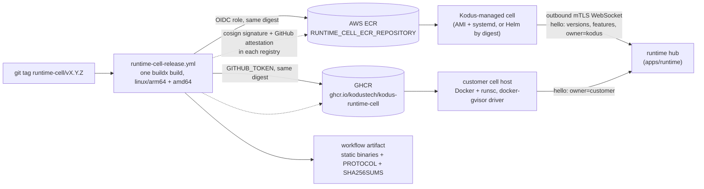
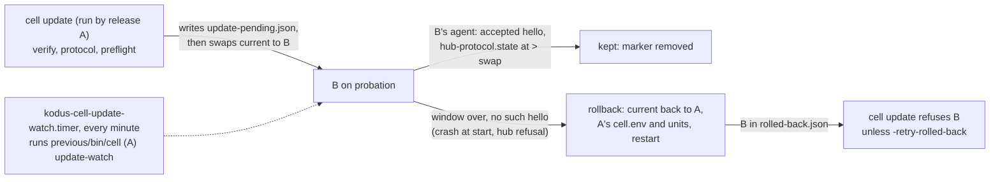

# Cell image distribution

How a Kody Runtime cell release reaches a cell: AWS ECR for cells Kodus runs, GHCR for cells a self-hosted customer runs. Line references are to this tree as of 2026-11-12. "Not verified" means the text was read but not run.



## The release

`.github/workflows/runtime-cell-release.yml` runs on a `runtime-cell/v*` tag or by hand, never on pull requests.

- `meta` fails first, with the variable named, when `RUNTIME_CELL_AWS_ROLE_ARN`, `RUNTIME_CELL_AWS_REGION` or `RUNTIME_CELL_ECR_REPOSITORY` is missing or malformed (`runtime-cell-release.yml:48-75`).
- `image` assumes the AWS role through GitHub OIDC (`:187-197`), logs in to GHCR with the job's `GITHUB_TOKEN` (`:207-212`), and pushes one build to both tags (`:229-251`). The SBOM and max-mode provenance are attestation manifests inside the image index, so both registries hold the same index and the same digest. `:253-266` checks that each tag resolves to the pushed digest before anything is signed.
- Each registry gets a keyless cosign signature (`:270-281`) and a GitHub provenance attestation pushed next to the image (`:283-298`), because a signature is stored in the registry that holds the image.
- The ECR host contains the account id and this repository's logs are public, so it is masked (`:199-205`). The run summary prints the GHCR reference and the ECR repository and region, never the account.
- `builder` builds the cell's image builder (`apps/runtime-cell/builder-image`, item 9) before the cell image, for linux/amd64 and linux/arm64, and pushes it to GHCR (`ghcr.io/kodustech/kodus-runtime-builder`) and to ECR (`RUNTIME_BUILDER_ECR_REPOSITORY`) under the release tag (`runtime-cell-release.yml:187-334`). Its build is reproducible (pinned bases and BuildKit commit, the BuildKit that builds it pinned in the workflow, timestamps from BuildKit's release commit, no attestation inside its index), and the cell pins its digest (`cmd/cell/config.go:23`): the job stops, before anything is signed and before the cell image is built (`:338`), when the digest it built is not that one (`:274-294`). Signatures and provenance go next to it in each registry as for the cell (`:296-322`). The pull-request workflow builds it the same way, pushing nothing, and fails on the same mismatch (`runtime-cell.yml:102`).
- `binaries` still uploads the eight static binaries per architecture and `PROTOCOL` (the hub protocol versions the release's cell speaks, written by `release-sign protocol` before `SHA256SUMS` is made over the directory, so the signature covers it) with `SHA256SUMS` and a provenance attestation (`:106-162`), for hosts that run them outside a container. It never holds the release key. Since 2026-11-14 a separate job `sign` signs `SHA256SUMS` into `SHA256SUMS.sig` with the release key, which an installed cell checks offline before it swaps to the next release (`cell update`, S-17 in [isolation-p3-snapshots.md](isolation-p3-snapshots.md)). `sign` runs only on a push of a `refs/tags/runtime-cell/v*` tag, in the GitHub environment `runtime-cell-release`, with `contents: read`; a `workflow_dispatch` (dev) build is never signed, so `cell update` refuses it. `cell update` also refuses a release lower than the running cell's version unless `-allow-downgrade` is passed (a dev build over a release counts as lower).

The product images follow the same split: cloud releases go to ECR (`prod-build-push-and-pr-green.yml:139-149`, OIDC role from secrets), self-hosted releases go to `ghcr.io/kodustech/kodus-ai-*` as an RC and are promoted to the release tag and `latest` (`selfhosted-build-push.yml:386-390`, `selfhosted-promote.yml:99-101`). The product images are not cosign-signed (no `cosign` in either self-hosted workflow).

## (a) Kodus cloud

A release in ECR does not reach a cell by itself. Today nothing pulls it.

- AWS EC2 cells: the `aws-ec2` driver and its OpenTofu foundation are frozen out of this tree. The step that turns a release into an AMI (pull the image or the binaries, install them with systemd units for `cell`, egress, resolver, injector, then bake) does not exist in this tree.
- Helm: not in this tree. The Kubernetes driver (`k8s-sandbox`) is frozen out of it, so a chart has no cell driver to run.
- The intended consumer pins the digest from the run summary, after `cosign verify` (below). Who writes that digest into the cloud deployment (an infra PR, as the product release does for ECS) is not decided.

## (b) Self-hosted

### What exists

The only driver a customer can run is `docker-gvisor`: the PR's compose project under `runsc` in the host's Docker (`apps/runtime-cell/README.md:113`). The cell refuses to start when Docker has no `runsc` runtime (`internal/drivers/dockergvisor/driver.go:259`, default runtime name at `:272`).

What a customer host would run, pulled from `ghcr.io/kodustech/kodus-runtime-cell@sha256:<digest>`:

- the cell agent (`ENTRYPOINT ["/usr/local/bin/cell"]`, `apps/runtime-cell/Dockerfile:48-51`), the same image carrying egress, resolver, injector, observer and reaper;
- the images the agent starts under runsc, each passed by digest: holder, builder (rootless BuildKit; by default the cell's own, `ghcr.io/kodustech/kodus-runtime-builder@sha256:07f92635...`, `KODUS_REVISION=2`), registry (by default `registry:3` by digest), helper, observer and browser runner (`cmd/cell/config.go:197-225`); outside `-dev` the cell refuses a tag on any of these flags (`cmd/cell/drivers.go` `pinnedImages`);
- the reaper as a systemd timer (`deploy/docker-gvisor/kodus-cell-reaper.service:1-17`), which expects a binary at `/usr/local/bin/kodus-reaper`;
- an enrollment: `cell register` with a one-time token, which writes the key, certificate, the hub CA that pins the hub, and the issuer (`apps/runtime-cell/README.md:185`); the hub side is `apps/runtime/src/hub/enrollment/cell-identity.service.ts:103`. The agent then dials `-hub-url` over mTLS (`README.md:370-371`).

### Host requirement: gVisor

`runsc` must be installed on the cell host and registered as a Docker runtime named `runsc` (in Docker's daemon configuration), on Linux with rootful Docker. It is never inside the cell image: the cell asks the host's Docker to run containers with `--runtime runsc`. `-gvisor-claim-limits required` also needs cgroup v2 and a delegated cgroup root (`README.md:102`). The tree has no install instructions for runsc; `test/gvisoregress` assumes a Linux Docker that already has it (`test/gvisoregress/build_linux_test.go:33`). `cell preflight` checks each of these on the host before an install ([self-hosted.md](self-hosted.md), "Host preflight").

### Verifying what was pulled

```sh
cosign verify ghcr.io/kodustech/kodus-runtime-cell@sha256:<digest> \
  --certificate-identity-regexp '^https://github.com/kodustech/kodus-ai/.github/workflows/runtime-cell-release.yml@refs/tags/runtime-cell/v' \
  --certificate-oidc-issuer https://token.actions.githubusercontent.com
gh attestation verify oci://ghcr.io/kodustech/kodus-runtime-cell@sha256:<digest> --repo kodustech/kodus-ai
```

The identity regexp accepts only a tag build of this workflow, so a `workflow_dispatch` dev build (`sha-<commit>` tag) does not verify as a release. Not verified: no release has been cut, so neither command has run against a real image.

### Keeping hub, worker, API and cell compatible

Cell and control plane do not need the same release number. They negotiate on every connection, in `libs/runtime/protocol`:

- Protocol version: every frame carries `v`. Both sides decode the current version and the one before it (`SUPPORTED_VERSIONS`, `libs/runtime/protocol/envelope.ts`; Go `SupportedVersions`, `apps/runtime-cell/internal/protocol/codec.go`). The cell's `hello` lists the versions it speaks and frames in the highest; the hub's ack names the version it chose, and every frame of that session goes out in it (`CellConnectionRegistry.framed`, `apps/runtime/src/hub/gateway/cell-connections.ts`). A `hello` is decoded whatever its `v` (both decoders, fixture `hello-newer-version.json`), so a cell of any version hears why it is refused.
- Features: the hello names the optional fields the cell decodes (`messages.ts:418`, list at `:182`). The hub sends a cell only those fields, and answers with `accepts`, the cell features it understands (`messages.ts:213-219`, used at `cell-hub.ts:345`). A feature name the hub does not know is ignored (`messages.ts:223-225`), so a newer cell does not break an older hub and a newer hub does not break an older cell's strict decoder (`messages.ts:129-134`).
- Owner: the hello says `kodus` or `customer` (`libs/runtime/contracts/enums.ts:112`, `messages.ts:412`).

The skew policy, Kubernetes' kubelet rule (`helloVersionRefusal`, `envelope.ts`; applied first in `acceptHello`, `apps/runtime/src/hub/cell-hub.ts`): a hub of protocol H accepts a cell whose highest offered version C is `MIN_CELL_PROTOCOL_VERSION ≤ C ≤ H`, where `MIN_CELL_PROTOCOL_VERSION` is H - 1 (1 while H is 1). A cell is never newer than its hub, and at most one protocol older. Upgrade the hub first, then its cells, one protocol version at a time.

- A cell newer than the hub is refused at hello with the nack code `cell_too_new`; one older than the minimum with `cell_too_old`. The message names both versions, the range the hub accepts and the side to upgrade. The nack goes out in the hello's own `v`, so the cell can read it. The hub keeps no session for that cell, counts the protocol violation and logs `cell.refused_version`.
- The cell logs the refusal at error level as `hub.refused_version`, with the code, the hub's message, its own protocol versions and its release. It treats an older hub's `unsupported_version` the same way. It dials again only after `RunConfig.RefusedBackoff` (5 minutes, `apps/runtime-cell/internal/agent/session.go`), not at the reconnect pace (1 s doubling to 30 s), because the refusal lasts until someone upgrades a side.
- Before this policy, the window was an exact match. A newer cell's hello failed the hub's version decode and got no answer, so the cell timed out on the ack. An older cell was refused with `unsupported_version` ("hub speaks vN"). The message told nobody which side to upgrade.
- Raising `PROTOCOL_VERSION` keeps the minimum at the old version only while the hub still sends that version's bodies to a session that chose it. A hub that cannot do this raises `MIN_CELL_PROTOCOL_VERSION` in the same change.

`cell update` applies the same rule before it installs, so a host never swaps to a cell its hub refuses at hello:

- The release says what it speaks. `PROTOCOL` in the release directory is one line, `<lowest> <highest>`, the cell's `SupportedVersions` (`releasesig.ProtocolName`, written by `cmd/release-sign protocol`, which is built from the release's own commit). `SHA256SUMS` lists it, so it is signed with the binaries; `cell update` reads it only through the manifest and refuses one that does not match or parse (`releasesig.ReadProtocol`).
- The host remembers what the hub accepts. A cell that keeps `<state-dir>/hub-protocol.state` names the hello feature `cellProtocols`; a hub that knows it adds `cellProtocols: {min, max}` (`HUB_CELL_PROTOCOLS`, `envelope.ts`) to the hello ack, and the agent writes the chosen version and that range after every accepted hello (`internal/hubprotocol`, atomic, `0600`, no secret). A refused hello writes nothing. An older hub never sees the feature name as anything but unknown and sends no range; an older cell never names it, so it never gets a field its strict decoder refuses.
- `cell update` reads both and refuses, before anything under `<root>` changes, a release whose highest protocol is above the hub's highest (`cell_too_new`: "upgrade the hub first and let this cell reconnect to it, then update") or below its lowest (`cell_too_old`). The message names the release's protocol, the hub's range and when the cell last reached it. The state is found under the cell's `-state-dir` as the cell resolves it from `-preflight-config` (default `$KODUS_CELL_CONFIG`), or `-state-dir`.
- A hub that names no range predates the field, and every such hub speaks protocol 1: it is taken to speak the version it chose (`hubprotocol.State.Accepted`).
- What cannot be checked installs with a note: a release without `PROTOCOL` (one from before it; `-require-protocol` refuses it instead) and a cell that never reached a hub (no state file). A state file that does not read is refused, never taken for none. `-skip-protocol-check` installs without the check, for an operator who upgraded the hub before this cell reconnected to it.

Not covered:

- The state is what the hub said at the cell's last accepted hello. A hub upgraded while the cell was down is not seen until the cell reconnects, so the update refuses a release the new hub would accept; the message says to let the cell reconnect, or `-skip-protocol-check`.
- `CELL_FEATURES` holds 34 names. Hubs from this release accept up to 64 in a hello's `features` (and send up to 64 in `accepts`); hubs before it refuse more than 32. A hub before it refuses the whole hello, so the cell trims (`trimForOlderHub`, `apps/runtime-cell/internal/agent/agent.go`): when a hello of more than 32 features is refused, the next hello carries only the first 32 (the list is in release order, newest last, so an older hub loses only names it never knew: `exercisedLines`, `bakeShare` and any after them), and the hello after that tries the whole list again (`session.go`, logged as `hub.hello_features_refused`). The skew policy still requires the hub first; the trim keeps a cell connected while it is not.
- The hello does not carry the cell's release name. The hub logs the cell's protocol and features, not its build. Adding a field would make an older hub's strict decoder refuse the hello.
- Each release's `PROTOCOL` says which protocol it speaks, but nothing maps the product release to its hub's protocol (item 6 below), and nothing tells the customer which cell digest matches their product release.

### Updating a host, and rolling back by itself

`cell update` (`internal/cellupdate`) is run by the release already installed. It refuses to run without the cell's
config (`-preflight-config` or `$KODUS_CELL_CONFIG`, exit 2) unless the operator says `-skip-preflight`: the new
release's own `cell preflight` judges the host before the swap. The installer's `cell-host.sh upgrade --from <dir>`
always passes `/etc/kodus/cell/cell.yaml`.

After the swap the new release is on probation. Its health signal is the one the agent already writes:
`hub-protocol.state` under the cell's `-state-dir`, whose `at` is written after every accepted hello. Within
`-rollback-window` (default 10 minutes) after the swap that `at` must be newer than the swap; otherwise the host
returns to the release before, with no operator.



- **Who watches.** `cell update` writes `<root>/update-pending.json` right before the swap (the release, its directory,
  the one before, the swap time, the deadline, the state file). A systemd timer (`OnCalendar=minutely`) starts
  `kodus-cell-update-watch.service` only while that file exists (`ConditionPathExists`), and the service runs
  `/opt/kodus-cell/previous/bin/cell update-watch`: the release before, which ran the update (the watch is armed only
  when the update runs from the installed release's own `bin/cell`) and is known to run. A
  new binary that crashes at start never runs the check that judges it. A watcher inside the new binary, or a loop in
  the operator's `cell-host.sh` session, would not survive either case. Reference units:
  `apps/runtime-cell/deploy/docker-gvisor/kodus-cell-update-watch.{service,timer}`; the installer installs them.
- **What it does.** A hello after the swap keeps the release, ends the watch and forgets it as rolled back. Inside the
  window it changes nothing. After the window it lists the release in `<root>/rolled-back.json`, points `previous`
  at it and `current` at the release before (atomic renames), copies that release's own `cell.env` and `systemd/`
  units back (the installer keeps both per release), runs `systemctl daemon-reload` and
  `systemctl restart kodus-cell.target`, removes the marker and logs one line:
  `rolled back release <B> (<dir>) to <A> (<dir>): no accepted hello with the hub within 10m0s of the swap at <t>
  (last accepted hello: <t>, before the swap | never); cell update refuses <B> until -retry-rolled-back`.
- **Never below the floor.** `cell update` keeps, in `<root>/release-index.state`, the highest `minimum` of every
  index the host accepted and the key that signed each release it installed. When the release before is below that
  floor (the new release fixed a vulnerability and its index raised the minimum), is not semver while a floor is set,
  or was signed with a key an index revoked since, the watch does not roll back: the new release stays current, the
  marker goes (so a fixed release can still be installed), one line says which rule held it, and `cell update-watch`
  exits 1 so the unit shows failed. Whatever blocked the hello (a hub outage, an attacker on the path) cannot put the
  host back on a release below the floor. A release installed before the state kept keys is checked on the floor only.
- **No network.** It reads two local files, renames two links, copies local files and runs `systemctl`.
- **No loop.** The watch only moves `current` back. The release is listed before the links move, so a stop at any
  point leaves it refused; `cell update` refuses a listed release unless `-retry-rolled-back`, and refuses any other
  release while the current one has not connected since its swap (the update would make an unproven release the one
  a rollback returns to). A rollback cut short (a failed restart) is finished by the next run.
- **By hand.** `cell-host.sh rollback` still swaps back with the release's settings and units, and removes the marker:
  the operator took over. A marker whose release is no longer current is dropped by the watch without changing anything.
- **A state it cannot parse.** A newer release may add a field to `hub-protocol.state` that the older watcher's strict
  decoder refuses. Only the agent writes that file, after an accepted hello, so its modification time stands for `at`.

Prior art: systemd's boot counting (an entry stays "indeterminate" until `boot-complete.target` blesses it with
`systemd-bless-boot`, and the boot loader, not the new entry, falls back to the one before;
[systemd.io/AUTOMATIC_BOOT_ASSESSMENT](https://systemd.io/AUTOMATIC_BOOT_ASSESSMENT/)); Android A/B updates
(`update_verifier` marks the new slot successful after its checks, and a slot not marked falls back;
[source.android.com/docs/core/ota/ab](https://source.android.com/docs/core/ota/ab)) and ChromeOS `update_engine`
(the new partition is marked good after the first boot into it, else the old one boots;
[update_engine README](https://chromium.googlesource.com/aosp/platform/system/update_engine/+/HEAD/README.md));
Teleport's managed agent updates ("If the agent fails to come back healthy, the updater will automatically initiate a
rollback to the last working version";
[agent update management](https://goteleport.com/docs/reference/architecture/agent-update-management/)). The cell takes
the indeterminate state and the blessing from boot counting, the judge that is not the new release from A/B, and the
hub's own acceptance as the health check. k3s's
[system-upgrade-controller](https://github.com/rancher/system-upgrade-controller) labels a node only after its upgrade
job succeeds and leaves recovery to the operator; a single host can do more because the release before is on disk.

Not covered:

- The window starts at the swap, not at the restart. A hello the old process makes between the two counts for the new
  release, and a release left un-restarted past the window is rolled back. `cell-host.sh upgrade` restarts at once.
- The watch runs the release before, so the first update from a release that predates `update-watch` gets no
  automatic rollback (that release writes no marker either). `cell update` arms the watch only when it runs from the
  installed release's own `bin/cell`; from any other binary it installs, says the rollback is not armed, and names the
  path to run it from.
- `cell-host.sh upgrade` with `--cell-image` or `--cell-bin-dir` (and the default, the image of `images.lock`) still
  copies binaries without `cell update`: no signature check, no preflight, no automatic rollback.
- The staged preflight takes the config file only (`cell preflight -config`): flags the unit passes in `$CELL_ARGS`
  are not part of it.

## What is missing for a self-hosted customer to run a cell

1. Control plane images. The hub and the runtime worker are bake targets outside the default group, published by no workflow "until the Runtime ships" (`docker-bake.hcl:142-170`). A self-hosted install has no hub for a cell to dial.
2. Installer. `kodus-installer` (checked at `6c26339`, and its `origin/main`) has no runtime service: the compose file and the `kodus` chart list web, api, worker, webhooks, mcp-manager, RabbitMQ, Postgres and Mongo (`kodus-installer/docker-compose.yml:3-246`, `charts/kodus/values.yaml:233-338`). Missing: runtime-hub and runtime-worker services, the hub URL and CA, an enrollment-token step, and a separate cell host profile.
3. Cell host install. No script or doc installs runsc and registers it with Docker, writes the cell's configuration, runs `cell register`, and installs a systemd unit for the agent and for egress, resolver and injector. Only the reaper unit exists (`deploy/docker-gvisor/`), and it expects `/usr/local/bin/kodus-reaper` while the release ships `reaper-linux-<arch>` and the image has `/usr/local/bin/reaper` (`Dockerfile:49`).
4. The other images by digest. Holder, observer and browser-runner digests are flags with no default (`cmd/cell/config.go:197-225`). The builder and the registry now have defaults: the release publishes the builder (item 9), and the registry is upstream `registry:3` by digest. Which image serves as holder, and where the browser runner (`apps/runtime-cell/browser-runner/Dockerfile`) is published, is not decided. Not verified: whether the cell image itself can serve as the observer image (it carries `cmd/observer`, but at `/usr/local/bin/observer`, not `/observer`).
5. Chart values. Not in this tree: the Kubernetes driver is frozen out of it.
6. A compatibility table. The cell release's protocol is in its signed `PROTOCOL` (not on the image, and without the features); nothing maps the product release to the hub's protocol, so the installer can pin a cell digest that fits.
7. Upgrade, restore and uninstall. Not started.
8. AMI equivalent. For cloud, the bake that turns a release into an approved AMI; for self-hosted, the host requirements in its place (Linux distribution, kernel, Docker version, cgroup v2, disk filesystem for `-gvisor-container-disk`, `README.md:113`). Neither is written down.
9. Builder image. Done in code, not released. The stock `moby/buildkit:*-rootless` hits BuildKit's overlay differ fallback under gVisor (ENOTSUP on `trusted.*` xattrs) and walks the whole tree per layer: about 10 minutes of export on a heavy monorepo. `apps/runtime-cell/builder-image` is upstream's v0.34.0 rootless image with `buildkitd` rebuilt from the release commit plus the fix and its two tests (`overlay-enotsup.patch`); its README has the rebase rule for every BuildKit bump. Two from-scratch builds on the dev VM gave the same index, `sha256:f4c8f1e1e94d6ab48d181cd4e07e50b667c0e7aef510bae930546454510a63b1` (arm64 `sha256:824603f7...`, amd64 `sha256:80199eb0...`), which is the cell's default `-gvisor-builder-image`. Not verified: that a GitHub runner (an amd64 build platform) reproduces that digest; the pull-request job says so on its first run. The GHCR image does not exist until the first release: a cell started with the default before then cannot pull its builder. The upstream fix is written, not opened. Revision 2 (2026-11-13) adds `exec-ca-bundle.patch` (every RUN trusts the cell CA, [egress-allowlist.md](egress-allowlist.md) §16): two from-scratch builds on an amd64 host gave `sha256:07f92635…`, the new pin; the same host rebuilt revision 1 as `sha256:e704b2d1…`, not the dev VM's `f4c8f1e1…`, so the digest depends on the build host and the pull-request job's first run decides the pin.
10. Secret store. OpenBao is the store in self-hosted too (decided 2026-11-12, [sandbox.md](sandbox.md)). The dev compose service `runtime-openbao` is the reference; the installer must ship:
    - the upstream image by digest (`openbao/openbao:2.7.2@sha256:5046911075e137e154ce49ab051502f4ec7cf367d484ae4a4dce665d9b90561f`), unmodified, MPL-2.0, as its own service, with `IPC_LOCK`;
    - `docker/openbao/config/` (listener, `postgresql` storage, `static` seal, stdout audit, self-init) and `docker/openbao/policies/`;
    - a one-shot that runs `docker/openbao/create-database.sql` against the Postgres it already runs (role `openbao`, database `kodus_openbao`), and `PG*` + `PGPASSFILE` for OpenBao;
    - generated once and kept across upgrades: the 32-byte unseal key, the TLS key and certificate (names: the service, and the address cells use), the API's and the injector's AppRole role id and secret id (`scripts/runtime/dev-openbao.sh` does this for dev). The unseal key goes in the customer's own backup, apart from the database: without it the database backup cannot be read;
    - the API's env: `RUNTIME_OPENBAO_ADDR`, `RUNTIME_OPENBAO_CA_FILE`, `RUNTIME_OPENBAO_ROLE_ID_FILE`, `RUNTIME_OPENBAO_SECRET_ID_FILE` (`RUNTIME_OPENBAO_MOUNT`, default `runtime-kv`);
    - the injector's flags: `-openbao-addr`, `-openbao-ca`, `-openbao-role-id-file`, `-openbao-secret-id-file`; a single-org cell's injector policy narrowed to `runtime-kv/data/orgs/<organizationId>/secrets/+`;
    - a network path from each cell host to OpenBao on 8200 (TLS), and from the API.

    Kodus Cloud runs the same service with the `awskms` KMS plugin instead of the static key (no longer built in since OpenBao 2.7.0) and its database on the product RDS.

## Profiles (planned, [isolation-architecture.md](isolation-architecture.md))

One cell image for every topology. What changes per installer profile:

| Profile | Host needs | Extra artifacts |
|---|---|---|
| `docker-gvisor` | Docker with runsc registered | Builder image (BuildKit with the ENOTSUP fix) |
| `docker-firecracker` | `/dev/kvm`, cgroup v2, XFS or a thin pool | microVM kit: firecracker + jailer, guest kernel, base rootfs images |
| `kubernetes` | A gVisor or Kata RuntimeClass, or a node pool with KVM | The kit when the pool runs Firecracker |
| any, air-gapped | No network on the cell host | Signed offline bundle per cell release: the release, every image as an OCI archive by digest, the gVisor archive (`release-sign bundle`; `cell-host.sh install/upgrade --release-bundle`, [self-hosted.md](self-hosted.md), "Air-gapped host"). The control plane's images go to the customer's registry with the installer's `bundle-export.sh` / `bundle-import.sh` |

OpenBao ships in every profile. The cell refuses to start when its profile's requirements are not met and says which one.

## Repository settings this needs

| Setting | Kind | Value |
|---|---|---|
| `RUNTIME_CELL_AWS_ROLE_ARN` | variable | IAM role whose trust policy admits `token.actions.githubusercontent.com` for `repo:kodustech/kodus-ai:ref:refs/tags/runtime-cell/v*` (and the branch used for `workflow_dispatch`, if dev builds should push), with ECR push on the one repository |
| `RUNTIME_CELL_AWS_REGION` | variable | region of the ECR repository |
| `RUNTIME_CELL_ECR_REPOSITORY` | variable | ECR repository name; the workflow does not create it |
| `RUNTIME_CELL_RELEASE_SIGNING_KEY` | environment secret of `runtime-cell-release` | the release key's private file (`apps/runtime-cell/scripts/sign-release.sh generate`), whose public line is pinned in `apps/runtime-cell/internal/releasesig/keys/cell-release.pub`; a tag release fails without it. It must not exist as a repository or organization secret. The environment needs required reviewers (with "Prevent self-review"), a deployment rule that admits only tags `runtime-cell/v*`, and no admin bypass; a tag ruleset on `refs/tags/runtime-cell/v*` restricts who can create, move or delete those tags |
| `RUNTIME_BUILDER_ECR_REPOSITORY` | variable | ECR repository of the image builder (e.g. `kodus-runtime-builder`), same region, pushable by the same role; the workflow does not create it |
| `packages: write`, `id-token: write`, `attestations: write` | job permissions | set in the workflow |
| GHCR package visibility | GitHub | `kodus-runtime-cell` and `kodus-runtime-builder` are created private on first push; both must be made public (or the customer given a pull token) for self-hosted pulls |

Not verified: that cosign's signature and the attestation push succeed on an ECR repository with immutable tags; the product repositories are immutable, and cosign writes a tag per signed digest.
