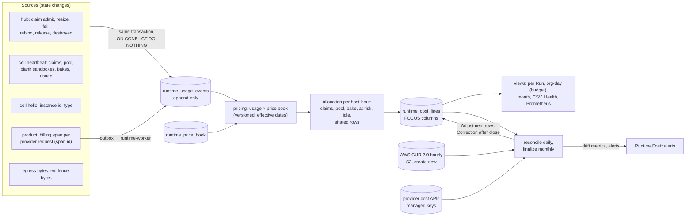

# Kody Runtime cost metering

Design for knowing what the Kody Runtime costs, exactly and provably: per Run, per org and day, per month, for Kodus
and for the customer. Nothing here is built yet; it is for review before any code changes. Terms are in
[glossary.md](glossary.md); today's report is [usage-report.md](usage-report.md); event names follow
[observability.md](observability.md) part 2. Line references are to the code as of
2026-11-12. Prices were read on that date and live in the price book (§4.2), not in this text.

## 1. Why and scope

The `aws-ec2` cell driver is frozen out of this tree; the product still prices that cell kind, which the protocol can
name, so its rows below stand.

Cost is computed today in four places that do not agree. The Run page and Run list price each claim from its
`runtime_claims` row (`libs/runtime/api/domain/run-cost.ts:172-234`): MB·min ÷ allocatable MB × a host US$/h on a
shared cell, or Run wall time × hard-coded VM prices on aws-ec2 (`run-cost.ts:27-31, 297-317`). The usage report sums the
same rows per month without splitting intervals (`domain/usage-report.ts:241-286`). The org day budget counts wall
seconds per claim from `runtime_machine_reservations` (`apps/runtime/src/hub/claims/pg-machine-minutes.store.ts`, view at
`apps/runtime/src/shared/persistence/runtime-schema.ts:389-399`). LLM cost is read from Mongo usage spans
(`observability_telemetry`) by `tu.route = 'runtime'` (`libs/analytics/.../tokenUsage.repository.ts:645-711`) and priced
from live catalogs at read time. A claim row is rewritten on every round (`runtime_claims.claim_id` is the primary key,
`hub-store.ts:596-604`), so history is lost. Host idle, pool, bakes, storage, network and the control plane are
counted nowhere. The audit found 19 machine defects (M1..M19) and 13 LLM defects (L1..L13); 21 of them are proved by 25
tests that fail today (§2), the rest by code evidence. The worst ones: every Kodus-paid LLM call reads as US$ 0 (L1), aws-ec2 Runs are priced 53% high
(M4), and a claim's first round is lost on rebind (M1).

Scope: every cost the Runtime causes. Machines (Runs, setups, bakes, sandboxes, MCP, custom agents, pool, observers),
cell hosts, storage, network, control plane, LLM per caller, and third parties. Out of scope: CI cost of building the
cell images (`runtime-cell-release.yml`), and customer cells, whose machines are the customer's (their usage is metered,
not priced).

## 2. Audit

Severity: C critical, H high, M medium, L low. Tests are `it.failing` today and flip to `it` when fixed. Paths:
`MCA` = `libs/runtime/api/__tests__/machine-cost-audit.spec.ts`, `CMT` =
`apps/runtime/src/hub/claims/claim-machine-time.cost-audit.spec.ts`, `PGM` =
`apps/runtime/src/hub/claims/pg-machine-minutes.cost-audit.integration.spec.ts` (needs `RUNTIME_IT_DATABASE_URL`), `RLC` =
`libs/runtime/api/__tests__/runtime-llm-cost.cost-audit.spec.ts`, `MEX` =
`libs/core/observability/exporters/mongodb-exporter.cost-audit.spec.ts`.

| Component | Current method (source, granularity) | Defects (id, severity, file:line) | Proving test |
|---|---|---|---|
| Run claims, shared cell | `runtime_claims` row; `admitted_at` → `released_at`, else `min(now, hard_expires_at)`, failed/blocked `state_changed_at` (`run-cost.ts:172-181`); ms; Postgres `now()` | **M1 H** rebind sets `admitted_at = now()`, first round lost (`hub-store.ts:598-601`, `capacity-wait.ts:17-23`). **M2 H** release overwrites the failure time (`claim.service.ts:849-855`, `run-cost.ts:173-174`). **M3 M** a claim the cell dropped counts to `hard_expires_at`, lease not a cap (`claim.service.ts:877-899`, `pg-runtime-claim-usage.reader.ts:48`). **M14 L** Run list reads `LIMIT 1000` claim rows silently (`pg-runtime-claim-usage.reader.ts:52-53`) | CMT "a claim whose cell dropped during the boot and rejoined it counts the machine time from its first admission"; PGM "the Run cost of a claim with two rounds counts the machine time the org day budget counts for it"; CMT "a claim whose boot failed holds no machine time after the failure, even when the worker releases it later"; CMT "a bound claim its cell stopped listing is not counted as holding machines after the cell let it go"; MCA "an open claim whose lease ran out holds nothing after its lease…". M14: not unit-provable (needs > 1000 rows; a SQL-shape test tests implementation). Control: CMT "a claim admitted, ready and released counts from its admission to its release" |
| Run claims, aws-ec2 | Run wall time `bootingAt→finishedAt` (worker clock) × fixed 2 VM + 2 observer (`run-cost.ts:158-163, 303-306`) | **M4 H** priced m7i.2xlarge + t3.medium; the cell starts m7i.xlarge + c7i.large, +53% (`run-cost.ts:27-31`, the aws-ec2 driver's `InstanceType`, `agent/config.go:313-318`). **M5 M** month `kodusUsd` omits it, shows 0 (`usage-report.ts:266-270, 391-394`). EBS 60 + 20 GB per side unpriced (`driver.go:373-401`) | MCA "an aws-ec2 Run is priced at the instances its cell starts…"; MCA "the month's cost to Kodus includes the machine cost of every Kodus Run the Run page priced" |
| Setups, learn boots, repairs | setup claims created in the month, one per boot (`pg-runtime-usage-report.reader.ts:110-121`) | M2, M3 apply. No per-setup grouping (`usage-report.md` "Setups as their own unit") | as Run claims |
| Bake after release | none | **M6 H** bake keeps full boot memory up to 90 min after the setup claim is released, no row/event/metric (`image_policy.go:17, 67-78, 90-93`) | not unit-provable: nothing holds bake time to assert on |
| Sandboxes, blank sandboxes | sandbox claim at whole size (`cell-memory.ts:253-258`) | M2, M3 apply. Blank sandboxes pre-made by the cell counted nowhere (`sandbox_pool.go:147-200`, part of M7) | as Run claims; blank: not unit-provable (no source) |
| MCP sessions | claim `mcp:<sessionId>`, ceiling 240 min (`env-session.service.ts:317-318`) | M3 worst here (up to 4 h). **M15 L latent** non-runtime claim with `runId` counted twice (`pg-runtime-usage-report.reader.ts:97-121`, `internal.controller.ts:31-37`) | M3 as above; M15 not provable today (no producer sends one) |
| Custom agents | consumer exists (`enums.ts:118`), nothing acquires it | none today | n/a |
| Warm pool | API cron counts `poolAppliedSize` × minutes into `poolUsage` jsonb (`domain/pool.ts:153-163`) | **M8 M** every machine priced as an m7i.2xlarge (`pool-controller.service.ts:19-20`). **M9 L** month rollover drops minutes (`pool.ts:153-159`). **M10 M** gap capped at 15 min (`pool.ts:156-158`). Counts the size asked, not what the cell keeps | MCA "a ready pool machine is priced at most at the instance an aws-ec2 cell starts for it…"; MCA "the first count of a new month keeps the new month's machine time since midnight"; MCA "a gap between two counts counts every minute the cell kept the applied machines ready"; asked-vs-kept: not unit-provable (cell count not readable, `observability.md:488`) |
| Build machine, golden data | builds inside a claim are in its time; builder images are CI cost; no golden pipeline (`isolation-architecture.md:18-21`) | M6 (bake) | — |
| Observers | aws-ec2: 2 VMs per Run at wrong type (M4); docker-gvisor: inside the claim, unverified whether in `bootMb`/`readyMb` | M4 | M4 test |
| Memory and vCPU metering | hub meters base at `min(boot, ready)` (`cell-memory.ts:168-171`); vCPUs from size or hello default (`claim.service.ts:453-456`) | **M11 M** cold base under-metered 6× during build (`agent/memory.go:23-39`). **M12 L** claim-limits claim above default metered at default (`cell-memory.ts:258`, `dockergvisor/size.go:101-110`). **M13 L** default vCPUs `max(floor,1)` (`size.go:42-48`, `claim_limits.go:59`) | CMT "a Run's base side that booted cold is metered at its build size until it is ready…"; M12 not separately tested (same mechanism, heartbeat lacks the field); M13 not unit-provable (reported type is `int`) |
| gVisor vs Firecracker | no isolation dimension in the model; Firecracker refused (`dockergvisor/driver.go:137, 298-299`) | none today; microVM overhead will need its own meter | n/a |
| Cell host | claim share = MB·min ÷ `allocatable_mb` × host US$/h (`run-cost.ts:215-234`); price from `RUNTIME_CELL_PRICES` or `CELL_HOST_LIST_PRICES` (`run-cost.ts:57-62`, `runtime-api.config.ts:83-102`) | **M7 H** OS reserve, idle capacity, pool, blank sandboxes, bakes attributed to nobody; no fleet figure. **M19 L** on-demand only, no SP/RI/spot; region defaults differ (`run-cost.ts:28`, `runtime-api.config.ts:99`) | not unit-provable: no source exists; M19: billing data is outside the repo |
| Org day budget | reservations + claim end, `CEIL` seconds per round, size ignored (`pg-machine-minutes.store.ts:22-55`) | **M16 M** every round stays on its first round's UTC day (`pg-machine-minutes.store.ts:32-35, 47-51`). Disagrees with Run cost after rebind (M1). Reservation without claim row counts its ceiling (L, untested) | PGM "a claim's new round after midnight is admitted against the new UTC day…"; PGM M1 test above |
| Month boundary | Run claims → Run's requested month, others → created month; never clipped | **M17 L** a claim across midnight Oct 31 → Nov 1 all in October (`pg-runtime-usage-report.reader.ts:96-121`) | MCA "a month counts only the machine time inside it…" |
| Prometheus cost metric | `runtime.machine.gb_minutes` on hub `release()` only, end on hub clock (`claim.service.ts:822-851`); prices copied into `runtime-settings.rules.yml:9-14` | **M18 M** terminated, reaped, never-released claims missing; mixed clocks; third price copy | not unit-provable: missing emission on paths with no metric hook |
| Storage | none: EBS on aws-ec2 and cell hosts, ECR/GHCR, S3 evidence (`contracts/evidence-s3.ts`), Postgres rows | M7 | not unit-provable: no source |
| Network | egress proxy `kodus_egress_bytes_total{direction}`, process-wide, no org/claim (`egress/metrics.go:60`) | M7: no attribution; NAT, cross-AZ, hub↔cell, evidence transfer unmeasured | not unit-provable: no source |
| Control plane | none: hub, runtime-worker, API share, Runtime Postgres, OpenBao, Prometheus/OTel | M7 | not unit-provable: no source |
| LLM: gateway `runtime.plan`, `runtime.intent` | span per request (`byok-runtime-llm.provider.ts:92-110`), read by `tu.route` | **L1 C** managed default stores `tu.route = ''`: Kodus spend reads US$ 0, `complete: true` (`agent-loop-call.ts:275`, `observability.service.ts:447-466`, `token-usage-tu.ts:279-283`, `tokenUsage.repository.ts:673`) | RLC "the gateway call (runtime.intent) on the managed default is on its Run, as Kodus spend". Control: RLC "a BYOK gateway call shows on its Run…" |
| LLM: worker model turns | span per turn (`byok-model-turn.provider.ts:76-104`) | L1 | RLC "a worker planner's model turn on the managed default is on its Run" |
| LLM: setup learn loop | gateway span, runId = setup scope | L1; **L7 L** no `environmentId` on the span (`byok-runtime-llm.provider.ts:101-108`, `llm-gateway.use-case.ts:272`) | RLC "the usage report filtered by the setup's environment includes its learn-loop call" |
| LLM: recipe author, test planner | ONE span per loop of up to 16 / 12 steps, usage summed (`recipe-author.agent.ts:139`, `test-planner.agent.ts:34`, `agent-loop-call.ts:352-361`) | L1; **L2 H** long-context tier chosen on the loop sum, ~2× (`tokenUsage.repository.ts:177`) | RLC "the recipe author on the managed default is in the month's Runtime spend"; RLC "a recipe-author loop of three 80K-token requests on Gemini 2.5 Pro costs three base-rate requests". Control: RLC "a single call above 200K input is priced entirely at the long-context tier" |
| LLM: tool repair, failover, retries, failed-after-billing | own spans; failover 2 spans; errors carry usage (`ai-sdk-usage.ts:68-84, 161-173`) | correct, L1 applies | — |
| LLM: aborted in flight | 0 billed tokens; estimate written, never read (`aborted-in-flight.ts:4-30`) | **L12 L–M** cost stays `complete: true` (`run-cost.ts:264`) | not unit-provable: provider billing of cancelled requests is provider behavior |
| LLM: pricing | `PricingResolver` (models.dev, LiteLLM, org overrides) at read time, per span (`telemetry-llm-spend.reader.ts:22-50`) | **L3 M** tier thresholds case-sensitive (`tokenUsage.repository.ts:193`, `token-pricing.use-case.ts:245, 381, 597`). Info: `reasoning` rate unused; cache write single 5m rate; reseller thresholds on Claude | RLC "a 300K-token call of the org's 'Gemini-2.5-Pro' is priced at the 200K+ tier" |
| LLM: who pays | `paidBy = isByok ? 'customer' : 'kodus'` (`telemetry-llm-spend.reader.ts:41`) | **L4 M** `kodus` platform-funded credential is `type 'byok'`, left out of cost to Kodus (`platform-funded-provider.ts:1-21`, `agent-loop-call.ts:253`) | RLC "a call on the org's `kodus` (platform-funded) credential counts in what Kodus pays" |
| LLM: windows and reads | month `$lte` next 1st; read capped at 20 000 buckets | **L5 L** boundary span in two months (`usage-report.ts:35`, `tokenUsage.repository.ts:290`). **L6 M** cap drops buckets, no signal (`tokenUsage.repository.ts:123, 340-372, 679`) | RLC "a call stamped at 2026-12-01T00:00:00.000Z is in December only"; RLC "20 001 Runs with one call each add up to all of their tokens" |
| LLM: span ingestion | exporter buffer + WAL + `insertMany`, no span id stored (`mongodb-exporter.ts:1064-1172, 1636-1800`) | **L8 M** lost ack re-inserts (`:1403-1425`). **L9 L** WAL replay re-inserts (`:145-157, 358-404, 1782`). **L10 M** DLQ past 10 000 never replayed (`:1128-1146`). **L11 M** WAL in `os.tmpdir()` (`:75-79, 96-101`). **L13 L** exporter off reads as US$ 0 complete (`observability.service.ts:631-638`) | MEX "L8: a flush that committed but lost its acknowledgement does not store the span again on retry"; MEX "L9: a restart after a partly failed flush does not store the committed span again"; MEX "L10: every billing span exported while Mongo was unreachable is stored once it is back, even after a restart"; L11 not unit-provable (container filesystem lifecycle); L13 not unit-provable (zero rows ≡ zero calls by construction) |
| Third party | GitHub API: rate limits, no money. BetterStack, Grafana, OTel backends: subscriptions | none | n/a (shared control-plane rows, §4.3) |

Full evidence and the observed numbers of every failing test are in the two audit notes this doc was built from; the
tests themselves are the record.

### Phase 1 status (2026-11-12, paused: cost work deprioritized)

| Defect | State |
|---|---|
| M4 | Fixed: `AWS_EC2_LIST_PRICES` (AWS public price list, published 2026-11-10) and the default m7i.xlarge + c7i.large. MCA test flipped |
| M8 | aws-ec2 part fixed (pool machine = m7i.xlarge). Still an upper bound on a shared cell: the pool controller does not know the environment's cell. MCA test flipped |
| M1 | Confirmed, not fixed. A cell that drops during a boot keeps preparing (`capacity-wait.ts` CELL_LOST_WAIT_MS), but the hub marks the round `failed` (`not_ready`/`disconnected`, `claim.service.ts`), and the budget view ends it at `state_changed_at`. To pass CMT and PGM unchanged, the cost and the budget must both treat a round failed by disconnection as held until rebind/release/lease, and keep prior rounds' time in a column `rebindClaim` adds to |
| M2, M3 | Confirmed, not fixed. M3: the cell lists every claim it holds in each heartbeat (`agent.go` Heartbeat), so a bound claim it stops listing has been let go; the fix is to end it at the first missing beat, plus a lease cap in `heldUntil` (the reader must select `lease_expires_at`) |
| M5 | Confirmed, not fixed. Each aws-ec2 claim is one workload VM plus one observer (none for a sandbox, `agent/prepare.go`, `agent/sandbox.go`). Pricing per claim in both the Run page and `machineUsageOf` needs the cell's owner on the report's claim rows (join `runtime_cells`) |
| L1, L8–L11, L12/L13 | Not started |

## 3. Research summary

**FOCUS v1.4** (ratified 2026-06-04; [releases](https://github.com/FinOps-Open-Cost-and-Usage-Spec/FOCUS_Spec/releases)).
Four cost columns: [ListCost](https://github.com/FinOps-Open-Cost-and-Usage-Spec/FOCUS_Spec/blob/v1.4/specification/datasets/cost_and_usage/columns/listcost.md)
(list price × PricingQuantity), [ContractedCost](https://github.com/FinOps-Open-Cost-and-Usage-Spec/FOCUS_Spec/blob/v1.4/specification/datasets/cost_and_usage/columns/contractedcost.md)
(negotiated, defaults to list), [EffectiveCost](https://github.com/FinOps-Open-Cost-and-Usage-Spec/FOCUS_Spec/blob/v1.4/specification/datasets/cost_and_usage/columns/effectivecost.md)
(after discounts, amortized commitments; the number to allocate),
[BilledCost](https://github.com/FinOps-Open-Cost-and-Usage-Spec/FOCUS_Spec/blob/v1.4/specification/datasets/cost_and_usage/columns/billedcost.md)
(as invoiced; the number to reconcile invoices). ChargePeriod (when used) and BillingPeriod (invoice month) are
`[start, end)`. `ChargeClass = Correction` only for a closed period. Split allocation (v1.3) requires allocated rows to
sum to the origin charge, with the unallocated remainder as an `AllocatedResourceId = null` row
([split attribute](https://github.com/FinOps-Open-Cost-and-Usage-Spec/FOCUS_Spec/blob/v1.4/specification/attributes/data_generator_calculated_split_cost_allocation_handling.md)).
Corrections: Replacement, Delta or Ledger (reverse + re-enter, "full inherent auditability"); overwrite while a period
is open, ledger once closed ([correction_handling](https://github.com/FinOps-Open-Cost-and-Usage-Spec/FOCUS_Spec/blob/v1.4/specification/attributes/correction_handling.md)).

**AWS Data Exports.** CUR 2.0 (fixed 125 columns) or FOCUS 1.2 with AWS columns; `HOURLY`, `INCLUDE_RESOURCES=TRUE`
adds `line_item_resource_id` (instance id, volume id; blank for data transfer)
([CUR 2.0](https://docs.aws.amazon.com/cur/latest/userguide/table-dictionary-cur2.html),
[line items](https://docs.aws.amazon.com/cur/latest/userguide/Lineitem-columns.html)). Amortized instance cost =
`SavingsPlanEffectiveCost` on SavingsPlanCoveredUsage + `UnblendedCost` on Usage (+ `reservation_effective_cost` on
DiscountedUsage) ([cur-sp](https://docs.aws.amazon.com/cur/latest/userguide/cur-sp.html),
[split example](https://docs.aws.amazon.com/cur/latest/userguide/example-split-cost-allocation-data.html)). Refreshed at
least daily; the previous month may change for two weeks, and credits can arrive after finalization; "create new"
delivery keeps every refresh, read through `Manifest.json`
([delivery](https://docs.aws.amazon.com/cur/latest/userguide/dataexports-export-delivery.html)). Tags take up to 48 h to
activate and are not retroactive ([activating tags](https://docs.aws.amazon.com/awsaccountbilling/latest/aboutv2/activating-tags.html)):
join on instance id. EC2 bills per second with a 60 s minimum from `running`
([lifecycle](https://docs.aws.amazon.com/AWSEC2/latest/UserGuide/ec2-instance-lifecycle.html)); NAT bills partial hours
as full hours ([VPC pricing](https://aws.amazon.com/vpc/pricing/)).

**OpenCost / Kubecost.** Workload cost uses `max(request, usage)`; idle = asset cost − workload cost; idle shown
separately, or shared by node or cluster, proportionally per resource
([OpenCost spec](https://opencost.io/docs/specification),
[Kubecost idle](https://github.com/kubecost/docs/blob/v1.x/using-kubecost/navigating-the-kubecost-ui/cost-allocation/efficiency-idle.md)).
AWS split cost uses `max(reserved, actual)` and CPU:memory weights **9:1** derived from Fargate prices; with CPU
oversubscribed, the allocated total is the denominator
([split line items](https://docs.aws.amazon.com/cur/latest/userguide/split-line-item-columns.html)). A sampled meter errs
by one sample step at each end of a lifetime.

**Metering vendors.** OpenMeter (`id`+`source`, dedup window 24 h to 32 d), Lago (`transaction_id`; first wins),
Stripe Meters (`identifier` unique ≥ 24 h, 35-day backdating, 1–72 h grace, cancel only within 24 h), Orb
(`idempotency_key`, 12 h grace, backfills with close/revert)
([OpenMeter](https://openmeter.io/docs/metering/events/usage-events),
[Lago](https://getlago.com/docs/guide/events/ingesting-usage),
[Stripe](https://docs.stripe.com/billing/subscriptions/usage-based/recording-usage-api),
[Orb](https://docs.withorb.com/events-and-metrics/reporting-errors)). Every one has a bounded dedup window and becomes
append-only after finalization. So our own ledger, with a unique key and no TTL, is the system of record.

**LLM providers.** Anthropic: usage report with 1m/1h/1d buckets grouped by `api_key_id`, `workspace_id`, `model`,
`service_tier`, `inference_geo`; the new analytics `/cost` carries `amount` and `list_amount`, revisable until about
7 days after month end, `data_refreshed_at` on each response; the legacy cost report omits Priority Tier
([usage-cost API](https://platform.claude.com/docs/en/api/usage-cost-api),
[analytics](https://platform.claude.com/docs/en/manage-claude/usage-cost-analytics-api)). Cache writes 1.25× (5 m) or
2× (1 h), reads 0.1× or less, batch 50%, `inference_geo: us` 1.1×, all stacking
([pricing](https://platform.claude.com/docs/en/about-claude/pricing)). OpenAI: `/organization/usage/completions` (input
*includes* cached), `/organization/costs` daily only; > 272k input has its own price row
([costs](https://developers.openai.com/api/reference/resources/organization/subresources/audit_logs/methods/get_costs)).
Vertex: > 200K context prices the whole request at long-context rates; from 2026-11-13 timed-out > 32K completions are
billed ([Vertex pricing](https://cloud.google.com/vertex-ai/generative-ai/pricing)); Cloud Billing exports to BigQuery
([export](https://docs.cloud.google.com/billing/docs/how-to/export-data-bigquery)). Pitfalls: inclusive vs exclusive
token buckets by provider, tier evaluated per request over all input including cache, `service_tier` visible only in
usage, server-tool fees are not tokens, pricing frozen at ingestion freezes errors
([Langfuse](https://langfuse.com/docs/observability/features/token-and-cost-tracking)). Not researched: a usage or cost
export for Fireworks, which serves the managed default (`libs/llm/byok-defaults.ts:15`).

**Time.** Never subtract wall clocks from two hosts ([clock_gettime](https://man7.org/linux/man-pages/man2/clock_gettime.2.html)).
In Postgres `now()` is the transaction start and `clock_timestamp()` the actual time
([datetime](https://www.postgresql.org/docs/current/functions-datetime.html)). Leases bound a crashed holder's harm but
need fencing tokens against zombies ([Kleppmann](https://martin.kleppmann.com/2016/02/08/how-to-do-distributed-locking.html)).
The provider's state transition is the authoritative close; closing a lost interval at the last heartbeat bounds the
over-count by one heartbeat. The cell heartbeats every 10 s (`apps/runtime-cell/internal/agent/session.go:57`).

## 4. Design



### 4.1 Usage ledger

One append-only table in the Runtime Postgres. A row is a usage fact, never a price. Prices, allocation and
reconciliation are derived from it and can be recomputed at any time.

```
runtime.runtime_usage_events (                       -- partitioned by RANGE (event_time), monthly
  event_id        text        NOT NULL,              -- deterministic key, table below; PRIMARY KEY (event_id, event_time)
  interval_id     text,                              -- groups open/resize/close of one interval
  kind            text        NOT NULL,              -- open | resize | close | quantity | reverse | reenter
  meter           text        NOT NULL,              -- closed set: claim.machine, pool.machine, blank.machine, bake.machine,
                                                     -- host.instance, at_risk.machine, usage.sample, llm.<bucket>,
                                                     -- egress.bytes, evidence.bytes, storage.gb
  event_time      timestamptz NOT NULL,              -- DB clock_timestamp() at the state change (LLM: span end, see below)
  recorded_at     timestamptz NOT NULL DEFAULT clock_timestamp(),
  org_id text, run_id text, environment_id text, setup_scope_id text,
  claim_id text, cell_id text, instance_id text, consumer text, side text,
  quantity        numeric(24,6),                     -- for quantity rows and the size on open/resize (MB, vCPU)
  unit            text,                              -- MB, vCPU, token, request, byte, GB
  attrs           jsonb       NOT NULL DEFAULT '{}', -- inputs: memory_mb, cpus (float), driver, isolation, instance_type,
                                                     -- model, provider, service_tier, inference_geo, credential_kind, ...
  source          text        NOT NULL,              -- hub.claim, hub.cell, hub.maintenance, product.llm, egress, evidence
  epoch           bigint,                            -- fencing token: the claim round, the cell session
  closed_by       text,                              -- release | failure | destroyed | missing_on_cell | lease_expiry |
                                                     -- hard_expiry | cell_lost | rebind
  correction_of   text,                              -- event_id of the reversed row (kind reverse/reenter)
  correction_reason text
)
```

Append-only: the writer role has `INSERT, SELECT` only, and a trigger raises on `UPDATE`/`DELETE` for every role but
the partition-retention job. Every insert is `ON CONFLICT DO NOTHING`, so any replay is harmless. One mutable side
table, `runtime_usage_open_intervals (interval_id PK, last_seen_at, epoch, lease_expires_at, hard_expires_at)`, holds
only what the closing rules need; it is state, not record, and is deleted when the close row is written.

**Idempotency keys.** Deterministic from the source's own identity, never random:

| Source | Event | `event_id` |
|---|---|---|
| Hub claim | open round n / resize k / close | `claim:{claim_id}:r{n}:open`, `…:r{n}:resize:{k}`, `…:r{n}:close` (`n` = new `runtime_claims.round`, incremented by `rebindClaim`) |
| Cell pool, blank sandbox, bake | open / close | `pool:{cell_id}:{machine_id}:open\|close`, `blank:{cell_id}:{machine_id}:…`, `bake:{cell_id}:{bake_id}:…` |
| Cell host | open at hello / close at disconnect | `host:{instance_id}:{session_id}:open\|close` |
| Usage sample (cgroup) | per claim per minute | `sample:{claim_id}:r{n}:{minute_epoch}` |
| LLM | per provider request and token bucket | `llm:{trace_id}:{span_id}:{step}:{bucket}` |
| Egress, evidence | per claim close / per object | `egress:{claim_id}:r{n}`, `evidence:{object_key}` |
| Correction | reverse / re-enter | `corr:{target_event_id}:{seq}:rev`, `corr:{target_event_id}:{seq}:re` |

**Same transaction as the state change.** The hub's claim writes (`hub-store.ts:529-604`) become CTEs that compute
`clock_timestamp()` once, write it into the claim row and insert the ledger row, so row and ledger can never disagree:
admit (open r1), cell's committed-size change (resize; M11/M12), transition to failed/blocked (close, `closed_by =
failure`; M2: a later release inserts nothing new), release/terminate (close), rebind (close rn at the old cell's
`last_seen_at` with `closed_by = rebind`, open rn+1; M1), cell `claim.destroyed` (close). The setup step, pool and bake
events come from the cell through the hub in the frame handler's transaction. LLM: the product never writes the Runtime
DB (it holds only `RUNTIME_DATABASE_READ_URL`). A billing span with a stable id (L8/L9 fix: the span id becomes Mongo
`_id`) is sent through the existing product → runtime-worker outbox as `runtime.usage.llm_recorded`; the worker's
consumer inserts the rows in the same transaction as its inbox claim. A span exporter that cannot flush keeps the outbox
message, so neither store loses a call the other has (L10/L11).

**Interval model.** An interval is open → resize* → close; each segment `[event_i, event_{i+1})` has one size. Closing,
in order of preference:

1. **Event close**: release, failure, `claim.destroyed` (new cell frame, sent when the lease sweep, dead-man or reaper
   destroys machines; reason in `attrs`). Exact to the DB time of receipt.
2. **Missing on cell**: a heartbeat that does not list an open claim for 3 consecutive beats (30 s grace for a boot not
   yet listed) closes it at `last_seen_at`, `closed_by = missing_on_cell` (M3). Before building, confirm the heartbeat
   lists claims in every cell state (`claim.service.ts:877-899` says a booting claim may be absent).
3. **Cell lost**: a session ended by silence (`CELL_SILENCE_MS`, `cell-hub.ts:42`) closes every open interval of that cell
   at the session's `last_heartbeat_at`.
4. **Lease expiry**: maintenance closes at `least(last_seen_at, lease_expires_at)`.
5. **Hard expiry**: maintenance closes anything left at `least(last_seen_at, hard_expires_at)`.

For 2–5 the window `(close time, min(hard_expires_at, detection time)]` is written as an `at_risk.machine` interval on
the cell, with the claim's org in `attrs`. It is not charged to the Run; it shows in the host's idle rows and reconciles
against CUR. Attribution error per Run: at most one heartbeat (10 s) under; never over. A late close with an older
`epoch` is refused by the fence; a late close that is genuine (e.g., a release frame delayed past an expiry close) is
booked as reverse + re-enter, never an update.

**Corrections.** FOCUS Ledger style: a `reverse` row identical to the target with negated quantity, plus a `reenter`
row with the right values, both naming `correction_of`. While a month is open, cost lines are recomputed from the
corrected ledger; once finalized (§4.5), the correction lands in the current billing period with `ChargeClass =
Correction`.

**Day and month split.** Every interval is split at each UTC midnight into `[max(start, day), min(end, day + 1 d))`,
half-open. A day's quantity is the sum of its pieces; a month is the sum of its days. An open interval counts to
`least(now, last_seen_at + 30 s, lease_expires_at, hard_expires_at)` and is marked provisional. The org day budget
keeps its reservation semantics (an open round reserves its ceiling) but reads closed pieces from the ledger, so a
retry after midnight is judged against the new day (M16) and a round across midnight counts on both days. LLM rows take
the day of `event_time`; for them `event_time` is the span end on the product host (NTP-synced; the only cross-host
time in the ledger, and it matters only within seconds of midnight), and `recorded_at` is the DB time.

### 4.2 Cost model

**Price book** (`runtime.runtime_price_book`), replacing `RUNTIME_CELL_PRICES`, `CELL_HOST_LIST_PRICES`,
`RUNTIME_MACHINE_LIST_PRICES` (`run-cost.ts:27-62`), `POOL_USD_PER_MACHINE_HOUR`, `RUNTIME_MACHINE_USD_PER_GB_MINUTE`,
`RUNTIME_MACHINE_USD_PER_VCPU_MINUTE` and the prices in `runtime-settings.rules.yml:9-14`:

| Column | Meaning |
|---|---|
| `sku` | `aws/ec2/{region}/{instance_type}/linux/on_demand`, `aws/ebs/{region}/gp3/gb_month`, `llm/{provider}/{model}/{bucket}/{service_tier}/{geo}`, `kodus/runtime/{meter}` (Kodus's sell price) |
| `effective_from`, `effective_to` | `[from, to)`; a gist exclusion constraint (`btree_gist`) forbids overlaps per sku |
| `pricing_unit`, `list_unit_price`, `contracted_unit_price` | contracted = negotiated or org override; defaults to list |
| `tier_rule` | jsonb, e.g. `{"prompt_tokens_gt": 200000, "scope": "whole_request"}` |
| `source`, `source_ref`, `read_at`, `version` | where the number came from (offer file URL, models.dev entry), when, which revision |

A row is never edited; a price change is a new row with a new `effective_from`. LLM catalog prices (models.dev,
LiteLLM) are snapshotted into the book the first day a model is used, so a cost never changes because a catalog did.
The instance type comes from the cell's hello (the aws-ec2 driver's `InstanceType`; IMDS on a
shared cell), never from a constant (M4, M8).

**Cost columns** of `runtime.runtime_cost_lines` (FOCUS names; `x_` for ours): `charge_period_start/end`,
`billing_period_start`, `charge_category` (Usage, Adjustment, Credit), `charge_class` (null, Correction),
`consumed_quantity/unit`, `pricing_quantity/unit`, `list_cost`, `contracted_cost`, `effective_cost`, `billed_cost`,
`allocated_method_id`, `allocated_method_details`, `allocated_resource_id` (claim or null for idle), `org_id`, `run_id`,
`x_meter`, `x_cost_bearer` (kodus | customer_provider), `x_estimated`, `x_price_book_version`, `x_reconcile_run_id`.

| Column | Machines and hosts | LLM |
|---|---|---|
| ListCost | on-demand list × seconds | catalog list × exclusive bucket tokens, tier per request |
| ContractedCost | list unless a negotiated rate exists (EDP) | org manual override (BYOK) or Kodus's negotiated provider rate |
| EffectiveCost | estimate from the book; replaced by CUR `SavingsPlanEffectiveCost + UnblendedCost` once reconciled | provider cost export `amount` once reconciled (managed) |
| BilledCost | CUR billed share (0 on SP-covered usage; the SP fee is a shared row) | managed: provider invoice share; BYOK: 0 |

**Managed vs BYOK.** Every LLM row carries `credential_kind`: `managed` (Kodus default keys), `platform_funded` (the
`kodus` credential, `platform-funded-provider.ts:1-21`; L4, decision 4) or `byok`. Managed and platform-funded: cost to
Kodus, reconciled against the provider. BYOK: tokens plus an estimated ListCost/ContractedCost shown to the org,
`x_cost_bearer = customer_provider`, cost to Kodus 0, `x_estimated = true` always (we never see their invoice).

**Per-request LLM tier.** One ledger row set per provider request, not per `LLM.run` loop: the span projection records
each step's usage (L2; the change is in the span hand-off of `agent-loop-call.ts:352-361` and `observability.service.ts`,
nothing under `libs/llm/adapters`). Buckets are stored exclusive (uncached input, cache write 5 m, cache write 1 h, cache
read, output, reasoning count, server-tool requests), converting OpenAI/Gemini inclusive input. The tier is evaluated on
the request's total prompt (cache included) against `tier_rule`, model ids lowercased on both sides (L3). `service_tier`,
`inference_geo` and the cache TTL are SKU dimensions. An aborted request records its input estimate as an
`x_estimated` row and makes the Run's LLM part "estimated", not complete (L12). A missing exporter or an outbox lag past
its bound makes the period "not measured" (L13), driven by an ingestion watermark, not by zero rows.

### 4.3 Allocation

Per cell host and hour (the CUR grain). `H` = the host-hour's EffectiveCost (estimate until reconciled), including its
root/data EBS volumes (joined by volume → instance attachment).

- **Usage per claim**: `max(request, usage)` per resource per minute. Request = the cell's committed MB and the claim's
  vCPUs as a float (M13); usage = the cell's cgroup v2 `memory` average and `cpu.stat` delta for that minute
  (`usage.sample` rows). Without claim limits, usage above request is real and charged.
- **Split**: CPU:RAM **9:1** per vCPU vs per GB, the ratio AWS uses for its own split cost data, derived from Fargate
  prices. Why: it is published, reproducible and defensible to a customer; memory-only (today) makes a CPU-heavy claim
  free and shows a saturated CPU as idle. Versioned in the book (`allocated_method_details` carries it), so a change is
  a new method, not a silent edit. `H_cpu = H × 9C/(9C + M)`, `H_mem = H − H_cpu` with C, M the instance's vCPU and GiB
  (not allocatable: the OS reserve is unused capacity). A claim gets `H_cpu × c_i / max(C, Σc)` + `H_mem × m_i / max(M, Σm)`
  (oversubscription takes the allocated total as denominator, as AWS does).
- **Rows**: claims (allocated to claim, Run, org); pool machines (to their environment and org, `x_meter = pool`); bakes
  (to the setup scope, M6); blank sandboxes (cell, `x_meter = warm_spare`, null org); at-risk windows (null, with org in
  details); **idle** = `H − Σ above`, `allocated_resource_id = null`. Computed in `numeric` at full precision, idle last,
  so `Σ rows = H` exactly; a negative idle is impossible by construction and asserted.
- **Shown separately, optionally spread**: idle and warm-spare rows are their own lines everywhere. A report option
  spreads them proportionally to each org's allocated EffectiveCost on the same host (Kubecost "share by node"); the
  stored fact never changes (decision 3).
- **Shared rows**, from CUR with an explicit key:

| Shared cost | CUR source | Key |
|---|---|---|
| Control plane (hub, runtime-worker, Runtime Postgres, OpenBao, Prometheus/OTel, BetterStack/Grafana share) | resource ids / cost category of those services | org's share of claim-seconds in the month |
| Unused Savings Plan commitment | `SavingsPlanRecurringFee` unused part | same as the instances it covers (host EffectiveCost) |
| NAT processing, cross-AZ | usage types `NatGateway-Bytes`, `DataTransfer-Regional-Bytes` (no resource id) | `egress.bytes` per claim (egress proxy counts per claim, reported on close) |
| NAT hours, public IPv4 | hourly rows | org's share of claim-seconds |
| ECR, GHCR | repository storage | org's share of claim-seconds |
| S3 evidence | bucket storage and requests | `evidence.bytes` per org (written by the evidence writer) |
| Runtime Postgres storage | RDS storage | org's share of `runtime_run_events` rows |

Each shared row sums exactly to its CUR charge by the same remainder rule. Firecracker, when its driver lands, adds a
per-VM overhead meter allocated to its claim; the driver's merge criteria include that meter (no separate phase).

### 4.4 Views

All read `runtime_cost_lines` (and the ledger for quantities) with one rounding rule: sum at full precision, round once
at presentation, half-even, to US$ 0.0001 on a Run and US$ 0.01 on day and month totals. A displayed total is the
rounded sum, never the sum of rounded parts; the CSV carries the full-precision value.

| View | Reads | Replaces |
|---|---|---|
| `runtime_run_cost_v` | lines by `run_id` (machine, pool share if spread, LLM) + status (provisional, estimated, reconciled, final) | `estimateRunCost` (`run-cost.ts`), `RuntimeRunCostService` |
| `runtime_org_day_cost_v` | lines and claim-seconds by org and UTC day | `runtime_machine_usage` view, Health "Cost today", `RuntimeDailyCostHigh` input |
| `runtime_org_month_cost_v` | lines by org and billing period, Run rows + non-Run rows + shared/idle when shown | usage report totals, CSV, pool budget cutoff (`desiredPoolSize`) |
| `runtime_fleet_month_cost_v` | everything, including idle and shared, against CUR | nothing today (M7) |

The Run page, the usage report, Health, the CSV and the budget therefore cannot disagree: they are sums of the same
rows. No read is capped silently (L6, M14): a paginated read returns `truncated` explicitly. The Prometheus cost
metrics (`runtime.cost.usd`, a counter with the tenant label; `runtime.usage.interval_closed{closed_by}`) are
emitted by the runtime-worker from the ledger, so every close path is covered and the prices leave the rules file
(M18).

### 4.5 Reconciliation

A runtime-worker workflow, daily at 06:00 UTC, and a monthly finalize. Each run stores its inputs (manifest execution
id, `data_refreshed_at`, row counts, hashes) in `runtime_reconcile_runs`, so any number can be re-derived.

**AWS.** Read the newest CUR 2.0 delivery through `Manifest.json` (create-new mode keeps every restatement) into
`runtime_billing_lines` (key `identity_line_item_id` + `identity_time_interval`). Per instance-hour, EffectiveCost =
`savings_plan_savings_plan_effective_cost` (SavingsPlanCoveredUsage) + `line_item_unblended_cost` (Usage) +
`reservation_effective_cost` (DiscountedUsage); ListCost = `pricing_public_on_demand_cost`. Join on
`line_item_resource_id = instance_id` from the host intervals. Checks:

1. Every instance billed under the cell cost category has a host interval, and every host interval has CUR hours.
2. Seconds: Σ host-interval seconds vs CUR usage amount per instance-day.
3. Cost: ledger estimate vs CUR EffectiveCost per day; allocation recomputed with the CUR `H`.
4. Invariant per host-hour: Σ allocated + idle + at-risk = CUR EffectiveCost (exact).

**LLM, managed keys only.** Anthropic analytics `/cost` (`amount`, `list_amount`) and usage grouped by `api_key_id`,
model, `service_tier`; OpenAI `/organization/costs` (1d) and completions usage by `project_id`; Gemini/Vertex via the
Cloud Billing BigQuery export; Fireworks per what its export offers (to be confirmed, decision 10). Compare per
provider-day; book the difference as an `Adjustment` line spread over that day's managed rows by EffectiveCost.

**Restatement window.** Days of the open month are re-reconciled on every run. A month is finalized on the 15th of the
next month (AWS restates up to two weeks; Anthropic about 7 days), after a run whose `data_refreshed_at` is past
month end + 7 d. Later changes (credits, refunds) are Correction lines in the current billing period.

**Drift thresholds** (decision 5) and signals, named per the taxonomy:

| Signal | Kind | Rule |
|---|---|---|
| `runtime.cost.reconcile_drift{kodus.runtime.cost.source}` | gauge (ratio) | \|ledger − provider\| ÷ provider for the last complete day |
| `runtime.cost.reconcile_age{kodus.runtime.cost.source}` | gauge (s) | since the last successful reconcile |
| `runtime.cost.untracked_instance_hours` | counter | CUR instance-hours with no host interval |
| `runtime.usage.at_risk_seconds{kodus.runtime.usage.meter}` | counter | at-risk windows written |
| `runtime.usage.ingest_lag` | gauge (s) | oldest billing span not yet in the ledger |
| log events | — | `cost.reconcile.ran`, `cost.reconcile.drift`, `cost.reconcile.failed`, `cost.period.finalized`, `cost.correction.booked`, `usage.interval.expired`, `usage.event.duplicate` |
| **RuntimeCostReconcileDrift** | warning | AWS > 2% or > US$ 5 per day; LLM > 1% or > US$ 1 per provider-day; for 1 run |
| **RuntimeCostReconcileStale** | warning | no successful reconcile per source in 36 h |
| **RuntimeCostUntrackedInstance** | warning | any untracked instance-hour in the last reconcile |
| **RuntimeUsageAtRiskHigh** | warning | at-risk seconds > 1% of claim seconds over 24 h |
| **RuntimeUsageIngestLagging** | warning | `ingest_lag` > 30 min for 15 m |

Each alert gets an entry in [alerts.md](alerts.md) and a promtool test, as the existing rules
(`scripts/runtime/test-alert-rules.sh`). The new dimensions (`kodus.runtime.cost.source`, `kodus.runtime.usage.meter`,
`closed_by`) and metrics go into `libs/runtime/telemetry/taxonomy.json` first; no id is a label.

## 5. Test plan

Behavior first, lowest layer that proves it, never implementation.

**Unit, one per defect.** Every `it.failing` in §2 flips to `it` in the phase that fixes it, with no change to its
assertion. New tests for the defects proved only by evidence: M6 (a bake after release opens and closes a `bake.machine`
interval from the cell's frames), M7 (each new source writes its rows), M12/M13 (committed size and float vCPUs from the
heartbeat), M14/L6 (a read past its page says `truncated`), M15 (a non-runtime claim with a `runId` counts once), M18
(every `closed_by` emits `runtime.usage.interval_closed`), L11 (the deploy mounts a WAL volume: compose/tofu check),
L12/L13 (estimated and not-measured statuses).

**Property tests.** `fast-check` is not a dependency today (not in `package.json`, not in `node_modules`); it would be
added as a devDependency (MIT). Generators produce arbitrary interleavings of admit, resize, fail, rebind, release,
heartbeat, missing beats, cell loss, lease and hard expiry, duplicates and reorderings:

1. Σ per-Run cost over all Runs + non-Run rows + idle + shared = ledger-priced total, exactly (`numeric`).
2. No instant of a claim is counted twice, under any interleaving (segments of one claim never overlap).
3. A lost release closed by any fallback charges ≤ the true machine time, under by at most one heartbeat, and
   charged + at-risk = time to the close bound.
4. Day and month split preserves totals: Σ pieces = interval, for intervals across any number of midnights.
5. Replaying any subset of events any number of times, in any order, yields the same ledger.
6. Allocation: Σ rows = `H` per host-hour for any set of claims, including oversubscription; idle ≥ 0.
7. Corrections: reverse + re-enter leaves the corrected total and the history both readable.

**Postgres integration** (opt-in `RUNTIME_IT_DATABASE_URL`, like `PGM`): the claim CTEs write row and ledger with one
timestamp; the append-only trigger refuses updates; the fence refuses an old epoch; concurrent rebind and release under
two connections; budget across midnight; partition boundaries.

**Reconciliation fixtures.** A synthetic CUR 2.0 delivery (manifest + Parquet, made-up instance ids, no real account) with
On-Demand, SavingsPlanCoveredUsage + Negation, an unused SP fee, a restated second delivery and a post-finalize credit;
expected: per-host EffectiveCost, invariant 4, an untracked-instance alert, a Correction line. Same for Anthropic analytics,
OpenAI costs and a BigQuery export sample built from their documented shapes. No customer data in any fixture.

**Product validation.** Each phase is validated in QA through the product: a connected repository, a Run, a setup, an
MCP session, the Run page, the usage report and Health, with the ledger rows checked against the cell's own logs.

## 6. Migration

1. **Shadow-write.** The ledger and the cost lines are written beside today's computation; no reader changes.
2. **Side by side.** A daily diff job compares, per Run and per org-day, old vs new, and classifies every difference by
   defect id (a rebind shows M1, a failed claim M2…). Unexplained differences block cutover. At least 14 days of QA and
   production data.
3. **Backfill** where the stores allow, each row `source = backfill` and `x_estimated = true`:

| Data | From | What cannot be recovered |
|---|---|---|
| Claim intervals | `runtime_claims` (last round's `admitted_at`/end, metering) | first rounds before a rebind: only their seconds survive in `runtime_machine_reservations.settled_seconds` (a quantity row, no times); failure time of a failed-then-released claim (overwritten, M2) unless `runtime_claim_blockers` dates it; cold-boot size (M11) |
| Host intervals | `runtime_cell_sessions` (`connected_at`, `last_heartbeat_at`, `disconnected_at`) | instance id: not recorded, joined to CUR only if the instance carries the cell's tag |
| Pool | `poolUsage` jsonb: one monthly figure | per-machine intervals; the minutes M9/M10 dropped |
| Bakes, blank sandboxes, storage, egress, control plane | none | everything; first months start from CUR shared rows |
| LLM | `observability_telemetry` billing spans with `attributes.route = 'runtime'` (recovers the managed spans L1 hid) | duplicates from L8/L9 (no span id to tell them apart); spans lost by L10/L11; per-step usage of past loops (L2): loops above a tier threshold are marked tier-uncertain |

4. **Cutover.** Readers switch to the views one at a time: Run page, usage report and CSV, Health, budget, pool screen,
   Prometheus. Each switch is one PR with its diff evidence.
5. **Delete** the old paths: machine formulas in `run-cost.ts` and `usage-report.ts`, `CELL_HOST_LIST_PRICES`,
   `RUNTIME_MACHINE_LIST_PRICES`, `POOL_USD_PER_MACHINE_HOUR`, `RUNTIME_CELL_PRICES`, `RUNTIME_MACHINE_USD_*`, the prices
   in `runtime-settings.rules.yml`, `countPoolUsage` and `poolUsage`, the `runtime_machine_usage` view, the Runtime read
   of `getRuntimeUsage`. `usage-report.md` is rewritten against the ledger.

## 7. Phases

Ordered by risk. Engineering days; all six are scheduled back to back, shadow time overlapping P3–P5.

| Phase | Work | Defects closed | Days | Weeks |
|---|---|---|---|---|
| P1 Stop wrong numbers | L1 route on managed spans + read `attributes.route` for past spans; M4/M8 price by the instance types the cell reports; M1 keep prior rounds' time, M2 keep the failure end, M3 cap at lease end / missing on cell; M5; L8/L9/L10 span id as `_id`, DLQ replay; L11 WAL volume in deploys; L4 per decision 4; L3, L5 | L1, L3, L4, L5, L8–L11, M1–M5, M8 | 10 | 1–2 |
| P2 Ledger, shadow-write | schema, partitions, append-only trigger, fence; hub CTEs for every claim transition; cell protocol: committed size, float vCPUs, `claim.destroyed`, pool/blank/bake machine lists, cgroup samples (Go); LLM per-request usage + outbox consumer; diff job | M6, M9–M13, L2, L7 (rows exist) | 11 | 3–4 |
| P3 Price book and views | price book seeded with sources; pricing engine (EC2, EBS, LLM tiers, exclusive buckets); day/month split; four views; budget on the ledger; Prometheus from the ledger | M14–M18, L6, L12, L13 | 8 | 5–6 |
| P4 Allocation | host intervals with instance id; 9:1 split with max(request, usage); pool, bake, warm-spare, at-risk, idle rows; shared rows with keys; egress bytes per claim, evidence bytes | M7 (machines, host, network, storage) | 7 | 6–7 |
| P5 Reconciliation | Data Export via OpenTofu; CUR ingester; host-hour invariant; LLM provider exports; finalize and Correction lines; alerts and runbook | M19, M7 (control plane, shared) | 9 | 8–9 |
| P6 Cutover and deletion | review 14+ days of diffs; switch readers; delete old paths; rewrite usage-report.md | — | 5 | 10 |
| **Total** | | all 32 | **50** | ~10 |

Every PR on this plan carries the flipped tests and its QA evidence. P1 fixes go into today's code because they are
wrong in production now; P2–P6 then replace that code, so each P1 fix is kept small.

## 8. Decisions for the user

1. **AWS account and export.** A CUR 2.0 Data Export, hourly, `INCLUDE_RESOURCES=TRUE`, Parquet, create-new delivery, to
   a dedicated S3 bucket in the account that runs the cells (or the payer account filtered to it), read by a role with
   S3 read only. **Recommend CUR 2.0** over FOCUS 1.2: the Savings Plan columns and AWS's split formula are documented
   on it, and we emit FOCUS names ourselves.
2. **Price shown to customers.** **Recommend ListCost** (stable, reproducible, leaks no discount) next to Kodus's sell
   price; EffectiveCost stays internal.
3. **Idle pool and unused host.** **Recommend**: an environment's pool machines are charged to its org (it asked for the
   pool size); unused host capacity, warm spares and at-risk windows are absorbed by Kodus, shown as separate rows
   internally, not spread to customers.
4. **The `kodus` platform-funded credential (L4).** **Recommend: cost to Kodus**; Kodus's upstream keys pay the provider.
5. **Drift thresholds.** **Recommend** daily AWS 2% or US$ 5, host seconds 120 s per instance-day, LLM 1% or US$ 1 per
   provider-day, month-final 0.5%; any untracked instance-hour alerts.
6. **BYOK display.** **Recommend**: tokens plus estimated cost at the org's override, else list, labeled "estimated,
   billed by your provider"; never in cost to Kodus.
7. **Rounding and granularity.** **Recommend**: measure in ms on the DB clock, price per second with no per-minute or
   per-round rounding (the budget keeps minutes as its unit, from exact seconds); round only at display, half-even.
8. **Control plane, storage, network in customer-facing cost.** **Recommend: cost to Kodus only**; the customer sees
   machine and LLM. Revisit with a per-org driver only if pricing needs it.
9. **Retention.** **Recommend**: ledger and cost lines 25 months online, then Parquet in S3 for 7 years (confirm with
   finance); per-minute usage samples 90 days after finalize, aggregated after; raw CUR deliveries 13 months.
10. **Dedicated managed keys for the Runtime.** The managed default is shared with code review features
    (`byok-defaults.ts:12-16`), so a provider export cannot isolate the Runtime. **Recommend** a Runtime-only API key,
    workspace or project per managed provider, and checking what usage export Fireworks offers before P5.
11. **How LLM usage reaches the ledger.** **Recommend the outbox** to the runtime-worker over granting the product an
    insert role on the Runtime DB: the product stays read-only there.
