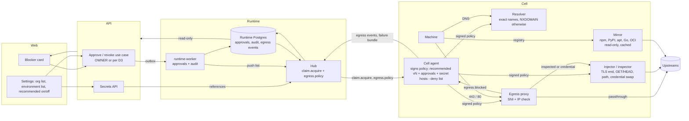

# Egress allowlist: design for review

Status: decided and mostly built (2026-11-13); §16 says what was built, what was left and how
it deploys. Sections 1-15 are the design as reviewed on 2026-11-13: their `path:line`
references are to the code of that day. Every claim about another product cites its own documentation (Sources, at the end).

## 1. Problem

A claim's machines reach only approved hosts. A host off the list fails the setup with an
`external_service:egress:<host>` blocker that an org owner approves for that environment. The real cases:

- demo-nocodb and demo-n8n: `pnpm install` fetches `https://cdn.sheetjs.com/xlsx-0.20.3/xlsx-0.20.3.tgz`, ENOTFOUND
  (measured on the dev cell, 2026-11-13). SheetJS's npm package is stale; its own CDN is the official source
  [sheetjs].
- demo-novu: `npm.taskforce.sh`, the BullMQ Pro registry, which needs a licensed token in `.npmrc` [bullmq-pro]
  ([planner-eval.md](planner-eval.md)). Approving the host alone does not install anything.

The `cdn.sheetjs.com` decision has been open since 2026-11-11, and it holds
H1 at 7/10. The question is not this one host: it is what the default list is,
who widens it, how, and what a widened list costs in exfiltration risk.

## 2. How egress works today

### Enforcement (cell)

| Piece | What it does | Reference |
| --- | --- | --- |
| Resolver | The only DNS the machines have. Answers the claim's exact allowlist and `app.kody.internal`; every other name is NXDOMAIN **without a query leaving the cell**. Logs every query per claim; 50 qps / 200 burst per source. | `internal/resolver/resolver.go:1-7`, `:113-114`, `:324` |
| Egress proxy | The only way out. **Never opens TLS**: reads the ClientHello SNI (or the plain HTTP Host), checks the exact allowlist and the deny list, and that the destination IP is one the resolver handed the claim for that name (or one it resolves now). Refuses ECH, IP literals, IPv6, internal and link-local destinations; plain HTTP is one request per connection. 512 connections per source, 2 min idle, 2 h lifetime. | `internal/egress/proxy.go:1-20`, `:47-51`, `:399-420`, `:427-470` |
| What the proxy cannot see | The method, path, body and the Host inside TLS; HTTP/2 coalescing on a shared CDN address reaches other tenants of that CDN. The file states this as an accepted risk. | `internal/egress/proxy.go:8-13` |
| Policy | Signed per claim by the cell agent (ed25519): exact hosts, **no wildcards**, deny list applied before signing, credential hosts, Go and image pins, secrets as placeholders. A `phase` field (`build` for a setup, `test` for every other claim) is a label on events; the allowlist does not vary by phase. | `internal/policy/policy.go:21-26`, `:43`, `:118-140`, `:161-209`; `internal/agent/egress_policy.go:17-20` |
| Re-push | Every new policy re-checks the claim's live connections and cuts the ones it no longer allows. | `cmd/egress/plane.go:96`, `internal/egress/proxy.go:202-220` |
| Deny list | Over everything (base, approval, secret host): generic object storage, paste and request bins, tunnels, LLM APIs, DoH. | `internal/netguard/deny.go:12-35` |
| Injector | The only holder of a credential. The proxy sends it only the claim's credential hosts; it terminates the machine's TLS with the cell CA, swaps the secret placeholder for the value, goes to the exact address the proxy validated, masks responses, refuses and alerts on a credential or bait going out. Request body cap 16 MiB, response 256 MiB on a credentialed request; a read on the inspected tier (a download, nothing masked) is cut only past `-max-inspected-response-gb` (default 16 GiB). | `internal/injector/injector.go:1-14`, `:78-79`; `internal/policy/secrets.go:11-24` |
| Mirror | Read-only pull-through for **Go modules** (only what `go.sum` pins; no cache) and **Docker Hub images** (only what the Dockerfiles name; content-addressed disk cache shared by all tenants, safe because every blob is checked against its digest; optional Docker Hub account for the rate limit). No npm, PyPI or OS packages. | `internal/mirror/goproxy.go:1-8`, `:24-37`; `internal/mirror/blobstore.go:21-25`; `internal/mirror/cache.go:17-33`; `internal/mirror/credentials.go:11-14`; `cmd/egress/main.go:106-131` |

### Where a claim's list comes from

1. **Cell base list**: the `-egress-allow` flag (`cmd/cell/config.go:255`). No deployment in the tree sets it; only the
   dev script does, with Docker Hub, `registry.npmjs.org` and Debian/Ubuntu/Alpine hosts
   (`scripts/dev-gvisor-cell.sh:69`). Production has no Kodus-owned default list.
2. **Environment approvals**: `runtime_egress_approvals (organization_id, environment_id, host, approved_by,
   approved_at)` (`apps/runtime/src/shared/persistence/runtime-schema.ts:109-116`, `:147-148`), sent in
   `claim.acquire` and pushed again after `claim.ready` and on every new approval
   (`apps/runtime/src/hub/claims/claim-egress.service.ts:20-90`).
3. **Recipe `egress.allow`** is a requirement, never a grant: the cell checks it against base + approvals and blocks
   with `recipe_egress_approval_required` when one is missing (`internal/agent/recipe_requirements.go:31-57`). The
   spec had it widening the list (`egress.allow` "hosts exatos extras"); #2491 made it declaration-only.
4. **Secret hosts**: an org secret's hosts join the list and `credentialHosts` (`internal/policy/secrets.go:72-76`).

Who gets the approvals: setup, base and same-repo PR claims do; **the PR side of a fork never does**
(`claim-egress.service.ts:7-13`), nor its secrets (`apps/runtime/src/hub/claims/claim.service.ts:599`). A sandbox
(agent session) gets **every approved host of the org, across all environments**, plus the git host its caller names,
up to 256 (`claim-egress.service.ts:35-49`).

### Approval flow

Blocker card "Allow `<host>` and set up again" (`libs/runtime/blockers/catalog.ts:957-990`, `who: 'one_click'`) →
`ApplyBlockerFixUseCase` (`libs/runtime/api/application/use-cases/apply-blocker-fix.use-case.ts:95-106`) →
`ApproveEgressUseCase`: `Action.Update` on `RuntimeEnvironment`, which only `OWNER` holds
(`libs/identity/domain/permissions/policies/role-policies.ts:27-28`, `:75`, `:111`); refuses the API's denylist;
writes an outbox command (`approve-egress.use-case.ts:57-110`) → runtime-worker `EgressApprovedHandler` inserts the row
and pushes the full list to live claims (`apps/runtime/src/worker/commands/command-handlers.ts:68-84`). The environment
page lists approvals with who and when (`apps/web/src/app/(app)/runtime/environments/[environmentId]/_page-component.tsx:485-515`).

### Gaps found while reading

- **G1. The spec's default is the mirror, not registries.** §4 of the v18 contract: "Allowlist padrão da VM: só o
  espelho e o resolver da célula. Os upstreams de registry ficam na allowlist do espelho", and the mirror is
  "pull-through só leitura … push é recusado, porque sem abrir TLS só o espelho vê o método", with npm, PyPI, OCI, Go
  and Debian in the MVP (S-03 row: "a allowlist padrão da VM é só o espelho e o resolver … o que tira a CDN
  compartilhada da lista da VM"). The mirror has Go and OCI only, so the dev list puts `registry.npmjs.org` on the VM
  directly, where a publish to the registry is a write the proxy cannot tell from an install (`proxy.go:8-13`).
- **G2. Two deny lists that differ.** The API refuses approving `raw.githubusercontent.com`, `gist.github.com`,
  `gist.githubusercontent.com`, `discord.com`, `*.workers.dev`, `openrouter.ai` and other LLM APIs
  (`libs/runtime/api/domain/egress.ts:12-70`); the cell's `netguard` list has none of them
  (`internal/netguard/deny.go:16-35`). A host the API refuses can still reach a claim through `-egress-allow` or a
  secret's hosts.
- **G3. No revocation.** Nothing deletes from `runtime_egress_approvals` but a dev mock seed; no route, no
  command, no UI.
- **G4. Audit is the row.** `approved_by` + `approved_at`; no reason, no blocker or Run it came from, no list version,
  no revoke event, nothing in the org audit trail.
- **G5. Sandbox approvals are org-wide.** An approval for one environment's setup reaches every agent session of the
  org (`claim-egress.service.ts:35-49`).
- **G6. Secrets do not reach an image build.** The placeholder env goes to compose services' environment
  (`internal/agent/compose_boot.go:63`) and sandbox execs (`internal/agent/org_secrets.go:156-160`); nothing passes it
  to a Dockerfile `RUN npm install`: secrets during a build were missing. To confirm on a
  cell before building, because demo-novu installs in its Dockerfile or a setup step. Built 2026-11-13: §16.
- **G7. No byte budget, shaping or abuse detection.** No `tc`/qdisc in the tree; the proxy counts bytes per connection
  (`proxy.go:482-490`) and globally (`internal/egress/metrics.go:60`) but caps none; CPU, memory and pids are cgroup
  limits (`internal/claimlimits/limits.go`), not detection.
- **G8. A git host in a sandbox is a full write channel.** A sandbox gets its caller's git host (`github.com`) on the
  plain SNI path (`claim-egress.service.ts:35-49`). Code in the machine that brings its own token can push anywhere on
  that host; the proxy cannot tell a fetch from a push (`proxy.go:8-13`).

## 3. What others do

Read on each vendor's own pages (Sources). "Not documented" means the docs say nothing, not that the feature is
missing.

| Product | Default | Recommended list | Entry scope | Method / path control | Phases | Credentials | Blocked request |
| --- | --- | --- | --- | --- | --- | --- | --- |
| GitHub Copilot cloud agent [gh-fw] [gh-list] | Firewall on; "a recommended allowlist is also enabled to allow the agent to download dependencies" | OS repos, container registries, language registries, certificate authorities, Playwright browsers (`registry.npmjs.org`, `pypi.org`, `deb.debian.org`, `ghcr.io`, `objects.githubusercontent.com`, `codeload.github.com`, `ocsp.digicert.com` …) | A domain "and any subdomains", or a URL "limited to the specified path and descendant paths" | Path prefix only | Setup steps (`copilot-setup-steps.yml`) are outside the firewall | Not via the firewall | "a warning is added to the pull request body … or to a comment", with the address and the command |
| Org control (Copilot) | | Enable firewall / Recommended allowlist: Enabled, Disabled, "Let repositories decide" (default) | Org rules "cannot be deleted at the repository level" | | | | "Organization owners can disable this to prevent repositories from adding custom rules" |
| OpenAI Codex cloud (legacy page) [codex-net] [codex-env] | "blocks internet access during the agent phase. Setup scripts still run with internet access" | Presets: None, Common dependencies (~70 root domains), All | Domain allowlist | "restrict network requests to `GET`, `HEAD`, and `OPTIONS`" | Setup online, agent offline | Secrets "are only available to setup scripts … removed before the agent phase starts" | Not documented |
| Claude Code cloud [cc-env] [cc-sbx] | Limited, package managers on | Package registries, GitHub, cloud SDKs | Domain, `*.` for subdomains | GitHub through its own proxy: "rejects branch deletions and pushes of anything other than a branch"; API limited to the session's repositories | Network secrets are never attached to "Setup script requests" | The agent proxy "adds the key to requests for the hosts you list, after each request leaves the session's VM" | Not read |
| Devin [devin-sec] | Not documented | Not documented | Hostnames with `*`, CIDRs | Not documented | | Secrets bound as env vars when needed | Devin "will ask for access"; approval is per session |
| Cursor cloud agents [cursor-net] | "internet access by default" | Default list incl. `*.githubusercontent.com`, `*.docker.io` | Allowlist modes; enterprise "Lock Network Access Policy" | Not documented | Build secrets only in the Docker build | Redacted from transcripts | Not documented |
| E2B [e2b-net] | Open | None | Domains only on 80 (Host) and 443 (SNI); wildcards | Not documented | | Header injection (beta) by the egress proxy, with an E2B CA | "blocked connections may appear successful" |
| Modal [modal-net] | Open | None | CIDR, or TLS domain allowlist (beta); "DNS traffic is allowed without restriction" unless all egress is blocked | Not documented | | | Not documented |
| Fly.io [fly-np] | Open until a rule exists | None | Ports and machines; no domain rules documented | | | | |
| Gitpod / Ona | No egress allowlist in the docs | | | | | | |

What this says for us:

- **Market default**: a recommended list on by default (Copilot, Claude Code, Codex preset, Cursor), an org layer
  that can lock or delegate it (Copilot, Cursor), and SNI/host filtering that the vendors themselves call bypassable:
  Copilot's "Sophisticated attacks may bypass the firewall" [gh-fw]; Claude Code's "the proxy makes its allow decision
  from the client-supplied hostname without inspecting TLS, code running inside the sandbox can potentially use domain
  fronting" and "Allowing broad domains such as `github.com` can create paths for data exfiltration" [cc-sbx].
- **Where we are already ahead**: deny by default with exact hosts (no subdomain wildcards, unlike Copilot, Cursor,
  Devin, E2B, Modal); DNS that never leaves the cell for an unlisted name, where Modal allows DNS freely and E2B
  allows `8.8.8.8`; credentials that never enter the machine (the injector), like Codex's and Claude Code's network
  secrets; a deny list that no approval lifts; the PR side of a fork never gets approvals or secrets.
- **Where we are behind**: no recommended list, no org layer, no method restriction (Codex), no path scoping
  (Copilot), no git-push restriction (Claude Code's GitHub proxy), no revocation, and the blocker card does not tell a
  missing credential from a missing host.
- **Our bet** (section 6): beat the market on the one thing every vendor concedes, a hostname check that cannot see
  the request. Registries go through a read-only mirror (the spec's S-03 design), download hosts through a
  TLS-terminating, GET-only, path-scoped path the cell already has (the injector), and only what neither covers stays
  on SNI passthrough, approved by an owner, audited and revocable. Metric: setups blocked on egress per week, at zero
  write-capable hosts in the default list.

## 4. Threat model

The attacker is the code of a PR (any author for a fork, a compromised dependency for any PR), or content that steers
an LLM agent in a session (repo text, a page, a log line: the "lethal trifecta" of private data, untrusted content and
a way to communicate out [willison]). The asset is the repository's code and anything in the machine: the repo token,
secret placeholders, decoys. What the cell can enforce depends on whether it opens TLS:

| Threat | Today's control | Residual |
| --- | --- | --- |
| Write to a generic store (S3, GCS, paste, request bin) | Deny list over every source (`netguard/deny.go:16-35`); S-04 | Stores the deny list does not name; G2 drift |
| **Write through an allowed write-capable host**: `npm publish`, `twine upload`, a git push, a GitHub API call (gist, issue, repo) with a token the code brings. MITRE T1567.001: "Adversaries may exfiltrate data to a code repository" [mitre-1567]. The 2025 npm worm reportedly re-published packages with stolen tokens and wrote to public GitHub repos [wiz-shai]. | None: the proxy sees the name, not the method (`proxy.go:8-13`) | **Open** for every direct registry and git host. The spec's answer is the read-only mirror ("push é recusado, porque sem abrir TLS só o espelho vê o método") |
| Right host, wrong tenant: the attacker's own account on an allowed API (the Claude Code Interpreter case, files uploaded to `api.anthropic.com` under an attacker's key [er-anthropic]) | LLM APIs on the deny list (`deny.go:21`) | Any allowed SaaS API with write endpoints; applies to every approval of an app API |
| DNS tunneling (CVE-2025-55284 exfiltrated through DNS lookups [er-dns]) | Resolver answers only exact allowed names, NXDOMAIN with no upstream query (`resolver/resolver.go:1-7`, `:324`); only 53/udp to the egress address leaves a bridge (`docs/runtime/isolation-architecture.md:346-348`); DoH hosts denied; S-03 | None for unlisted names; an allowed name cannot carry a subdomain (exact match, `policy.go:443-451`) |
| Domain fronting: SNI of an allowed host, Host of another on the same CDN [wiki-df]; "domainless" fronting with a blank SNI [mitre-1090] | ECH refused, blank SNI refused (`proxy.go:399-406`), IP must be one handed for that name (`proxy.go:427-470`). Google, Amazon and Cloudflare block SNI/Host mismatch [wiki-df] (Cloudflare answers 421 [cf-421]) | Accepted risk by name in the spec (§4 "Domain fronting numa CDN compartilhada fica como risco aceito … até o Inc. 5") and in `proxy.go:8-13`. Closed only where the cell terminates TLS |
| Broad entries (`*.amazonaws.com` reaches "public S3 buckets, API Gateway and Lambda URLs" [aws-agents]) | No wildcards at all (`policy.go:120-127`) | None |
| Malicious or vulnerable dependency (Codex's "Downloading malware or vulnerable dependencies" [codex-net]) | Go and images pinned by the checkout (`mirror/goproxy.go:1-8`) | npm/PyPI direct and unpinned; not an egress problem alone (the PR chooses its lockfile) |
| Credential exfiltration | Injector, placeholders, baits, alerts (`injector/injector.go:1-14`); S-29, S-50 | A credential host's own write endpoints (a registry token that can publish) |
| Rebinding to internal addresses | `netguard.RefusedDestination` on every answer (`proxy.go:446-452`) | None found |

## 5. Options

| | A. Curated direct list | B. Mirror for registries | C. Intercept everything | D. Customer's dependency proxy |
| --- | --- | --- | --- | --- |
| What | Kodus list of registry hosts in every claim's SNI allowlist (what the dev script does) | npm, PyPI, apt/apk join Go and OCI in `internal/mirror`; machines point at `mirror.cell.internal` | Every host through a TLS-terminating proxy with method/path rules | The org's Artifactory/Nexus/Verdaccio as one credentialed host |
| Write exfil through registries | **Open** | Closed: read-only | Closed | Depends on the customer's proxy |
| Fronting on registry CDNs | Open | Closed (the VM never names the CDN) | Closed | Closed for that host |
| Rate limits | Per claim, per cell IP | One fetch per artifact per cell (cache) | Same as A | Customer's |
| Breaks | Nothing | Tools that ignore the registry setting (a tarball URL in a lockfile, a postinstall that downloads a binary) | Clients with their own trust store or pinning; every connection pays a handshake; the proxy holds plaintext of all traffic | Orgs without one |
| Cost | Small | Medium: two ecosystems and OS repos in Go, or Verdaccio/devpi as the spec chose | Large; contradicts ADR-056's "the proxy never opens TLS" | Small for us (it is a secret + a host) |

Artifactory remotes are caching proxies that hold the upstream credential ("The user name for accessing the URL of
the remote repository") [jfrog-remote]; Nexus "proxy repository caches content from a remote repository" [nexus];
Verdaccio uplinks take `auth: { type: bearer, token_env: … }` and cache tarballs [verdaccio]. D is a supported
configuration, not a default: most orgs on the corpus have none.

## 6. Recommendation

One design, in four tiers, built in the order of section 13:

1. **Mirror tier** (B). Public registries are reached only by the mirror: npm, PyPI, Debian/Ubuntu/Alpine, with Go and
   Docker Hub as today. Read-only; machines get `npm_config_registry`, `PIP_INDEX_URL`, apt sources and
   `GOPROXY` pointing at `mirror.cell.internal`. The upstream hosts never enter a claim's policy. This is the spec's
   S-03 design and closes the write channel and the CDN fronting for every registry.
2. **Inspected tier** (new, reuses the injector). A host whose use is downloading (`cdn.sheetjs.com`, GitHub release
   downloads, Playwright browsers) goes the way a credential host goes today: the proxy hands it
   to the injector (`proxy.go:355-358`), which terminates TLS with the cell CA the machines already trust
   (`internal/machinetrust/machinetrust.go:44-57`) and checks the Host itself. New: it allows only `GET`/`HEAD`, only
   under the entry's path prefixes, with a body cap of zero up. A credentialed host is an inspected host with a
   credential. This is Codex's method restriction plus Copilot's URL entries, enforced where the request is visible.
3. **Passthrough tier** (today's behaviour). SNI-only, for hosts that need writes or that break under the cell CA (an
   app's own API at boot). Never in the recommended list; owner approval only; the card says it is the risky choice.
4. **Deny list** over all three, one list in one place (G2).

Then the four things the owner agreed to explore, on top:

- **Recommended list**: Kodus-maintained, versioned, on by default; mostly mirror and inspected entries (section 7).
- **Org and environment lists** on the screen, with an org setting on who may change them (section 9).
- **One-click approval** from the blocker, which defaults to the inspected tier, audited and revocable (section 9).
- **"Needs a credential"** detection that points to Settings → Secrets, with secrets reaching the build (section 10).

For the two cases now: `cdn.sheetjs.com` becomes a recommended inspected entry with path prefix `/xlsx-` (the
official install is `npm i --save https://cdn.sheetjs.com/xlsx-0.20.3/xlsx-0.20.3.tgz` [sheetjs]); until the
inspected tier exists, an owner can approve it per environment today with the existing one-click (passthrough, read
the risk in section 4: a static CDN host, so the residual is fronting through its CDN). `npm.taskforce.sh` is a
secret, not an approval (section 10). **Decision D1.**

How the pieces meet across web, API, runtime and cell:

## 7. The recommended list

### Contents (v1, v2)

Built from what Copilot, Codex and Claude Code ship [gh-list] [codex-net] [cc-env], cut to exact hosts and to what our
own denied-host data asks for (`libs/runtime/blockers/catalog.ts:146` already names the registries the catalog
recognizes). Each entry names its tier.

| Ecosystem | Hosts | Tier | Note |
| --- | --- | --- | --- |
| npm / Yarn | `registry.npmjs.org`, `registry.yarnpkg.com`, `repo.yarnpkg.com` | mirror | |
| PyPI | `pypi.org`, `files.pythonhosted.org` | mirror | |
| Go | `proxy.golang.org`, `sum.golang.org` | mirror (today) | `mirror/goproxy.go` |
| Docker Hub | `registry-1.docker.io`, `auth.docker.io`, `production.cloudfront.docker.com` | mirror (today) | `mirror/oci.go`; GHCR and Quay are not mirrored yet: **Decision D6** |
| Debian / Ubuntu / Alpine | `deb.debian.org`, `security.debian.org`, `archive.ubuntu.com`, `security.ubuntu.com`, `ports.ubuntu.com`, `dl-cdn.alpinelinux.org` | mirror | |
| GitHub release downloads | `github.com` (paths `/<owner>/<repo>/releases/download/`, `/<owner>/<repo>/archive/`), `codeload.github.com`, `objects.githubusercontent.com`, `release-assets.githubusercontent.com` | inspected | All four appear in Copilot's or Codex's lists; git push and the API stay out |
| Known package CDNs | `cdn.sheetjs.com` (path `/xlsx-`) | inspected | SheetJS's npm is out of date [sheetjs] |
| Browsers for tests | `cdn.playwright.dev` | inspected | On Copilot's list [gh-list] |
| Web fonts (v2) | `fonts.googleapis.com` (path `/css`), `fonts.gstatic.com` (path `/s/`) | inspected, build passthrough | Added 2026-11-13 (owner's approval): `next/font/google` downloads the stylesheet and the font files at `next build`, so a Next.js app that imports it could only run `next dev` (demo-nextjs). Both serve GET only, with no write API and no user content: the same case as the other read-only CDNs, so a build reaches them uninspected and a machine through the inspected tier |

Deliberately out: `raw.githubusercontent.com`, `gist.*`, `*.githubusercontent.com` (serve any user's content; the API
already refuses them, `egress.ts:32-34`), `api.github.com` and git push (write channels, G8), telemetry hosts (a calcom
build was denied five and needed none of them, `catalog.ts:557-561`), certificate status hosts (`ocsp.*`, `crl*`: on
Copilot's list; add only if a denied-host count shows a client that fails without them), anything with a wildcard.
Candidates waiting on our own denied-host data, not in v1: `nodejs.org` under `/dist/` (Node headers for native
builds; payload's setup stops on a node-gyp toolchain, cause not yet read as
egress), GHCR and Quay (D6).

### Maintenance

- One versioned file in the repository, read by both the Go cell and the TypeScript API (the same way the protocol
  schema is shared, `libs/runtime/protocol`): entry = host, ecosystem, tier, path prefixes, why, upstream doc link,
  version added. Versions are immutable; a change is a PR that a security code owner approves.
- The deny list moves into the same file (closes G2); the API's refusal and the cell's `netguard` read one list.
- The cell embeds the version it was built with and names it in `hello`; the signed policy carries
  `recommendedVersion`, so "which list was in force for this claim" is answerable from the audit.
- Candidates come from data, never automatically: the weekly top denied hosts across orgs (the hub already stores
  `runtime_egress_events`), each read by a person before it becomes an entry.
- Self-hosted: the same file ships in the release; `-egress-allow` stays as the operator's own addition, and the org
  setting below can turn the recommended list off.

## 8. Per-phase policy

Today the phase is a label (`agent/egress_policy.go:17-20`); one claim has one list. The pieces to vary it exist: a new
policy can be pushed at any time and the proxy cuts what it no longer allows (`cmd/egress/plane.go:96`,
`proxy.go:202-220`).

| Phase | Whose code | Gets | Does not get |
| --- | --- | --- | --- |
| Setup (bake) | Default branch, recipe from the default branch | Mirror, recommended inspected, org + environment lists, org secrets' hosts | Passthrough hosts nobody approved |
| Run, build (PR side and base) | The PR: untrusted for a fork, trusted-ish for the same repo | Same repo: as setup. Fork PR side: mirror and recommended only, no approvals, no secrets (today, `claim-egress.service.ts:7-13`) | — |
| Run, test (app up, probes running) | The app built from the PR | Environment passthrough hosts the app calls at runtime; the mirror stays (harmless, read-only); any denial makes the Run partly tested (the spec's verdict table: "o proxy negou uma saída durante o teste"); its check is `action_required` since 2026-11-18, or neutral where the org chose that fallback | Recommended inspected download hosts (a running app does not install) |
| Agent session (sandbox) | An LLM steered by repo content | Mirror, recommended inspected, the session's own list, the git host **inspected with fetch only**; of the operator's base list (`-egress-allow`) only the hosts an inspect rule covers (read-only), never ghcr.io, rubygems.org or crates.io raw, and `proxy.golang.org` / `sum.golang.org` only when the caller asked (`agent.SandboxBase`) | The org's environment approvals (closes G5); passthrough; git push except through the product's own path |

On the Codex split (setup online with secrets, agent offline [codex-net] [codex-env]): it fits Codex because its
setup script is the environment owner's and its agent phase is the only untrusted one. For us the untrusted code is a
PR, which must install what its own lockfile names, so "offline after setup" would make every dependency PR fail. The
split that matches our threat model is install vs run: installs need registries (made safe by the mirror's read-only
path), a running app needs only its declared APIs. Secrets "only during setup" matter less for us because the value
never enters the machine; what we take from Codex is the method restriction, applied per tier instead of per phase.
**Decision D4** (whether to split build/test inside one PR claim; it costs a policy push at the build→boot boundary).

## 9. Screens, blocker and approval audit

### Settings

- **Org → Runtime → Outbound access** (new): "Use the Kodus recommended list" (on; the version and its entries
  listed read-only); "Org allowlist": hosts every environment of the org gets, each with tier; "Who may add hosts to an
  environment": Owners only (today's rule, `role-policies.ts:27-28`) / Owners and repo admins of the environment's
  repositories / Nobody (org list only). Mirrors Copilot's "Let repositories decide" and "prevent repositories from
  adding custom rules" [gh-fw]. **Decisions D2, D3.**
- **Environment → Approved outbound hosts** (exists, `_page-component.tsx:485-515`): each row gains its tier, where it
  came from (blocker, settings), and a Revoke button (G3). The empty state names the recommended list's version.

### Blocker card states

| State | How the cell knows | Card | Buttons |
| --- | --- | --- | --- |
| Host not allowed, approvable | `egress.blocked` `not_allowed`, or an unresolved registry in the log (`catalog.ts:930-990`) | "The build tried to reach H" + the log line | **Allow H for this environment** (inspected by default; "full access" behind a second step with the risk text), **Allow for the org** (when D3 permits), **Use a fake** (non-registry) |
| Needs a credential | Host allowed or recommended and the log has an auth failure (`npm ERR! code E401`, `ERR_PNPM_FETCH_401`, HTTP 401/403 from pip), or the checkout's `.npmrc` names `//H/:_authToken=${VAR}` with no org secret named `VAR`; on the inspected tier the cell sees the 401 itself | "H needs a credential. Your `.npmrc` reads it from `VAR`." | **Create secret `VAR` for H** (opens Settings → Secrets prefilled with name and host); no "allow" (an allow alone fixes nothing) |
| Kodus deny list | `platform: true` in the bundle (`resolver.go:39-41`) | As today (`catalog.ts:937-956`) | Mirror or fake, never allow |
| Fork PR | Claim is a fork's PR side | "Approvals and secrets never reach a fork's code" | None; an owner can re-run on a same-repo branch |

A user who cannot approve sees "Ask an owner" with a link to the card. The approve call stays the existing one
(`apply-blocker-fix.use-case.ts:95-106`), with the tier added.

### Audit

`runtime_egress_approvals` gains `mode` (inspected | passthrough), `path_prefixes`, `revoked_at`, `revoked_by`. A new
append-only `runtime_egress_audit` row per approve, revoke and setting change: org, scope (org | environment |
sandbox), environment, host, tier, actor, at, source (blocker signature with its setup or Run id, or settings),
recommended-list version, optional reason. Written by the runtime-worker from the outbox command, like the approval
today (`command-handlers.ts:68-84`); shown on the environment page, in the same record shape the secrets use case writes for its own audit
(`libs/runtime/api/application/use-cases/secrets.use-cases.ts:89`). Revoking pushes the new list to live claims,
which cuts their connections to the host (`proxy.go:202-220`). Expiry of unused approvals: **Decision D5**.

## 10. Private registries and secrets

The path exists end to end for a running service: an owner creates a secret with its hosts (owner only, audited), the
hub sends references in `claim.acquire`, the cell gives each claim a placeholder as an env var, signs the hosts into
the policy, and the injector swaps it on those hosts only (`agent/org_secrets.go:17-38`;
`policy/secrets.go:72-76`). For demo-novu: secret `NPM_TASKFORCESH_TOKEN`, host `npm.taskforce.sh`, and the repo's
`.npmrc` as BullMQ documents it, `//npm.taskforce.sh/:_authToken=${NPM_TASKFORCESH_TOKEN}` [bullmq-pro]. npm expands
the env var [npmrc]; the machine sends a placeholder; the injector puts the token on the wire.

What is missing, to confirm on a cell before building:

1. **The build does not get the placeholder** (G6). The compose boot adds secret env to services
   (`agent/compose_boot.go:63`), not to a Dockerfile `RUN`. The fix is a BuildKit secret mount per secret (the
   placeholder never lands in a layer) or the recipe's setup steps' env, plus the cell CA in the builder's trust.
   Built as the BuildKit secret mount (§16).
2. **A private registry's token can usually publish.** On the inspected tier the injector allows `GET`/`HEAD` only, so
   a credential host that is a registry is read-only even with a write-capable token.
3. **Fork PRs.** A fork's PR side never gets secrets (`claim.service.ts:599`), so it cannot install a private package.
   The spec's answer is a per-org private cache ("pacote privado … fica num cache por org. Na célula gerenciada nenhum
   pacote de uma org é servido a outra", §4 mirror): the base bake's packages, served read-only to the org's later
   claims. **Decision D7.**
4. **Mirror cache keys.** Public artifacts can share one cache because each is checked against its digest or lockfile
   hash (`mirror/blobstore.go:21-25`). A private package must be keyed by (org, upstream host, name, version) and never
   answer a public name (dependency confusion), which is the spec's per-org rule.

## 11. Rate limits, bandwidth and abuse

- **Rate limits and IP reputation.** Many claims leave from one cell address. Today: the Docker Hub mirror caches and
  can pull with an account (`mirror/credentials.go:11-14`); Go has no cache (`mirror/goproxy.go` has no store), and
  npm/PyPI go direct per claim. The mirror tier fixes most of it (one fetch per artifact per cell); authenticated
  upstream pulls next; IP pools only if the mirror's upstream 429 count says so (section 14). Codex publishes shared
  egress ranges [codex-env]; Cursor advises against IP allowlisting as the main control [cursor-net].
- **Bandwidth.** No shaping in the tree (G7). Recommend a per-claim **upload** byte budget in the proxy, per phase
  (installs download; exfiltration uploads), cutting the connection and raising `egress.blocked` with reason
  `upload_budget`; `tc` shaping per tap only for fairness on shared hosts, not as a security control.
  Numbers from measured p99 of `bytesUp` (`proxy.go:482-490` already logs it per connection). **Decision D8.**
- **Abuse.** Mining needs a pool host; with exact hosts and 80/443 only (`isolation-architecture.md:346-348`) that is
  a passthrough approval away, so detection is cheap insurance: sustained CPU at quota per claim from the cgroup the
  cell already owns (`internal/claimlimits`; spec case S-27 is absent today), and scanning as distinct denied names per
  claim per minute from the resolver's query log (`resolver.go:27-44`). Alert, do not block, until measured.

## 12. Security cases

Existing cases this design leans on: S-03 (every exit denied, DNS, DoH, IPv6), S-04 (storage denied, new domain asks an
admin), S-20 (injection changes no egress), S-29 and S-50 (credentials), S-39 (registry push refused: today only true
for Go and OCI, `cmd/egress/main.go:106-131`). New cases, each a test on a real cell:

| Case | Setup | Pass |
| --- | --- | --- |
| S-53 Publish through the default list | A setup that runs `npm publish`, `twine upload` and `git push` to the recommended hosts with its own tokens | All refused; `egress.blocked` for each |
| S-54 Approval scope | Approve H for environment A | Reaches A's setup and same-repo PR claims; not B's claims, not A's fork PR side, not an agent session |
| S-55 Revocation | Revoke H while a claim holds a connection to it | Connection cut within one policy push; next claims never resolve H |
| S-56 Inspected tier | `POST`, `PUT`, a path outside the prefix, Host ≠ SNI to an inspected host | Refused; the allowed `GET` succeeds |
| S-57 Git as a channel | From a sandbox, push to another repo on the git host with a token the code brought | Refused; fetch of the session's repository works |
| S-58 Needs a credential | Private registry host with no secret | Card says "needs a credential", names the variable, offers no allow |
| S-59 One deny list | Every host the API refuses | The cell refuses it from every source (base, approval, secret host) |
| S-60 Upload budget | A claim that uploads past its budget to an allowed host | Cut, event, Run partly tested |

## 13. Migration

Every step ships behind the same claim protocol feature mechanism the hub already uses (`protocol/features.go`), so an
older cell keeps today's behaviour. All steps are part of this design; the order only keeps every step shippable.

1. One deny list file for API and cell (G2) and its test (S-59).
2. Recommended list v1 file; until the mirror has npm/PyPI/apt, those entries are emitted as passthrough so nothing
   regresses against the dev list (`scripts/dev-gvisor-cell.sh:69`); S-53 stays red until step 6. Existing approvals
   stay as passthrough rows.
3. Revoke, tiers on approval rows, audit table, settings screen (G3, G4).
4. Sandbox scope: sessions stop inheriting the org's environment approvals (G5); git host inspected, fetch only (G8).
5. Needs-a-credential card and secrets in the build (G6).
6. Mirror npm, PyPI, apt/apk; recommended registry entries flip to mirror; S-53 green; registries leave every policy.
7. Inspected tier in the injector; `cdn.sheetjs.com`, GitHub downloads and the rest flip to inspected; approvals
   offered as inspected by default; S-56, S-57 green.
8. Phase split in PR claims if D4 says so; upload budget (D8).

## 14. Metrics

| Metric | Source | Watch for |
| --- | --- | --- |
| Setups ending on an egress blocker per week, by class (approvable / credential / denied / fork) | blocker signatures | Falls after steps 2 and 5 |
| Time from egress blocker to the next setup that passes | blocker + setup timestamps | Approval friction |
| H1 boot rate on the corpus | `docs/runtime/measurements-*.md` | n8n and nocodb unblocked |
| Write-capable hosts reachable in the default policy | the recommended file | Zero after step 6 |
| Approvals by tier, revocations, approvals never used in 30 days | audit table + `egress.allowed` | Passthrough share should fall |
| Runs partly tested from test-phase denials | verdict reasons | Apps that need a declared API |
| Mirror hit rate, upstream 429/5xx per host | mirror metrics (`/metrics/mirror`) | Rate-limit pressure, IP pools |
| `bytesUp` p99 per claim per phase, distinct denied names per claim | proxy and resolver logs | Budget sizing, scanning |
| Inspected-tier refusals by reason (method, path, Host mismatch) | injector | Misfit entries vs attacks |

## 15. Decisions for the owner

Decided by the owner on 2026-11-13; each answer is the recommendation, as built in §16.

- **D1.** `cdn.sheetjs.com` is a recommended inspected entry, GET/HEAD under `/xlsx-`, in production. No approval on the
  dev environment by this change: that is a step of the consolidated deploy.
- **D2.** The org may turn the recommended list off; the screen warns first.
- **D3.** Owners, owners and the repo admins of the environment's repositories, or nobody (org list only): the org
  chooses; owners only by default.
- **D4.** Install and run split inside a PR claim: the recommended hosts leave a PR or base claim once its build, boot
  and recipe steps are done.
- **D5.** Approvals do not expire; they are revocable and the screen shows when a claim last got each one.
- **D6.** GHCR and Quay mirror after npm and PyPI; design only here (§16).
- **D7.** A fork's PR side never gets approvals or secrets; it ends partly tested and says why. Extended by the owner on
  2026-11-18: any PR whose boot fails because the egress proxy denied it a host is not a regression. What decides is the
  proxy's own record, never the PR's output: the hosts the hub recorded as denied to the Run's PR claims
  (`egress.blocked`, `runtime_egress_events`) and never to its base claims, that an approval could open (not the
  platform deny list, not a reverse lookup, not a tool's telemetry). The Run is partly tested, every behavior path is
  blocked by `external_service`, the boot failure is the "approve this host" card (`external_service:egress:<host>`,
  `deniedHosts`), and the check is `action_required` whatever the org's partly tested fallback: never green and never
  neutral. A PR boot with no such record stays a regression (S1-01). The failed claim's bundle carries the same record
  as `deniedEgress` (`apps/runtime-cell/internal/agent/bundle.go`; a Run claim's holds only that), and the worker
  reads both (`worker/run/run-orchestrator.ts` `settleBoot`, `libs/runtime/blockers/rules/egress.ts`
  `prOnlyDeniedHosts`).
- **D8.** Upload budget per claim, observe only first (measure, log, count; never cut).
- **D9.** The mirror is our own Go mirror in `internal/mirror`.

## 16. What was built (2026-11-13)

| Item | Built | Where |
| --- | --- | --- |
| G2 one deny list | `libs/runtime/protocol/egress-lists.json`, byte copy embedded in the cell; both sides run its cases and check the copy | `internal/netguard/lists.go`, `libs/runtime/protocol/egress-catalog.ts`, `libs/runtime/api/domain/egress.ts` |
| Recommended list v1 | Same file, versioned, 22 hosts with tier and paths; on by default (`-egress-recommended`), off per org (D2) | `internal/netguard/lists.go`, `cmd/cell/main.go` `policyOf` |
| G1 inspected tier | Policy `inspected` + `inspectSources`; proxy checks plain HTTP itself and sends TLS from trusted sources to the injector; injector lets only GET/HEAD under the paths, no body, Host = SNI, URI ≤ 4 KiB, git push refused | `internal/policy/inspect.go`, `internal/egress/proxy.go`, `internal/injector/inspect.go` |
| Cell CA for inspection | Every claim the cell boots trusts the cell CA when it inspects; only those machines are inspect sources | `internal/agent/org_secrets.go`, `internal/agent/egress_policy.go` |
| G1 mirror (D9) | npm under `/npm/`, PyPI under `/pypi/`: GET/HEAD only, index URLs rewritten to the mirror, publish/login/token/search/audit routes and credentialed requests refused; build args `npm_config_registry`, `PIP_INDEX_URL` | `internal/mirror/packages.go`, `internal/drivers/dockergvisor/build.go` |
| G5 sandbox scope | A sandbox gets the approvals of the `sandbox` environment and its caller's git host, never another environment's nor the org list | `apps/runtime/src/hub/claims/claim-egress.service.ts` |
| Protocol `egressTiers` | `egressInspect`, `egressRecommended` in claim/sandbox acquire, `inspect` in egress.policy; gated by the cell feature | `libs/runtime/protocol/messages.ts`, fixtures `*egress-tiers*`, `*egress-inspect*` |
| Tiers, revoke, audit, org list (G3, G4, D5) | Migration 32; commands `egress_revoked`, `egress_settings_changed`; hub re-reads approvals per push, records last use | `runtime-schema.ts` v32, `command-handlers.ts`, `hub-store.ts` |
| D3 who may add | `RuntimeEgressAccess`; routes for owner or repo admin, the use case applies the org setting | `libs/runtime/api/application/egress-access.service.ts` |
| One-click approve | Inspected (`/`) by default; full access is the card's second step with the risk text; audited with the blocker signature and setup | `apply-blocker-fix.use-case.ts`, `blocker-card.tsx` |
| Needs a credential (S-58) | 401/403 of an installer or npm's `Failed to replace env in config: ${VAR}` → card with host and variable, link to Settings, Secrets prefilled; no allow | `libs/runtime/blockers/catalog.ts`, `runtime-secrets.tsx` |
| Screens | Environment approvals with tier, source, last use, Revoke; Settings, Runtime, Outbound access (recommended list, who may add, org list, audit) | `apps/web/src/core/components/runtime/egress-access.tsx` |
| D4 | New preparation step `running`: a PR or base claim drops the recommended hosts; the phase label and the verdict's test-phase denials unchanged | `internal/agent/prepare.go`, `egress_policy.go` `RecommendedOn` |
| D7 | Fork PR side's boot failure title says approvals and secrets never reach a fork. A PR boot the proxy's record shows it stopped (a host denied the PR's claims and not the base's) is partly tested with the approve-host card and an `action_required` check; any other PR boot failure the cell or hub did not declare is a regression | `libs/runtime/run/boot-failure.ts`, `apps/runtime/src/worker/run/run-orchestrator.ts` `prBootDenied`, `libs/runtime/blockers/rules/egress.ts` |
| D8 | `-upload-budget-mb` (64), observe only: logged once per claim and counted | `internal/egress/upload_budget.go` |
| G1 from a build, option (a) | The cell's builder (`KODUS_REVISION=2`) gives every RUN the cell's trust bundle; its address is an inspect source: TLS to an inspected registry goes through the injector, a publish is refused there, a repository's own Dockerfile installs without the mirror ARGs | `builder-image/exec-ca-bundle.patch`, `internal/policy/build.go`, `internal/dockercli/dockercli.go` `RunBuild` |
| G6 secrets in a build | A build gets, as BuildKit secrets holding the placeholder, only the claim secrets it asks for (compose `build.secrets`, Dockerfile `RUN --mount=type=secret`); one that asks for none gets none. The injector swaps the placeholder toward the secret's host only | `internal/compose/sandbox/build_secrets.go`, `internal/drivers/dockergvisor/build.go` `askedSecrets`, `internal/driver/build_secrets.go`, `dockercli` `BuildRun.Secrets` |

### Security cases

| Case | Test (lowest layer) | Needs a real cell for |
| --- | --- | --- |
| S-53 publish | `policy/inspect_test.go` (PUT refused), `injector/inspect_test.go` `TestS53…`, `mirror/packages_test.go` `TestS53…`, `egress/build_test.go` `TestG1…` (an untrusted build's TLS to an allowed registry refused) and `TestATrustedBuild…` (a trusted build's goes to the injector); on runsc `gvisoregress` `TestATrustedBuildIsInspected…` (a Dockerfile `npm publish` meets the injector's 403) | `npm publish`, `twine upload` from a machine |
| S-54 approval scope | `cell-hub.sandbox.spec.ts` (G5), `cell-hub.spec.ts` (org list, fork skip), `egress-commands.spec.ts` (org list never a sandbox) | A's setup and same-repo PR vs B, fork, session on one cell |
| S-55 revocation | `egress-commands.spec.ts` `S-55…`, `egress/proxy_conn_test.go` (cut on a narrower policy), `cell-hub.spec.ts` (push re-reads approvals) | The cut within one push on a live connection |
| S-56 inspected tier | `policy/inspect_test.go`, `egress/inspect_test.go`, `injector/inspect_test.go` (POST, PUT, off-path, Host ≠ SNI refused; GET goes); on runsc a build's `npm view`, `npm install` and `pip download` through the injector (`gvisoregress`, below) | A machine's npm/pip through the injector with the mounted CA |
| S-57 git as a channel | `policy/inspect_test.go` `TestS57…` (the rule: push refused, fetch allowed) | Not wired: the sandbox's git host is still passthrough (left, below) |
| S-58 needs a credential | `blockers/__tests__/credential-card.spec.ts`, `blocker-card.spec.tsx` | The demo-novu setup with and without the secret |
| S-59 one deny list | `netguard/lists_test.go` (`TestS59…`, shared cases), `egress-catalog.spec.ts` | None |
| S-60 upload budget | `egress/upload_budget_test.go` `TestS60…` (observe: logged once, not cut) | Measured `bytesUp` p99 before a number and enforcement |

### Left, and why

- **Registries stay on the policy** (inspected) next to the mirror: yarn v1 lockfiles and Dockerfiles without the ARG
  name the registry itself. The mirror does not pin by lockfile yet, and has no cache for npm/PyPI files (one fetch per
  request); a private package never enters it (credentialed requests are refused), so no per-org cache exists to key.
- **Injector refusals are logs and a metric** (`cell_injector_inspected_requests_total`, `injector.inspect.refused`),
  not `egress.blocked` events in the failure bundle. A build's refused publish shows as the tool's own `403` in the
  build log.
- **G8/S-57 wiring**: the fetch-only git rule exists; the sandbox's git host is not switched to it because the
  product's own push path from a session was not confirmed.
- **apt/apk mirror**: not built; their plain HTTP is inspected (GET/HEAD) by the proxy from every source.
- **D6 GHCR/Quay**: design only. The OCI mirror's `/v2/` handler takes one registry; a second needs a prefix
  (`/v2/ghcr.io/…`) or a host-routed mirror, the token flow of each registry, and pins from the Dockerfiles' `FROM
  ghcr.io/...`; the blob store is already content-addressed and safe to share.
- **D8 enforcement**: the budget only observes; a cut and a neutral Run wait on measured numbers.
- **The builder digest on a GitHub runner**: revision 2 is pinned from an amd64 host (two identical builds); the same
  host rebuilt revision 1 as `e704b2d1…`, not the pinned `f4c8f1e1…` the dev VM gave, so the pull-request job's first
  run confirms or moves the pin (`builder-image/README.md`).
- **A secret named in the compose file's `build.secrets`**: read since 2026-11-13 (next section, "Each build gets only
  the secrets it asked for"). Kody's own compose files still may not name one (`authored-files-policy.ts` keeps
  `build` to context, dockerfile, target and args): Kody's Dockerfiles mount the secret, which is enough.
- **Not proven through the product**: the runs below are the driver, the egress and the injector on the KVM host, not a
  Run on a cell with the hub (no deploy in this change).

### G1 from the image build (closed 2026-11-13)

A Dockerfile `RUN npm publish` went out: the builder's RUN steps keep their base image's trust store, so the cell
could not inspect them and let their TLS through as SNI passthrough. Two ways were weighed:

- **(a) The build trusts the cell CA.** Nothing in BuildKit does it without the Dockerfile asking: `buildkitd.toml`
  has no option that adds env, mounts or a CA to every RUN container (its `ca` is for registry connections)
  [buildkitd-toml]; a CDI device reaches a step only through `RUN --device` and the `device` entitlement [dockerfile];
  the only build args a RUN gets undeclared are the proxy ones (`HTTP_PROXY` … `ALL_PROXY`) [dockerfile]. So it takes
  a change to our BuildKit's executor in `builder-image`, a new image digest, and a run under runsc to prove it. Built
  later the same day: the next section.
- **(b) The build gets no TLS passthrough** — built. The builder's address is a build source of the signed policy
  (`policy/build.go`): over TLS it reaches only `buildPassthrough`, the recommended list's read-only CDNs with no
  write API (`"build": "passthrough"`: OS package mirrors, `files.pythonhosted.org`, the Go proxy, release download
  CDNs, `cdn.sheetjs.com` for D1), an owner's full-access approvals and the operator's `-egress-build-passthrough`;
  over plain HTTP it reaches an inspected host under its rule (GET/HEAD) or the same list. Everything else is refused
  as `build_needs_inspection`. The registries, `github.com` and Docker Hub are never reached from a build: npm and pip
  go through the read-only mirror (the cell passes `npm_config_registry`, `PIP_INDEX_URL`, `GOPROXY` as build args;
  npm rewrites the lockfile's registry host to it by default [npm-config]), images through the registry mirror.
  `kodus_egress_inspect_bypassed_total` no longer counts the build (`egress/build_test.go`).
- **The card loop** (`github.com`, `registry.yarnpkg.com`): a host refused to a build gets the build card
  (`external_service:build_egress:<host>`): install through the mirror (registries) or fetch at run time, and "Give
  the build full access" (`approve_full:`), a passthrough approval with the risk written, an owner's decision. The
  reads-only allow is never offered there.
- **Kody's Dockerfiles declare the mirror's build args** (`recipe-author/authored-dockerfile-mirror.ts`): once a
  submission is accepted (so every error still names Kody's own lines), each stage that runs npm, pnpm, yarn,
  corepack, pip, uv or a `go` install gets `ARG` lines right after its `FROM`, from the shared list
  (`egress-lists.json` `mirrorBuildArgs`, the same names the cell passes, `mirror_args_test.go`): `npm_config_registry`
  (npm reads `npm_config_*` [npm-config]), `pnpm_config_registry` (pnpm reads `pnpm_config_*` [pnpm-npmrc]),
  `YARN_NPM_REGISTRY_SERVER` and `YARN_UNSAFE_HTTP_WHITELIST` (Yarn Berry reads `YARN_<SETTING>`; HTTP is refused
  unless the host is on `unsafeHttpWhitelist` [yarnrc]), `PIP_INDEX_URL` and `PIP_TRUSTED_HOST` (pip reads
  `PIP_<OPTION>` [pip-config]), `UV_DEFAULT_INDEX` and `UV_INSECURE_HOST` [uv-env], `GOPROXY`. An `ARG` with no
  value stays unset, so a cell without the mirror builds as before. A recipe that booted and is reused gets them too.
  The repair path does the same: a registry refused to a build (`external_service:build_egress:<registry>`) is
  repairable (`environment-setup.repairs.spec.ts`), and the repaired Dockerfile goes through the same step.
- **Cost**: with a builder that is not ours, a build of the repository's own Dockerfile (not Kody's) that installs
  without declaring the ARGs fails with the build card; Kody cannot change that file, only write its own under
  `.kodus/`. Yarn v1 and Bun are not covered. `-egress-build-passthrough registry.npmjs.org` puts the old behaviour
  back for an operator who accepts it. The cell's own builder (revision 2) removes this cost: the next section.

### G1 option (a) and G6: the build trusts the cell CA (built 2026-11-13)

**What changed.** Our BuildKit (`builder-image/exec-ca-bundle.patch`, Apache-2.0, `KODUS_REVISION=2`) takes one OCI
worker option, `execCABundle`. With it every RUN gets the bundle read-only at `/run/buildkit/ca-bundle.pem` and
`SSL_CERT_FILE`, `NODE_EXTRA_CA_CERTS`, `REQUESTS_CA_BUNDLE`, `PIP_CERT`, `CURL_CA_BUNDLE`, `GIT_SSL_CAINFO` pointed at
it. The cell gives its builder `machinetrust`'s bundle (the public roots and the cell CA) at `/etc/kodus/ca-bundle.pem`,
`SSL_CERT_FILE` for BuildKit's own TLS, and the option in `buildkitd.toml` (`dockercli.RunBuild`). It does so only for
its own builder, known by the pinned digest under any name or by `-gvisor-builder-trust` for a local build of a new
patch, and only on a cell with trust files (`dockergvisor.builderTrusted`). The driver then says so on the claim
network (`ClaimNetwork.SourcesTrustCellCA`), and the agent signs the builder's address as an inspect source too
(`policy.Spec.BuildTrusted`). The builder's TLS then goes:

- to a build passthrough host (read-only CDNs and package mirrors, an owner's full access, the operator's list):
  straight, as before, inspected rule or not (`InspectsFrom`). apt over HTTPS and GnuTLS wget, which read none of the
  variables, keep reaching the package mirrors, and a Docker layer is not cut at the injector's response bound;
- to an inspected host (the registries, `github.com`): through the injector, GET and HEAD under the paths only;
- to a secret's host: through the injector, which swaps the placeholder;
- anywhere else: refused, `build_needs_inspection`, as before.

A builder that is not ours (a stock BuildKit) keeps the passthrough-only rule of option (b).

**Decisions.**

- **The Dockerfile's own value wins.** A variable the image or the build already set (`ENV NODE_EXTRA_CA_CERTS=…`, a
  declared build arg) is left alone, as BuildKit does for its tracing variables. Overriding it would break a
  repository's own corporate CA toward its passthrough hosts; leaving it costs nothing in safety: a tool that does not
  trust the cell CA refuses the injector's leaf, and its request to an inspected host goes nowhere (proven below).
- **The bundle goes in through a bind and process variables, not into the image's trust store.** BuildKit v0.34's
  `executor.InjectProxyCA` (for its own exec proxy) appends a CA to the rootfs bundle for one RUN and removes it after
  [buildkit-src], which would also cover apt and GnuTLS wget; but the rewritten bundle is copied up with a new
  modification time, which the overlay differ reports as changed, so every RUN layer would carry a copy of the bundle.
  The variables reach no image config and no cache key; the mount point is a stub BuildKit's own stub cleaner removes
  [buildkit-src].
- **Tools that ignore the variables fail closed.** apt over HTTPS (GnuTLS, `Acquire::https::CaInfo`), GnuTLS wget and
  the JVM (`cacerts`) refuse the injector's leaf toward an inspected host. What we do: the package mirrors and CDNs stay
  on the build's passthrough list; a JVM build fetches Maven Central (not on the recommended list) only through an
  owner's full-access approval (the build card), which is passthrough.
- **G6, how a Dockerfile reads a secret.** A claim secret the build asks for is a BuildKit secret of its name: `RUN
  --mount=type=secret,id=NPM_TOKEN,env=NPM_TOKEN npm ci` [dockerfile]. The builder's environment holds them under
  `KODUS_BUILD_SECRET_<n>`, so no secret name replaces a variable the builder reads. Only the placeholder enters the
  build: the value is swapped in at the injector toward the secret's host and masked in its answer, so neither a layer
  nor a log line can carry it. A builder that is not ours gets no secrets (they could not reach their host). A fork
  gets none, as before (the hub binds no secret to it).

### Each build gets only the secrets it asked for (built 2026-11-13)

Until this change every claim secret was a BuildKit secret of every build of the claim: a service whose Dockerfile
reads `NPM_TOKEN` also got `STRIPE_KEY` in its builder. BuildKit hands a secret only to the RUN step that mounts it,
so a step could already read any secret by naming it; now a build is offered only the ones it names:

- **The compose build section** (`build.secrets`, compose's own syntax [compose-build]): a name (`[NPM_TOKEN]`) asks
  for the org secret of that name under that id; `{source, target}` asks for the source's secret under the id
  `target` (compose: the id the Dockerfile reads, `source` by default). A top-level entry `secrets: {npm:
  {environment: NPM_TOKEN}}` makes `source: npm` the org secret `NPM_TOKEN`; a source with no entry is the org secret
  of its own name. Any other source (`file`, `external`, `content`) brings in the host and is refused, as are `uid`,
  `gid`, `mode` and an id that is not an env var name (the builder passes ids through `buildctl --secret`). The
  top-level section leaves the file the cell runs (`Apply`), and a service still never mounts a secret
  (`services.<name>.secrets` stays refused; `VerifyCanonical` refuses a top-level `secrets` in what compose runs).
- **The Dockerfile**: each `RUN --mount=type=secret` asks for its id, else the base name of its `target`/`dst` (the
  Dockerfile reference's default [dockerfile]), else its `env`; a compose mapping of the same id wins. An id that is
  not an env var name, an interpolated one included, asks for nothing. The scan reads the first MiB and does not
  parse the Dockerfile: a mount in a comment counts as asking, which offers only a secret the claim already holds.
- **The driver** (`dockergvisor.askedSecrets`) offers the claim's placeholders for those ids only; an id the claim
  has no secret for is left out (BuildKit skips the mount, or fails the step that marked it `required`). A build that
  asks for none gets none, and its builder holds no `KODUS_BUILD_SECRET_*` variable.

Tests: `compose/sandbox/build_test.go` `TestBuildsReadTheSecretsEachBuildAsksFor`, `TestDockerfileSecretIDs`,
`TestTopLevelSecretsLeaveTheFileAndServicesNeverMountThem`, the refusals in `TestBuildsRefusesWhatReachesOutside`;
`dockergvisor/build_test.go` `TestABuildGetsOnlyTheSecretsItAskedFor` (fails before the change: the build that asked
for none got all three). The runsc proof below mounts `ECHO_TOKEN` in its Dockerfile, so it still gets it.

**Proof on runsc** (KVM host, `test/gvisoregress/build_trust_linux_test.go`, `KODY_E2E_GVISOR=1
KODY_E2E_TRUSTED_BUILDER=<revision 2>`; the egress in a container, the injector in the test process with a synthetic
secret value, the builder under runsc on a claim network; all five pass, 126 s):

| Case | Result |
| --- | --- |
| A Dockerfile with no mirror ARGs: `FROM node:22-alpine`, `npm view` and `npm install is-number@7.0.0` | Installs; `egress.allowed registry.npmjs.org inspected=true` for each connection, `cell_injector_inspected_requests_total{outcome="allowed"}` counts them |
| `FROM python:3.12-alpine`, `pip download six==1.16.0` | Downloads; `pypi.org` `inspected=true`, `files.pythonhosted.org` straight (passthrough) |
| `npm publish` with a token | npm gets `403 Forbidden - PUT https://registry.npmjs.org/…`; `injector.inspect.refused reason=inspect_method`; the PUT reached only the injector |
| `ENV NODE_EXTRA_CA_CERTS=/nonexistent.pem`, then `npm view` | Fails with a certificate error after npm's retries; every connection still went to the injector (`inspected=true`), none straight |
| `RUN --mount=type=secret,id=ECHO_TOKEN,env=ECHO_TOKEN` fetch `https://postman-echo.com/headers` with it, print it, write it to a file | Boots; the file and the log hold the placeholder; the echo shows the value masked (`***`); `egress.allowed postman-echo.com injected=true`, `cell_injector_swaps_total{outcome="swapped"} 1`; the value is in none of the image's exported filesystem, its config, the build log, the egress log, the injector log |
| Every built image | No `/run/buildkit`, no trust variable in its config |
| The whole run | `kodus_egress_inspect_bypassed_total 0` |

### Deploy notes

- Runtime migration **32** (next is at 29, next-p3 takes 30-31). Additive; the API reads approvals as before it until it
  runs (`pg-runtime-egress.reader.ts`).
- Hub and cell: `egressTiers` is a cell feature, so an old cell gets the hosts alone and a new cell with an old hub
  keeps the recommended list on with no inspected approvals.
- Inside a cell: the agent signs `inspected`/`inspectSources` only when a claim has an inspected host, and
  `buildSources`/`buildPassthrough` only on a driver with a builder (docker-gvisor); the egress,
  resolver and injector of this release must start before or with the agent (their strict decoder refuses unknown
  fields). `-egress-recommended=false` turns the recommended list and its rules off.
- API and runtime-worker: `egress_approved` gained optional fields and two commands are new; deploy the runtime-worker
  with or before the API (an older worker dead-letters a command it does not know).
- No DBOS step changed order or was added; `RUNTIME_RELEASE_VERSION` needs no bump for this.
- Nothing was approved on any environment by this change, `cdn.sheetjs.com` included.
- The builder is a new image (`defaultBuilderImage` `sha256:07f92635…`, `KODUS_REVISION=2`): the release publishes it
  before the cell; a cell whose `-gvisor-builder-image` is a stock BuildKit keeps option (b). The egress, resolver and
  injector of this release must run with or before the cell: an older one refuses a policy whose build source is
  also an inspect source (`validateBuild`).

## 17. Known read-only build artifacts (2026-11-23)

**Security change: needs a security code owner's review before merge.**

Problem. Three common downloads failed in the cell: the Firebase emulators (jars and a zip from
`storage.googleapis.com`, on the fixed deny list on purpose: writable object storage is an exfiltration path), Prisma's
engines (`binaries.prisma.sh`, fetched inside an image build, which reaches only build passthrough hosts, and this is
not one) and MongoDB test binaries (`fastdl.mongodb.org`, `mongodb-memory-server`'s postinstall).

Decision. The deny list does not change and no host is allowed. The mirror (§6) serves a **fixed, reviewed list of
paths**, as it serves npm and PyPI: a machine reaches only `mirror.cell.internal`, and the mirror alone reaches the
upstream. The list is code (`internal/mirror/artifacts.go` `DefaultArtifacts`), not a flag and not part of the shared
`egress-lists.json`, so an operator cannot widen it and the API has nothing to approve.

Route. `/artifacts/<id>/<upstream path>`; the path after the id is the upstream path, so a tool's mirror variable is the
URL up to the id.

| Id | Upstream (https) | Path prefix | Name after the prefix, whole | Cap | Used by |
|---|---|---|---|---|---|
| `firebase-emulators` | `storage.googleapis.com` | `/firebase-preview-drop/emulator/` | `firebase-database-emulator-v<x.y.z>.jar`, `cloud-firestore-emulator-v<x.y.z>.jar`, `cloud-storage-rules-runtime-v<x.y.z>.jar`, `ui-v<x.y.z>.zip`, `pubsub-emulator-<x.y.z>.zip` | 256 MiB | firebase-tools (no mirror variable: see below) |
| `firebase-dataconnect` | `storage.googleapis.com` | `/firemat-preview-drop/emulator/` | `dataconnect-emulator-linux[-amd64]-v<x.y.z>` | 256 MiB | firebase-tools (same) |
| `prisma` | `binaries.prisma.sh` | `/all_commits/` | `<40 hex>/<linux target>/(libquery_engine.so.node\|query-engine\|schema-engine).gz`, plus `.gz.sha256` | 64 MiB | `PRISMA_ENGINES_MIRROR` |
| `mongodb` | `fastdl.mongodb.org` | `/linux/` | `mongodb-linux-(x86_64\|aarch64)[-<distro>]-<x.y.z>[-rcN].tgz`, plus `.tgz.md5` | 512 MiB | `MONGOMS_DOWNLOAD_MIRROR` |

Linux targets the Prisma pattern admits: `debian-openssl-<n.n>.x`, `rhel-openssl-<n.n>.x`,
`linux-[musl-][arm64-]openssl-<n.n>.x`, `linux-musl`, `linux-static-(x64\|arm64)`.

Verified shapes (read 2026-11-23 from the published npm packages, not run; sizes by `HEAD` on the upstream):

- Prisma: `@prisma/fetch-engine` 5.22.0 and 6.19.3, `getDownloadUrl`:
  `${PRISMA_BINARIES_MIRROR || PRISMA_ENGINES_MIRROR || "https://binaries.prisma.sh"}/all_commits/<version>/<binaryTarget>/<binaryName>.gz`
  with `channel` fixed to `all_commits` by the caller; `binaryName` is `libquery_engine.so.node` (from
  `@prisma/get-platform` `getNodeAPIName`, 5.22.0 and 6.19.3), `query-engine` or `schema-engine` (`BinaryType`). The
  checksum is `${url}.sha256`, that is `<file>.gz.sha256` (`downloadZip` `fetchChecksum`). A `.sig` exists upstream but
  nothing requests it, and `.sha256` without `.gz` is not requested either, so neither is served. Target names come
  from `@prisma/get-platform`'s target list. Each Linux engine is about 8 MB (`schema-engine.gz` 8.06 MB for
  `debian-openssl-3.0.x`), so the cap went from 256 MiB to 64 MiB.
- MongoDB: `mongodb-memory-server-core` 9.5.0 and 10.4.3, `MongoBinaryDownloadUrl.getDownloadUrl`:
  `<MONGOMS_DOWNLOAD_MIRROR or https://fastdl.mongodb.org>/<platform>/<archive>` with platform `linux` and archive
  `mongodb-linux-<x86_64|aarch64>[-<distro>]-<version>.tgz` (`ubuntu2204`, `debian12`, `rhel80`, `amazon2023`,
  `suse15`, ...; `-clang` only for `ubuntu1410`). The check is `<url>.md5` (`makeMD5check`); no `.sha256` is requested
  (it exists upstream, so it was dropped from the entry). `MONGOMS_DOWNLOAD_MIRROR` is the right variable:
  `MONGOMS_DOWNLOAD_URL` is one whole URL and would need the distro-and-version file name spelled by hand. The tool
  also needs a non-zero `Content-Length` (the mirror forwards it). `win32`/`osx` use other prefixes and are not served.
  `mongodb-linux-x86_64-ubuntu2204-7.0.14.tgz` is 84.7 MB, so 512 MiB stays.
- Firebase: `firebase-tools` 14.27.0 (`lib/emulator/downloadableEmulatorInfo.json`) and 13.35.1
  (`downloadableEmulators.js`). Database 4.11.2 (34.5 MB), Firestore 1.19.8 (63.6 MB), Storage rules 1.1.3 (52.9 MB),
  UI 1.15.0 (3.5 MB) and Pub/Sub 0.8.17 (65.2 MB) come from
  `storage.googleapis.com/firebase-preview-drop/emulator/<name>`; Data Connect comes from a different path,
  `storage.googleapis.com/firemat-preview-drop/emulator/dataconnect-emulator-linux-amd64-v2.17.3` in 14.x (30.0 MB;
  `dataconnect-emulator-linux-v1.9.2` in 13.x; no arm64 Linux build in either, a 404 upstream). Each version embeds
  `expectedSize` and `expectedChecksum` (md5, and `expectedChecksumSHA256` in 14.x); `downloadEmulator` checks both.
  There is **no environment variable for the download URL**; the overrides are `FIREBASE_EMULATORS_PATH` (cache
  directory) and `<EMULATOR>_EMULATOR_BINARY_PATH` (use a file already on disk). The `ui-vSNAPSHOT.zip` the
  `emulatoruisnapshot` experiment fetches has no checksum and is not served. The old `[A-Za-z0-9._-]*.(jar|zip)`
  pattern let any object of the prefix through; the new ones are the five families above.

What each request must satisfy, all before anything leaves the cell:

- GET or HEAD. A PUT, POST, DELETE or PATCH is 405.
- No query or fragment (so no `?uploadType=`, `?name=`, signed-URL parameters or data smuggled in a query), and no `%`,
  backslash, `//`, `.` or `..` in the path.
- The path starts with the entry's prefix and the rest matches the entry's pattern whole: it cannot spell a slash
  (no sub-path, no other object in the bucket, no listing), so another bucket on the same host is not reachable.
- No `Authorization`, `Cookie` or cloud credential header: only public objects, no private object bought with an
  identity.
- From a claim of this cell that is not sealed (the same checks as npm and PyPI).
- The response is one 200 of the fixed upstream, no redirect followed, `Accept-Encoding: identity`, served as
  `application/octet-stream` with `nosniff`. Over the cap by `Content-Length` it is refused; over it while streaming
  the connection is aborted, so a short body never looks whole.

Threat reasoning. The deny list exists because a claim can write to object storage with a key it brings, and the
proxy sees the host, not the method. The artifact route has no write method, no way to name another path, no
credential and no query, so the only thing that crosses is a download of a name its pattern accepts. The remaining
channel is the *name* of a request (a covert channel through which of the allowed names is fetched): a few bits per
request, bounded by the patterns, and the same as every read-only mirror in §6; and the Prisma pattern admits any 40-hex
commit and platform, so the number of distinct names is large. We accept it for the same reason as for npm package
names, and would not for an open path. The deny list still denies `storage.googleapis.com` and every bucket host to
every claim for everything else (`cmd/egress` `TestTheArtifactHostsStayOnTheDenyListForEverythingElse`).

Pinning. Not by checksum in the cell, deliberately. Each artifact is addressed by the version the tool asks for and
the tool verifies it (Prisma downloads the `.gz.sha256` next to each engine, `mongodb-memory-server` checks `.md5`, firebase-tools compares each emulator with the hash of its release). A hash list in the cell would have to
follow every release of three publishers and would fail a build the day one ships a version. What stays closed is the
path, the method, the size and the source. A recipe that needs a hard pin pins it in its own Dockerfile (`sha256sum -c`).

How a build or recipe uses it.

- Image build: the cell passes `PRISMA_ENGINES_MIRROR=http://mirror.cell.internal:<port>/artifacts/prisma` and
  `MONGOMS_DOWNLOAD_MIRROR=http://mirror.cell.internal:<port>/artifacts/mongodb` like the npm and PyPI args
  (`netguard.MirrorArtifactBuildArgNames`, `buildmirror.Mirror.Artifacts`). A Dockerfile Kody writes declares them in
  each stage that runs `prisma` or `mongodb-memory-server` (`declareMirrorBuildArgs`); a hand-written Dockerfile adds
  `ARG PRISMA_ENGINES_MIRROR` and `ARG MONGOMS_DOWNLOAD_MIRROR` itself. A project's own value wins.
- A running service or test step (not a build): the cell gives every service the same variables a build gets, the
  npm, PyPI and Go addresses included (`agent.Config.ServiceEnv`, `buildmirror.Mirror.Args`), so a spec that downloads a
  MongoDB binary or a Prisma engine while it runs reaches the mirror. A value the compose file or the recipe sets
  stays.
- Firebase: firebase-tools has no variable for the download URL, so it would try `storage.googleapis.com` directly
  and be refused. The recipe fetches the files from the mirror before the emulator starts, into the cache firebase-tools
  looks in (`${FIREBASE_EMULATORS_PATH:-$HOME/.cache/firebase/emulators}`), under the name it expects, which is the
  upstream file name (`downloadPathRelativeToCacheDir`); a missing file is the only thing that triggers a download
  (`downloadIfNecessary`). For each emulator the project uses:
  1. `curl -fsSL http://mirror.cell.internal:<port>/artifacts/firebase-emulators/firebase-preview-drop/emulator/<file> -o "$CACHE/<file>"`
     (Data Connect: `.../artifacts/firebase-dataconnect/firemat-preview-drop/emulator/dataconnect-emulator-linux-amd64-v<ver>`, saved as
     `$CACHE/dataconnect-emulator-<ver>` and `chmod +x`).
  2. Check it against the checksum of the installed firebase-tools (`lib/emulator/downloadableEmulatorInfo.json`,
     `expectedChecksumSHA256`; 13.x only has the md5 in `downloadableEmulators.js`). The skipped download is also a
     skipped check, so the recipe does it.
  3. Jars (database, firestore, storage) need nothing more. `ui` and `pubsub` are zips the tool unpacks itself: unzip
     `ui-v<ver>.zip` into `$CACHE/ui-v<ver>/` and `pubsub-emulator-<ver>.zip` into `$CACHE/pubsub-emulator-<ver>/`
     (what `downloadEmulator` does), or the tool downloads them again.
  The file name carries the version, so it must match the firebase-tools the project installed.
  **Kody does these steps itself** for a repository whose `firebase.json` has an `emulators` block and that installs
  firebase-tools and starts the emulators: the Dockerfile it writes declares `ARG FIREBASE_EMULATORS_MIRROR` (the cell passes
  `<mirror>/artifacts/firebase-emulators`, `mirrorBuildArgs.firebase`; Data Connect is the sibling `firebase-dataconnect`
  entry) and, before its `CMD`, runs a helper (`libs/runtime/api/application/recipe-author/firebase-emulators-fetch-script.ts`,
  written inline as one base64 line) that asks the installed firebase-tools for its own emulator table
  (`downloadableEmulators.getDownloadDetails`, the same in 13.x and 14.x), downloads each needed file from the mirror to
  the cache path firebase-tools names (`FIREBASE_EMULATORS_PATH` or the default), checks size, md5 and, where the version
  has it, SHA-256, unpacks the zips with firebase-tools' own unzip and marks the binary executable. Any mismatch, a
  missing file or a 404 stops the build. No version is written in Kody's code. docker-gvisor cells need
  `-gvisor-mirror-artifacts` to pass the arg.
- MongoDB over the mirror: the mirror is `http://`, and `mongodb-memory-server` requests with `https` unless
  `MONGOMS_USE_HTTP=1` is set. A step that runs it sets that variable together with `MONGOMS_DOWNLOAD_MIRROR`.
  The cell passes `MONGOMS_USE_HTTP=1` with the mirror variable (`buildmirror.Mirror.Args`, `mirrorBuildArgs.artifacts` in both
  copies of `egress-lists.json`), and a Dockerfile Kody writes declares it, so a build-time postinstall works over the mirror.

Not covered, on purpose: any other file of those hosts (other emulator buckets and the Data Connect macOS and Windows
binaries, Prisma's non-engine downloads and `.sig` files, MongoDB tools, `.sha256` files and non-Linux builds), and every
host not listed here.

Built: `internal/mirror/artifacts.go` and tests; `cmd/egress/main.go` (`/artifacts/`); `internal/buildmirror`;
`mirrorBuildArgs.artifacts` in both copies of `egress-lists.json`; `egress-catalog.ts`. The shapes above were read from the
releases named in "Verified shapes". To verify on a real cell: that the versions in a customer's lockfile build the same
URLs (a major release can change them).

### Nuxt's `nuxt prepare` postinstall (2026-11-24)

No host was opened and no mirror entry was added. Measured on a synthetic Nuxt 4.7 app (`@nuxt/fonts`, `@nuxt/icon`,
`@nuxt/image`, `@nuxtjs/i18n`, `@nuxtjs/google-fonts`) run with `sandbox-exec (deny network*)`: `nuxt prepare` exits 0
with no network at all. `@nuxt/telemetry` posts to `telemetry.nuxt.com` with a 5 s timeout and swallows the error, and
`@nuxtjs/google-fonts` logs its failed `fonts.googleapis.com` fetch and goes on (that host is build passthrough anyway).
What exits 1 is a missing source: a layer in `extends`, or a locale file the i18n config names, absent from a
manifests-only install layer (the shape the author writes for caching). So the fix is not a host: Kody's Dockerfile sets
`ENV NUXT_TELEMETRY_DISABLED=1` in each stage that installs with npm, pnpm or yarn (`declareMirrorBuildArgs`, no refused
connection from any Nuxt install), and the author's instructions say to install with scripts skipped and run
`<pm> rebuild` plus `nuxt prepare` in that workspace after `COPY . .`, never to remove the postinstall. Not measured: a
real cell build of a Nuxt monorepo (the partner's exact failure text was not available).

## Sources

Vendor and research pages, read 2026-11-13.

- [gh-fw] GitHub, Customize the agent firewall: https://docs.github.com/en/copilot/how-tos/use-copilot-agents/coding-agent/customize-the-agent-firewall
- [gh-list] GitHub, Copilot allowlist reference: https://docs.github.com/en/copilot/reference/copilot-allowlist-reference
- [codex-net] OpenAI, Agent internet access (Codex Cloud, legacy): https://learn.chatgpt.com/docs/cloud/internet-access
- [codex-env] OpenAI, Cloud environment (legacy) and current cloud environments: https://learn.chatgpt.com/docs/environments/cloud-environment, https://learn.chatgpt.com/docs/environments/cloud-environments
- [cc-env] Anthropic, Configure cloud environments (network levels, GitHub proxy, network secrets): https://code.claude.com/docs/en/cloud-environments
- [cc-sbx] Anthropic, Claude Code sandboxing (security limitations): https://code.claude.com/docs/en/sandboxing
- [devin-sec] Devin, Security profiles and secrets: https://docs.devin.ai/product-guides/security-profiles, https://docs.devin.ai/product-guides/secrets
- [cursor-net] Cursor, Cloud agent security and network: https://cursor.com/docs/cloud-agent/security-network
- [e2b-net] E2B, Internet access: https://e2b.dev/docs/sandbox/internet-access
- [modal-net] Modal, Sandbox networking: https://modal.com/docs/guide/sandbox-networking
- [fly-np] Fly.io, Network policies: https://fly.io/docs/machines/guides-examples/network-policies/
- [jfrog-remote] JFrog, Remote repositories: https://docs.jfrog.com/artifactory/docs/remote-repositories
- [nexus] Sonatype, Repository types: https://help.sonatype.com/en/repository-types.html
- [verdaccio] Verdaccio, Uplinks: https://verdaccio.org/docs/uplinks
- [npmrc] npm, .npmrc: https://docs.npmjs.com/cli/v10/configuring-npm/npmrc
- [sheetjs] SheetJS, Node.js installation: https://docs.sheetjs.com/docs/getting-started/installation/nodejs
- [bullmq-pro] BullMQ, Pro install: https://docs.bullmq.io/bullmq-pro/install
- [willison] Simon Willison, The lethal trifecta: https://simonwillison.net/2025/Jun/16/the-lethal-trifecta/
- [mitre-1567] MITRE ATT&CK T1567.001, Exfiltration to Code Repository: https://attack.mitre.org/techniques/T1567/001/
- [mitre-1090] MITRE ATT&CK T1090.004, Domain Fronting: https://attack.mitre.org/techniques/T1090/004/
- [wiki-df] Domain fronting: https://en.wikipedia.org/wiki/Domain_fronting
- [cf-421] Cloudflare, Error 421: https://developers.cloudflare.com/support/troubleshooting/http-status-codes/4xx-client-error/error-421/
- [aws-agents] AWS, Control which domains your AI agents can access: https://aws.amazon.com/blogs/machine-learning/control-which-domains-your-ai-agents-can-access
- [er-dns] Embrace The Red, Claude Code exfiltration via DNS requests (CVE-2025-55284): https://embracethered.com/blog/posts/2025/claude-code-exfiltration-via-dns-requests
- [er-anthropic] Embrace The Red, Claude abusing network access and the Anthropic API: https://embracethered.com/blog/posts/2025/claude-abusing-network-access-and-anthropic-api-for-data-exfiltration/
- [dockerfile] Docker, Dockerfile reference (predefined ARGs, `RUN --device`, secret `env`): https://docs.docker.com/reference/dockerfile/
- [compose-build] Docker, Compose Build Specification, `secrets` (short and long syntax, `target` is the id): https://docs.docker.com/reference/compose-file/build/
- [buildkitd-toml] BuildKit, buildkitd.toml: https://github.com/moby/buildkit/blob/master/docs/buildkitd.toml.md
- [buildkit-src] BuildKit v0.34.0 source (commit `f5b59a1f`), read for the patch: `executor/runcexecutor/executor.go`
  (spec options, the proxy CA), `executor/proxyca_linux.go` (`InjectProxyCA`), `executor/stubs.go`
  (`MountStubsCleaner`), `util/overlay/overlay_linux.go` (`sameDirent`): https://github.com/moby/buildkit/tree/v0.34.0
- [pnpm-npmrc] pnpm, .npmrc and `pnpm_config_*`: https://pnpm.io/npmrc
- [yarnrc] Yarn, yarnrc settings (`YARN_` variables, `npmRegistryServer`, `unsafeHttpWhitelist`): https://yarnpkg.com/configuration/yarnrc
- [pip-config] pip, configuration (`PIP_<UPPER_LONG_NAME>`): https://pip.pypa.io/en/stable/topics/configuration/
- [uv-env] uv, environment variables (`UV_DEFAULT_INDEX`, `UV_INSECURE_HOST`): https://docs.astral.sh/uv/reference/environment/
- [npm-config] npm, config (`replace-registry-host`, `npm_config_*`): https://docs.npmjs.com/cli/v10/using-npm/config
- [wiz-shai] Wiz, Shai-Hulud npm supply-chain attack (read as a summary, not quoted): https://www.wiz.io/blog/shai-hulud-npm-supply-chain-attack
- Spec: Kody Runtime engineering spec v18, §4 (egress proxy, DNS resolver, registry mirror) and §10 (S-03,
  S-04, S-39, S-50).

Not verified: Devin's default policy, Cursor's `environment.json` egress fields, an Ona egress control, whether pnpm
records an integrity hash for a tarball-URL dependency (read the nocodb lockfile: if it does, the inspected tier can
pin the exact URL and hash instead of a path prefix).
