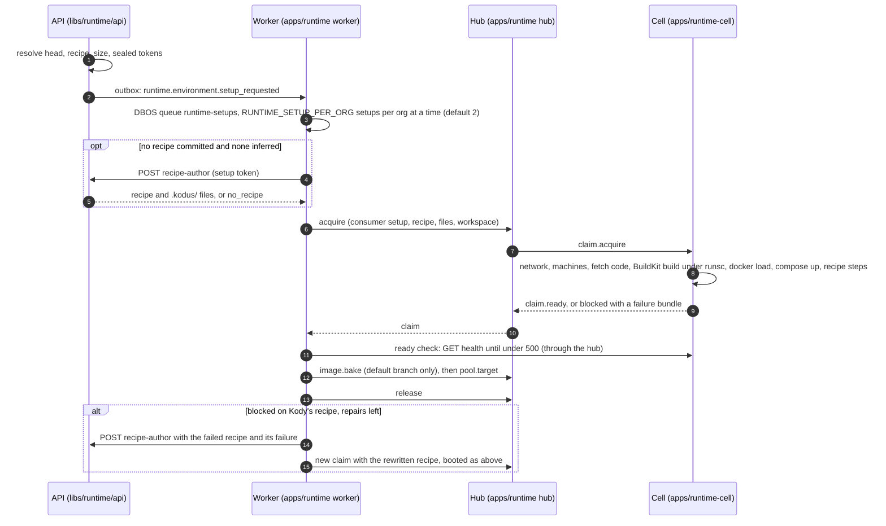

# Environment setup

How a Kody Runtime environment comes up, as the code does it on 2026-11-11. Terms are in
[glossary.md](glossary.md); several repositories in [multi-repo.md](multi-repo.md).

A setup builds the environment from its default-branch head, proves it answers, and leaves a baked image (and a
warm pool, when configured) that every pull request Run boots from.

## 1. The request (API)

- Who asks: `POST runtime/environments/:id/setup`, which needs Manage over every repository of the environment
  (`libs/runtime/api/application/use-cases/request-environment-setup.use-case.ts:35`). Adding, removing or
  re-aliasing a repository asks for one too (`environment-repositories.use-cases.ts:212`).
- `RuntimeSetupRequester.request` keys the setup as `<environmentId>:<requestedAt>`, writes one outbox row and
  marks the environment `setup_requested` (`libs/runtime/api/application/runtime-setup-requester.service.ts:90-126`).
- `resolve` does everything the worker must not decide (`runtime-setup-requester.service.ts:129-229`):
  - the default-branch head from the Git API; GitHub only for now (`:136-151`);
  - the recipe at that commit: `.kodus/workspace.runtime.yaml` first, then `.kodus/workspace.yaml`
    (`libs/runtime/contracts/enums.ts:119`, `runtime-setup-requester.service.ts:156-170`), at most 64 KiB
    (`libs/runtime/contracts/runtime-commands.ts:125`);
  - with no recipe, a deterministic inference from the repository files, no LLM (`:172-178`);
  - parse and machine size against the plan's ceiling (`:181-204`);
  - a one-hour download token sealed to this setup's key (`:206-216`), the members' heads and tokens
    (`:237`, see [multi-repo.md](multi-repo.md)), and the LLM token Kody's author uses (`:225`).
- Anything it cannot resolve travels as a typed blocker in the same message (`:51-54`, `:117-123`); the worker
  records it and boots nothing.

## 2. The queue (worker)

- `EnvironmentSetupRequestedHandler` takes the message (`apps/runtime/src/worker/commands/command-handlers.ts:160-174`)
  and starts a DBOS workflow (`apps/runtime/src/worker/dbos/run-engine.service.ts:243-270`).
- The setup queue `runtime-setups` (`run-engine.service.ts:35`) is registered with `partitionConcurrency:
  RUNTIME_SETUP_PER_ORG` (1 to 8, default 2) and partitioned by organization (`:189`, `:269`). In plain words: **up to
  two setups per organization run at a time by default**; the next setup of the same org waits for one to end, even
  for another environment. Setups of different
  orgs run in parallel, up to `RUNTIME_SETUP_CONCURRENCY` (default 4, never above `RUNTIME_GLOBAL_CONCURRENCY`;
  `apps/runtime/src/worker/dbos/queue-limits.ts` `queueRegistrations`). Under durable admission the admission store
  holds the same limit (`globalSetups`, a setup past it waits as `setup_limit`).
- With durable admission on, a setup is accepted by the admission store first (`run-engine.service.ts:245-262`),
  whose attempts also run one per org by default, and which holds a setup at most one per org (`setup_limit`,
  `shared/admission/admission-store.ts`).
- The same command delivered twice returns the first answer (`apps/runtime/src/worker/setup/environment-setup.service.ts:307-308`).
- A boot waits up to 30 minutes for room on a cell before it is blocked (`environment-setup.service.ts:231`, `:257-260`).

## 3. The recipe

Four sources, first match wins:

1. **Committed** in the repository (the paths above).
2. **Submitted** by the developer's own coding agent with their own model: `kodus env recipe submit` (the
   `kodus-runtime-setup` skill), the `/mcp/env` tool `env_recipe_submit`. The API checks it: submit blocks on the parse and the `.kodus/` build files
   under Kody's bounds (`libs/runtime/api/application/env-tools.service.ts` `recipeProblems`); `env_recipe_check` also reads the
   repository at its default-branch head and runs the checks Kody's own submissions pass (`checkAuthoredSubmission`,
   `repositoryProblems`: errors for what Kodus refuses, such as a compose file or COPY source that is not there, a compose path
   outside the repository root, a Dockerfile the cell refuses; warnings for the Node build rules), and skips them with a
   warning when the repository cannot be read or the environment has several repositories. Submit does not block on them:
   they are stricter than the cell, a developer's own recipe may use what Kody never writes, and the boot is the proof, keeps it on the environment
   (`runtime_environments.submitted_recipe`) and asks for a setup that boots it with its files (`origin: 'submitted'`).
   It needs `env:fix` and is audited (`env_recipe_submit`). Kody never repairs it and the learn loop leaves it: the agent
   reads `env_status` (its `setupKey`) and `env_blockers` and sends another. Once it boots twice, the Runtime page offers
   the PR that commits it, like Kody's. A key that reaches several environments refuses a call that names none
   (`environment_required`, with the list as data); `kodus env` then reads `git remote get-url origin`, takes the
   environment whose `repositoryName` is that owner/name (case-insensitive) and asks again, and keeps the refusal when none
   or several match (`apps/cli/src/services/env.service.ts` `targeted`). Before writing it, the agent reads the authoring guide: `kodus env recipe guide`,
   the `/mcp/env` tool `env_recipe_guide` (`env:exec` or `env:fix`, static text, no repository read). It is Kody's own
   author's rules (`recipe-author/recipe-authoring-rules.ts`, one source: the author's prompt is built from the same
   blocks, byte for byte) plus the facts of the sandbox a repository does not show (`recipe-authoring-guide.ts`): compose
   paths are relative to the repository root, a build reaches registries only (download at start instead), the mirror's
   build args and that a stage must declare them (Kodus adds those `ARG`s, and the Firebase emulator fetch, only to
   Dockerfiles Kody writes, not to files a developer sends), and the Firebase emulators mirror
   (`FIREBASE_EMULATORS_MIRROR`, `buildmirror.go`).
3. **Inferred** by Kodus from the files, with no model (`runtime-setup-requester.service.ts:173-176`).
4. **Written by Kody**, only when nothing is committed and inference failed
   (`environment-setup.service.ts:443`), and only for the default-branch head (`:935`;
   `libs/runtime/api/application/use-cases/recipe-author.use-case.ts:202`). The last setup's authored recipe comes
   first: at the same commit, one that booted is kept with no call (`environment-setup.service.ts:948`); at a new
   commit the product checks it again and answers it as is, with no model call, unless the checks refuse it or
   its last boot failed (`:915-926`, `lastAuthoredRecipe` at `:145`).

**When the author's instructions change.** Each authored recipe records the version of the instructions that wrote
it (`recipe.authorVersion`; none recorded: 1). The versions are `RECIPE_AUTHOR_REVISIONS`
(`libs/runtime/run/recipe-author-version.ts`), bumped by hand in the same change as the prompt; a revision marked
`reauthor: true` (v2, the rule that tells the author to start the production server) is one existing recipes must get. The next setup of
an environment whose booted recipe predates it, at the same commit too, asks Kody once with `reauthor`
(`environment-setup.service.ts:1117`, `reauthoredRecipe` at `:1162`), and the product writes it again from it instead of
answering it as is (`recipe-author.use-case.ts:343`). The record keeps the version tried (`reauthor`, carried from setup
to setup): never asked twice for one version. A rewrite that passes no check keeps the recipe that booted; no answer
(budget, product down) keeps it too and leaves the rewrite to the next setup. The recipe card says "Recipe updated to
author v<N>: <reason>". A rewritten recipe whose boot fails goes through the repairs (section 7) like any other: the
old one is not booted again in that setup.

Whoever wrote it, the worker runs the same checks before booting: parse, reserved resources, and that every
`services.needs` is a repository of the environment (`environment-setup.service.ts:381-400`). The cell checks again.

**Notes for the planner.** The recipe says how the app boots, not how it is reached once it does. The planner's input
carries only each service and port, so a repository whose services answer under a prefix (a Firebase function under
`/<project>/<region>/<function>/...`) or behind a login the seed creates writes it in `.kodus/runtime-notes.md`: plain
text, at most 3,000 characters in a prompt (`libs/runtime/planner/environment-notes.ts`). The planner reads it from
the repository at the Run's base commit through the `RepoReader` it already has, so a PR cannot rewrite what it is
tested with, and no recipe field, protocol message or Go change carries it. It reaches every planner round as data
under the same redaction as any file the model reads (secret-named values masked). It is not a build file: `kodus env
recipe submit` leaves it out of the files it sends (`apps/cli/src/features/env-recipe/recipe-files.ts`), and the
developer's guide (`recipe-authoring-guide.ts`) and the `kodus-runtime-setup` skill tell a coding agent to write it. A
recipe already carries free text in `notes` (at most 1,000 characters, the author's own account of what it did); that
field is the author's output, never an input of the planner.

### Kody's author

The worker calls the API (`apps/runtime/src/worker/agent/http-recipe-author.ts:55-62`); the agent runs in the
product with the org's BYOK key, which never reaches the worker.

- **Tools:** `list_files`, `read_file`, `find_files`, `submit_recipe`
  (`libs/runtime/api/application/recipe-author/recipe-author.agent.ts:541`, `:574`, `:593`, `:615`).
  `find_files` matches globs with a state machine walked once per path, never a backtracking regex (`:39-48`).
- **Facts block:** computed with no model from the root listing and a few manifests (lockfile and package manager,
  workspace globs, Node version, Dockerfiles, compose files, `next/font/google`) (`repository-facts.ts:6-13`),
  prepended to the first message (`recipe-author.agent.ts:767-779`); the prompt says to trust it (`:375`).
- **CI evidence:** the primary repository's `.github/workflows` jobs that boot the app for tests (e2e, integration,
  Playwright, Cypress, compose, `services:`), summarised by code with no model: job, services, setup actions,
  run commands, env var names only, capped at 4 KB (`ci-evidence.ts`); sent after the Facts. The prompt says to boot
  what that workflow boots and a smaller app only with the reason in notes. Which apps recent PRs touch is not sent:
  the Git port has no cheap read of it.
- **Prompt rules** (`recipe-author.agent.ts:345-396`): the repository's own compose file or Dockerfile first and
  the CI workflow's steps mirrored (`:367-376`); registries-only egress, with rules for Nx, Yarn Berry, pnpm and
  corepack, `next/font/google`, and native modules on arm64 (`:377-382`); monorepos (`:383-388`); Kody's own files
  only under `.kodus/` and what the checks refuse (`:389`); a build that is fast to rebuild: dependencies before
  source with `COPY --parents`, cache mounts, multi-stage, a development build (`:390-396`).
- **Deterministic checks on every submission** (`checkAuthoredSubmission`,
  `authored-files-policy.ts:1192`), with the Node build rules on (`recipe-author.agent.ts:685`). The Node rules
  (`authored-files-policy.ts:307-313`, `checkNodeBuild` at `:668`):
  - (a) in a monorepo, an install after a `COPY` of the members or of the whole source is refused (`:672-679`);
  - (b) a package manager release left unpinned, or pnpm 11 on a lockfile the project did not move to pnpm 11, is
    refused (`:687-715`);
  - (c) `corepack enable` with no `corepack prepare <pin>` and no `COREPACK_DEFAULT_TO_LATEST=0` is refused (`:716-725`);
  - (d) Nx without `NX_NO_CLOUD=true` is refused (`:727-740`).
  A refusal goes back to the model as a tool error naming the line and the fix.
- **Limits:** 16 steps, 400k tokens, 4 refusals per run (`recipe-author.agent.ts:138-149`). A stop policy leaves
  only `submit_recipe` once the next steps would not fit (`:418-456`).
- **Context options** `clearStaleReads` and `prefetch` (`recipe-author-context.ts:6-17`, defaults `:45-49`) are
  off by default; the product passes neither (`recipe-author.use-case.ts:310-321`). Eval variants v3 to v5 turn them
  on.
- **Run limit:** 10 minutes for the whole run (`recipe-author.use-case.ts:72-78`, applied at `:320`). The worker
  waits 11 minutes, on a dispatcher whose headers timeout matches (`http-recipe-author.ts:15-16`, `:75-83`).
- **Budget:** the run's tokens are reserved before it starts, under the setup's scope (`recipe-author.use-case.ts:264-272`);
  with less than 20k left it does not start (`:63`). The per-setup LLM budget is 1.6M tokens, four runs of 400k:
  the first recipe and the three repairs at the 400k cap (`libs/runtime/api/infrastructure/runtime-api.config.ts:78`).

## 4. The boot on the cell

- The worker acquires a claim with consumer `setup` and key `setup:<key>` (`environment-setup.service.ts:495-525`).
  The recipe text and Kody's files travel in the acquire; the cell boots with them, not with the checkout's copy.
  Only a default-branch setup may write the environment's build cache (`seedsCache`, `:512`).
- A setup claim lives 45 minutes; the hub waits up to 44 for `claim.ready` (`libs/runtime/environment/environment-runtime.ts:256-268`).
- The cell prepares the claim in order: network (or a warm pool machine), machines, code, upload, compose, egress
  policy, the recipe's setup/migrate/seed, the observer's read-only database account
  (`apps/runtime-cell/internal/agent/prepare.go:26-46`). The code step fetches the tarball, extracts it with no
  network, revokes the token, and lays Kody's files and the recipe over it (`prepare.go:194-270`).
- Compose `Up` runs sandbox, build, render, data, up, record (`internal/drivers/dockergvisor/up.go:25-46`).
- **gVisor:** containers run under the `runsc` runtime, the default and a requirement
  (`internal/drivers/dockergvisor/driver.go:251-262`).
- **BuildKit, one builder per build:** each build section runs `docker run --rm --runtime runsc` of a rootless
  BuildKit image (`buildctl-daemonless.sh`) on the claim network at a fixed address, with memory, CPU and pid limits
  (`internal/dockercli/dockercli.go:797-890`). docker.io pulls go through the cell's mirror (`:785-792`);
  Go builds get the mirror's `GOPROXY` (`dockergvisor/build.go:181-190`).
- **Reuse before build:** a build whose fingerprint matches an image the environment baked takes that image
  (`build.go:53-128`).
- **Build state on XFS:** with `-gvisor-build-state`, BuildKit's state (layer snapshots and cache-mount
  directories) is kept per environment (`buildstate/store.go:1-21`). The default-branch setup writes it; every
  other build gets a throwaway view: a reflink clone on XFS or btrfs, a kernel overlay elsewhere
  (`cmd/cell/config.go:202`, `buildstate/clone_linux.go:17-31`). GC keeps 20 GB per environment; below 20 GB free
  the least recently used states go (`config.go:210-211`). A build that fails on an overlay view runs once more
  without it (`build.go:290-318`). Without build state, BuildKit imports and exports a local zstd cache
  (`dockercli.go:872-878`).
- **Cache mounts:** the author is told to put package and compile caches in `RUN --mount=type=cache`
  (`recipe-author.agent.ts:393`); they persist with the build state.
- **Image export:** the default builder is the cell's own (`apps/runtime-cell/builder-image`, `config.go:23`):
  stock rootless BuildKit falls back to walking the whole tree for every layer it exports under gVisor
  (measured on the dev cell). The image reaches the cell's Docker through a registry of the build's own, so
  only the layers that changed move (`config.go:206`, `dockergvisor/registry.go`). A build that does not seed and
  finds the environment's registry never seeded (no default-branch setup pushed into it yet) sends an uncompressed
  `type=docker` tarball that the cell `docker load`s instead (`registry.go:88-96`, `build.go:270-290`).
  `-gvisor-image-transfer tarball` sends a tarball for every build. buildkitd's own log is kept per build
  (`dockercli/builder_log.go`) and summarised in `build.builder_log`, which counts the layers the overlay differ
  could not compute.
- **Runs like CI:** GitHub Actions always sets `CI=true`, and many tools change behavior on it (a build config that
  skips lint only under CI, test runners and package managers going non-interactive), so the Runtime does the same.
  Every image build gets the build arg `CI=true` (`buildmirror.Mirror.Args`, under the names of `mirrorBuildArgs.ci`;
  Kody's Dockerfiles declare `ARG CI` in each stage that runs something, `declareMirrorBuildArgs`), and every
  service boots with `CI=true` in its environment (`loadClaimCompose`, `compose.Project.DefaultEnvironment`). A value
  the project sets itself wins: a build arg of its own, the compose file's `environment`, or the recipe's
  `services.compose.env`.
- **Nuxt:** Kody's Dockerfiles also set `ENV NUXT_TELEMETRY_DISABLED=1` in each npm, pnpm or yarn install stage, so `nuxt prepare`
  (a common postinstall) makes no connection to `telemetry.nuxt.com`; its other failure, a manifests-only install layer
  without the config, layers or locale files, is handled by the author's install-then-rebuild rule (egress-allowlist.md §17).
- **Firebase emulators:** firebase-tools has no download-URL override, so for a repository whose `firebase.json` has
  an `emulators` block, that installs firebase-tools and starts the emulators, Kody's Dockerfile fetches them from the
  cell mirror in its last stage (`authored-dockerfile-firebase.ts`, `FIREBASE_EMULATORS_MIRROR`; egress-allowlist §17).
- **Golden data:** when the database's data is made by the database alone, the first boot keeps a copy of its
  volumes and each reset restores it instead of running initdb and the seed again (`dockergvisor/golden.go:25-45`,
  data step `up.go:270-320`).

## 5. The ready check

`readyCheck` sends `GET <health>` to the public HTTP service (`environment-setup.service.ts:760-818`): every 5 s
(`apps/runtime/src/worker/env/ready-check.ts:13`) until the recipe's `health_timeout` (default 120 s,
`ready-check.ts:11`; at most 900 s, `libs/runtime/protocol/recipe.ts:37`), and never later than 120 s before the
claim's ceiling (`environment-setup.service.ts:214`). Under 500 is ready (`:807`). Otherwise the blocker is
`not_ready` with the service, port and path in its signature. No HTTP service exposed: the check is skipped.

## 6. Bake and pool

- The bake runs only when the commit is the default-branch head the product resolved (`environment-setup.service.ts:571-596`).
  It is keyed by the recipe digest and the commit; several repositories add `refsDigest` (`:583`). The cell
  publishes an immutable generation and promotes the build caches (`dockergvisor/bake.go:81-150`). Accepted: Runs
  boot on the bake.
- `pool.target` asks the cell that baked to keep `poolSize` machines made from the bake (`environment-setup.service.ts:598-622`);
  a claim adopts one when it fits (`prepare.go:103-118`, `agent/pool_claims.go:31`).
- The claim is released; a failed release is left to the reaper (`environment-setup.service.ts:641-648`).

## 7. The repair loop inside a setup

`RUNTIME_SETUP_AUTHOR_REPAIRS`: how many times one setup sends a failed boot of Kody's recipe back to Kody and
boots the rewrite. Default 3, max 5, 0 turns it off (`libs/runtime/run/environment-setup.ts:215-218`,
`apps/runtime/src/shared/config.ts:307`).

It runs only when all of these hold (`repairFailureOf`, `environment-setup.service.ts:191-200`; `repair`, `:661-667`):
the setup is blocked; it booted the default branch; the recipe was written by Kody or inferred by Kodus (an inferred recipe goes to Kody with no `last`, so Kody writes one from scratch); the first blocker is a recipe
failure, not the platform, no cell or a capacity refusal (`environment-setup.ts:245-248`), and the catalog does not
read it as the platform (`environment-setup.service.ts:166-174`); the worker has the author client and the setup
carries its LLM token; no diagnostic hold.

It never runs for a recipe the customer committed (it is theirs), a `security_violation`, `boot_timeout` or `out_of_memory`
(`:182`), an `external_service:egress:*` blocker (a host an admin approves), or a claim that failed (lease lost,
capacity) (`:738`).

Each repair sends the failed recipe, its files, notes and the catalog's signature, title and last 20 evidence lines
(`:668-697`). It stops, keeping the failed boot's blocker, when Kody is unreachable or the budget is spent, writes no
recipe, answers a recipe that already failed in this setup, or writes one the checks refuse (`:700-721`). Otherwise
the new recipe boots on a new claim `setup:<key>:repair-<n>` (`:495`, `:734-740`). Every repair is recorded on the
setup (`environment-setup.ts:191-213`).

After a blocked setup closes, the separate learn loop may try hypothesis recipes on new claims; it never commits
anything (`environment-setup.service.ts:981-1004`).

## 8. Blockers and the catalog

- A blocked step records kind, signature, message and, with several repositories, the alias. The cell attaches a
  redacted failure bundle: service states, last log lines per service, ports, disk, denied egress
  (`environment-setup.ts:150-154`).
- `classifyBlocker` turns it into a card with title, evidence and fixes (`libs/runtime/blockers/catalog.ts:579`).
  Cards added in this round: `environment_not_prepared`, `builder_failed`, `image_load` (platform, retry),
  `image_too_large` (resources), `compose_refused` (toolchain).
- **Evidence for a developer's agent.** A card's evidence is one line, enough for the page. `env_blockers` (and so
  `kodus env status` and `submit --wait`) carries more for a failed build or boot (signature `compose_up`):
  `evidence.step`, the failed build step, and `evidence.lines`, its output (`libs/runtime/blockers/evidence.ts`
  `fullEvidenceOf`, chosen by `blockerGroups(..., { fullEvidence: true })`). The bounds, from the build to the tool:
  the cell keeps a failed step's last 40 lines and its first 8 error lines that scrolled out (`buildprogress`
  `MaxTailLines`, `MaxErrorLines`), each at most 500 bytes (`MaxLine`), redacted; the failure bundle's `boot output`
  entry carries them (500 lines of 2048 bytes); the blocker message is kept to 2000 characters
  (`BLOCKER_MESSAGE_MAX`) and a step's detail to 2000 (`STEP_DETAIL_MAX`), up from 500 and 300; the evidence is at most
  49 lines (`FULL_EVIDENCE_LINES`). A boot with no step named gets the last lines of the boot output instead.
- A builder that prints nothing for 5 minutes while no step of the Dockerfile runs (`[stage N/M] RUN|COPY|...`) is
  stopped by the cell as `builder_failed` (`dockergvisor/build.go` `watchBuildStall`): a builder that hangs between
  BuildKit's own steps is the platform's, and before this it waited out the worker's boot limit, which read as the
  PR's `boot_timeout` and a regression. Silence inside a project step stays the project's.
- How a denied host is read as the cause (`deniedHosts`, `catalog.ts:561-577`):
  - reverse-DNS names (`*.in-addr.arpa`, `*.ip6.arpa`) are dropped (`:540`);
  - phone-home hosts (telemetry, `checkpoint.prisma.io`, opencollective) count only when the log names them (`:537`);
  - when the failing lines name another cause (an `ERR_*` code such as `ERR_PNPM_IGNORED_BUILDS`, a compiler error,
    a missing module) and no network cause, a denied host the log does not name is not the cause (`:542-551`);
  - hosts the log names come first, then the one denied last.
  A package registry the installer could not resolve is read as blocked too (`:153-166`, `:899`). The card's
  signature is `external_service:egress:<host>` with an "allow" fix (`:925`); hosts on the platform deny list get a
  card with no allow.

## 9. Requests that never arrived

- Worker to API (Kody's author): a connection refused, unresolved or unreachable is sent again after 5, 15, 30 and
  60 s, about what an API restart takes (`http-recipe-author.ts:18-27`, `:110-125`). A request that reached the API
  is never sent again: the run may have happened. A 400 to a request with `last` is sent once more without it (`:131`).
- Worker to hub: a refused connection is sent again after 2, 5, 10, 20, 30 and 30 s
  (`apps/runtime/src/worker/env/hub-environment-runtime.ts:103`, `:115-123`).
