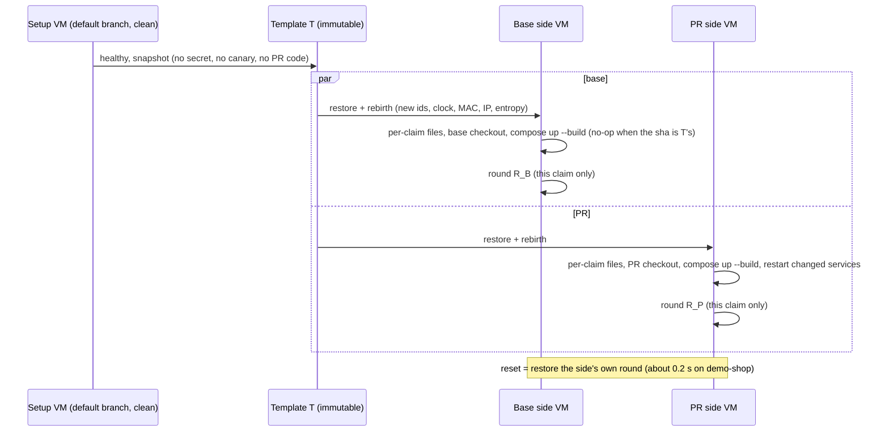

# Fork from a checkpoint, and cache-aware placement (2026-11-23)

**Question.** A Run boots the repository's app twice, once for the base and once for the PR, each on its own machine
("two VMs from the same image", D3). kodus-ai boots in about 4 min per side; a reset from a volume snapshot takes about
1 min (97–122 s on the dev cell, [gvisor-checkpoint-reset.md](gvisor-checkpoint-reset.md)). Two ideas from a competitor
(Prime Intellect sandboxes):

1. Boot the environment once, checkpoint it when healthy, and fork the checkpoint into the base side, the PR side and
   every per-round reset. D3 holds: both sides come from one checkpoint.
2. Place a claim on the cell that already holds the repository's image, build cache or snapshot, instead of only keeping
   a warm pool.

**Against the boat-first decision ([host-providers.md](host-providers.md) §13, 2026-11-17).** Runs execute on boat
first, and on boat we do not build what boat gives:

- **Idea 1 on boat** is boat's own: a Run host is created `--from` the environment's saved snapshot (the cell, the baked
  images, the seeded data), one host per Run (`perRun`). That is host-providers steps 7 and 8, blocked on the boat spike
  (needs a key on the $20 plan). Whether the microVM memory snapshot is in that template depends on spike item 5 (CPU
  model across boat machines); if not, templates hold the disk only.
- **Idea 2 on boat** does not apply: a `perRun` host is new for each Run and is placed by boat.
- **This document's own design is the second path**: our checkpoint, fork and cache-aware placement for `pooled` hosts
  (AWS with nested virtualization or bare metal) and for `static` pools (self-hosted cells), which host-providers lists
  as "later". Step 3 below (a failed restore boots cold) holds on every path and is built.
- Build order follows host-providers: the boat spike and live template first; this design's steps 1, 2 and 4 to 10
  after, when a `pooled` provider is built.

**Answer.**

- **Idea 1 is already built on Firecracker, and off.** A setup's healthy VM becomes the environment's template; each Run
  side restores it, rebuilds its own checkout on top, and takes its own round for memory resets. The design below is
  mostly closing gaps (freshness, fallback, the round's cost, telemetry), not a new mechanism. It is blocked by the P3
  security review (`RunsEnvironments = false`), not by code.
- **On docker-gvisor, one checkpoint cannot be forked into two claims** with what exists: gVisor's restore works, Docker
  28 and 29 break it, and a restore keeps the checkpointed network identity. The gVisor lever is the warm spare (built,
  off), which fixes resets and not boots.
- **The gain is mostly in resets, not boots.** The measured boot gain (240 s to about 15 s) is on a small app; for
  kodus-ai the PR side still rebuilds and restarts its changed services, and the round (a 10 GiB memory write) is about
  as long as the boot it replaces. Resets go from about 100 s to well under 10 s. Modeled below: about 3x less machine
  time per Run. **kodus-ai was never run on the microVM path**, so every kodus-ai figure here is a model.
- **Placement today is one soft preference for one cell** (the cell of the environment's last setup). The hub knows
  nothing about what a cell holds. The design adds an ids-only holdings report in the heartbeat and ranks eligible
  cells by it, with today's order as the fallback.

Terms are in [glossary.md](glossary.md). In this repo a cell is one host (`glossary.md:28`), so "a cell with more than
one host" is several cells of one pool; placement chooses among cells.

**Not found.** The decisions table with D3 is not in this worktree: `docs/runtime/plan-status.md` does not exist on this
branch, and the copy in `kodus-ai-kr-next-all` (17/11) has no D3 row. `persistent-state.md:567` has a different D3
(state is per preview). This doc takes D3 as stated in the request and keeps it: both sides start from the same image.

## 1. What exists today

### 1.1 Idea 1: fork from a checkpoint

| Piece | State | Evidence | What blocks it |
|---|---|---|---|
| Firecracker memory snapshots: template, session, round | **Built, proven on a KVM host, off by default for environments** | `isolation-p3-snapshots.md` "Answer first", "A whole Run through the hub protocol"; `drivers/microvm/microvm.go:192-203` (`Parts` gives `Snapshots` and `Baker` only with `SnapshotMemory` and nested Docker) | `microvm.RunsEnvironments = false` (`microvm.go:699`): `-isolation-backend auto` keeps environments on gVisor until the P3 security review; `firecracker` picks it explicitly (`microvm.go:694-698`, `cmd/cell/drivers.go:81`). The review items are in `isolation-p3-snapshots.md` "Threat model" |
| Environment template from a setup | Built | `Bake` keeps the setup's pinned VM as template `env-<hash(env)>` (`microvm/env_run.go:406,424-455`); `vmsnap.Admit` allows a template only from a setup machine with no secret, credential, canary or PR code (`vmsnap/gate.go`, `Admit`) | The same review. S-28 (c): a setup whose builds get org secrets never becomes a template (`env.go:376-388`) |
| Both sides restore the template | Built | `Create` restores the claim's `ImageID` when it is a template of the claim's environment (`microvm.go:496-514`); the compose project is the environment's, so the side updates the setup's project (`env_run.go:53-57`); `Up` uploads/uses the side's checkout and runs `compose up --build` (`env.go:348-460`) | Measured only on demo-shop (Express + Postgres): base ready 15.5 s, PR 15.5-15.6 s (`isolation-p3-snapshots.md`, hub-protocol table). kodus-ai: not run |
| Per-round memory reset | Built, on by default in the worker, acts only on cells that keep snapshots | `RUNTIME_ROUND_SNAPSHOTS` default 1 (`apps/runtime/src/shared/config.ts:156,500`); `withRound` in the acquire step (`worker/run/run-orchestrator.ts:305-313`); cell `runSnapshot` and `resetToRound` (`agent/snapshots.go:90,124`); a round is restored only into its own claim's machine (`isolation/firecracker/snapshot.go:286`) | Same. A gVisor cell answers none and the Run resets compose volumes |
| Fallback when the template is missing | Built for a refusal only | `Create` boots cold when `Restore` returns `vmsnap.ErrRefused` (unknown, other kit or host, other org) (`microvm.go:508-514`); `TestARunsWorkloadOfATemplateNotHereBootsCold` | Any other restore error is returned and fails the claim (`microvm.go:508`): gap 4.3 below |
| gVisor checkpoint/restore | **Researched, designed, not built** | `gvisor-checkpoint-reset.md` §2-§4; `isolation/gvisor/gvisor.go:216-229` (`Snapshot` and `Restore` return `ErrUnsupported`); nothing under `dockergvisor/` mentions checkpoint | Docker 28.5.2 and 29.10.0 fail `docker start --checkpoint` on any non-host network (`/proc/0/ns/net`). The cell runs Docker 29.1.3 and the installer takes the latest (`scripts/selfhosted/provision.sh:526`). The workaround (a runc holder per service, `network_mode: container:<holder>`, address put back with root `nsenter`) was proven for one container only and needs the S-10 threat model to allow it |
| gVisor warm spare (a second copy booted while the round runs, swapped in at reset) | **Built behind `-gvisor-warm-fork-reset`, default off** | flag `cmd/cell/config.go:255-258,411`; `dockergvisor/spare.go`; `dockergvisor/driver.go:408-411,640-642`; `agent/spares.go`; `gvisor-warm-fork-reset.md` §4: swap 0.29 s (app + pgvector) and 0.90 s (six services) against 2.4 s and 4.65 s today's resets | Needs `-memory-admission` on and claim limits off; the dev cell runs the opposite (`gvisor-warm-fork-reset.md` §5). kodus-ai not run. It does nothing for boot |
| Sharing inputs on gVisor | Built | bake images and golden data copied per side; the PR rebuilds on the environment's build state (`gvisor-warm-fork-reset.md` §3; `build-cache.md` §1); registry-shared bakes `-gvisor-bake-share` (`shared-baked-environments.md` §10) | Process state is not shared: "forking a running process needs a memory snapshot, which is what Docker 28+ breaks" (`gvisor-warm-fork-reset.md` §3) |
| Re-making the template when the default branch moves | **Not found** | The only producer of `setup_requested` I found is the user's request (`libs/runtime/api/application/runtime-setup-requester.service.ts:75-142`). A template is the setup's commit; `TemplateTTL` is 7 days (`firecracker.go:193-195`) | Nothing triggers it |

### 1.2 Idea 2: cache-aware placement

| Piece | State | Evidence |
|---|---|---|
| Choice of a cell for a claim | Built: one SQL, soft preference for one cell | `reserveCellFor` (`apps/runtime/src/shared/persistence/cell-directory.ts:280`), `RESERVE_CELL_SQL` (`:181`): eligible = connected, heartbeat < 30 s, org-owned or Kodus-owned, not cordoned, pool, isolation, size, same backend as the other side, `free_slots > 0`; order = pool order, `cell_id = prefer`, org's own cells, fewest of the org's live claims (spread), most free slots (`ORDER`, `:170`) |
| What `prefer` is | The cell of the environment's last setup (`cellId`, else `buildCellId`) | `poolCellOf` (`worker/dbos/run-deps.factory.ts:116-122`), set at the setup's boot (`worker/setup/boot-once.ts:224,241`), passed by `hub-environment-runtime.ts:459-465`. One cell id per environment. It does not say what that cell still holds |
| Template location | For **code sandboxes** only: `runtime_snapshot_cells` (`snapshot-placements.ts:5-8`, `runtime-schema.ts:682`), read by `SandboxService` (`worker/sandbox/sandbox.service.ts:78,133-137`). Not used for an environment's template, which relies on `poolCellOf` and on `Create` falling back cold |
| Build state | Negative signal only: the cell lists environments whose state its disk floor evicted (`heartbeat.evictedBuildStates`, `libs/runtime/protocol/messages.ts:748-768,858`, `agent/agent.go:444`); the hub stores them (`hub-store.ts:625-650`, `runtime_build_state_evictions`) and refuses a PR boot that would build cold past its wait (`hub/claims/claim.service.ts:122-155,515-527`). There is no record that a cell holds a state |
| Baked images across cells | A digest per environment in a registry (`runtime_shared_images`, `runtime-schema.ts:843`, `sharedImagesFor` `claim.service.ts:727`), so any cell may pull; `last_pulled_at` is never written (`shared-baked-environments.md` §8). The hub never hears a bake's result (§1) |
| What a cell reports | Memory, blank sandbox pool target/ready, evicted states, host hardening (`messages.ts:725-780`). **No images, bake generations, build states or templates** |
| What the cell knows locally | bake generations `internal/bakecatalog/catalog.go`; build state per `EnvKey(cell, org, env)` (`dockergvisor/buildstate/store.go:201`); template restorability on this kit and host `Manifest.Restorable` (`isolation/vmsnap/manifest.go:132`) |
| Warm pool | Machines a cell keeps booted from the bake (`glossary.md:43`); the hub sees only `sandboxPool` counts for blank sandboxes and sends `pool.target` after a bake (`claim-image.service.ts:114`) |

## 2. The design for idea 1

### 2.1 Firecracker: one template, two forks, each side its own round

**Why the PR needs its own round, and never forks a base checkpoint.** The two sides run different code. A checkpoint
taken after the base's processes ran holds base state and the base claim's canaries and placeholders, and `Admit` allows
that only as a round for the same claim (`gate.go`; `snapshot.go:286`). So the only shared checkpoint is the clean
template T; each side adds its own delta (checkout, per-claim files) and takes its own round after it is healthy. This
is what `docs/runtime/isolation-p3-snapshots.md` built; D3 holds because both sides are T plus a checkout.

**Shared between the sides.** The template's memory file (one inode, hard-linked into each jail, so one page cache) and
its disk blocks until a clone writes them (reflinks), the kit and host fingerprint (`Manifest.Restorable`), the images,
layers and build cache that sit on T's data disk (so the PR rebuilds only changed layers), the environment's compose
project name (`env_run.go:53-57`).

**Never shared (each is handled and tested today; table H1-H16 in `isolation-p3-snapshots.md`):**

| Item | How it stays separate |
|---|---|
| Memory | `MAP_PRIVATE` file-backed restore: a write is a private copy. T's file is immutable, mode 0444 |
| Randomness | VMGenID plus 64 host bytes into `RNDADDENTROPY` and `RNDRESEEDCRNG` before the workload thaws (H1). **Residual:** user-space PRNG state and anything an app generated at boot (a signing key) is in T and is the same in both sides and every round. Same org, same environment, nothing secret by rule (H9); a recipe "after restore" hook is not built |
| Clocks | `clock_realtime` at load, then init sets the clock and the PTP-KVM sync steps it (H8). Monotonic time is the guest's |
| Secrets and canaries | Never in T. The Run's decoy file and secret placeholders are written after restore, and the machine is tainted before the write (`env.go:376-388`), so it can never be a template. A fork PR's side gets no org secret (`claim.service.ts` `secretsFor`) |
| Network identity | New tap, MAC, address by `network_overrides` plus init re-addressing; the bridge fence drops anything else (H6). Old TCP connections die (H7) |
| Data | Each side's disks are reflinks of T's at restore; a write is private. The seed ran once, in T |
| Machine ids | New `boot_id`, `machine-id`, host name (H3-H5) |
| A round | Restored only into the same claim and machine (`snapshot.go:286`); removed with its claim (`RoundTTL` 5 h) |

**How per-round resets use it.** Unchanged: `machine.reset` kind `memory` restores the side's own round R (`agent/snapshots.go:124`).
Round 1's state is the state at first ready, so the oracle's comparison is unchanged.

**The base side when its commit is T's.** The setup booted the default branch at commit C. A base side whose sha is C
restores, writes its per-claim files, and `compose up` finds nothing to build or recreate. The base is then a pure
restore. A base on a newer commit builds the delta on T's data disk (layers and cache mounts are there). Today the
template's commit only advances when a person asks for a setup (§1.1, last row), so a busy repository's base drifts from
T. That is the case to measure (§5) and to fix (step 9).

### 2.2 docker-gvisor: what is possible and what is not

One checkpoint into two claims does not work with what exists. Three reasons, in order of how final they are:

1. **Docker.** "Expects the container which created the checkpoint to be the same container used to restore", and
   28/29 fail on any non-host network (`gvisor-checkpoint-reset.md` §1, §2).
2. **Network identity travels with the checkpoint.** At start runsc takes the interface's address into its own netstack;
   a restore needs that same address and MAC put back (`gvisor-checkpoint-reset.md` §2, "Why no network"). Claim
   networks are different /24s and the egress policy is keyed on the claim's source addresses
   (`gvisor-warm-fork-reset.md` §2.2), so the base and the PR would need the same addresses in two isolated networks.
   **Unverified:** the raw runsc test restored one image twice, never into a second network namespace.
3. **The PR's app restarts anyway.** Restoring dependencies (postgres, mongo, rabbitmq) saves their start, but the
   changed service has to be rebuilt and started, which `seedMs` says is most of the 88-111 s on kodus-ai (compose waits
   for each healthcheck, then the API runs migrations and seeds).

So on gVisor, idea 1 reduces to what is built or designed per side:

- **Boot:** share inputs (bake, golden data, build state, registry-shared bakes). Already done. No process sharing.
- **Resets:** the warm spare (built, off) takes a reset from 97-122 s to a swap of about 1 s at the price of the claim's
  memory twice while it runs. A per-side checkpoint of the claim's own compose project (design in
  `gvisor-checkpoint-reset.md` §3) stays blocked by Docker 28/29 and the S-10 `nsenter` decision. Both are same-claim,
  never cross-claim, so D3 is untouched.
- **Recommendation:** do not build a cross-claim gVisor fork. Turn the spare on where the cell has the memory; file the
  Docker 28 regression with moby (the reproduction is in `gvisor-checkpoint-reset.md` §2); run the one-day raw runsc
  spike in step 10 to settle the unverified point, because a pass would change this paragraph.

### 2.3 How it degrades

| Case | Result today | Design |
|---|---|---|
| No template for the environment (never baked, bake refused as `setup_secrets`, swept at 7 days) | Cold boot from the checkout, today's time | Same; the claim's timing says `bootPath: cold` (step 2) |
| Template on another cell, kit or host (`Manifest.Restorable` refuses) | `ErrRefused`, cold boot (`microvm.go:508-514`) | Same; with holdings (step 5) the hub avoids this cell when another holds a restorable one |
| Restore fails for another reason (VMM start, disk, jail) | Claim fails (`microvm.go:508`) | Destroy the half-made machine and boot cold. A template is an accelerator, never a dependency (step 3) |
| Template older than the base commit | Delta build on T's disk; correct, slower with the delta | Measure delta vs age (step 1); refresh trigger (step 9) |
| Template's restored env does not answer its health check | Up fails as a boot failure | Same, plus the cold retry of step 3 |
| Round refused (room, rules) or cell has none | Compose-volume reset (`isolation-p3-snapshots.md` "Wiring") | Same |
| Round lost (cell restart, TTL) | `resetToRound` errors: "no such round snapshot" (`snapshots.go:124`) | Hub falls back to a compose reset for that reset (check in step 3's test) |
| Template evicted by disk (`Room`, sweep) | Cold boot | The cell drops its holding; the hub's row goes with the next heartbeat |

## 3. The design for idea 2: cache-aware placement

**Rule.** A claim goes to the eligible cell that holds the most useful thing for its environment, among cells that pass
every filter it passes today. Holding is a rank, never a filter, so no claim waits for a holder and the cold path stays
as today.

**Rank, best first** (for an environment and, for a Run, its base sha or the template's commit):
1. a **template** this cell can restore now (microvm; kit and host fingerprint checked on the cell, `Manifest.Restorable`);
2. a **baked image generation** whose fingerprint matches (docker-gvisor, `bakecatalog`), or the registry-shared digest
   already pulled;
3. a **build state** for the environment (`buildstate`, not evicted);
4. nothing.
`prefer` (the setup's cell) stays as the tie-break inside a rank, so a deployment with no holdings reports orders cells
exactly as today.

**What the cell reports.** A new heartbeat field `holdings` (feature `cellHoldings`, cell to hub, only to a hub whose ack
accepts it, like `evictedBuildStates`): at most 64 entries of `{orgId, environmentId, kind: template | bake | buildState,
key, bytes, at}`. Ids and a content key only, never a path, a name or a value (the same rule as
`EvictedBuildStateSchema`, `messages.ts:752-768`). `key` is the template id, the bake fingerprint, or the state's
`EnvKey` hash. The cell builds the list from what it can restore now, so a template another kit would refuse is not
listed. Like the eviction ledger it is the whole list each time: a heartbeat without it clears the cell's rows.

**What the hub stores.** `runtime.runtime_cell_holdings (cell_id, org_id, environment_id, kind, key, bytes, reported_at)`,
replaced per cell on a changed heartbeat (the pattern at `hub-store.ts:625-650`: diff key per connection, write only on
change), deleted with the session, purged with the org (`organization-purge.ts`), granted to the reader role like the
other tables.

**How a claim picks a host.** In `RESERVE_CELL_SQL` the single `COALESCE(s.cell_id = $4, false) DESC` becomes a rank from
a left join on the holdings of `(s.cell_id, $org, $env)`, then `prefer`, then the existing order. The filters, `FOR UPDATE
SKIP LOCKED` and `free_slots > 0` do not change, so memory admission, same-backend and pool constraints decide first.
The request already carries `environmentId` (`cell-directory.ts:94`).

**Fallback.** Holder full, disconnected, cordoned, in another pool or of another backend: the next cell by today's order,
and the side boots cold or pulls the shared bake. Nothing waits. An optional bounded wait for the holder (its
`nextFreeAt` from `NEXT_FREE_SQL`, `cell-directory.ts:211`, against the cold cost the cell already measures as
`rebuildSeconds`) is an open decision (§7), not part of the first build.

**Both sides.** Today both sides carry the same `prefer`, so they land together when one cell has two slots. With a
single free slot the second side goes to another cell and boots cold while its sibling forks: the verdict compares
different boot histories (timers, warm caches). The Run's report records each side's boot path (step 2) so this is
visible; making the second side prefer the first side's cell is one more term in the same order (the sibling's cell is
already read by `SIBLING_BACKEND_SQL`, `cell-directory.ts:136`).

**Security.** The hub is untrusted by the cell for what to restore: the cell checks org, environment binding and kit
(`microvm.go:496-503`, "F2-03"). A wrong or forged holding sends a claim to a cell that then boots cold; it cannot make
a cell restore another org's template (`isolation-p3-snapshots.md` H11).

## 4. Gaps in idea 1 to close

1. **Telemetry.** The cell does not say how a side became ready. Add `bootPath` (`template` | `bake` | `cold`),
   `templateId`, `forkMs` (restore to first guest answer), `deltaMs` (checkout upload and `compose up`) to `claim.ready`
   timing, and show them in the Run's report. Nothing in this doc can be confirmed on kodus-ai without it.
2. **Template freshness.** Record the setup's commit with the template; a base side at that commit is a pure restore.
   Refresh the template when the default branch advances, coalesced, without PR code (step 9).
3. **Round cost on the boot path.** `snapshot` takes about 50 s per 4 GiB on gp3 and is on the boot path of both sides
   (`isolation-p3-snapshots.md` "Wiring"); kodus-ai's round holds 10 GiB (same doc, "Files and durability"), about 125 s at
   that rate (model). Add a per-environment ceiling (`RUNTIME_ROUND_MAX_SECONDS`) from the time the setup's template
   took; above it the worker skips the round and resets compose volumes. Break-even is about two resets per side
   (125 s against about 100 s saved per reset).
4. **Restore failure is fatal.** `Create` falls back only on `ErrRefused`.

## 5. Expected gain per Run

**Assumptions** (everything not marked measured is a model): kodus-ai; 4 resets per side (the plan grows 2+1 to 4+4 rounds;
change the number and the table moves linearly); both sides boot in parallel, resets run in parallel across sides
(`bootBoth`, `run-orchestrator.ts:386`); machine price is the product's own list price per side VM, m7i.xlarge
US$0.2016/h, and per observer c7i.large US$0.08925/h (`libs/runtime/api/domain/run-cost.ts:33-52`), two of each; hosts and
LLM spend not included.

| | Today (docker-gvisor, no spare) | Firecracker fork, round on the path | Firecracker fork, no round (compose resets) | gVisor + warm spare |
|---|---|---|---|---|
| Base ready | 240 s (measured, "about 4 min") | about 5 s + round 125 s = about 130 s (model) | about 5 s | 240 s |
| PR ready | about 250 s (measured on demo: "build PR 4 min 10 s") | 0.2 s + delta build 25-70 s + restart of changed services 30-60 s (assumed) + round 125 s = about 180-255 s | about 55-130 s | about 250 s |
| One reset | 97-122 s (measured); about 60 s with a volume snapshot (reported) | 0.2-0.9 s demo-shop (measured); 0.5-11 s for 10 GiB, page cache warm to gp3 cold (model from the 0.42 s / 11 s spike) | 97-122 s | 0.3-0.9 s (measured on 2 and 6 services; kodus-ai not run) |
| Per side, boot + 4 resets | about 650 s | about 190-265 s | about 450-520 s | about 255 s |
| Machine-minutes per Run (2 sides) | about 21 | about 6.5-9 | about 15-17 | about 8.5 |
| Machine cost per Run, VMs + observers | about US$0.10 | about US$0.03-0.04 | about US$0.07 | about US$0.04, if the claim's memory twice does not cut slots |

Reading the table:
- The fork's boot gain is small for kodus-ai once the round is on the boot path: base 240 to about 130 s, PR roughly flat
  to 25 % faster. The Run's total time falls because **resets** fall from about 400 s per side to under 50 s.
- Without the round, boots are fast (55-130 s) and resets are unchanged: this is the choice §4.3 makes per
  environment.
- Machine cost per Run is small in dollars (cents). What the saving buys is slots: a claim holds its slot and memory
  about 3x shorter, so a cell serves about 3x the Runs, which is where cost per Run appears once cells are scarce
  (`cell-directory.ts` `free_slots`; memory admission, ADR-070).
- One-time and standing costs not in the per-Run figure: the template (47.6-62.4 s of a setup VM, off the Run's path,
  `isolation-p3-snapshots.md`), and disk: the template (memory + disks, 7 days), plus two rounds of about 10 GiB held for the
  Run. `Room` refuses a snapshot that does not fit (`room.go`).
- Placement adds no time to a Run. Its gain is avoiding the cold branch of §2.3 on a multi-cell pool: a side that lands
  on a cell with no template boots at today's 240 s instead of about 130 s. The size of that gain is the cold-landing rate
  times about 110 s per side, and the rate is unknown today (step 1 measures it).

**What must be measured to confirm** (none of it exists for kodus-ai):
1. kodus-ai on a KVM host, through the hub protocol: setup to template (time, bytes), template to base ready and to PR
   ready (`forkMs`, `deltaMs`), first healthy probe.
2. Round create time and bytes at kodus-ai's memory, on the cloud disk type; the memory reset to first probe, page cache
   warm and cold.
3. The delta: PR ready time against the commits between the template and the PR's base (0, 10, 100), with and without a
   lockfile change.
4. Peak guest RSS of kodus-ai, to size the VM; the round is proportional to the memory the guest touched.
5. In production: the share of sides that landed cold (no template on the chosen cell) per pool, from `bootPath`.
6. The same Run on docker-gvisor with the spare, on a cell with memory admission on and claim limits off.

## 6. Risks and security review items

| # | Item | Why it matters | Where it stands |
|---|---|---|---|
| R1 | The P3 review (`isolation-p3-snapshots.md` "Needs a security review") | It gates `RunsEnvironments`; this design adds nothing to the trust boundary but depends on it | Open. Items: template residual risks (shared user-space RNG state and app-generated keys, boot-time kernel secrets, freed pages), the taint contract, the choices marked _review_ |
| R2 | Both sides are the same template | A PR's code, as root of its VM, can read all of T's memory. Allowed because T holds nothing a PR may not know (Invariant 1) and the same org and environment own it. A fork PR is never given secrets | Holds by `Admit`; review should confirm that a recipe that generates a long-lived secret at boot (a JWT key) is acceptable to share with the PR VM |
| R3 | A restored side keeps the template's process state | Timers, caches, request ids, pids repeat across sides and rounds. Good for comparison, bad for anything seeded once | The "after restore" hook is not built (P3 residual). Step 4 checks the Run's probes do not depend on boot time |
| R4 | Holdings leak which environments a cell holds | Ids only, org-scoped, to the hub that already knows the cell's claims | Same rule as `evictedBuildStates`; org purge covers the table |
| R5 | A hub that lies in holdings or placement | Can steer a claim to a cold cell, not to another org's template | Cell-side checks (`microvm.go:496-503`, H11) stay the authority |
| R6 | Refresh trigger on default-branch pushes (step 9) | A webhook starting setups is a cost and abuse path | **Built** (`libs/runtime/api/application/default-branch-push-setup.service.ts`). Only the default branch of a repository in an environment (the Git API names the branch and the commit, not the payload; a fork is another repository; tags, deletions and other branches never pass); coalesced per environment (a push while a setup is queued or running starts nothing, the newest commit runs once after it, or the running setup is enough if it already is at that commit); at most `RUNTIME_PUSH_SETUP_DAILY_LIMIT` (default 12, 0 turns it off) setups per environment per UTC day, the next push is logged and skipped; the setup is the one "Set up again" requests, so it is budgeted and blocked like any setup. GitHub only, because setup reads the default branch from GitHub only |
| R7 | Round writes on the boot path | A 10 GiB memory write through the VMM's cgroup page cache caused an OOM kill once (`isolation-p3-snapshots.md` "The exec that closed its stream") | Fixed (cgroup room grows during a create); re-run at kodus-ai's size in step 1 |
| R8 | Disk | Two rounds per Run plus templates on one state disk | `Room` and `RoundTTL`; step 1 sizes it |
| R9 | CPU feature fingerprint | A template restores only on the same CPU family, kernel and Firecracker build (H13). A mixed fleet strands templates | Same instance family per pool (`host-providers.md:243`); holdings list only restorable templates |
| R10 | Cold side next to a forked side | The two sides differ in boot history | Recorded per side (step 2); closed for the common case by the sibling-cell term (§3) |

## 7. Build order

Each step is small and has the test that proves it. The measurement comes first because every later choice (round
ceiling, refresh trigger, placement wait) depends on it.

1. **Measure kodus-ai on the Firecracker path.** Add a KVM test beside `TestFirecrackerKrShopRunThroughTheHubProtocol`
   that drives kodus-ai (or the largest corpus repository) through setup, bake, both sides ready, a round and three memory
   resets, and writes the §5 numbers as JSON. *Proof:* the test passes and its output fills the six rows of §5.
2. **Boot-path telemetry.** Add `bootPath`, `templateId`, `forkMs`, `deltaMs` to the claim timing in
   `libs/runtime/protocol` (zod first, `go generate ./internal/protocol`, a fixture, both test suites), set them in
   `microvm.Create` and `Up`, and show them in the Run report. *Proof:* a `microvm` unit test (a restore reports
   `template` and a positive `forkMs`; a refused template reports `cold`), and a worker spec that the report carries
   them for each side.
3. **Restore failure boots cold.** In `Create` (`microvm.go:505-514`), any error from `restore` before the guest agent
   answered destroys the partial machine and takes the cold path, as `ErrRefused` does. Include the hub's fallback to a
   compose reset when a round is gone. *Proof:* `TestARestoreThatFailsBootsCold` with a backend whose `Restore` returns a
   plain error, and `TestAResetWhoseRoundIsGoneFallsBackToComposeVolumes` at the agent.
4. **A base at the template's commit recreates nothing.** Record the setup's commit and recipe sha in the template's
   manifest; assert that restore plus `Up` with the same checkout builds and recreates no container. *Proof:* a KVM test
   counting Docker events in the VM across the `Up`, and a unit test that the manifest carries the commit.
5. **Holdings on the cell.** Add feature `cellHoldings` and heartbeat `holdings` to the protocol; microvm lists
   restorable templates from `vmsnap.Store` with `Manifest.Restorable`; docker-gvisor lists `bakecatalog` generations and
   non-evicted build states. *Proof:* Go unit tests per driver (a template of another kit is not listed, an evicted state
   is not listed), `hello` test for the feature name and the 64-feature limit, fixtures in both suites.
6. **Holdings on the hub.** Migration for `runtime_cell_holdings`, a store that replaces a cell's rows only when the
   heartbeat's key changed, delete on disconnect, org purge, reader grant. *Proof:* a Postgres integration spec beside
   `pg-hub-store.integration.spec.ts` (replace, no-op on the same key, cleared by a heartbeat without the field and by
   disconnect, purged with the org).
7. **Placement by holdings.** Rank in `RESERVE_CELL_SQL` as in §3, plus the sibling-cell term. *Proof:* a
   `cell-directory` spec with three cells: the template holder is chosen; a full holder yields the next cell; a
   disconnected, cordoned or other-pool holder is ignored; another org's holding is ignored; with no holdings the order
   equals today's (the existing specs unchanged and green); the second side prefers the first side's cell.
8. **Round ceiling.** The cell reports the template's snapshot time; the worker skips `snapshotRound` for an environment
   whose estimated round exceeds `RUNTIME_ROUND_MAX_SECONDS`. *Proof:* a worker spec (above the ceiling: no
   `claim.snapshot`, compose resets; below: unchanged) and the step 1 numbers set the default.
9. **Refresh the template when the default branch advances.** On a push to the default branch of an enabled repository,
   request a setup, coalesced per environment, rate-limited, never from a PR or a fork. *Proof:* a trigger spec (a push
   to the default branch yields one `setup_requested`, a burst yields one, a PR branch and a fork yield none) and a
   step 1 re-run showing the base's `deltaMs` near zero. Decision 2 is made. *Built:* `default-branch-push-setup.spec.ts`
   covers the trigger; the step 1 re-run is still to do.
10. **Spike on docker-gvisor: one image, two network namespaces with the same addresses.** With raw runsc as in
    `gvisor-checkpoint-reset.md` §2 (`raw.sh`), restore one checkpoint into a second namespace that carries the same
    addresses and MACs, and check that both answer and keep their state. *Proof:* pass means both containers answer and
    one's writes do not appear in the other; fail ends the question. A pass would still need the Docker 28/29 workaround and
    the egress keyed on those addresses, so nothing is built on it before a new design.

## 8. Decisions needed

1. **Turn on Firecracker environments for Kodus Cloud cells** (explicit `-isolation-backend firecracker`) before the P3
   review closes, or wait. Everything in idea 1 is gated by it.
2. **Refresh the template on default-branch pushes** (step 9): **decided, yes** (owner approved). Limits: default branch of a
   repository already in an environment only; coalesced per environment; 12 setups per environment per UTC day
   (`RUNTIME_PUSH_SETUP_DAILY_LIMIT`; a manual "Set up again" is not counted); GitHub only until setup reads the other
   platforms (R6).
3. **Placement strictness.** Soft rank with a cold fallback (this design), a bounded wait for the holder, or both sides
   required on the same cell.
4. **Round ceiling** (step 8): how many seconds of boot path a round may cost before the environment keeps compose resets.
5. **gVisor.** Turn the warm spare on where memory allows and file the Docker 28 bug with moby (recommended), or also
   decide whether root `nsenter` for the holder workaround is acceptable under S-10.
6. **Cost basis.** Price a Run by VM and observer (the product's list prices, used above) or by host-hours on Kodus cells.
