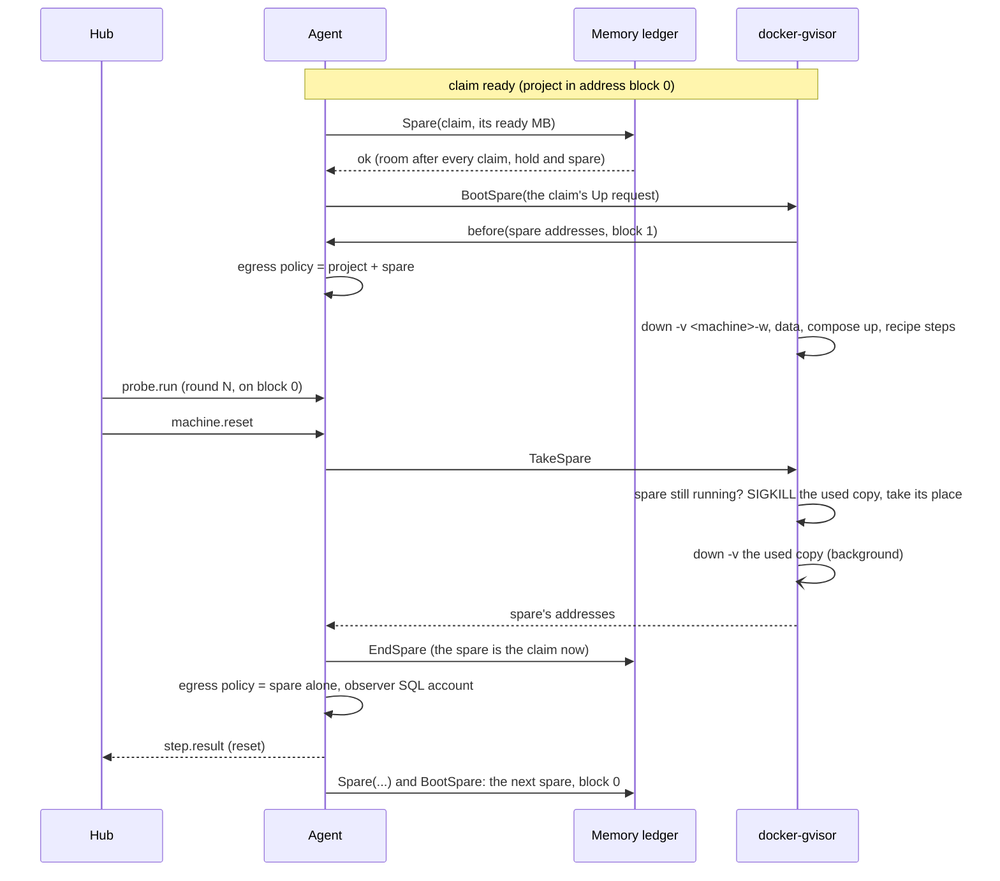

# Warm fork reset on docker-gvisor (2026-11-17)

**Problem.** A reset on `docker-gvisor` takes 97–122 s on kodus-ai. Restoring the data takes 1.3–2.6 s; the rest
(`seedMs` 88–111 s) is the services starting again (measured on the dev cell,
2026-11-15). gVisor's checkpoint/restore would remove it, but Docker 28 and 29 break it
([gvisor-checkpoint-reset.md](gvisor-checkpoint-reset.md)), and its §4 recommends this instead.

**What was built.** Behind `-gvisor-warm-fork-reset` (off by default), a Run claim keeps a **warm spare**: a second copy
of its compose project, started from the same images and data a reset starts from, beside the project, while the round
runs. The next `machine.reset` swaps the spare in and ends the used copy. Then the next spare boots in the background.

**Measured.** On a local Docker 29.10 with runsc (not the dev cell), through the real driver:

| | Today's reset | Swap to the warm spare |
| --- | --- | --- |
| Sample app (Express + pgvector), 6 rounds | 2.40 s median (2.35–2.62) | **0.29 s median (0.25–0.30)** |
| Six services (3× the app, pgvector, mongo, redis), 6 rounds | 4.65 s median (3.24–8.40) | **0.90 s median (0.49–1.17)** |

The swap is a check that the spare still runs and a `SIGKILL` of the used copy. Its `down -v` follows in the
background. The swap does not depend on how long the app takes to start, so on kodus-ai it should stay near the
six-service figure (one container per service) instead of 97–122 s. **kodus-ai itself was not run.**

## 1. How a reset works today

`agent.runReset` (`internal/agent/steps.go`) calls `Resetter.Reset` and then `composeUpAgain`:

1. `Reset` (`dockergvisor/lifecycle.go`) runs `compose down -v` on the project. Containers and volumes go.
2. `Up` (`dockergvisor/up.go`) runs the boot's steps again: sandbox, build (cached, no new image), coverage, render
   and `VerifyCanonical`, data (golden copy for postgres when the recipe allows it, else the bake's volumes for
   `data.reset: snapshot`, else new volumes), then `compose up --wait`.
3. The agent pushes the egress policy again, runs the recipe's boot steps (`RunRecipe`) and provisions the
   observer's SQL account.

Where the time goes on kodus-ai: `downMs` and `restoreMs` are seconds. `seedMs` is compose waiting for each service's
healthcheck in dependency order (postgres, mongo and rabbitmq start, then the API runs its migrations and seeds, then
starts). That is 88–111 s, and no data trick removes it: the processes have to start.

## 2. The design



### 2.1 Two names, two address blocks

The two copies share what every boot of the machine shares: the claim network, its egress container and resolver
file, the holder and its cgroup parent, the images built for the machine, the decoy file, the trust files and the
coverage directory. They cannot share a compose project name or an address.

- A machine's project runs under one of two names (`dockergvisor/spare.go` `projectName`): the machine's own name
  in address block 0, and `<machine>-w` in block 1. A spare takes the one its project is not in.
- `sandbox.ServiceAddressesIn` splits the services' lower half of the claim subnet in two blocks of 59
  (`AddressBlockSize`). Block 0 starts where today's addresses start, so a machine with no spare renders exactly as
  before. `sandbox.Options.AddressBlock` picks the block, and `VerifyCanonical` checks the addresses of that block.
  A project with more than 59 services gets no spare.
- MACs stay derived from the address (`ServiceMAC`). A block's address always carries the same MAC, as today's
  reset relies on for the observer's ARP cache.
- `kodus.project-of=<machine>` labels every container of a `-w` project.

The machine's state remembers which name and block its project is in (`machineState.project`, `block`). Every reader
of the project by name goes through `projectOf`: `Reset`, the next `Up`, diagnosis, service logs, the coverage flush.
`owned`, `Destroy` and the reaper cover both names.

### 2.2 What the swap changes, and who reads it

| Reader | Today | After a swap |
| --- | --- | --- |
| Observer targets (`Targets`), the browser runner | `m.services` | The spare's services (other block). Read per probe |
| Egress policy | the claim's sources, same addresses each reset | `afterSwap` sets the spare's sources and pushes the policy |
| Exec, recipe steps, observer SQL | `m.exec`, `m.targets` | The spare's containers |
| The services among themselves | `extra_hosts` of their block | `extra_hosts` of their own block |
| Recipe boot steps | run again after every reset's Up | run in the spare before it is ready, not again |
| Observer SQL account | provisioned after every reset | provisioned after the swap, in the spare's database |

The spare's addresses join the claim's egress policy before any spare container starts (`BootSpare`'s `before`), so a
setup step that fetches works, as it does after today's reset.

### 2.3 Memory admission

A spare costs about the claim's memory again. The ledger (`agent/admission`) reserves it as a **spare**:

- `Spare(id, mb, evict)` succeeds only if `mb` fits after every claim, every hold and every other spare. The agent
  asks for the claim's own count (its ready size, or the settled ceiling).
- `Committed()` (heartbeat memory) never counts it, and `Admit`, `Retain` and the free figure in a refusal ignore it.
  So the hub keeps sending what it would send without spares.
- When a claim, a growing claim (`Set`) or a bake's hold needs the room, the ledger drops the newest spares and calls
  `evict`, which destroys the spare (`DropSpare`). The claim is admitted at once.
- No room: no spare, and the reset is today's.
- With `-memory-admission` off there is no ledger, so there are no spares.

`TestASpareNeverMakesAClaimRefuseOrWait` and `TestAGrowingClaimOrAHoldEvictsASpare` (ledger), then
`TestAClaimThatNeedsTheSparesRoomIsAdmittedAndTheSpareDropped` (agent), check it.

Physical memory overlaps for as long as the evicted spare takes to go down (seconds), while the new claim begins its
build.

**Claim limits.** Under `-gvisor-claim-limits required`, a ready claim runs under a ceiling settled near what it holds
(`settle.go`), which never rises. A spare in the same cgroup parent would push both copies into the OOM killer, and a
spare in a cgroup of its own breaks every reader of the claim's group (health, settle). The driver refuses
`-gvisor-warm-fork-reset` together with claim limits.

### 2.4 Isolation (S-10, S-52)

- **What a spare starts from.** The images of the machine's own builds (`machineState.built`), the environment's
  baked volumes (`restoreData`) and the machine's golden copies (`restoreGolden`), copied into volumes of the spare's
  own project. `BootSpare` first runs `down -v` on the spare's name, so nothing the used copy left there is reused.
  The spare never reads a volume or a container of the copy the rounds used
  (`TestAResetWithAReadySpareIsASwap`, `TestAClaimStartsFromTheBakedData`).
- **PR code.** Today's reset already starts the PR's images with the PR checkout's bind mounts, at every reset. A PR
  claim's spare is that same `Up` a few minutes early. It runs on the same claim network, under the same cgroup
  parent, egress policy, canaries and decoy as the copy it replaces. It is no new trust boundary. A base claim's spare
  runs the base side's images. A setup claim (the source of a bake) never gets a spare.
- **Destruction.** The swap kills the used copy (`compose kill -s SIGKILL`) before it answers, then takes it down with
  its volumes in the driver's background group. The next spare under that name waits for that down, then runs its
  own `down -v` on the name. `Destroy` waits for it too, ends the spare (cancels its boot, waits, `down -v`) and takes down the project under
  `-w`. The sweep and the reaper group `-w` containers with their machine through `kodus.project-of`, and remove both
  names' containers and volumes. Spare containers carry the claim's `kodus.hard-expires`, so the reaper ends them at
  the claim's ceiling (`TestDestroyTheSweepAndTheReaperTakeTheSpare`).
- **No new privilege.** Nothing runs as root on the host beyond what a reset already runs (`docker compose`), and
  nothing joins another container's network namespace.

### 2.5 Failure

- A spare that fails to boot (build image missing, render, data, compose up, recipe step, or the egress push of its
  addresses) is taken down and turns the machine's spares off (`spareOff`). Its resets are today's from then on.
- `TakeSpare` checks that every service of the spare still runs. A spare whose app died, or a kill or down of the used
  copy that fails, turns spares off. The machine keeps the project it had, and the agent resets it today's way.
- A spare dropped for memory, or by `Destroy`, does not turn spares off.
- A reset that comes while the spare still boots is today's. The spare stays for the next one.

## 3. Base and PR: seed once, fork twice?

**Do the base side and the PR side boot and seed separately? Yes.** They are two claims. Each has its own network,
holder and compose project. The PR side builds its own images and the base side boots the bake's. Each copies the
environment's baked volumes (`data.reset: snapshot`, kodus-ai), or takes its own golden copy at its first boot
(`recreate` recipes: initdb and the SQL seed, 4–6 s under runsc). Each runs its own migrations and seeds at start
(kodus-ai's API).

**Could one seeded state serve both?**

- **The data already does, for kodus-ai.** The seed runs once per environment, at the bake. Both sides start from
  copies of the same baked volumes.
- **For `recreate` recipes, sharing the base's golden copy with the PR** would save one initdb + seed (4–6 s), once
  per Run, not per round. It only holds when the inputs hash the same (compose file, recipe, seed file, the binds of
  the copied services: `goldenSum`). It could only go from base to PR, never the reverse (S-52). Not built: the saving
  is one boot's seconds, and the warm fork does not make it cheaper.
- **The running state cannot be shared.** The base and PR sides run different images (that is the comparison), so no
  booted process can serve both. Forking a running process needs a memory snapshot, which is what Docker 28+ breaks.

What dominates is the 88–111 s of starting services, at every reset of each side. The warm fork takes that out of the
reset on both sides. Seeding once would save seconds per Run.

## 4. Measurements

**Method.** OrbStack on an Apple M-series Mac (linux/arm64, 10 CPUs, 7 GB for the VM). A privileged `docker:29-dind`
container (Docker 29.10.0, compose v5.7.1) with runsc `release-20261026.0` as a runtime, the same binaries as the
checkpoint research. The shared dev cell host was not touched. The smoke tests run the real driver against that Docker
(`dockersmoke` build tag, cross-compiled test binary run inside the dind):

```sh
GOOS=linux GOARCH=arm64 CGO_ENABLED=0 go test -c -tags dockersmoke -o smoke.test ./internal/drivers/dockergvisor/
# in the dind, with the sample app's image built and pgvector, mongo, redis pulled:
KGR_APP_DIR=/work/app KGR_APP_IMAGE=kr-reset-smoke/app:local KGR_RESETS=6 KGR_BASELINE=1 \
  ./smoke.test -test.run 'TestSmokeWarmFork(SampleApp|SixServices)' -test.v
```

Each round writes a row, boots the spare (`BootSpare`), swaps (`TakeSpare`), and checks that the round starts as the
first boot did: the seeded rows and their checksum, none of the earlier rounds' rows, a new app process, the used
copy's containers gone. A runsc container on the claim network (the observer's place) then GETs `/health` at the
app's new address. Memory is `docker stats` of every container of both copies while both run. `KGR_BASELINE=1` resets
a second machine today's way, in turns, on the same host.

**Sample app** (`libs/runtime/protocol/fixtures/sample-app`: app + pgvector, golden data), 6 rounds:

| | Median | Range |
| --- | --- | --- |
| Swap, measured by the caller (`TakeSpare`) | 289 ms | 248–296 ms |
| Swap, driver's `reset.timing` | 213 ms | 191–230 ms |
| Today's reset of the same app, in turns | 2,404 ms | 2,354–2,623 ms |
| Spare boot (background, while the round runs) | 2.1 s | 2.0–2.4 s |
| Memory: one copy / both copies while the spare waits | ~80 MiB / 160–164 MiB | |

**Six services** (the app three times as `app`, `worker`, `webhooks`, plus pgvector, mongo:8.0 and redis:7-alpine,
mongo and redis on named volumes), 6 rounds:

| | Median | Range |
| --- | --- | --- |
| Swap, measured by the caller | 903 ms | 494–1,170 ms |
| Swap, driver's `reset.timing` (spare check + `SIGKILL` of 6 sandboxes) | 776 ms | 431–857 ms |
| The used copy's containers all stopped | 0.93 s after the swap began | 0.50–1.19 s |
| Today's reset, same host, in turns | 4,650 ms | 3,238–8,402 ms |
| Spare boot (background) | 4.2 s | 3.0–9.2 s |
| Memory of both copies while the spare waits | 556–928 MiB | mongo alone 113–286 MiB per copy |

An earlier run that also waited for the used copy's `down -v` inside the swap measured 0.71–3.31 s (median 1.19 s)
on the six services: the down is what moved to the background.

After every swap, a runsc container on the claim network answered its first GET at the app's new address, in both
directions of the alternation (block 0 to 1 and back): no stale ARP or MAC entry. Its "first answer" times (0.55–0.6 s
and 0.9–2.2 s) include the test's own checks before the GET.

rabbitmq's stock image exits under the sandbox's `cap_drop: ALL` on this host, so redis took its place. Not
investigated: it is the same for today's reset.

Logs: `run2.log` to `run5.log` in the session scratchpad.

## 5. Limits and open questions

- **CPU.** A spare boots while the round runs. On kodus-ai that is about 100 s of migrations, seeds and starts on a
  4 vCPU host, during the round's probes, for both sides. Probe timings will move, and a timing-sensitive probe may
  see it. Not measured on kodus-ai.
- **Time since boot.** A spare waits ready for as long as the round lasts. Its processes are older at the round's
  start than after today's reset (timers, caches warmed by nothing, JWTs issued at boot).
- **Coverage.** A Run's instrumented services write V8 coverage into the claim's coverage directory, the spare's
  included. A spare's boot adds startup lines that today's reset would add after the reset anyway. The set of lines
  is the same; a spare dropped before it is taken still leaves its startup files.
- **Egress after eviction.** A spare evicted after it was ready leaves its addresses in the claim's policy until the
  next reset sets the sources again. Only the cell assigns those addresses, and the containers have no `NET_ADMIN`.
- **kodus-ai.** Not run end to end. Its recipe has a `setup` step (idempotent, `[ -e .env ] || ...`) that the spare
  runs in its own containers.
- **Dev cell.** `-memory-admission` is off there (perf-fleet.md), and claim limits are `required`. The warm fork
  needs the first on and the second off.
