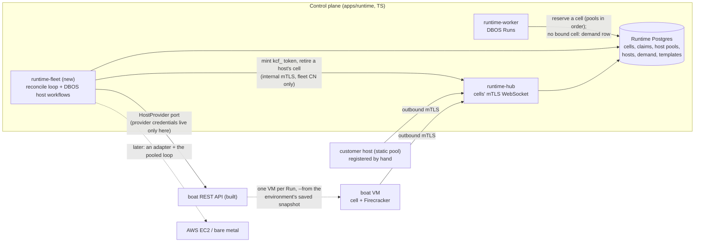
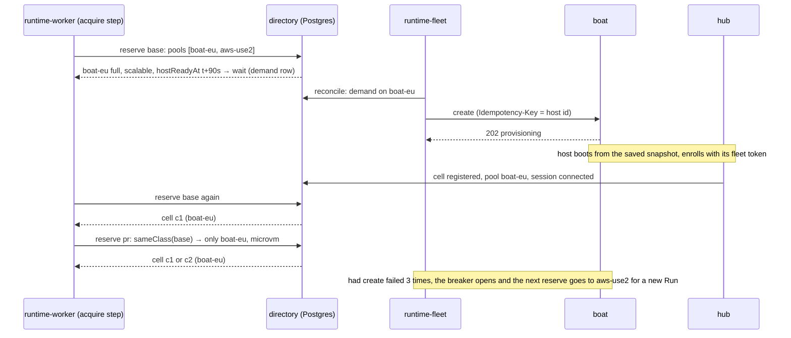
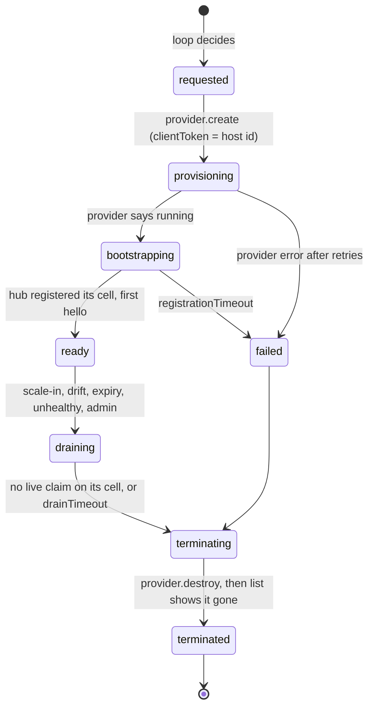

# Host providers: where Runs execute

Design of 2026-11-17, revised the same day for the boat profile (section 13 says what is built). It answers one requirement: the owner chooses where Runs execute and mixes places freely (boat.dev
now; AWS without boat, bare metal or another cloud later, each as an adapter), and a self-hosted customer keeps
running our cell on their own hosts, air-gapped, with no third party. Line references are to the code of
2026-11-17. Terms are in [glossary.md](glossary.md); "warm pool" there means machines
inside one cell, so this document says **host pool** and **warm host** for the layer below it.

## 1. Summary



- Three layers, three owners: **placement** chooses a cell (worker and hub, TS), the **host provider** makes and
  removes the Linux hosts cells run on (new `runtime-fleet` process, TS), the **isolation driver** makes machines
  inside a cell (Go, unchanged).
- A **host pool** names a provider, a provider-specific **host class**, labels, an admission list and a **lifecycle**:
  - `perRun` (built, the boat profile): one host per Run. The controller creates it when a Run asks for room, the cell
    on it serves only that Run, and the controller deletes it when the Run is done. The provider's own TTL is the
    dead-man switch. Nothing is kept warm, nothing is consolidated.
  - `pooled` (documented, not built): long-lived hosts shared by Runs, with `min`/`max`/`warm`, consolidation, drift
    and drain for scale-in (sections 7.1 and 7.3). This is what AWS without boat and bare metal need later; adding
    them is an adapter plus the `pooled` loop, nothing else.
  - A `static` pool has no controller: hosts registered by a person. Every existing cell is backfilled into one, so an
    air-gapped install runs exactly what it runs today.
- **On boat, we do not build what boat gives.** The environment's template is a boat **saved snapshot** made from a
  setup host that booted only the default branch (S-52): the cell, the baked images, the seeded data and, if the
  spike shows the CPU is the same across boat machines, the microVM memory snapshot. It replaces the shared bake
  registry and warm hosts in the cloud. Run hosts never keep a snapshot (`snapshots: false`) and are deleted after
  the Run.
- Every cell belongs to exactly one pool, bound by the hub from the registration token, never stated by the cell. A
  Run's base and PR stay in one pool; on a `perRun` pool they share the Run's one host.
- One enrollment everywhere: a single-use, short-lived `kcf_` token per host, bound to pool, host and the Run, delivered
  by the provider's own channel (boat `files`). Provider credentials never reach a host.
- The cell, the microVM fence, the reset in under a second inside the host, and the product are unchanged.
- Customer data at rest in boat (the template) needs legal sign-off; until then a boat pool admits only Kodus's org.

## 2. What exists

| Piece | Where | State |
| --- | --- | --- |
| Cell choice for the worker | `apps/runtime/src/shared/persistence/cell-directory.ts:234` `reserveCellFor` | Eligible = connected, heartbeat in 30 s, `owner = 'kodus' OR org_id = $1` (`:100`); ordered by the environment's pool cell, own cells, spread, free slots (`:146`); refusals `no_capacity` with `hosts` and `nextFreeAt`, `org_capacity`, `size_unavailable`, `isolation_unavailable`, `backend_unavailable` (`:46-62`) |
| Same backend for both sides | `cell-directory.ts:106` `sameBackend`, `:112` `SIBLING_BACKEND_SQL` | The other side's driver and isolation fix this side's |
| Physical admission (both sides on one cell) | `apps/runtime/src/shared/admission/physical-admission-directory.ts:40` | Opt-in (`RUNTIME_DURABLE_ADMISSION`); reasons in `admission-contract.ts:41` |
| Memory admission on the hub | `apps/runtime/src/hub/claims/cell-memory.ts:9` (ADR-070) | The replica holding a cell admits by committed MB |
| Capacity wait shown to users | `libs/runtime/run/run-projection.ts:122`, `apps/runtime/src/worker/env/hub-environment-runtime.ts:279` | `hosts`, `cap`, `nextFreeAt` |
| Cell sessions and cells | `apps/runtime/src/shared/persistence/runtime-schema.ts:15` (`runtime_cell_sessions`), `:71` (`runtime_cells`), `:89` (`runtime_cell_tokens`) | No pool, no host, no cordon column |
| Registration | `libs/runtime/contracts/cell-token.ts:13-16` (topologies `hybrid`, `self_hosted`; 15 min), `apps/runtime/src/hub/http/public-cell.controller.ts:29`, `apps/runtime/src/hub/enrollment/cell-identity.service.ts:103` | Org owner mints a `kcr_` token; the hub binds org and topology, signs a 24 h clientAuth certificate |
| Kodus-owned cells | `apps/runtime/src/shared/config.ts:279` `RUNTIME_MANAGED_CELLS`, `cell-identity.service.ts:153` | A static map of cell id to pinned serial in the hub's config |
| Hello | `libs/runtime/protocol/messages.ts:725` | Carries `driver`, `isolation`, `regions` (`:730`, sent by the cell, `cmd/cell/main.go:198`, read by nothing in `apps/runtime/src`), `owner`, `capabilities` |
| Isolation port | `apps/runtime-cell/internal/driver/driver.go:41` `Capabilities`, `:417` `MachineDriver` | `dockergvisor` (product Runs), `microvm` (`RunsEnvironments = false`, `internal/drivers/microvm/microvm.go:689`), `k8ssandbox` and `awsec2` (frozen out of this tree) |
| Host prices | `libs/runtime/api/domain/run-cost.ts:62-80` (`MAX_USD_PER_HOST_HOUR`, `OwnHostPrice`), `RUNTIME_CELL_PRICES` (`libs/runtime/api/domain/ports.ts:107`), org `machineUsdPerHostHour` (`libs/runtime/api/application/use-cases/settings.use-cases.ts:170-184`) | One price per org for its own cells; Kodus cells priced from config |
| Cloud fleet | an OpenTofu `aws-cell` foundation, frozen out of this tree with `awsec2` | Network, IAM and KMS foundation only, no EC2 instances, image bake or working cell, never applied |
| Who may call a cloud API | `docs/runtime/architecture.md:51` | The runtime-worker never "dials a cell, a cloud API or SSH" |

The P5 phase of [isolation-architecture.md](isolation-architecture.md) planned "EC2 cells with KVM, autoscaling on the
pool, templates in the object store". The nested-virtualization spike settled the host type for Runs: nested
`m8i`/`c8i` hold Run-shaped load with no VM-entry failure, and a small warm pool beats a fresh instance per Run, which
pays 1.5 to 2 minutes before its base side is ready (the Firecracker spike,
round 3). The boat decision ([`runtime-cloud-boat.html`], 17/11) uses boat as a **host** for our cell, never as the
sandbox, because a boat VM gives root and open egress with no network API.

## 3. Patterns, and what we take

| Pattern | What it does | We take | We leave | Source (read 17/11) |
| --- | --- | --- | --- | --- |
| Kubernetes controller | A non-terminating loop moves current state toward a spec; "controllers that interact with external state find their desired state from the API server, then communicate directly with an external system" | The fleet controller is a level-triggered loop over Postgres rows (desired) and provider lists (current); it reports status back to rows other loops read | A Kubernetes API server: the Runtime has Postgres and DBOS already | [kubernetes.io controller](https://kubernetes.io/docs/concepts/architecture/controller/) |
| Cluster API infrastructure provider | Core owns Machine and MachineSet; a provider implements `InfraMachine` + `InfraMachineTemplate` with a provider ID, "initialization completed", conditions, and a delete path behind a finalizer | The split: core (pools, hosts, drain, health) knows nothing of a provider; a provider implements one small contract and reports `providerId`, `provisioned`, addresses and conditions; terminal failures are conditions, not special states | CRDs, clusterctl, the bootstrap-provider split (our bootstrap is one: the cell enrollment) | [CAPI InfraMachine contract](https://cluster-api.sigs.k8s.io/developer/providers/contracts/infra-machine) |
| CAPI MachineHealthCheck | Remediate a machine whose condition holds past a timeout, with `nodeStartupTimeout` (10 min) and `unhealthyLessThanOrEqualTo` short-circuit | Registration timeout and heartbeat-loss timeout per pool; stop remediating when too many hosts of a pool are unhealthy at once | Remediation templates | [CAPI health checking](https://cluster-api.sigs.k8s.io/tasks/automated-machine-management/healthchecking) |
| Metal3 BareMetalHost | An inventory of physical hosts through `registering`, `inspecting`, `available`, `provisioning`, `provisioned`, `deprovisioning`, `externallyProvisioned` | The `baremetal` adapter's host states, and `externallyProvisioned` as the shape of a host a person installed | Ironic, BMC drivers in our code (a bare-metal provider's API or PXE does it) | [Metal3 state machine](https://book.metal3.io/bmo/state_machine) |
| Karpenter NodePool / NodeClass | Pool = constraints, limits, weight, disruption; NodeClass = provider-specific launch settings; drift by a template hash; finalizer + taint + drain; consolidation with `consolidateAfter`; budgets; `expireAfter` + `terminationGracePeriod`; repair stops above 20% unhealthy; a capacity error is cached 3 minutes per offering | HostPool and HostClass, weights for failover, `limits`, drift by spec hash, cordon then drain then delete, `consolidateAfter`, a disruption budget, a maximum host lifetime, the 20% repair breaker, an unavailable-offering cache | Bin-packing simulation (our unit is one Run on one cell, admitted by memory), spot-to-spot consolidation | [NodePools](https://karpenter.sh/docs/concepts/nodepools/), [Disruption](https://karpenter.sh/docs/concepts/disruption/) |
| Nomad autoscaler target plugins | A target plugin is two calls, `Status` and `Scale`; the ASG target drains a node with a deadline and picks `least_busy` | The port stays small and the policy stays out of it; scale-in picks the least busy host and drains with a deadline | Agent-side APM plugins: our demand is in our own tables | [Target plugins](https://developer.hashicorp.com/nomad/tools/autoscaling/concepts/plugins/target), [aws-asg](https://developer.hashicorp.com/nomad/tools/autoscaling/plugins/target/aws-asg) |
| GitHub ARC runner scale sets | A listener sees queued jobs and patches the desired count; each runner registers with a **just-in-time** single-use config | Scale on queued demand, not CPU; a JIT, single-use, per-host registration | Ephemeral host per job: a Run costs minutes of boot that a warm host does not pay | [ARC](https://docs.github.com/en/actions/concepts/runners/actions-runner-controller) |
| RunsOn warm pools | Hot and stopped standby instances; a 30 s reconciler; a spec hash tags each instance and outdated ones are replaced; ordered rebalance (terminate errors, dangling, outdated first to free quota, then create, then trim); instances running a job are never terminated; overflow cold-starts | `warm` and `stopped` targets, the spec hash, that rebalance order, "a host with a live claim is never a victim", overflow to cold create | Spot by default | [RunsOn warm pools](https://runs-on.com/docs/performance/warm-pools/) |
| Buildkite Elastic CI Stack | `MinSize`, `MaxSize`, `InstanceBuffer`, `ScaleInIdlePeriod` (600 s), scale-in cooldown (3600 s), instances self-terminate when idle, `DisconnectAfterUptime`, nested virtualization on c8i/m8i | Idle period and cooldown as pool fields; a maximum uptime; a host that stops itself when the control plane is gone (dead-man switch) | Lambda scaler per queue | [Elastic CI parameters](https://buildkite.com/docs/agent/self-hosted/aws/elastic-ci-stack/ec2-linux-and-windows/configuration-parameters) |
| EC2 Auto Scaling warm pools | Stopped warm instances with lifecycle hooks; "Amazon EC2 Auto Scaling does not wait for user data to finish running" before it stops the instance | Why the AWS adapter launches instances itself (below) and why a host enrolls only after it leaves standby | ASG as the scaler | [ASG warm pool lifecycle](https://docs.aws.amazon.com/autoscaling/ec2/userguide/warm-pool-instance-lifecycle.html) |

## 4. Layers and ports

### 4.1 Who owns what

| Layer | Question it answers | Lives in | Owner (writer of its state) | Never |
| --- | --- | --- | --- | --- |
| Placement | Which cell takes this claim, among the pools the Run may use | Rules: new pure library `libs/runtime/placement`. Execution: `shared/persistence/cell-directory.ts` and `shared/admission/physical-admission-directory.ts` (worker), the hub's refusal before admission | Hub writes `runtime_cell_sessions` and `runtime_cells`; the worker writes only its reservation (`cell-directory.ts:156`) and the demand row (5.4) | Calls a provider; starts a host |
| Host provider port and fleet controller | How many hosts each pool has, and which ones | New process **runtime-fleet**, `apps/runtime/src/fleet/`; the port and the pure rules (desired count, victims, breaker, rate budget) in new `libs/runtime/fleet` | runtime-fleet writes `runtime_host_pools.status`, `runtime_hosts`, `runtime_host_events` | Talks to a cell; decides a verdict; reads product Git credentials |
| Isolation driver | Which machine boots a claim on this host | `apps/runtime-cell/internal/driver`, `internal/drivers/*` | The cell | Knows which provider made its host |

Why a separate process and not the worker or the hub. The architecture forbids the worker any cloud API
(`architecture.md:51`), and the hub "runs no workflow logic" (`apps/runtime/src/hub/AGENTS.md`). A third process is
also the only place a provider credential can live with nothing else beside it: its own IAM role on AWS, its own
secret for boat, and its own client CN at the hub. It follows `apps/runtime`'s layering: `src/fleet/` imports
`shared/` and `libs/*`, never `hub/` or `worker/` (a new rule in `apps/runtime/AGENTS.md` and a case in
`shared/module-resolution.spec.ts`). It is a TypeScript control-plane component, like the hub and the worker (ADR-045
to 048: TS for control, Go for data). Its durable steps are DBOS workflows in its own DBOS application and system
database; the reconcile loop itself is a plain timer under a `DistributedLocks` lock (`shared/persistence/locks.ts:10`),
so one replica decides at a time.

### 4.2 The host provider port

The port is the CAPI infrastructure contract cut to what a host needs. A provider adapter is a class in
`apps/runtime/src/fleet/providers/<kind>/`; the interface and its error types are in `libs/runtime/fleet` (pure, no I/O).

```ts
// libs/runtime/fleet/host-provider.ts (design sketch, not code to copy)
interface HostProvider {
  readonly kind: 'static' | 'boat' | 'aws' | 'baremetal' | string;
  /** What hosts of this class can do and cost, from the class alone (no API call when it can be avoided). */
  describe(cls: HostClass): Promise<HostClassFacts>;   // vcpu, memoryMb, diskGb, arch, kvm, usdPerHour (+ source, at), startsWarm
  /** The account's limits now: concurrent hosts, starts per window, remaining; null when the provider has none. */
  quotas(cls: HostClass): Promise<ProviderQuotas | null>;
  /** Idempotent by clientToken: a retry returns the same host and never bills a second one. */
  create(req: { hostId: string; clientToken: string; cls: HostClass; bootstrap: BootstrapPayload; tags: HostTags }): Promise<ProviderHost>;
  get(providerId: string): Promise<ProviderHost | null>;
  /** Every host carrying this installation's fleet tag, all pages; the orphan pass reads it. */
  list(tags: Pick<HostTags, 'installation'>): Promise<ProviderHost[]>;
  /** Optional parts, declared in describe(): stop/resume for stopped warm hosts, image() for the template pipeline. */
  stop?(providerId: string): Promise<void>;
  resume?(providerId: string, bootstrap: BootstrapPayload): Promise<ProviderHost>;
  image?(req: { fromHost: string; name: string }): Promise<HostImageRef>;
  /** Idempotent: a host already gone is success. */
  destroy(providerId: string): Promise<void>;
}
type ProviderHost = { providerId: string; state: 'pending' | 'running' | 'stopped' | 'gone' | 'failed';
                      addresses: string[]; region: string; tags: HostTags; conditions: Condition[] };
type ProviderError = Throttled /* retryAfterMs, window */ | QuotaExceeded | CapacityUnavailable /* offering */
                   | InvalidClass | Unauthorized | Transient;
```

Rules every adapter keeps, checked by one conformance suite (`libs/runtime/fleet/testing.ts` `describeHostProviderConformance`, run against
a fake and against each adapter's recorded responses):

- `create` with the same `clientToken` twice yields one host. A lost answer is retried with the same token, never a
  new one (boat `Idempotency-Key`, EC2 `ClientToken`, as the frozen `awsec2` driver did).
- Every host is tagged with the installation, the pool and the host id, and `list` finds it by the installation tag
  across every page and region the class names.
- `destroy` of a gone host succeeds; `destroy` never takes a host without this installation's tag.
- Errors are typed. `Throttled` and `QuotaExceeded` feed the rate budget, `CapacityUnavailable` the offering cache,
  `Unauthorized` and repeated `Transient` the circuit breaker.
- Fork, snapshot and stop/resume are optional parts named in `describe`, never methods a provider stubs (the cell's
  own rule for drivers: `driver.go:415-416`).

`fork` is deliberately not in the port's core. A boat fork copies a running host's disk, and our hosts hold a cell
identity and claim data: a fork is only for the template pipeline (section 8), which works from a host that never
enrolled.

### 4.3 The isolation driver port (unchanged)

The cell keeps `internal/driver` as is. What the host layer needs from it is already in the hello: driver,
isolation, `capabilities.kvm`, `arch`, `maxClaimSize`, and the memory a cell may commit in each heartbeat. One cell per
host; a host's class says which backend its cell runs:

| Host | Backend | Why |
| --- | --- | --- |
| boat VM (`/dev/kvm`, nested) | `microvm` only | Root inside the boat VM is boat's tenant boundary, not ours: the PR must sit inside our microVM with our nftables fence ([`runtime-cloud-boat.html`] §6). Needs `RunsEnvironments = true` and the P3 security review first |
| EC2 `m8i`/`c8i` with `NestedVirtualization=enabled` | `microvm`, `docker-gvisor` as fallback | The spike's recommendation; gVisor stays while microVMs do not run environments |
| Bare metal | `microvm` or `docker-gvisor` | KVM without nesting; round 2 found no VM-entry failures at density on `.metal` |
| Customer host (static) | `-isolation-backend auto` (`internal/isolation/choose.go:31`) | Today gVisor on every host |

### 4.4 Placement

Placement stays where it is and gains pools. The hub derives a cell's pool from its `runtime_cells` row at hello and
writes it to `runtime_cell_sessions.pool_id`, so the directory filters without a join and the cell never states it.
Changes:

- `ELIGIBLE` (`cell-directory.ts:100`) also requires `cordoned_at IS NULL` and `pool_id = ANY($pools)`, the pools the
  placement policy allows for this claim, in order (section 6).
- `sameBackend` (`:106`) becomes the **class** of the sibling: `pool_id`, `driver` and `isolation`. Base and PR never
  span pools, even pools of the same provider, because two pools may differ by kit, host type or region.
- A refusal names the pool it was about: `no_capacity` gains `pool` and, when the controller has a host on its way,
  `hostReadyAt` (the controller's estimate) next to `nextFreeAt`.
- The physical admission path (`physical-admission-directory.ts:40`) takes the same pool list and cordon filter, so the
  two paths never disagree (the gap `isolation-architecture.md` already notes for isolation).

## 5. Declarative pools

### 5.1 The objects

The schemas are zod in `libs/runtime/fleet/pool.ts` (`HostPoolSchema`, `HostClassSchema`, `PoolLifecycle`). The
boat profile:

```yaml
# A HostPool: what placement and the controller read. Provider-neutral.
kind: HostPool
name: boat-eu-perrun
scope: kodus                 # kodus (shared, every org it admits) | org:<organizationId> (that org's own hosts)
provider: boat
hostClass: boat-large-cell
lifecycle: perRun            # perRun: one host per Run, deleted after it | pooled: long-lived shared hosts (not built)
labels:
  region: eu-central
  residency: eu
  kvm: "true"
  backend: microvm
  arch: x86_64
  tenancy: run               # perRun hosts serve one Run of one org
weight: 100                  # higher first, when several pools may take a Run
admission: { allowOrgs: [<kodus org id>] }   # until legal accepts customer data at rest in boat
perRun:
  registrationTimeout: 10m   # create to the cell's first hello; past it the host is destroyed
  maxRunMinutes: 120         # a host older than this is destroyed even if the Run still asks for it
health: { maxConsecutiveFailures: 3 }        # creates that failed in a row before placement skips the pool
price: { usdPerHostHour: 0.072, source: list }
```

```yaml
# HostClasses: what only the provider reads. One per provider kind.
kind: HostClass
name: boat-large-cell
provider: boat
boat:
  type: large                # 8 vCPU, 16 GB, 111 GB disk, $0.072/h; on the $20 plan. xlarge stays an option
  noEnv: true                # none of the boat account's secrets, no in-sandbox API key
  snapshots: false           # a Run host is never snapshotted; a stop erases it
  monitoring: false          # boat keeps no command output or process list
  ttlSeconds: 7200           # dead-man switch, extended by the host workflow while the Run lives
  failFast: true             # 503 no_ready_machine in about 1.5 s instead of waiting for a build
  org: <boat organization id>
  # `from` is not here: each Run host starts from its environment's template (section 8.2)
```

A `pooled` pool adds `capacity: { min, max, warm, stopped }` and `disruption` (`consolidateAfter`, `expireAfter`,
`drainTimeout`, `budget`), and the AWS and bare-metal classes keep the shapes below. The schema accepts them so a
later adapter needs no schema change; the controller ignores them until the `pooled` loop exists.

```yaml
kind: HostClass
name: aws-m8i-2xl-use2-r42
provider: aws
aws:
  region: us-east-2
  instanceTypes: [m8i.2xlarge, c8i.2xlarge, m8id.2xlarge]  # one CPU fingerprint across them (spike round 3)
  nestedVirtualization: true
  threadsPerCore: 1
  image: { ssmParameter: /kodus/runtime/cell-ami/r42 }
  subnets: [<subnet ids of the AWS foundation>]
  securityGroups: [<the cell group>]
  instanceProfile: <cell host role, nothing but ECR pull and its logs>
  stateVolume: { type: gp3, sizeGb: 150 }
  imds: { tokens: required, hopLimit: 1 }
  capacityType: on-demand
---
kind: HostClass
name: metal-rack-a
provider: baremetal
baremetal:
  inventory: [{ name: rack-a-01, mac: "…", address: 10.0.0.11 }, …]
  provision: pxe             # pxe | api:<provider> | none (installed by a person, Metal3 externallyProvisioned)
---
kind: HostClass
name: acme-hosts
provider: static             # hosts register by hand with Settings → Runtime → Cells; nothing to create
```

### 5.2 Where pools are stored and who edits them

The runtime state is three tables in the Runtime database, created by new `RUNTIME_MIGRATIONS` entries
(`shared/persistence/runtime-schema.ts`):

| Table | Writer | Readers | Holds |
| --- | --- | --- | --- |
| `runtime_host_pools` | runtime-fleet (`apply` for spec with its class, the loop for status); the hub inserts static pools at registration | worker (placement), hub (pool of a cell), API (screens, read-only role) | scope, provider, lifecycle, spec jsonb (pool and class), `spec_hash`, `cordoned_at`, status: `scalable`, failures, last error |
| `runtime_hosts` | runtime-fleet | API (read-only), hub (link to the cell) | host id, pool, provider id, state, bound key, `usd_per_hour`, timestamps, last error |
| `runtime_host_events` | runtime-fleet | API (read-only) | one row per host transition, reason from a closed set |
| `runtime_cells` + `pool_id`, `host_id`, `bound_key`, `cordoned_at` | hub (at registration; cordon through its internal route) | everyone | the cell's pool, its host, whether placement skips it |
| `runtime_cell_sessions` + `pool_id`, `bound_key`, `cordoned_at` | hub (at hello, from the cell row) | worker | as above, for the directory |
| `runtime_pool_demand` | worker (directory, when no bound cell exists); runtime-fleet (host and failure) | runtime-fleet, worker | pool, bound key, org, environment, size MB, since, `expires_at` (2 min, refreshed while the Run waits), host id, failure |
| `runtime_fleet_tokens` | hub (minted for the fleet, burned at registration) | hub | token hash, pool, host, bound key, expiry, use |
| `runtime_env_templates` | runtime-fleet (template step) | runtime-fleet (create `from`) | org, environment, fingerprint, provider snapshot name, state, replaced at |

Who edits:

- **Kodus Cloud.** Pools and classes are files in the infrastructure repository (kodus-infra), reviewed like any
  other infra change, and applied by `runtime-fleet apply -f pools/` from the deploy pipeline. `apply` validates
  (every class resolves, `min ≤ max`, labels from a closed set, prices within `MAX_USD_PER_HOST_HOUR`), writes the
  spec and its hash, and never touches hosts: the loop does. A Kodus admin screen may change only `min`, `max`, `warm`
  and `cordoned` at runtime (break glass), recorded as events, and the next `apply` restates the file.
- **Self-hosted.** The installer writes one static pool (`self-hosted`, scope `kodus`, because in a full self-hosted
  install every cell serves the install's orgs) at install time; a customer who wants a cloud pool adds the same files
  to the installer's values and enables runtime-fleet (section 10).
- **Hybrid org (Kodus control plane, customer hosts).** The org's own cells form an implicit static pool,
  `org:<id>/default`, created at the first registration. Settings → Cells gains a pool name on the registration form
  so an org can keep several (for example `office-gpu` and `ci-hosts`); the token binds it.

Drift is a spec hash, as Karpenter and RunsOn do: each host records the hash of its class and pool fields that
shape a host (image, type, kit). A host whose hash differs is replaced through the normal drain, within the pool's
budget. Behavioral fields (`min`, `max`, `warm`, `weight`, disruption) never drift a host.

## 6. Placement policy

### 6.1 Inputs

- **Global rules** (Runtime DB, with the pools, edited like them): an ordered list, first match wins, each matching on
  consumer (`run`, `setup`, `sandbox`), residency, isolation minimum and org, and naming an ordered list of pools.
- **Org preferences** (product Postgres, API-owned, like `machineUsdPerHostHour`): residency (`any`, `eu`, `us`),
  whether the org's own pools come first or only (`own_first`, `own_only`), and whether Kodus pools may take
  overflow. The API copies them into the Run or setup request, so a Run's policy is fixed at trigger time and stable
  across DBOS retries.
- **Pool status** from runtime-fleet: breaker state, `scalable`, `nextHostReadyAt`.

### 6.2 The rule, as a pure function

`libs/runtime/placement` `candidatePools(rules, prefs, pools, status, claim) → { pools: PoolId[]; reason }`:

1. Pools the org may use: its own (`scope org:<id>`) and, unless `own_only`, the Kodus ones whose `admission` admits it.
2. Drop pools whose labels miss the claim: residency (`eu` keeps only `residency: eu`), isolation minimum
   (`contracts/isolation.ts`), backend when a sibling already holds one, arch.
3. Drop pools whose breaker is open (6.4).
4. Order: own pools first when `own_first`; then the first global rule that matches, then `weight`, then price.

The directory then tries the pools in that order in one reservation: the first pool with a free cell wins. When
every candidate is full, what comes back decides between waiting and moving:

| Situation | Answer |
| --- | --- |
| A sibling holds a pool | Only that pool. Full: `no_capacity` (wait). Its cells all gone: `backend_unavailable` (today's card, "run it again"; a new Run places both sides afresh) |
| The first pool is full and `scalable` with `nextHostReadyAt` before the next pool could serve | Wait on the first pool (`no_capacity` with `pool` and `hostReadyAt`); the demand row makes the controller scale |
| The first pool cannot grow (at `max`, quota or rate budget spent, breaker open) | Move to the next pool now; record demand on it |
| No candidate pool | `no_cell` with the reason (`residency_unavailable`, `isolation_unavailable`, ...): a blocker card, not a wait |

### 6.3 Provider rate limits

Placement never calls a provider; the controller owns every provider budget:

- A token bucket per provider account and window, seeded from the provider's own numbers: boat's `GET /limits`
  (`starts.minute.remaining`, `canStart`) and its `RateLimit` headers on every create, resume and fork, with
  `starts-minute`, `starts-hour` and `starts-day` policies. EC2's request-rate limits are handled with its retry
  headers.
- boat never queues a start ("boat never queues a start. A failed start does not run later", [Limits]): a refused
  start does not count, so the controller retries after `nextStartAt`, and stops spending when the plan's
  included starts are used unless the pool allows paid starts (`allowPaidStarts`, off by default).
- With hosts as the unit, starts are rare: a host serves Runs for hours. The $100 plan's 30 starts per minute and 300
  sandboxes at once is far above a host fleet's need; the limit that matters is `max`.
- When a pool's budget is spent, its status says `scalable: false, reason: rate_budget`, and placement moves new
  Runs to the next pool (6.2).

### 6.4 Circuit breaker per pool

Closed → open after 3 consecutive failed creates, or 2 hosts that miss `registrationTimeout` within 15 minutes, or
any `Unauthorized`. Open: no creates, `scalable: false`, placement skips the pool for new Runs; Runs already on it
keep it. Half-open after 5 minutes: one create; a host that registers closes the breaker. An `out_of_capacity` (boat,
`retryAfterSeconds` 120) or an EC2 insufficient-capacity error marks that offering unavailable for 3 minutes
(Karpenter's cache) without opening the breaker: the next instance type in the class is tried first.

### 6.5 A Run placed across two pools' failover



## 7. The fleet controller

### 7.0 The `perRun` lifecycle (built)

```mermaid
sequenceDiagram
    participant W as runtime-worker (acquire step)
    participant D as Runtime Postgres
    participant F as runtime-fleet
    participant H as hub (internal, fleet CN)
    participant P as boat
    participant C as cell on the boat VM
    W->>D: reserve base: pools [boat-eu-perrun, ...], bound key run:<org>/<run>
    D-->>W: no cell bound to the Run: demand row (2 min, refreshed) → no_capacity {pool, hostStarting}
    F->>D: reconcile (15 s, under the fleet lock): demand with no host
    F->>F: start DBOS workflow fleet.perRun:<hostId> (hostId derived from pool + demand key)
    F->>D: host row requested (before any call)
    F->>H: POST /internal/fleet/registration-tokens {hostId, poolId, boundKey}
    H-->>F: kcf_… (single use, TTL = registrationTimeout)
    F->>P: POST /sandboxes {from: environment template, type, noEnv, snapshots:false, ttlSeconds, labels, files:[kodus-enroll.json], failFast} Idempotency-Key = hostId
    P-->>F: 202 provisioning
    C->>H: cell register (reads and deletes the bootstrap file): pool, host, bound key from the token
    F->>D: wait for the cell's session (registrationTimeout)
    W->>D: reserve base again → the bound cell; reserve PR → same pool, same cell
    loop while the Run asks (demand row) or holds a live claim, at most maxRunMinutes
        F->>P: PATCH /sandboxes/{id} {ttlSeconds} (extend)
    end
    F->>H: POST /internal/fleet/hosts/{hostId}/retire (cordon + revoke the cell)
    F->>P: DELETE /sandboxes/{id} (confirm header), then GET until gone
    F->>D: host terminated
```

- **The worker never calls a provider.** It writes one demand row per waiting Run (`runtime_pool_demand`, keyed by
  pool and bound key) inside the reservation, and keeps today's capacity wait. The fleet acts on the rows.
- **One DBOS workflow per host** (`fleet.perRun:<hostId>`, in the fleet's own DBOS application): create, wait for
  registration, serve, destroy. Each outside call is a step; a restart resumes the workflow; the provider create is
  idempotent by `Idempotency-Key = hostId`.
- **Destroy on any failure.** A provider error, a registration timeout, a missing template, or the Run gone: the
  workflow retires the cell, destroys the host and marks the demand row failed with a reason from a closed set. The
  directory turns a failed demand into `host_unavailable` naming the pool, so the Run gets a blocker card instead of
  waiting to its 45 minutes.
- **Dead-man switch.** boat's `ttlSeconds` (2 h by default) is extended by the workflow while the Run lives. A
  controller gone longer than the TTL lets boat stop the host, and `snapshots: false` erases its disk.
- **Breaker.** After `health.maxConsecutiveFailures` failed hosts in a row the pool's status says `scalable: false`;
  placement drops it and the next pool takes new Runs.
- **Orphans.** The reconcile loop lists the provider by the installation label and destroys a host no row names after
  10 minutes; a row whose host is gone becomes `terminated`.

### 7.1 The `pooled` loop (documented, not built)

Every 15 seconds, and at once on a Postgres `NOTIFY runtime_pool_demand`, under the cluster lock, per pool:

```
committedMb   = Σ live claims' memory on the pool's cells (heartbeat memory)        // ADR-070 units
pendingMb     = Σ runtime_pool_demand not expired for the pool
hostMb        = the class's allocatable memory per host (describe(), then the cells' own figure once seen)
needed        = ceil((committedMb + pendingMb) / hostMb)
desiredReady  = clamp(min, max, needed + warm)
launching     = hosts in requested | provisioning | bootstrapping
```

Then, in RunsOn's order (it frees quota before spending it):

1. Destroy hosts in `failed` and orphans past their grace (7.4).
2. Replace unhealthy hosts (7.3), unless the pool is above `maxUnhealthy`.
3. Replace drifted hosts (spec hash), within the budget, create first and drain after.
4. Create `desiredReady - ready - launching` hosts, within the rate budget and `max`, each as one DBOS workflow.
5. Drain hosts above `desiredReady` that were empty for `consolidateAfter`, emptiest and oldest first (Nomad's
   `least_busy`), within the budget. A host with a live claim is never a scale-down victim.
6. Drain hosts past `expireAfter`, one at a time.
7. Write the pool's status (counts, `scalable`, `nextHostReadyAt` = the median time to ready of the pool's last ten
   hosts after the oldest launching host's start).

`stopped` hosts (RunsOn's stopped pool, an EBS-warmed AWS instance) are an option for classes whose provider has
`stop`/`resume`. boat's stop keeps nothing on a `snapshots: false` host, so a boat pool uses `warm` only.

### 7.2 One host's life in a `pooled` pool



Each arrow that touches the outside is a step of a DBOS workflow keyed by the host id
(`fleet.create:<hostId>`, `fleet.drain:<hostId>`), so a controller restart resumes it:

- **Create.** Insert the `runtime_hosts` row (`requested`) before any call, so nothing exists at the provider that no
  row names. Mint the fleet token (7.5). `create` with `clientToken = hostId` and the token in the bootstrap payload.
  Poll `get` with a bounded backoff until `running`. Wait for the hub's `runtime_cells.host_id = hostId` row and a
  session, with a DBOS durable sleep, up to `registrationTimeout`; else `failed`.
- **Drain.** `POST /internal/cells/:id/cordon` at the hub (sets `cordoned_at`; the directory and the hub's admission
  skip the cell). Wait until no live claim is on the cell. The wait is bounded by construction: a claim's hard expiry
  is absolute (`runtime_claims.hard_expires_at`), so `drainTimeout: claimHardExpiry` is the latest hard expiry on the
  cell. Then revoke the cell row (the hub drops it at the next handshake) and destroy.
- **Destroy.** `provider.destroy`, then confirm with `get`/`list` that it is gone; `terminated` only then.

A Kodus admin may cordon or drain a host or a pool from the screen; a customer may cordon their own static cells
(Settings → Cells), which the hub applies the same way. Cordon is a hub feature, so it works with no controller.

### 7.3 Health and replacement

A ready host is unhealthy when its cell has no heartbeat for `heartbeatLossTimeout`, when the provider reports it
failed, or when its cell reports an unsafe host it should not (`hostHardening`, `isolation-architecture.md` "Host
checks"). The controller drains it (claims on a dead cell already fail through the hub's silence rule,
`apps/runtime/src/hub/cell-hub.ts:46` `CELL_SILENCE_MS`) and creates its replacement first. Above `maxUnhealthy`
of a pool, it stops replacing and raises an alarm: a bad image or a provider outage is not fixed by more hosts
(MachineHealthCheck short-circuit, Karpenter's 20%).

### 7.4 Orphans, leaks and cost safety

- **Orphan pass**, every 5 minutes: `provider.list(installation tag)` against `runtime_hosts`. A provider host no
  row names, older than 10 minutes (a create in flight has its row first), is destroyed and logged
  `fleet.orphan.destroyed`. A row whose provider host is gone becomes `terminated`. A cell connected with no host
  row (a hand-registered host in a fleet pool) is cordoned and alarmed, never destroyed.
- **Ceilings.** Each pool's `max`; an installation-wide `maxHosts` and `maxUsdPerHour` (sum of `usd_per_hour` of
  non-terminated hosts) that refuse creates above them; boat's own plan limit and wallet are a third ceiling the
  provider enforces.
- **Dead-man switch on every host** (Buildkite's self-termination, turned into a lease):
  - boat: `ttlSeconds` on create, extended by the controller (`PATCH /sandboxes/{id}`) on each loop; a controller gone
    for longer than the TTL lets boat stop the host, and `snapshots: false` erases it.
  - AWS: `InstanceInitiatedShutdownBehavior=terminate`, and a host systemd timer that powers off when its cell has had
    no accepted hello for 6 hours (`hub-protocol.state`, already written after each hello). It keeps serving through a
    controller outage, since the hub, not the controller, is what it checks.
  - bare metal and static: no self-destruction; cordon only.
- **Spend alarm**: pool spend per hour and fleet overhead (host-hours no claim held) per day, with an alarm on each.

### 7.5 Idempotency

| Operation | Key |
| --- | --- |
| Provider create | `clientToken = hostId` (boat `Idempotency-Key`, kept 24 h; EC2 `ClientToken`) |
| Host workflow | DBOS workflow id `fleet.create:<hostId>`; steps with stable ids |
| Fleet token | One per host id; minting again for the same host returns `already_issued` unless the old one expired unused |
| Cell registration | The token is burned in the same transaction that inserts the cell row (today's `redeemAndRegister`) |
| Destroy | Idempotent at the provider; the row moves to `terminated` only after the provider says gone |

### 7.6 When something is down

| Down | Effect | Recovery |
| --- | --- | --- |
| runtime-fleet | No new hosts, no scale-in. Ready hosts keep serving; placement keeps working on them; waiting Runs wait to their 45 min limit or move to another pool whose hosts are up. boat hosts stop after `ttlSeconds` (3 h by default) without extension | A new replica takes the lock; DBOS resumes every host workflow; the orphan pass reconciles |
| A provider's API | Breaker opens for its pools; new Runs fail over by the policy; running hosts unaffected | Half-open probe |
| A provider's machines (boat outage) | Cells go silent; claims fail through the hub's silence rule; new Runs go to the next pool; in-flight Runs end `backend_unavailable` ("run it again") | Unhealthy-host replacement, short-circuited above 20% |
| The hub | Cells reconnect with backoff (today); controller sees no registrations and holds creates (breaker by registration timeout) | Hub back first, then cells |
| Runtime Postgres | Everything stops deciding; hosts keep running | No action; the dead-man switch bounds boat's cost |

## 8. Host bootstrap and identity

### 8.1 One enrollment everywhere

```mermaid
sequenceDiagram
    participant F as runtime-fleet
    participant H as hub (internal, fleet CN)
    participant P as provider
    participant C as new host: cell
    F->>H: POST /internal/fleet/registration-tokens {hostId, poolId}
    H-->>F: kcf_… (single use, TTL = registrationTimeout, bound to pool, host, owner kodus)
    F->>P: create(class, bootstrap: hub URL, hub CA, token)
    P->>C: boot from the host image; token in /run (boat files, user data, cloud-init)
    C->>C: cell register: key made on the host, CSR
    C->>H: POST /cells/register {token, csr}
    H->>H: burn token, insert runtime_cells {pool, host, owner kodus}, sign 24 h cert
    H-->>C: certificate, issuer
    C->>C: delete the token file; cell starts, dials /cells (mTLS)
    C->>H: hello (pool and host are not in it: the hub knows them)
```

- **The fleet token** is a new kind next to `kcr_` (`libs/runtime/contracts/cell-token.ts`): `kcf_` + 32 random
  bytes, stored hashed in `runtime_cell_tokens` with new columns `pool_id`, `host_id`, `owner`. It is single use, its
  TTL is the pool's `registrationTimeout`, and it binds every attribute, as GitLab 16, Teleport and Kubernetes do
  ([self-hosted.md](self-hosted.md) Decision 1). Only runtime-fleet may mint one: a new internal route accepts only the
  fleet's client CN (the internal guard today admits any CN in `RUNTIME_WORKER_ALLOWED_CNS`,
  `apps/runtime/src/shared/identity/internal-auth.guard.ts:31`; routes get a per-route CN list). An org owner's
  token can never make a `kodus` cell; a fleet token can never make one of an org.
- **It replaces `RUNTIME_MANAGED_CELLS`** (`config.ts:279`) for fleet hosts. A static map of pinned serials cannot
  follow hosts that come and go; it stays for the dev cell until that cell joins a static pool.
- **Delivery, per provider.** The token is the only secret a host receives, and it is dead once used:

| Provider | Channel | Note |
| --- | --- | --- |
| boat | `files` on create (`/tmp/kodus-enroll.json`, written before `ready`, at most 256 KB) | The template's boot unit runs `cell register -bootstrap /tmp/kodus-enroll.json`, which deletes the file once the hub answered; `/tmp` is never in a snapshot and a Run host has `snapshots: false` |
| AWS | user data (IMDSv2 only, hop limit 1) | Readable by root on the host until burned; never by a machine (S-01). Later option: the instance identity document as an attestation in place of the token (open decision 9) |
| bare metal | cloud-init NoCloud seed on the PXE boot, or the provider API's user data | The same file |
| static | a person pastes it (Settings → Cells → Connect a cell, `connect-cell.tsx`) | Today's `kcr_`, unchanged |

- **No long-lived secret on a host.** The key is made on the host and never leaves it; the certificate lives 24 h and
  renews over mTLS; the hub CA arrives in the bootstrap payload or the host image. Provider credentials (boat API key,
  AWS role) exist only in runtime-fleet: the host's own AWS role holds ECR pull and its logs, nothing that creates or
  lists hosts.
- **The host image never holds an identity.** The template pipeline builds it from a host that never registers
  (section 8.2), and a host starts its cell only after `cell register` succeeded.

### 8.2 Host images and environment templates

On boat, the host image and the environment's warm state are one artifact: a **saved snapshot per environment**.

| Artifact | What it is | Built by |
| --- | --- | --- |
| Host recipe | `cell-host.sh install` (kodus-installer): the microVM kit, the cell release, units, sysctls, state disk, nftables base | Release pipeline; the same script on every provider |
| boat cell base | The recipe on a boat base sandbox, `cell preflight` passing, saved as `kodus-cell-<release>-<kit>`. Never enrolled | Template step, once per release |
| **boat environment template** | A setup host created `from` the cell base, enrolled with a `kcf_` token bound to `template:<org>/<env>`, that ran the environment's setup on the **default branch only** (S-52: never PR code): the baked images, the seeded data and, if the spike allows it, the microVM memory snapshot. Then sealed (cell stopped, identity, token file and `/tmp` removed) and saved as `kodus-env-<org-hash>-<env-hash>-<fingerprint>-<base-hash>` | Template step (`apps/runtime/src/fleet/template/`), per environment, build fingerprint and cell base |
| AWS AMI, bare-metal image | The recipe by Packer, Image Builder or PXE | Later, with the `pooled` loop |
| Shared bake registry ([shared-baked-environments.md](shared-baked-environments.md)) | An environment's OCI images by digest | Stays for static and `pooled` pools; boat pools do not use it |

Rules:

- **The template reverses `snapshots: false` for the template only.** The setup host is created with snapshots on (a
  host with `snapshots: false` cannot be saved). Run hosts keep `snapshots: false` and are deleted after the Run.
- **Replacement.** A new template is recorded in `runtime_env_templates` (org, environment, fingerprint, snapshot name,
  state). Once it is `ready`, the older one of that environment is marked replaced and its saved snapshot deleted. A
  name is at most 63 characters (`^[a-z0-9][a-z0-9-]{0,62}$`), so org and environment go in as short hashes.
- **A build starts from the environment's previous template.** When the environment has a ready template on the same
  pool and the same cell base as the pool's now, the setup host is created `from` that template's snapshot, not from the
  cell base. Its disk already holds the images, the build cache (`cache/env/<key>`), the build state and the registry
  seed of the last setup, so the build is incremental instead of cold (a compose build of four services, two of them
  large, took 22 minutes cold). The template cell adopts the previous catalog as a Run host does (section 8.2.1; the
  bound key `template:<org>/<env>` is accepted), so those keys are found. Only images, build cache and build state carry
  over. The new setup is a clean setup claim: it never restores the previous bake's volumes (`restoreData` returns for a
  setup), so every service's data is seeded from scratch, and once its own bake is acknowledged the previous generation
  and its seeded volumes are removed before the disk is saved. If there is no ready template, it is of another cell base,
  its snapshot is gone, or creating a host from it fails, the build falls back to the cell base and is cold, as before.
  `template.built` says which one was used (`source: template|base`). The previous snapshot is deleted last: after the new
  one is ready, promoted, and the setup host created from it is destroyed. A failed build keeps it.
- **A new cell base rebuilds the template.** A template's disk holds the cell of the base its setup host booted, so the
  row records that base (`cell_base`, migration 61). Once the pool names another base (a cell release, a security fix),
  the old template is no ready template: Run hosts boot the new base (cold) and the rebuild pass builds the template
  again on it, under a name of its own; promoted, the old snapshot is deleted. Without this, a new cell reached Run
  hosts only when the repository's setup changed.
- **Customer data at rest in boat.** A template holds the environment's seeded data and images. boat's snapshots "can
  be stored outside the EU" ([Security]), so until legal signs off a boat pool admits only Kodus's org
  (`admission.allowOrgs`), and the template step refuses any other org.
- **CPU.** boat runs sandboxes on AMD Ryzen 9 9950X and Ryzen 7 9700X machines and promises no CPU model. A
  Firecracker memory snapshot restores only on the CPU it was taken on (`vmsnap.HostFingerprint`), so the template
  holds a memory snapshot only if the spike shows both models restore it; otherwise the template holds the disk only
  and the cell boots the microVM cold, then resets in under a second as today.
- **The plan.** A saved snapshot needs a paid plan: the $20 plan includes 10, then $0.056 a day each from the wallet.
  The free trial has none. With one template per environment, ten environments fit the $20 plan.
- A template never holds an identity: the seal step removes the key, the certificate and the token file before the
  save, and a host made from it registers with its own token.

#### 8.2.1 A Run host uses the template's bake

The template's bakes live in the cell's bake catalog (`state/bakes/catalog.json`), and every generation, image
(`kodus-bake/<cell>/<org>/<env>`) and volume names the cell id that made it. A Run host is a new cell with a new id on
a copy of that disk, so it found a catalog "of another cell" and crash-looped at start (`bake recovery: invalid
catalog`), and the Run failed `host_unavailable`. Two ways to fix it:

| | (a) Re-home on start | (b) Lineage id |
| --- | --- | --- |
| What changes | Retag every image to the new cell's names, copy every volume (Docker cannot rename one), rewrite the catalog | Bakes keep their names; the catalog's owner id is the lineage; ownership checks compare it, not the running cell |
| Cost at start | Copies the seeded data on every Run host: minutes and GB, the thing the template exists to avoid | None |
| Failure | A half-copied volume set | None new |

**Chosen: the names stay and the catalog is adopted** (a lineage in effect, without a new id: the cell that made the
bake is the owner, and it is already in the catalog and every name). Safety does not come from the catalog being on
the disk, which any disk copy carries, but from three checks the cell makes against what the hub told it:

1. **Only on a fleet host.** The seal unit (`kodus-cell-seal.service`, installed only by `cell-host.sh install
   --fleet-bootstrap`) is present and the cell is owned by Kodus (enrolled with a `kcf_` token). A self-hosted or
   static cell never adopts: it moves a catalog of another cell aside.
2. **Only the org the hub bound the host to.** `/cells/register` answers a fleet host with its token's `boundKey`
   (`run:<org>/<run>` or `template:<org>/<env>`), over the TLS the cell verified against the hub CA. `cell register
   -bootstrap` writes it next to the certificate (`bound-key`), replacing or removing any file the template left. The
   org is parsed from it.
3. **Every generation is checked as before**, against the owner's id (ids, names, labels, volumes), and the generations
   of any other org are retired, and their images and volumes removed, never used.

A host that does not meet them (or a catalog that fails any check) is never fatal: the catalog is renamed
`catalog.json.foreign-<unix>` (one kept), the cell starts with an empty catalog and logs
`bake.catalog.quarantined reason=corrupt|unsafe|unreadable|foreign_cell|foreign_driver|invalid` with the generation
counts. A generation whose images or volumes are gone is retired at start (`bake.recovery.retired`) instead of
failing it. At start a Run host from a template logs `bake.catalog.adopted from=<template cell> org=<org> kept=N
retired=M`, then recovers the bakes of its org as any restarted cell does, and its first claim boots from them.
Before it checks them it waits, up to 3 minutes, for docker to list every image the catalog names and the cell's own
images every boot runs that only the disk can hold (holder, observer, builder, and the registry with that transfer,
when named by content id `sha256:<hex>`; one named by repository and digest is docker's to pull; `disk.images.waiting
missingCell=N missingBake=M`, then `disk.images.loaded` or `disk.images.missing`): boat reports the host usable and
starts the cell while it still loads the disk's docker images one by one, and a 2 GB bake image came 51 s after the
cell started. Without the wait the bake was retired and removed and the Run built its environment again. Every cell
waits for its own images, adopted catalog or not: a suite host took its first claim while the builder's image was
still loading, and its first build failed `builder_failed` (`No such image`). The sandbox, browser and helper images
are not waited for, since a host may lack them on purpose. New
bakes on that host keep the owner's names, so the catalog stays one lineage.

The environment's build cache (`cache/env/<key>`), its build state and its registry seed are keyed by the same owner
id (`Driver.envCell`), not by the host's own. They are on the copied disk under the template cell's id, so a key made
from the host's new id found nothing and the PR side built every step cold, `apt-get` included. Only an adopted catalog
changes the id, and every key also carries the org, which is the one the host is bound to. A template with no bake
catalog leaves the host nothing to learn the id from, and it builds cold.

Left over: artifacts a quarantined catalog named (its own cell's or a foreign one's) stay on the disk, because no
reaper rule lists a bake; the disk is deleted with the Run host. The microVM driver has its own checks (its owner and
snapshot ids) and does not adopt yet.

## 9. Adapters

### 9.1 `static`

Hosts registered by a person with `kcr_` (or by the installer). No create, no destroy, no controller: the pool has
`min`/`max` empty and the loop only writes status. Cordon works through the hub. This is what every self-hosted
install and every hybrid org runs today, renamed; an air-gapped install needs nothing new.

### 9.2 `boat` (built, `apps/runtime/src/fleet/providers/boat/`)

- Plain `fetch` against `https://boat.dev/api/v1`, no SDK. Calls: `POST /sandboxes` (`from`, `type`, `noEnv`,
  `snapshots`, `monitoring`, `ttlSeconds`, `labels`, `files`, `failFast`, header `Idempotency-Key`), `GET
  /sandboxes/{id}`, `GET /sandboxes?label=kodus.installation=<id>` (cursor pages of 200), `PATCH /sandboxes/{id}
  {ttlSeconds}` (extend), `DELETE /sandboxes/{id}` with `X-Ascii-Confirm-Delete: <id>` (202 and a deletion operation,
  read with `GET /deletion-operations/{id}`), `GET /limits`, and for the template `POST /saved-snapshots`, `GET` and
  `DELETE /saved-snapshots/{name}`.
- States: `init`, `provisioning`, `provisioned`, `cloning` → `pending`; `ready`, `idle`, `running` → `running`;
  `archiving`, `archived` → `stopped`; `error` → `failed`; `cancelled` and 404 → `gone`.
- Errors to `ProviderError`:

| boat | `ProviderError` | Controller |
| --- | --- | --- |
| `429 rate_limited` (`window`, `limit`, `cause`, `nextStartAt`, `retryAfterSeconds`) | `throttled` with the window and the wait | Retry after the wait, never earlier; a start that was refused did not run and does not queue |
| `429 limit_reached`, `member_limit_reached`, `trial_compute_limit_reached` | `quota_exceeded` | No create; pool not scalable until a host goes |
| `503 no_ready_machine` (5 s), `out_of_capacity` (120 s) | `capacity_unavailable` with the wait | Retry the same host after the wait |
| `402 billing_required`, `team_member_cap_reached`; `401` | `unauthorized` | Breaker open, alarm |
| `403 trial_machine_class_not_allowed`, `machine_class_plan_required`; `400` | `invalid_class` | The pool's class is wrong for the plan: breaker open |
| `409 idempotency_in_progress`, 5xx, network | `transient` | Retry with the same `Idempotency-Key` |
| `409 idempotency_key_reused` | `invalid_class` | A bug: the same host asked twice with different bodies |

- **Plans** (docs.boat.dev/pricing, read 17/11). The free trial allows no `large` or `xlarge`, no saved snapshots, 2
  sandboxes at once and a 2-hour auto-stop: it cannot run this profile. The $20 plan allows 100 at once, 12 / 60 / 200
  starts per minute / hour / day, `large`, and 10 saved snapshots. One Run is one start, so the $20 plan starts 200
  Runs a day; past that a start is refused with `rate_limited` (paid starts from the wallet are off by default).
  `xlarge` needs the $100 plan. The adapter reads `GET /limits` (`canStart`, `starts.{minute,hour,day}.remaining`,
  `machineTypes[].available`) for the pool's status; it never spends a start to find out.
- Never used: `exec`, `prompt`, `host` (public URLs), `desktop`, `fork`, boat environments. The key is scoped to
  create, read, update and delete of sandboxes and saved snapshots, if boat's scopes allow that cut (spike item).
- The conformance suite runs on responses **recorded from the documented shapes, not from the live API**
  (`providers/boat/recorded/`). A live test runs only with `RUNTIME_BOAT_LIVE_TEST=1` and a key; it is skipped by
  default.

### 9.3 `aws`

- Direct `RunInstances` (or `CreateFleet` type `instant`) with a launch template and `ClientToken`, not an Auto
  Scaling group. The controller chooses which host to drain, and gives each host its own token; an ASG chooses its own
  scale-in victim and stops warm instances before user data finishes, so it would need scale-in protection and
  lifecycle hooks to get back what a direct call already has (Karpenter and RunsOn launch directly for the same
  reason).
- Launch template: nested virtualization, one thread per core, IMDSv2 required with hop limit 1, encrypted gp3,
  `InstanceInitiatedShutdownBehavior=terminate`, tags. Built in OpenTofu on an AWS network foundation, with the
  controller's IAM role (`ec2:RunInstances` on that template only, `CreateTags` on create, `TerminateInstances` and
  `DescribeInstances` conditioned on the installation tag, no `iam:PassRole` beyond the host profile). An IAM simulator
  test (S-07).
- `awsec2` (frozen out of this tree) is a cell driver for one VM per claim. It is not a host provider and nothing here
  uses it.
- BYOC later: the same adapter with an assumed role in the customer's account (external id, the customer's
  subnets), the pool scoped to that org. The customer's hosts are then in their account and network.

### 9.4 `baremetal`

- Inventory from the class; each machine through Metal3's states (`available` → `provisioning` → `provisioned` →
  `deprovisioning`). `provision: pxe` re-images on `expireAfter` and on replacement; `provision: api:<name>` calls a
  bare-metal provider's reinstall and power API; `provision: none` is `externallyProvisioned`: the controller cordons
  and alarms, a person acts.
- Scale-in powers a machine off only when the provider bills by the hour; owned hardware stays on at `min`.
- Decommission wipes the state disk (`blkdiscard`) before the machine leaves the inventory.

### 9.5 Adding a provider

1. A class schema (zod) in `libs/runtime/fleet/classes/<kind>.ts` and its validation in `apply`.
2. The adapter in `apps/runtime/src/fleet/providers/<kind>/`, with its errors mapped to `ProviderError`.
3. The conformance suite against its recorded responses, plus one live run behind an opt-in variable.
4. The host image leg of the template pipeline (the recipe on that provider's base image).
5. A security row in section 11 and its credentials' scope written down.
6. A pool in the infra repository; validation through the product (step 13.5's checklist).

## 10. Self-hosted

| | Hybrid (Kodus control plane, customer hosts) | Full self-hosted |
| --- | --- | --- |
| Control plane | Kodus Cloud | The customer's install (hub, worker; runtime-fleet optional) |
| Pools | `org:<id>/default` static, and any named static pools the org registers | One static pool from the installer; optional cloud pools in the installer's values |
| Customer configures | Hosts that meet `cell preflight`; one `kcr_` per host from Settings → Cells, with a pool name; residency and `own_only` in Runtime settings | The installer profile (`docker-gvisor`, `docker-firecracker`, `kubernetes`); for an autoscaled pool, a provider credential in their own secret store and a class |
| Controller | Not in the customer's network. Kodus's controller never manages a hybrid org's hosts (no credentials of theirs) until BYOC | Not installed by default. Installed only for a cloud pool in the customer's own account, with the customer's credentials |
| Air-gapped | Not possible (the control plane is ours) | Static pool only: no provider API, no controller, the signed offline bundle as today |
| Placement default | `own_only` (data stays in the customer's network); overflow to Kodus pools only when the org turns it on | Every pool is the install's |

So the same three layers ship in both modes; only which providers are configured changes. A self-hosted customer
never needs boat, AWS or any third party (ADR-048).

## 11. Cost and observability

### 11.1 Price

- Each host carries a price: its pool's `price.usdPerHostHour`, or the provider's figure at create when the adapter
  has one (boat type rate, EC2 list price for the type and region). `runtime_hosts.usd_per_hour` is what a Run is
  priced with.
- `run-cost.ts` prices a claim on a shared-memory cell as today (share of the host's committed MB × host $/h); the
  host's $/h now comes from cell → host → pool instead of `RUNTIME_CELL_PRICES` (kept as the fallback for a cell with no
  host row, then removed). A static pool's price is the org's `machineUsdPerHostHour` (`settings.use-cases.ts:170`):
  the setting moves from "my hosts" to "my pool" and keeps its bounds (`MAX_USD_PER_HOST_HOUR`, `run-cost.ts:66`).
- Fleet overhead: host-hours no claim held (warm hosts, drains, boots). Shown per pool, never charged to a Run.

### 11.2 Metrics and events

Closed labels only (`apps/runtime/AGENTS.md` "Logs and metrics"): `runtime.fleet.hosts{pool,state}`,
`runtime.fleet.provider_calls{provider,op,outcome}`, `runtime.fleet.breaker{pool,state}`,
`runtime.fleet.host_ready_seconds{pool}` (create to first hello), `runtime.fleet.orphans_destroyed{provider}`,
`runtime.fleet.usd_per_hour{pool}`, `runtime.fleet.utilization{pool}` (committed MB-minutes / allocatable MB-minutes),
`runtime.fleet.demand_mb{pool}`. Every host transition is a row in `runtime_host_events` with its reason from a closed
set (`scale_up`, `warm`, `drift`, `expired`, `unhealthy`, `consolidated`, `orphan`, `admin`, ...), as claims have
`ClaimReason`. Alarms: breaker open, a host that never registered, an orphan destroyed, spend over the ceiling,
utilization under 20% for a day.

### 11.3 Screens (words only; the owner sees each before it is built)

1. **Kodus admin → Runtime fleet.** A table of pools: provider, region and residency, backend, hosts by state (ready,
   warm, launching, draining), min/max/warm, utilization over 24 h, $/h now and spend today, breaker state with its last
   error. A pool's page: its hosts (id, provider id, age, cell, live claims, state, $/h), its events newest first, and
   three actions: change min/max/warm (recorded, restated by the next `apply`), cordon the pool, drain one host.
2. **Org → Runtime settings → Where Runs run** (today's Cells page grows into it). The org's pools with their cells,
   Connect a cell with a pool name, cordon and revoke per cell; residency (`any`, `eu`, `us`) and the own-first,
   own-only and overflow choices, each with a one-line hint of what it does; the price per host-hour per pool, with the
   current default.
3. **Run page.** Each side's pool and provider next to its cell. A capacity wait names the pool and says "starting a
   host, ready about 14:32" when the pool is scaling, or "moved to <pool>" when it failed over.
4. **Org usage report.** Machine cost per pool, and for Kodus pools the list price used.

## 12. Security boundaries and blast radius

### 12.1 Per provider

| | boat | AWS (ours) | Bare metal | Customer host |
| --- | --- | --- | --- | --- |
| Who is root on the host | Our cell, and boat (its agent runs commands as a sudo user, port 8911) and any holder of our boat API key | Our cell; AWS as hypervisor | Our cell; whoever has the room | The customer |
| PR code boundary | Our microVM + nftables + egress on the host; boat's VM is only the floor | microVM, or gVisor; security group to the egress | microVM or gVisor | As today |
| Egress | Open at boat; ours is the only fence, and it is the cell's | Ours + security groups + DNS firewall (`aws-cell`) | Ours + the site's firewall | Ours + theirs |
| Data that leaves to the provider | Checkout, build, service data and injected secrets in the Run host's memory and disk while the Run lives, nothing kept after (`snapshots: false`, `monitoring: false`, delete on destroy); the environment template (default branch build, images, seeded data, no secrets, no identity) at rest in boat's saved snapshots, which needs legal sign-off | Same, in our account | Same, on owned hardware | Never leaves the customer |
| Provider credential | boat key in runtime-fleet only; it can exec on every host, so it is as sensitive as a root key to the fleet: its own boat organization, rotated on a schedule (boat keys live 90 days by default), never logged | runtime-fleet's IAM role, scoped by tag; hosts hold ECR pull only | Provider API key or PXE server, in runtime-fleet only | None |
| Co-tenancy | boat's L0 shares physical hosts with other boat customers ("A sandbox's vCPUs are not dedicated physical cores") | Our instances; one thread per core on shared cells | Ours | Theirs |
| Blast radius of one host | Every claim on it; with `tenancy: org`, one org | Every claim on it (many orgs on a shared cell) | Same | One org |

Consequences written into the defaults:

- boat pools run `microvm` only, and a `perRun` host serves one Run of one org (`bound_key`), so a boat host never
  holds two orgs' claims. At $0.072/h for a `large`, a host per Run is cheap.
- A boat host is created with `noEnv: true`, which removes boat's in-sandbox API key; `ASCII_TOKEN` stays (it can only
  publish ports of that host), and the cell's egress never routes a machine to boat's agent or tunnel.
- A pool admits orgs by `admission.allowOrgs` until legal accepts the provider (boat: DPA and the subprocessor list);
  Kodus's own org first.

### 12.2 The S-cases this touches, and new ones

From the security suite ([isolation-p3-snapshots.md](isolation-p3-snapshots.md), "Placement, clock and the security suite"):

- S-01 (no IMDS or secret name reachable from a machine), S-02 (claims and host unreachable from a machine), S-03 and
  S-06 (egress and metadata names) are run on every host image of every provider before its pool takes a Run.
- S-07 (IAM) gains runtime-fleet's role. S-08 (reaper) and S-15 (cell identity) are unchanged on hosts.
  S-17 (signed cell update) holds: hosts are replaced by a new image, and a long-lived static host keeps `cell update`.

New cases, in the same suite:

| Case | Behaviour |
| --- | --- |
| F-01 | A host holds no provider credential: no boat key, no AWS key, no role able to create, list or destroy hosts |
| F-02 | A fleet token registers one cell, in its pool and as its host; reused, expired, or with another pool, it is refused and burned |
| F-03 | An org's `kcr_` token cannot create a `kodus` cell or join a Kodus pool; a fleet token cannot create an org's cell |
| F-04 | Only the fleet's CN may mint a fleet token or cordon through the internal routes |
| F-05 | A provider host the fleet has no row for is destroyed within the orphan grace; a hand-registered cell is cordoned, never destroyed |
| F-06 | Base and PR of one Run never land in two pools, through both placement paths |
| F-07 | A boat host's disk is not in boat's snapshot list after a destroy, and no snapshot was ever taken of it |

## 13. Build plan

Boat first. Each step is a commit with its tests written first.

| # | Step | State | Tests |
| --- | --- | --- | --- |
| 1 | `libs/runtime/fleet`: the `HostProvider` port, `ProviderError`, the pool and class schemas with `lifecycle: perRun \| pooled`, a `fake` provider, the conformance suite | Built | Conformance on the fake; schema specs |
| 2 | Schema: `runtime_host_pools`, `runtime_hosts`, `runtime_host_events`, `runtime_pool_demand`; `pool_id`, `host_id`, `bound_key`, `cordoned_at` on cells and sessions; every cell backfilled into a static pool (`kodus-static`, `org:<id>/default`); the hub binds the pool at registration | Built | Migration spec; `pg-hub-store.integration.spec.ts` |
| 3 | Placement by pool: `libs/runtime/placement` (pure), the directory and the physical-admission path filter by pool list, cordon and bound key; base and PR in one pool; refusals name the pool; the demand row | Built | `candidatePools` tables; directory integration specs; the existing specs unchanged |
| 4 | Fleet tokens: `kcf_`, single use, bound to pool, host and Run, minted at `POST /internal/fleet/registration-tokens` by the fleet CN only (`RUNTIME_FLEET_ALLOWED_CNS`); `cell register -bootstrap` reads the file and deletes it | Built | Ledger and guard specs (F-02, F-03, F-04); Go `register_test.go` |
| 5 | `runtime-fleet` process: entrypoint, its own DBOS app, the reconcile loop under `DistributedLocks`, the `perRun` host workflow with the `fake` provider; layering rule | Built | Workflow specs (registration timeout, destroy on failure, TTL extension, restart idempotency); module-resolution case |
| 6 | boat adapter, recorded-response conformance, opt-in live test | Built | Conformance on recorded responses; error mapping table |
| 7 | Template step: setup host, wait for the bake, seal, save `kodus-env-…`, record, replace the older one | Interface and fake-tested flow; live part after the spike. Until then a Run host starts from its class's cell base (`boat.base`, `kodus-cell-…`) and builds cold; a pool without a ready base is not scalable (`base_missing`) | Flow spec on fakes; `per-run-host.spec.ts`, `reconcile.spec.ts` |
| 7a | `runtime-fleet apply -f <dir>` (5.2): validates the file set, writes spec, hash and weight in one transaction | Built (20/11); prune of pools no file names is not | `pool-apply.spec.ts`, `fleet-command.spec.ts`, `pool-apply.integration.spec.ts` |
| 7b | Deployable: nest project, image stage and bake target, dev compose profile `runtime-fleet` with its own client certificate | Built (20/11), except `package.json` `build:runtime`/`build:apps`, which the owner changes | `deployable.spec.ts` |
| 8 | boat spike (below) and the live template | Needs the key | — |
| 9 | microVM runs environments (`RunsEnvironments = true`) after the P3 review | Not started | fcregress, KVM suite |
| 10 | Screens (11.3), cost per pool | Not started; the owner sees each screen first | — |
| later | `pooled` loop (warm, consolidation, drift, drain for scale-in), AWS and bare-metal adapters, AMI/PXE pipelines | Documented in sections 7.1 to 7.3 and 9.3 to 9.5 | — |

**The boat spike** (needs a boat account on the $20 plan or higher and a key for the fleet's boat organization; the
trial cannot run it):

1. A no-env `large` from a hand-made cell base; `/dev/kvm` and Firecracker under boat's nesting; the KVM security
   suite (`scripts/runtime/kvm-security-suite.sh`) on the host.
2. The cell's nftables next to boat's agent (inbound TCP 8911, WireGuard in `wg show wg0`) without the host turning
   `degraded`.
3. Whether `from` and `snapshots: false` combine (a Run host created from a saved snapshot, with snapshots off).
4. That `files` lands `/tmp/kodus-enroll.json` before `ready`, and that `/tmp` is not in a saved snapshot.
5. **CPU models.** boat runs on AMD Ryzen 9 9950X and Ryzen 7 9700X and promises no model: whether a Firecracker
   memory snapshot taken on one restores on the other. If not, templates hold the disk only (8.2).
6. Time from create to the cell's first hello, from a template; reset and ready times; cost per Run.
7. Whether a scoped key can be cut to sandboxes and saved snapshots only.
8. Two Runs from a PR on demo-shop through `@kody runtime`; a PR that tries to leave the allow-list is blocked.

**Release.** Steps 3 and 5 change durable workflow code (the worker's acquire records demand; the fleet's host
workflow is new): deploy them with a new `RUNTIME_RELEASE_VERSION`.

## 14. Decisions

Settled with the owner (17/11): the three layers, the port with adapters, host pools, placement by pool, one
enrollment with single-use fleet tokens, the static pool for self-hosted, and the boat profile (`perRun`, the
environment template as a boat saved snapshot).

Open, each built with the safe default:

1. **boat host size.** `large` (8 vCPU, 16 GB, $0.072/h, $20 plan). `xlarge` later, if a Run needs it.
2. **Legal for customer data at rest in boat.** Until signed off, boat pools admit only Kodus's org and the template
   step refuses other orgs.
3. **Memory snapshot in the template.** Off until the spike shows it restores across both boat CPU models.
4. **Which Runs go to boat.** Only `runtime` Runs (consumer `runtime` with a Run id). Setups, sandboxes and the
   template's own setup run where they run today, or on the template host.
5. **Order across pools.** Own pools first, then weight, then name. With no admitted fleet pool, placement is today's.
6. **Failed host.** The demand is marked failed and the Run gets `host_unavailable` (a blocker card) at once, not a
   45-minute wait.
7. **boat dead-man TTL.** `ttlSeconds: 7200`, extended every 5 minutes while the Run lives; `maxRunMinutes: 120`.
8. **Breaker.** 3 failed hosts in a row make the pool not scalable for 5 minutes.
9. **Paid starts above the plan.** Off; a full start window makes the pool not scalable and placement moves on.
10. **Physical admission with `perRun` pools.** The durable admission path filters by pool, cordon and bound key and
    records demand the same way; it stays opt-in (`RUNTIME_DURABLE_ADMISSION`).
11. **Where Kodus Cloud's pools are edited.** Files in the infra repository applied by `runtime-fleet apply`; no screen
    edits until the admin screen is approved.
12. **The process name.** `runtime-fleet`, beside `runtime-hub` and `runtime-worker`.
13. **Pooled lifecycle defaults** (when it is built): `expireAfter: 24h`, drain to the claims' hard expiry, direct
    `RunInstances` on AWS rather than an Auto Scaling group, on-demand capacity.

## 15. Sources

Read in the open browser on 2026-11-17:

- boat: [Quickstart](https://docs.boat.dev/quickstart), [llms.txt key facts](https://docs.boat.dev/llms.txt),
  [API overview](https://docs.boat.dev/api/v1.md) (errors, limits, pagination, idempotency, lifecycle),
  [Limits and errors][Limits], [Create sandbox](https://docs.boat.dev/api/reference/sandboxes/create-sandbox.md),
  [Firewall](https://docs.boat.dev/hosting/firewall.md), [Virtualization](https://docs.boat.dev/machines/virtualization.md),
  [Security and isolation][Security], [What a snapshot saves](https://docs.boat.dev/snapshots/whats-saved.md).
- The patterns in section 3, each linked in its row.
- boat, read 17/11 for the boat profile: [Pricing](https://docs.boat.dev/pricing.md) (as quoted by the owner) and the
  key facts of llms.txt; API reference pages for create, list, update, delete and its deletion operation, limits, and
  save and delete of saved snapshots (`https://docs.boat.dev/api/reference/...`).
- AWS: [ASG warm pool lifecycle](https://docs.aws.amazon.com/autoscaling/ec2/userguide/warm-pool-instance-lifecycle.html),
  [lifecycle hooks](https://docs.aws.amazon.com/autoscaling/ec2/userguide/lifecycle-hooks.html); nested virtualization
  as read in the Firecracker spike's round 3.
- This repository: [architecture.md](architecture.md), [isolation-architecture.md](isolation-architecture.md),
  [cell-distribution.md](cell-distribution.md), [self-hosted.md](self-hosted.md),
  [shared-baked-environments.md](shared-baked-environments.md), [gvisor-warm-fork-reset.md](gvisor-warm-fork-reset.md),
  [isolation-p3-snapshots.md](isolation-p3-snapshots.md), and the code cited in section 2.
- [`runtime-cloud-boat.html`]: the boat decision of 2026-11-17 (shared outside the repository).

[Limits]: https://docs.boat.dev/limits.md
[Security]: https://docs.boat.dev/security.md
[`runtime-cloud-boat.html`]: #15-sources
