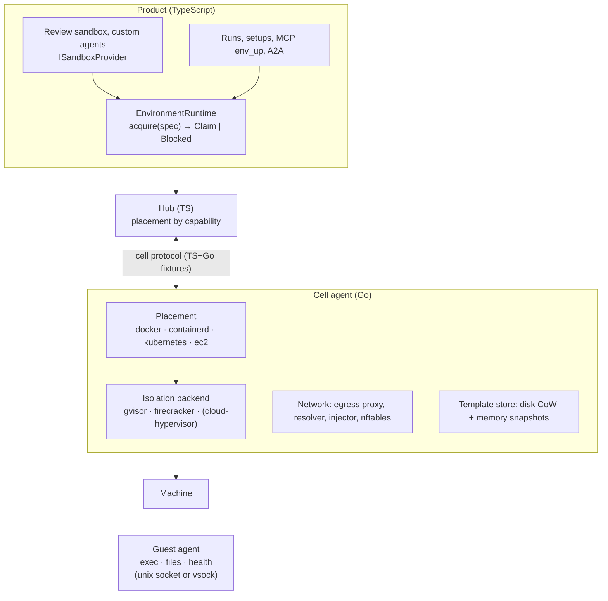
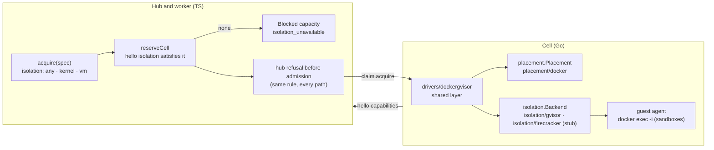
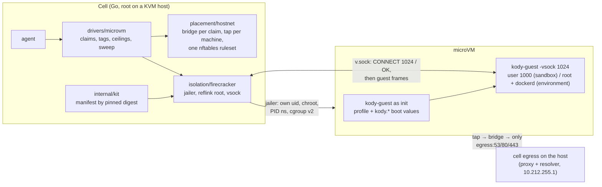

# Isolation architecture: machines, sandboxes and where they run

Plan of 2026-11-12. It extends [sandbox.md](sandbox.md) and the cell design to three goals at once: performance,
security and freedom inside the machine. It covers Kodus Cloud, self-hosted on Docker and self-hosted on
Kubernetes with one design. Terms are in [glossary.md](glossary.md).

## The technique

The current state of the art for agent sandboxes combines six pieces. Kodus has three of them today and part of a
fourth.

| # | Piece | Kodus today |
|---|---|---|
| 1 | microVM per machine (Firecracker; Cloud Hypervisor when a feature needs it) | ❌ gVisor only |
| 2 | Snapshot/restore with lazy memory loading (userfaultfd) and a shared copy-on-write base | ❌ (gVisor checkpoint spike only) |
| 3 | Block-level copy-on-write disks per machine (dm-thin or reflink files) | 🟡 reflink for the build state |
| 4 | A template per repository, made automatically, with the system already up | ✅ setup + Kody's recipe (no other product does this without a hand-written template) |
| 5 | Audited egress and secrets injected outside the machine | ✅ proxy, approval, injector; OpenBao in progress |
| 6 | A fallback where there is no KVM | ✅ gVisor |

Target: every claim is a machine restored from its environment's template, with copy-on-write memory and disk, egress
through the cell's proxy, secrets from OpenBao, and root inside. A sandbox of the customer's repo is ready in
milliseconds; a Run skips boot and build; the agent can install and run anything.

A side effect worth stating: because secrets never enter a machine, a memory snapshot never contains one.

## Two workloads, one machine model

| | Sandbox (agent) | Environment (Run, setup, MCP `env_up`) |
|---|---|---|
| Contents | Tool image + the repo at `/workspace` | The system: compose, databases, the build |
| Size | 1 vCPU, 0.5–2 GB | 4–8 vCPU, 8–16 GB |
| Matters most | Start latency, pause/resume, density | Build and disk I/O, ready data |
| Template | Tool image + repo checkout, snapshot after the guest agent is up | The setup's machine after the ready check, snapshot with the system running |

Both are a **claim** with a **shape** (`sandbox` or `environment`). One lease, one reaper, one egress, one injector.

## Layers and contracts



### C1. Product contract: `EnvironmentRuntime` (TS, `libs/runtime/environment`)

The single port every consumer uses. `ISandboxProvider` (`libs/sandbox`) becomes an adapter over it (ADR-035: one
lease, one reaper).

- `acquire(spec)` returns a `Claim` or a typed `Blocked`. `spec` carries:
  - `shape`: `sandbox` or `environment`;
  - the repo ref and the size;
  - the egress additions;
  - the secrets by name (never by value);
  - `isolation`: the minimum level (`any`, `kernel` for gVisor or better, `vm` for a microVM);
  - `resumeFrom`: a session snapshot id.
- On a claim: `exec`, `files.read/write/list/stat`, `pause` (returns a session snapshot id), `release`.
- `upload` and `status` from §5 come in through `files` and the Claim view.

### C2. Cell protocol (`libs/runtime/protocol`, fixtures shared by Jest and Go)

Additive messages, each with fixtures on both sides:

- **hello:** the cell announces `capabilities`: backends, `snapshotMemory`, `nestedDocker`, `kvm`, `arch`, and the maximum size.
- **claim.acquire:** gains `shape`, `isolation`, `template` (id + generation) and `resumeFrom`.
- **files.\*:** request and response, bounded.
- **claim.pause / claim.resume:** session snapshots.
- **template.ready:** emitted by a setup that produced a VM template.

The hub places a claim only on a cell whose capabilities satisfy its `isolation` and `shape`. A claim that asks for
`vm` and finds no such cell is `Blocked` (kind `capacity`), never placed lower.

### C3. Cell internals (Go)

Split today's `drivers/dockergvisor` into two interfaces:

- **Placement:** where machines live and how the network is attached. `docker` (the current path), `containerd`,
  `kubernetes`, `ec2` (both drivers frozen out of this tree).
- **IsolationBackend:** `Create(template) → Machine`, `Start`, `Pause`/`Snapshot`, `Restore`, `Destroy`, plus
  `Capabilities()`.
  - `gvisor`: runsc, the current behaviour, unchanged.
  - `firecracker`: jailer + firecracker. The rootfs is a block device made from the OCI image, plus a pinned guest
    kernel; networking is a tap device per machine; the guest agent is reached over vsock; snapshots come from
    Firecracker's snapshot API with userfaultfd lazy loading.
  - `cloud-hypervisor` (later): only for what Firecracker lacks (virtio-fs, GPU, hotplug).

Everything above these interfaces is shared: claims, leases, reaper, egress proxy and resolver, injector, canaries,
evidence, audit.

### C4. Guest agent (Go, inside every machine)

One small static binary that does exec (with streams, timeouts and output bounds), file operations (no-follow,
bounded) and health. It serves a unix socket in gVisor and vsock in a microVM. One implementation, one test suite,
both backends. The observer stays outside the workload machine, as today, and runs probes over the claim network.

### C5. Templates

The setup of the default branch already produces OCI images (the bake). On a cell with the `firecracker` backend it
also produces a **VM template**:

1. Boot a microVM from the base rootfs. Docker runs inside it, and the stock BuildKit runs on a real kernel, so the
   patch is not needed.
2. Build and start the compose.
3. Wait for the ready check to pass.
4. Snapshot the memory and the disk.

A Run restores two machines from that template. The PR side then rebuilds only the changed layers inside its VM. A
sandbox template is the tool image plus the repo, snapshotted once the guest agent is up.

Every restored clone gets a new entropy seed (vmgenid / reseed), a new hostname and new machine ids (ADR-004), so
clones never share RNG state. How, and what a snapshot may never hold: [isolation-p3-snapshots.md](isolation-p3-snapshots.md).

Templates live on the cell's disk as copy-on-write bases. Cloud cells can share them through the object store
(per-org KMS), which the evidence store already plans for.

## Where it runs

| Topology | Placement | Backend | Notes |
|---|---|---|---|
| **Kodus Cloud** | `ec2`: a fleet of cells on instances with KVM (bare metal, or recent x86 families with nested virtualization) | `firecracker`; `gvisor` kept as the fallback | Templates in the object store; autoscaling on pool targets |
| **Self-hosted, Docker host** (kodus-installer compose) | `docker` | Auto: `firecracker` when `/dev/kvm` is present, else `gvisor` (runsc registered in the host's Docker) | The cell container needs `/dev/kvm` and `CAP_NET_ADMIN` for the microVM backend |
| **Self-hosted, Kubernetes, sandbox runtime available** | `kubernetes` | The cluster's RuntimeClass: gVisor (e.g. GKE Sandbox) or Kata (e.g. AKS Pod Sandboxing) | No privileged pods; the cell schedules pods. Snapshots depend on the runtime |
| **Self-hosted, Kubernetes, dedicated node pool with KVM** | `kubernetes` (a DaemonSet of cells on that pool) | `firecracker` | Privileged on those nodes only; the same as the Docker host inside each node |
| **Hybrid** | Any of the above at the customer; control plane in Kodus Cloud | Any | The cell dials out only; nothing changes |

### Both sides of a Run on one backend

A mixed fleet (gVisor and Firecracker cells serving one org) must never put a Run's base on one backend and its PR on
the other: the two sides would differ by kernel and build path, and the verdict would blame the PR. `prefer` (the pool
cell) is soft, so the constraint is hard and lives in the worker's reservation (`shared/persistence/cell-directory.ts`):
a Runtime claim names its Run attempt's other side (`sameBackendAs`, from the `${runId}:${side}:${attempt}` key, its
first and renewed claim). Once that side has a claim or a reservation, live or released, only a cell of its `driver`
and `isolation` is eligible. Its backend full is a capacity wait (`no_capacity`); no connected cell of it is
`backend_unavailable` (kind `capacity`, a catalog card that says to run it again; a new Run places both sides afresh).
The org's advisory lock already serializes reservations, so two sides acquired together still see each other. The
physical admission ticket places both sides on one cell, so it needs nothing.

The class is driver plus isolation. The kit and kernel version are not in the cell's hello (adding them would break an
older hub's strict decoder), so they are held equal by pinning one kit per fleet, not by placement. No DBOS step
changed: the constraint is inside the existing `acquire:<side>:<attempt>` step.

### A VM's log outlives its jail

Every Firecracker machine records its states with their times (`created`, `restoring`, `launched`, `running`,
`paused`, `snapshotted`, `failed` with the error, `exited` when the VMM was gone before Destroy, `destroyed`) in
`<state>/vmstates/<id>.jsonl`, outside the jail (at most 32 KiB per machine). Before Destroy removes the jail, the
backend keeps the machine's states and the newest 64 KiB of its VMM's log in `<state>/vmlogs/`, one root-only file per
machine, token-shaped strings masked (`redact.Patterns`). The newest 128 files are kept, none older than 72 h
(`internal/isolation/firecracker/vmlog.go`). The microVM driver is now a `Diagnoser`: a failed setup's bundle has one
entry per VM of its claim, live or destroyed (`vm <machine>`, its last state, its states and then its VMM log), masked
again with the claim's redactor before it leaves the cell. Only the claim's own org and claim id read them.

The serial console stays off (`8250.nr_uarts=0`): turning the UART on is a guest-facing device and a security
decision, left for review. The VMM log stays at `Warning`, so a guest cannot fill the jail with log lines.

### Is the self-hosted image different?

No. There is one cell image, one binary and one code path for every topology; behaviour comes from configuration and
capabilities. What differs is what a topology needs next to it:

- **Cell image**: the same everywhere. Multi-arch, signed with cosign, the same digest in ECR and GHCR.
- **microVM kit**: only for the `firecracker` backend. A signed OCI artifact holding firecracker + jailer, the
  pinned guest kernel and the base rootfs images (guest agent, Docker for environments, tools for sandboxes). The
  installer pulls it by digest; the cell verifies its manifest by digest at start (P2: `microvm-kit/README.md`).
- **Builder image**: only for the `gvisor` backend (BuildKit with the ENOTSUP fix). A microVM builds with stock
  BuildKit inside the VM.
- **Host requirements** per profile:
  - `docker-gvisor`: runsc installed and registered;
  - `docker-firecracker`: `/dev/kvm`, cgroup v2, XFS (`reflink=1`) or btrfs for copy-on-write disks (P2 chose reflink
    files over a thin pool, "P2 as built");
  - `kubernetes`: a RuntimeClass, or a KVM node pool.
- **Offline bundle** for air-gapped installs: every image and kit in one OCI layout, loaded into the customer's
  registry, with the same digests.
- **OpenBao**: in the installer for every profile, with storage on the Postgres it already ships.

The installer exposes these as **profiles**. The cell refuses to start when its profile's requirements are not met,
and says which one is missing.

## Tests

The same behaviour has to hold on every backend, so the core is a conformance suite parametrized by backend.

| Layer | What | Where it runs |
|---|---|---|
| Unit | Rules: placement by capability, spec validation, bounds, placeholder swap, retention | Every PR |
| Contract | The cell protocol and the guest-agent wire format: one fixture set read by Jest and Go | Every PR |
| Backend conformance (Go) | One suite per behaviour, run against `gvisor`, `firecracker` and `kubernetes` (listed below) | gvisor on standard CI runners; firecracker on a CI runner with KVM; kubernetes on kind with a gVisor RuntimeClass, and Kata on a KVM runner |
| Security (S-01..S-52) | The existing case list, parametrized by backend | Nightly, and before a cell release |
| Performance gates | Cold boot, restore from template, sandbox create p50/p95, density per host, recorded per release | Nightly on the reference hosts; a regression over the threshold blocks the release |
| Product | A connected repo, the screens, `@kody runtime`, an agent using a sandbox: the existing rule | Dev stack, then dogfood |

Behaviours the conformance suite checks:

- a machine cannot reach a host that is not on the allow-list;
- a symlink in `/workspace` cannot read outside it;
- a placeholder secret becomes the real value only for its allowed host;
- a restored clone has a new entropy seed and new ids;
- two orgs never share a machine, a template or a pooled clone;
- a released machine is gone, and so are its disk and memory files;
- memory and CPU limits hold;
- pause → resume keeps files and processes.

## Reuse

- One claim model, one lease and reaper, one egress, injector and OpenBao path, one guest agent, one template pipeline,
  one protocol.
- A backend implements only create, start, snapshot, restore, destroy and network attach.
- `ISandboxProvider` keeps its callers unchanged. `e2b` stays as the Cloud provider until the `runtime-sandbox`
  provider reaches parity on the performance gates, then it is retired.

## Phases

| Phase | Delivers | Exit criterion |
|---|---|---|
| P0 (running now) | Sandbox on gVisor (claim shape, file API, tool image, pool); OpenBao and placeholder secrets; the builder fix; registry with tarball fallback | The review and custom agents run in a `runtime-sandbox` in self-hosted |
| P1 (built in code 12/11, below) | Placement / IsolationBackend split with no change in behaviour; the guest agent used by the gVisor backend; capabilities in hello; the conformance suite on gVisor | The suite is green on gVisor; product Runs are unchanged |
| P2 (built in code 12/11, below; not run on KVM) | `firecracker` backend: OCI → rootfs, tap + nftables, vsock guest agent, jailer, copy-on-write disks; the microVM kit | The conformance and security suites are green on firecracker; twenty boots in a microVM |
| P3 (backend built and proven on KVM 13/11: [isolation-p3-snapshots.md](isolation-p3-snapshots.md); the protocol and the template pipeline left) | Snapshots: lazy memory restore, VM templates from the setup, the pool from the snapshot, pause/resume | Sandbox create p95 under 300 ms from the template (measured 96 ms); a Run of twenty skips the base boot and the build of unchanged layers |
| P4 | Kubernetes (the driver is frozen out of this tree): a real cluster for `k8ssandbox` (gVisor and Kata RuntimeClasses), a chart that runs cells, the installer profiles and the offline bundle | A self-hosted install on Docker and on Kubernetes passes the product checks |
| P5 | Cloud fleet: EC2 cells with KVM, autoscaling on the pool, templates in the object store, metrics and alerts | One dogfood week with no hung Run; performance gates hold under load |

P1 starts after P0 lands, to avoid editing the same files twice. P2's exit needs a host with KVM, and the dev VM has
none. Creating one is the user's decision.

## P1 as built (12/11)

Not deployed; the conformance suite has not run on a gVisor cell yet.



**Interfaces.**

- `internal/isolation` (`isolation.go`): `Backend` with `Capabilities`, `Create(Spec) → Machine`, `Discard`, `Start`,
  `Pause`, `Snapshot`, `Restore`, `Destroy(name, {KeepData})` and `DialGuest`. `Capabilities` names the backend, its
  isolation, the OCI runtime its containers run under, how it suspends, `SnapshotMemory`, `NestedDocker`, the guest
  transport and the arches. `ErrUnavailable` / `UnavailableError` is a backend this host cannot run. `host.go` probes
  `/dev/kvm` (a character device the cell can open) and the arch.
- `isolation/gvisor`: runsc on the host's Docker. `New` refuses a Docker without runsc (`ErrNoRuntime`, the old
  `ErrNoIsolatedRuntime`). An environment machine is the holder plus its compose project: `Pause`/`Start` stop and start
  the project, `Destroy` takes it down (volumes unless a bake keeps them) and removes the holder. `Snapshot` and
  `Restore` fail with `driver.ErrUnsupported` until P3.
- `isolation/firecracker`: `New` and every method return `UnavailableError` ("no usable /dev/kvm" when that is
  missing, else "not built yet (phase P2)"); `Capabilities` is what it will offer (microvm, hibernate, snapshots, vsock).
- `internal/placement` (`placement.go`): `Placement` with `CreateNetwork` (no route out, a /24 of the pool, dynamic
  addresses in its upper half), `AttachEgress`, `DetachEgress`, `RemoveNetwork`, `NetworkLabels`. `placement/docker` is
  the code that was `dockergvisor/network.go` (`createClaimNetwork`, `claimSlot`).

**What moved.** `dockergvisor` keeps the shared layer: claim checks, limit groups, adoptions, the resolver file, the
build path, the registry, data and golden copies, bakes, the sandbox pool, the reaper. It now calls the backend for the
holder, observer and sandbox containers, suspend, resume and destroy, and the guest stream, and the placement for the
claim network and the egress attach. The helper containers it runs on a claim (builder, registry, data copies, browser,
compose services) take the backend's `OCIRuntime`. `-isolation-backend gvisor|firecracker` selects the backend; a cell
asked for firecracker does not start. An arch rule keeps `isolation` and `placement` free of the agent, the hub client
and the concrete drivers.

**Guest agent.** Sandboxes reach `cmd/kody-guest` through `Backend.DialGuest` (docker exec -i on gvisor). Environment
machines still exec with `docker exec` in the public service's container: on gVisor the services are host containers,
so the guest agent would have to enter the customer's own image, which changes what runs. The seam is
`dockergvisor/exec.go` `execIn`: on a microVM the guest agent runs in the VM next to the project's Docker and takes the
same exec op over vsock.

**Capabilities and placement.** hello carries `capabilities: {backends, snapshotMemory, nestedDocker, kvm, arch,
maxSize?}` (optional, strict; fixtures `hello-capabilities-*.json` read by Jest and Go). The product's acquire spec has
`isolation` (`any` when absent). The worker reserves only a cell whose hello `isolation` satisfies it
(`contracts/isolation.ts`: `kernel` takes sandboxed-container, microvm, vm; `vm` takes microvm, vm); with cells
connected and none that does, the acquire is `Blocked` with kind `capacity`, signature `isolation_unavailable`, and
nothing is sent. The hub applies the same rule before admission, so a claim that reached it another way is refused, never
placed lower. Placement reads hello `isolation`, the level a cell runs its claims under; `backends` is announced and
logged, and becomes a placement input once `claim.acquire` carries `isolation` to a cell with more than one backend (P2).
Deploy the hub before the cells: an older hub refuses a hello with `capabilities`.

**Conformance suite.** `test/conformance` (library, `Run(t, Target)`), on the fake in `test/conformance/fake_test.go`
and on gvisor in `test/gvisoregress/conformance_linux_test.go`.

| Behaviour | fake | gvisor |
|---|---|---|
| off-allow-list egress is refused (an allowed host answers, another host, an address and another resolver do not) | skipped: no boundary | real |
| a workspace symlink cannot read outside it (read, list, stat, write through a link) | real | real |
| a placeholder becomes the value only for its host (not another credential host of the claim) | real (in-process proxy and injector) | skipped: this harness starts no injector |
| two orgs never share a machine or pooled clone (files, network, a released pool machine) | real (network part skipped) | real |
| a released machine is gone with its files (no guest, not listed, no container or volume) | real | real |
| memory and CPU limits hold (512 MB cannot hold 1 GB; two spinners get about one CPU) | skipped: no limits | real |
| a restored clone gets a new entropy seed and ids | pending P3 | pending P3 |
| pause→resume keeps files and processes | pending P3 | pending P3 |

On the cell, with the tool image built (`docker buildx bake runtime-sandbox`):

```sh
cd apps/runtime-cell
KODY_E2E_GVISOR=1 KODY_E2E_SANDBOX_IMAGE=<tool image ref> \
  go test -count=1 -run TestGVisorKeepsTheConformanceBehaviours -v ./test/gvisoregress/
```

Left for P1's exit: the run above on the dev cell, and a Run through the product on the split driver. Also open:
admission tickets (`physical-admission-directory.ts`) reserve by size only, so a Run that asked `vm` through them would
be refused by the hub rather than routed. The reaper (`cmd/reaper -driver docker-gvisor`) now ends a machine through
the backend's `Destroy` (`gvisor.NewEnder`, which skips New's runsc check so a machine goes whatever runtimes the host
lists now); the shared layer's leftovers (built images, directories, golden data, claim networks) stay in the reaper.
It still finds machines by Docker labels, so a backend whose machines are not containers (firecracker, P2) needs a
`List` from its own state and a `-isolation-backend` flag on the reaper before it can be reaped.

## P2 as built (12/11, proven on a KVM host 13/11)

Not deployed, and no microVM has booted from this code: everything
below that needs KVM is listed as pending, with its command. Versions are the P2 spike's
(the Firecracker spike, not in this tree): Firecracker v1.18.0, Linux 6.1.188 with Firecracker's guest config (built here from kernel.org; the
spike used Firecracker's CI build of it), Ubuntu 24.04 by digest with docker.io 29.1.3 and BuildKit v0.34.0, and its
boot arguments (the `i8042.*` set took a sandbox's cold boot from 713 to 263 ms). From its findings: the accepted vsock
descriptor is `SOCK_CLOEXEC` (a command's background child held the host's connection open without it); Destroy waits
for the VMM to exit before it removes the tap (an immediate reuse hit `EBUSY`); clones share user-space RNG state, the
clock and a `boot_id` read before the snapshot, which is P3's to handle; and with more than about 100 VMs under load on
nested virtualization, some died on `KVM_EXIT_FAIL_ENTRY`. The spike ran Firecracker without the jailer and its guest
without a network fence, so both are new here.



**Design choices.**

- **Copy-on-write disk: reflink files, not dm-thin.** A machine's root is a `FICLONE` clone of the kit's base image,
  made in its jail: a plain file the jailed firecracker opens, removed with the jail, with no thin pool to size, watch
  or repair and no device-mapper or LVM tooling in the cell. P3's snapshots are files too. XFS has reflink on by
  default (xfsprogs 5.1+), btrfs always. A state directory that cannot clone (ext4, overlay, tmpfs) is refused at
  start, naming it and the file systems that work; there is no full-copy fallback, which would hide a 1–2 GB copy in
  every create. Clones cannot cross file systems, so the kit's images are copied once into
  `<state>/vm/bases/<sha256>` (checked again while copied). A sandbox's root is attached read-only and mounted `ro`;
  an environment's root is writable and it gets a sparse data disk (`-firecracker-*`, 40 GB apparent) that its init
  formats on first boot and holds Docker, containerd and `/workspace`.
- **Networking: a bridge per claim, a tap per machine, no route out.** `placement/hostnet` gives a claim a bridge
  (`kfb<hash>`) in a /24 of the pool (gateway `.1`, machines from `.128`) and each machine a tap (`kft<hash>`) owned by
  its VMM's user; the guest's kernel sets eth0 from `ip=`. The egress (cmd/egress: proxy and resolver) listens on one
  host address on a dummy interface (`kodus-egress`, default `10.212.255.1`, refused inside the pool); it is the
  claim's resolver and the address the resolver steers allowed names to. One nftables ruleset, replaced whole in one
  transaction on every change and re-applied from the state files on start: from any claim bridge, input reaches only
  the egress address on 53/udp and 53, 80, 443/tcp and is dropped otherwise; nothing is forwarded off a bridge (to the
  internet, the host's other networks, another claim); in the bridge family each tap may send only from its own MAC
  and IPv4 address (IPv4 and ARP, nothing else), so no machine speaks with another's source, on which the egress
  policy keys. A tap is fenced before it exists: if nft refuses the ruleset, no tap is made. On a host with Docker,
  each new claim network checks that `DOCKER-USER` starts with `-i kfb+ -o kfb+ -j ACCEPT` and inserts it once:
  with `br_netfilter` loaded (Docker loads it when a network needs it) a frame between two machines of one claim also
  crosses the IPv4 forward hook, where Docker's filter table drops it by policy, and the ruleset's same-bridge accept
  cannot override a drop in another base chain. The rule names every claim bridge, but a frame between two bridges
  never reaches it: the ruleset's forward chain (priority `filter - 10`) drops it first. This was chosen over
  `bridge-nf-call-iptables=0`, which is global and changes how Docker's own bridges are filtered. The rule stays when
  the cell stops, like the egress interface. A host that drops forwards some other way (no Docker chain) is not
  covered.
- **vsock.** Firecracker's hybrid vsock: the host connects to the machine's `v.sock` in its jail, writes
  `CONNECT 1024`, reads `OK <port>`, and the stream then carries the guest agent's length-prefixed frames, the same as
  gVisor's `docker exec -i` (`internal/vsock`, `cmd/kody-guest -vsock`). The handshake reads its acknowledgement one
  byte at a time, so nothing of the stream behind it is lost.
- **Jailer.** Each machine's VMM runs as its own uid (900000 + n, never shared by two live machines), chrooted in
  `<state>/vm/jail/firecracker/<id>/root`, daemonized in a new PID namespace, in `kodus-microvm/<id>` (cgroup v2):
  `memory.max` the guest's memory plus 128 MiB, `cpu.max` its vCPUs, `pids.max`; `fsize` (the kernel kills a VMM that
  writes past it with SIGXFSZ) 64 MiB for a sandbox, whose root is read-only and whose log is the only file it writes,
  and an environment's largest disk (its data disk, 40 GB) for an environment; and 1,024 descriptors. No serial console (`8250.nr_uarts=0`). Destroy kills the VMM only after
  checking its pid's command line still names the jail id (`--id <id>`, as the jailer passes it), then removes its
  cgroup (through `cgroup.kill` when something is still in it), tap, jail and record.
- **Guest init.** `kody-guest` (`guestinit.AgentPath`) is the kernel's `init=`. The kernel gives PID 1 no `/proc` and
  no `PATH`, so init mounts `/proc` before it reads anything, never asks for its own path (`/proc/self/exe`), and
  looks each program up in the `PATH` it gives that program (`guestinit.Setup` over a `Kernel` port, tested with a
  fake kernel that has neither). It reads the profile the rootfs builder baked in
  (`/etc/kody-guest/profile.json`, only the cell's two exactly) and the `kody.*` boot values (hostname, resolver, vsock
  port, `/workspace` and `/tmp` sizes); mounts `/sys`, `/dev`, `/run`, cgroup2, bounded `nosuid,nodev` tmpfs
  `/tmp` and (sandbox) `/workspace` owned by 1000; writes `/run/kody/resolv.conf` (`/etc/resolv.conf` links there);
  formats a blank data disk just before mounting it and starts dockerd on it (environment); then runs the server under
  the profile's user with `no_new_privs`
  (sandbox: 1000, as on gVisor) and restarts it if it dies.
- **Rootfs pipeline.** `internal/rootfs` (`cmd/kody-kit rootfs`): an OCI layout (a directory or a tar, as `docker save`
  and `buildx --output type=oci` write; zstd layers refused by name) or one exported tar, flattened tar to tar with the
  OCI whiteout and opaque-directory rules and every layer checked against its digest, owners and modes kept in the
  headers (no root needed); the guest agent, its profile and the resolver link added over whatever the image had; a
  sandbox loses every set-id bit and device node; then `mkfs.ext4 -d` (e2fsprogs 1.47.1+, with libarchive, in a UTF-8
  locale) with the UUID and hash seed from the content, so the same input makes the same image.
- **The kit.** `apps/runtime-cell/microvm-kit` (`docker buildx bake runtime-microvm-kit`; its sandbox base is
  `runtime-microvm-sandbox`, the sandbox tool image for `RUNTIME_MICROVM_PLATFORMS` only, so the x86_64 kit builds on
  an x86_64 host with no emulation): firecracker and the jailer
  from the v1.18.0 release by sha256 (and its `SHA256SUMS`), Linux 6.1.188 from kernel.org by sha256 cross-compiled
  with Firecracker's own `microvm-kernel-ci-*-6.1.config` (by sha256), `rootfs/sandbox.ext4` from `runtime-sandbox`,
  `rootfs/environment.ext4` from `environment.Dockerfile`, and `manifest.json` (each file by size and sha256). The
  release workflow pushes it to GHCR, signs it with cosign and prints the manifest digest. The cell takes
  `-firecracker-kit` and `-firecracker-kit-digest` and `internal/kit` refuses a manifest that is not that digest, a file
  that is not its manifest's size and sha256, a link or a path out of the kit, and another architecture. The kernel
  ships as a separate binary with a source offer in the kit's README.
- **Capabilities and the driver.** The backend reports `microvm`, `kvm`, `nestedDocker` true when the kit has the
  environment base, `snapshotMemory` false, suspend `hibernate` (Firecracker's pause: memory stays in RAM), guest
  `vsock`. `-isolation-backend firecracker` makes the cell open `drivers/microvm` (hello `driver: microvm`) instead of
  docker-gvisor, which refuses firecracker: its shared layer is Docker containers on the host. The microvm driver runs
  code sandboxes and bare environment machines and passes `drivertest.Run`; it says `NestedContainers` false and refuses
  a Run's upload and exec (`microvm.NoRuns`) until the compose boot inside a VM is wired. Before anything touches the
  host's network, `microvm.Open` checks every prerequisite and refuses naming all the missing ones: `/dev/kvm`, the kit
  (and why it did not load), root, cgroup v2 with memory, cpu and pids, `ip`, `nft`, `sysctl`, `/dev/net/tun`, a state
  directory short enough for a jail's socket path, and reflink.

**Proven without KVM.**

| Behaviour | Where | How it ran |
|---|---|---|
| The vsock handshake reaches the guest agent and carries its frames; a port nobody listens on is `ErrNotListening`; a bad acknowledgement is refused; bytes behind the acknowledgement are kept | `internal/vsock` | `go test` (a fake Firecracker socket, the real guest agent) |
| The guest agent's listener serves its frames on a real `AF_VSOCK` port | `internal/vsock` (`loopback_linux_test.go`) | `KODY_E2E_VSOCK_LOOPBACK=1 go test -run TestTheGuestListenerServesOnARealVsockPort ./internal/vsock/` in a privileged container (the kernel's vsock loopback, CID 1) |
| The boot values the cell writes read back the same in the guest; unknown or repeated `kody.*` refused; a sandbox's mounts are bounded tmpfs owned by its user; an environment's Docker and workspace are on its data disk; a profile that is not the cell's is refused | `internal/guestinit` | `go test` |
| An environment machine comes up from a kernel that gave init no `/proc` and no `PATH` (data disk formatted, dockerd and the server started); a sandbox serves as 1000 with `no_new_privs`; a formatted data disk is never formatted again; a program is found in the `PATH` init gives it | `internal/guestinit` (`init_test.go`) | `go test` (a fake kernel) |
| Layers apply as the OCI spec says; the guest agent, profile and resolver link are in every rootfs; a sandbox has no set-id file or device node; an escaping path, dangling hard link or path below a file is refused; an OCI layout gives the asked platform's layers; a tampered layer fails | `internal/rootfs` | `go test` |
| The ext4 image holds the tree with owners, modes, links and non-ASCII names, and is reproducible | `internal/rootfs` (`ext4_test.go`) | `go test` in `golang:1.27.4-trixie` with e2fsprogs 1.47.2 and libarchive |
| A kit loads only at its pinned digest; a changed file is refused by name; a link or a path out of the kit is refused; another arch is refused | `internal/kit` | `go test` |
| A claim network is a bridge in a free /24 that survives a restart; each machine gets its own tap, address and MAC; the ruleset leaves only the egress and fences each tap; a tap is not made when it cannot be fenced; the egress address is outside the pool; on a host with Docker the claim bridges are let through `DOCKER-USER` once, on one without nothing is added | `placement/hostnet` | `go test` |
| On a real kernel, a machine (a network namespace on the tap's place) reaches the egress's proxy and resolver ports and not the egress's other ports, the host through its gateway, another claim's machine or gateway, or the internet; a spoofed source address or MAC is dropped; with the drops removed the test fails | `placement/hostnet` (`kernel_linux_test.go`) | `KODY_E2E_HOSTNET=1 go test -run TestOnARealKernel ./internal/placement/hostnet/` as root in a privileged `golang:1.27.4-trixie` container (Linux 7.2) with iproute2 and nftables |
| On a real kernel with Docker's `FORWARD DROP` and `br_netfilter` loaded (`bridge-nf-call-iptables=1`), two machines of one claim reach each other on its bridge; with the pre-fix placement the same test fails (`10.213.246.128 does not reach 10.213.246.129`) | `placement/hostnet` (`kernel_linux_test.go`) | the same command, as root on the KVM host below (Ubuntu 24.04, Docker 29.1.3), 13/11 |
| A root is a copy-on-write clone (the base unchanged after a write to the clone); ext4 is refused naming XFS and btrfs | `isolation/firecracker` (`disk_linux_test.go`) | `KODY_E2E_REFLINK_DIR=<btrfs> KODY_E2E_NOREFLINK_DIR=<ext4> go test -run TestARootIsACopyOnWriteClone ./internal/isolation/firecracker/`, loop-mounted btrfs and ext4 in a privileged container |
| The jailer confines the VMM to the machine's user, jail, PID namespace and size; the VM config boots the guest agent read-only with its network and bounds, skips the i8042 probe, and its boot args parse back in the guest; a host without the prerequisites is refused naming each; an environment's VMM may write to the end of its disks, a sandbox's only to its log's bound; Destroy takes a pid for the VMM only when its command line carries `--id <id>` | `isolation/firecracker` | `go test` |
| Create → vsock → pause/resume → Destroy leaves no record, jail, tap or guest; two machines share no user, jail or address; a VMM that does not start leaves nothing; an environment on a kit without its base is unsupported | `isolation/firecracker` | `go test` (a fake VMM serving the API socket and the real guest agent on `v.sock`) |
| The microvm driver keeps the driver contract; a sandbox gets the sandbox shape on its claim's network; the sweep ends a lapsed lease; a cell asked for firecracker on a host that cannot run it refuses naming why and runs no host network command | `drivers/microvm`, `cmd/cell` | `go test` (`drivertest.Run` on an in-memory backend) |
| The kit builds and verifies: firecracker and the jailer from the release by checksum, the kernel built from kernel.org with Firecracker's config, both ext4 bases with the guest agent as init, their profiles and resolver links, no set-id bit in the sandbox (`/usr/bin/su` is 0755), dockerd and buildkitd in the environment; `kody-kit verify` passes on the output (manifest `sha256:07328aa7…` for that arm64 build) | `microvm-kit/` | `RUNTIME_MICROVM_PLATFORMS=linux/arm64 docker buildx bake runtime-microvm-kit --set runtime-sandbox.platform=linux/arm64 --set '*.output=type=local,dest=out'` on an arm64 Docker (native), 12/11; the x86_64 kit on the KVM host below |

**Proven on a KVM host (13/11).** A cloud instance with nested virtualization, Ubuntu 24.04, Docker 29.1.3 (`FORWARD DROP`),
buildx 0.30.1, nftables 1.0.9, Go 1.27.4, the state directory on a loop-mounted XFS with `reflink=1`, the P2 code of
that day. As root:

```sh
docker buildx bake --allow=fs.write=/var/lib/kodus-cell runtime-microvm-kit \
  --set 'runtime-microvm-kit.output=type=local,dest=/var/lib/kodus-cell'   # /var/lib/kodus-cell/kit
cd apps/runtime-cell
KODY_E2E_FIRECRACKER=1 KODY_E2E_FIRECRACKER_KIT=/var/lib/kodus-cell/kit \
KODY_E2E_FIRECRACKER_KIT_DIGEST="$(cat /var/lib/kodus-cell/kit/DIGEST)" KODY_E2E_FIRECRACKER_STATE=/mnt/xfs/kody-e2e \
  go test -count=1 -v ./test/fcregress/
```

The kit built as written in 1 min 45 s (the kernel layer cached from the spike; 153.6 s to compile it cold), x86_64
only, no emulation: manifest `sha256:e6857bb12ef070f717af6091fc3db11020291e8c4c632f70f956991206505bb0`, firecracker
`b33f46cd…`, jailer `ddadbaa1…`, kernel 6.1.188 `80cb614f…`, `rootfs/sandbox.ext4` `76d7ea24…` (1.38 GB),
`rootfs/environment.ext4` `1525f49a…` (1.90 GB, `nestedDocker: true`).

`test/fcregress`, three full runs after the fixes, `br_netfilter` loaded and `bridge-nf-call-iptables=1`:

| Behaviour | Result |
|---|---|
| off-allow-list egress is refused (the allowed host reached through the cell's egress proxy; another host, a bare address and another resolver refused) | pass, 3 of 3 |
| a workspace symlink cannot read outside it | pass, 3 of 3 |
| a placeholder becomes the value only for its host | skip (no injector in this harness, as on gVisor) |
| two orgs never share a machine or pooled clone | pass, 3 of 3 |
| a released machine is gone with its files (no record, jail, VMM, cgroup or tap) | pass, 3 of 3 |
| memory and CPU limits hold | pass, 3 of 3 |
| a restored clone gets a new entropy seed and ids; pause then resume keeps files and processes | skip (P3) |
| the environment machine runs Docker: the guest agent answers as root, `docker info` gives 29.1.3 on cgroup v2 | pass, 3 of 3 |
| two sandboxes of one claim reach each other on its bridge (TCP, the server sees the client's own address) | pass, 3 of 3; with the pre-fix `hostnet` it fails (the server's accept times out) |

| Time (create to the guest agent's first answer; Destroy) | Measured |
|---|---|
| Sandbox boot, 1 vCPU, 1 GiB, jailed, on its claim's bridge | 417–442 ms (6 boots) |
| Environment boot, 2 vCPU, 2 GiB, first boot formats its 40 GB data disk | 856–862 ms (3 boots); `docker info` answered 3–16 s after the start |
| Sandbox destroy | 42–78 ms |
| Environment destroy | 87–123 ms |

Leftovers after every run: no firecracker process, no `kodus-microvm/kfc-*` cgroup, no `kfb*`/`kft*` link.

What the first run on this host found, and the fix of each (a test that fails on the old code with each, the KVM-only
ones confirmed here):

| Found | Fix |
|---|---|
| Init died 0.6 s into every boot: `readlink /proc/self/exe: no such file or directory` (`os.Executable` as PID 1 before `/proc`) | `guestinit.Setup` mounts `/proc` first and takes its path from `AgentPath` |
| `exec: "mkfs.ext4": executable file not found in $PATH` (PID 1 has no `PATH`) | every program is looked up in the `PATH` init gives it |
| The kit command needed `--allow=fs.write=…` (buildx 0.30) and `--set runtime-sandbox.platform=linux/amd64` (the sandbox context built arm64 too, with no emulation) | `runtime-microvm-sandbox` builds for `RUNTIME_MICROVM_PLATFORMS`; the command above carries the entitlement |
| Two VMs of one claim cut off by Docker's `FORWARD DROP` once `br_netfilter` is loaded | the `DOCKER-USER` accept above |
| Destroy never killed a VMM: it looked for `--id=<id>`, the jailer passes `--id <id>`; the cgroup stayed busy, the jail went, the VM ran on | the command line read argument by argument; a busy cgroup emptied through `cgroup.kill` |
| The environment's VMM died on SIGXFSZ (`Shutting down VM after intercepting signal 25`): `fsize` 64 MiB, the data disk 40 GB | `fsize` is the largest disk the VMM writes |
| 713 → 263 ms boot with the `i8042.*` args (the spike) | already in the boot args; now asserted by the config test |

Not run here: the cell itself (`cell -driver docker-gvisor -isolation-backend firecracker -firecracker-kit …
-firecracker-kit-digest … -observer http …`) and a sandbox through the product (`runtime-sandbox` provider).

**Left.**

- An environment Run on a microVM: the compose boot, the build and exec through the guest agent inside the VM (the
  seam is `dockergvisor/exec.go` `execIn` and `up.go`); observer machines as microVMs; bakes. The driver refuses them.
- The security suite (S-01..S-52) parametrized for firecracker, and the placeholder behaviour with an injector in the
  firecracker harness.
- The cell's cgroup parent must be delegable: a cell in a container needs the host's cgroup namespace and a writable
  `/sys/fs/cgroup`.
- A host that drops forwarded traffic other than through Docker's chain (firewalld, a Kubernetes node's own policy)
  still cuts off two machines of one claim once `br_netfilter` is loaded.
- The cell and a sandbox through the product on a KVM host (above).
- Hardening after the first run: the network namespace per VMM, the out-of-process reaper, the per-VM limits and the
  host checks are built (below). Left: an arm64 kit (KVM on Graviton needs bare metal), and the release job for the
  kit, which has not run.

### The VM security items (built 13/11)

- **Out-of-process reaper.** `cmd/reaper -driver microvm -firecracker-state-dir <the cell's>` reads the cell's machine
  records and the host, never the cell's process: it destroys machines past `kodus:hard-expires` and its orphan pass
  ends what no record names (a VMM process, a cgroup under `kodus-microvm/`, a jail, a states file, a tap, a machine
  network namespace). A record exists before any of those and goes after all of them, so nothing in flight is taken
  for an orphan. The reaper never writes the nft table (the cell's placement owns it). The cell runs the same pass at
  start, and also prunes the claim networks no machine record holds, with their bridges and rules. It is meant to run
  as a systemd timer (`-once`), as the docker-gvisor reaper does. No unit ships for a KVM host yet, since there is no
  KVM host IaC (P5). S-08 runs the reaper binary, plus a machine whose
  record a dying cell lost.
- **Per-VM limits.** Each drive and the NIC, both ways, get Firecracker's token buckets, sized per vCPU: 100 MB/s and
  2500 IOPS per drive and 250 Mbit/s per NIC by default, capped at 500 MB/s, 12000 IOPS and 2000 Mbit/s a machine,
  with a one-time burst of 5 s. Operators set them with `-firecracker-disk-mbps-per-cpu`,
  `-firecracker-disk-iops-per-cpu` and `-firecracker-net-mbps-per-cpu` (`-1` turns one off). A restored machine gets
  this cell's buckets by `PATCH`, since a snapshot keeps the ones it was taken with. The VMM's cgroup gets `io.max`
  on the state disk (its whole disk, never a partition) at twice the drives' bandwidth: the bucket shapes the guest,
  and the cgroup bounds the VMM's own snapshot and writeback I/O.
- **VMM network namespace.** Each machine gets a namespace (`kfn…`). Its tap is there, bridged to a veth whose host end
  keeps the tap's name on the claim's bridge, so every fence rule that names the tap holds as before. The jailer
  joins it (`--netns`) on boot and on a restore. vsock and the API socket stay in the jail. Detach, the orphan pass
  and the reaper remove the namespace with the host end.
- **Host checks.** `-firecracker-host-policy shared` (the default) refuses a host with SMT, KSM or swap on, or a CPU
  vulnerability the kernel reports as not mitigated (`/sys/devices/system/cpu/vulnerabilities`). A host that does
  not say whether SMT is on is refused too. `dedicated` starts there and warns. Either policy sends what it found
  (SMT, KSM, swap, the unmitigated vulnerabilities, the microcode revision, the policy) in heartbeats to a hub that
  accepts `hostHardening`, and as the `cell_host_hardening` gauge. The hub logs each change and raises an alarm
  for a Kodus-owned cell that reports an unsafe host under `dedicated`. On EC2, a shared cell launches with one
  thread per core.

### What both backends share (production starts on gVisor)

- **One reaper.** `cmd/reaper` takes a driver plugin: `docker-gvisor` (labels and the work directory) and `microvm`
  (records and the host). The generic part (`internal/reaper`) ends what passed `kodus:hard-expires`. A driver that
  implements `OrphanReaper` also gets its orphan pass, which removes what it owns but no longer accounts for:
  - docker-gvisor removes the build, cache and BuildKit state directories of a machine none of whose containers is
    left, once they are older than 2 min;
  - microvm removes VMMs, cgroups, jails, taps and namespaces.
- **One limits policy.** `driver.IOLimits` holds the rates per vCPU, with defaults and ceilings, set by
  `-sandbox-disk-mbps-per-cpu`, `-sandbox-disk-iops-per-cpu` and `-sandbox-net-mbps-per-cpu`. Each driver enforces
  them its own way:
  - **microVM**: token buckets on each drive and the NIC, and `io.max` on the VMM's cgroup.
  - **docker-gvisor** (`-gvisor-io-limits`, off until it is proven on the production hosts):
    - each workload container (sandbox or environment holder) gets Docker's blkio limits (`--device-*-bps/-iops`,
      the container cgroup's `io.max`) on the disk Docker's data root is on;
    - its host-side veths get `tc`: a tbf toward the container and a policer from it;
    - a container whose veth cannot be shaped is removed and refused.
  - **Where the writes go.** A gVisor sandbox's `/workspace` and `/tmp` are tmpfs in its memory, and its root is
    read-only, so its memory limit bounds what it writes and the blkio limits apply to what a holder's services
    write. A microVM sandbox's workspace is in guest memory too.
- **One host check.** `internal/hostcheck` runs at start on any cell whose sandboxes share the host (docker-gvisor
  and microvm). `-host-policy auto` means shared on firecracker and dedicated on docker-gvisor, whose EC2 hosts run
  SMT today; a shared gVisor fleet sets `shared` once its hosts run one thread per core. Both drivers send the
  report.
- **Conformance.** The suite runs two more behaviours on both targets. The out-of-process reaper ends an expired
  machine and an orphan, and a noisy sandbox does not starve another org's. Where the target declares limits, the
  second also downloads a large file from the allowed host and checks that the rate lands near the limit. A
  sandbox's disk is in memory on both backends, so the drive buckets are proven on environment VMs in fcregress.

### Security suite on a KVM host

`scripts/runtime/kvm-security-suite.sh` runs as root on a KVM host. It builds the kit from the tree (or takes `-k`),
checks that the state directory is XFS with direct I/O if it is on a loop device, and runs `test/fcregress` with the
security suite, conformance, reaper, limits, netns, disk and demo-shop cases. It then fails if anything of a machine is
left on the host (a VMM, a `kfc-` cgroup, a `kft`/`kfb` link or a `kfn` namespace), and writes `summary.txt` with the
evidence lines and the OOM count. `.github/workflows/runtime-kvm-security.yml` runs it by hand on a self-hosted runner
labelled `kvm`. GitHub's hosted runners have no `/dev/kvm`.

The conformance suite on gVisor runs nightly on a GitHub-hosted runner (`.github/workflows/runtime-cell-gvisor.yml`:
runsc from gVisor's apt repository, `runsc install`, the sandbox image built in the job, the test as root). The KVM
workflow's schedule (nightly suite, weekly kit rebuild) is written but commented out: with no runner labelled
`[self-hosted, linux, x64, kvm]` a scheduled run only queues. Both conformance targets end with a skip table, and fail
on a skip they do not declare (`conformance.Target.MaySkip`).

A real CI needs, before the schedule is turned on:
- an ephemeral KVM runner per job: a bare-metal or nested-virtualization instance (c8i/m8i), started for the job and
  terminated after it, since the suite needs root and changes the host's network;
- an XFS state disk on instance NVMe or a dedicated EBS volume, not a loop file on the root disk;
- the runner's own IAM role, with nothing but its logs bucket;
- demo-shop's two checkouts (`KODY_E2E_KRSHOP_*`) baked into the runner image;
- a branch-protection rule that requires it on the paths `runtime-cell.yml` watches;
- on this public repository, settings that keep any other workflow off the runner, since a fork's pull request can
  add its own workflow with `runs-on: [self-hosted, kvm]` and a root shell on the host is what it would get:
  the runner in a runner group open only to `.github/workflows/runtime-kvm-security.yml@refs/heads/main` and not to
  public repositories' fork pull requests, registered just-in-time and ephemeral (one job, then gone), and
  "Require approval for all external contributors" on fork pull requests. The workflow itself also refuses to run
  outside `main` of `kodustech/kodus-ai`, but that check lives in a file a branch can change: the runner group is
  what holds.

### Kit rebuild cadence

The kit (guest kernel 6.1.y, the root file systems' packages, Firecracker) is rebuilt only on a release tag today.
`scripts/runtime/kit-rebuild.sh` is the weekly step.
1. It picks the newest patch of the pinned kernel line (kernel.org's `releases.json`) and of the pinned Firecracker
   minor (the GitHub releases API).
2. It builds the kit with `--no-cache`, so the distribution packages come fresh.
3. It scans both ext4 images with Trivy (`rootfs`, HIGH and CRITICAL).
4. It runs the promotion test, which is the KVM suite against the candidate.
5. It writes `promotion.json` with the old and new versions, the digest, the scan and the test result.

The script changes nothing remote. Promoting is a reviewed change: the pins in `microvm-kit/Dockerfile`, a kit release,
and the cells' `-firecracker-kit-digest`. A new kit retires the snapshots made with the old one (H13). The workflow
above runs it with `rebuild_kit`.

## Risks

- **Nested virtualization overhead on cloud instances.** Measure it against bare metal in the P2 spike before choosing
  the fleet type.
- **Firecracker has no virtio-fs.** Workspace I/O goes through block devices and the guest agent, so there is no live
  host↔guest folder sharing.
- **Guest kernel maintenance.** The kernel is pinned and rebuilt for security fixes, like the builder image.
- **Snapshot hygiene.** Entropy reseed, clock jump and network re-addressing on restore. All three are in the
  conformance suite.
- **Architecture.** Firecracker runs on x86_64 and aarch64, but KVM on AWS Graviton needs bare metal. The arm64 dev
  VM cannot host it.
- **Licenses.** Firecracker, Cloud Hypervisor, Kata and gVisor are Apache-2.0 (Cloud Hypervisor also BSD-3). OpenBao
  is MPL-2.0 and runs as a separate, unmodified service.
