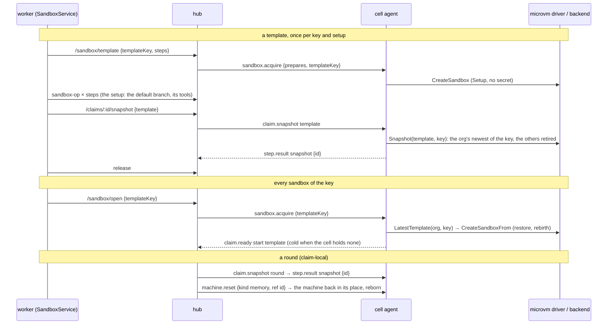

# Isolation P3: microVM snapshots and restore, done safely

Design and proof of 2026-11-13 for phase P3 of [isolation-architecture.md](isolation-architecture.md): Firecracker
memory snapshots of sandboxes and environments, restored as many machines (templates) or as one (sessions), with
nothing a restored machine shares with another that it must not.
Terms are in [glossary.md](glossary.md). Spike numbers are from the Firecracker spike (not in this tree); the ones this design rests on are quoted below: on the same `m8i.2xlarge`, a
sandbox restored from a File-backed snapshot to its first command in 37.6 ms (36.4–39.8, page cache warm; 339 ms cold)
against 76 ms with the lazy UFFD handler, a running environment to `/healthz` in 0.42 s (11 s from gp3 cold); four clones
of one snapshot gave four different `/dev/urandom` reads (VMGenID, RDRAND) but the same Python `random.random()`;
`boot_id` was shared once read before the snapshot; a restored environment's clock was 67 s behind.

**Needs a security review before it is turned on** (security-sensitive): the threat model and its
residual risks (below), the taint contract, and the choices marked _review_.

## Answer first

- **Every hazard the spike found is handled, and a test fails on each when it is not.** On the KVM host, two clones of
  one template differ in `boot_id` (even though the template read its own before the snapshot), host name, MAC,
  address and kernel randomness; a clone's clock is within 50 ms of the host's 3 s after the template; two clones of
  one claim reach each other and the egress; a machine with secrets and a sandbox running a workload process are
  refused (a pooled and a non-setup machine too, in the unit tests); a template never restores into another org; a
  session restores once. With the rebirth removed (negative control below) the id, clock and network behaviours fail.
- **Sandbox restore to the guest agent's first answer: p50 80–84 ms, p95 84–90 ms** (20 restores in each of four
  runs, jailed, on its claim's bridge, rebirth included), against the P3 exit's 300 ms and a 446 ms cold boot.
  Environment restore with Docker and a running container: 114–166 ms to the first answer.
- **The guest's init makes each restored machine its own before its workload runs again**: the cell sends 64 bytes of
  its randomness, its clock, new names and the new tap's address over a privileged vsock port; init reseeds the kernel
  generator (`RNDADDENTROPY` + `RNDRESEEDCRNG`), sets the clock, binds a new `boot_id` and `machine-id`, re-addresses
  eth0, and only then thaws the workload's cgroup, frozen since before the snapshot.
- **A snapshot never holds a secret** by rule, not by hope: a machine handed the org's secrets or a credential is
  tainted before it exists and the backend refuses it. A snapshot ends its source machine.
- **A whole demo-shop Run goes through the hub protocol on microVMs.** It covers setup, bake to template, base and PR,
  probes through each claim's observer VM, a compose reset, and a round with memory resets, and it reaches the product's
  verdict. The base side is ready in 15.5 s (gVisor 3 min 40 s), and a memory reset to the probe's answer takes about
  0.2 s. The observer VM is reached over vsock only, so the network fence did not change (see "A whole Run through
  the hub protocol").

## Sources

Primary sources read for this design (Firecracker at tag v1.18.0, the kit's release):

| Source | What it settles here |
|---|---|
| Firecracker `docs/snapshotting/snapshot-support.md` | MAP_PRIVATE file-backed memory; the memory file must stay immutable; "Usage examples" (a source that resumes after its snapshot makes every clone insecure); VMGenID on every restore; `clock_realtime` (host Linux ≥ 5.16); vsock reset closes connections, listeners survive; only CRC on the state file, so integrity and encryption are the integrator's; restore only on identical hardware and software; disk quotas against DoS |
| `docs/snapshotting/random-for-clones.md` | The race between vCPU resume and the VMGenID reseed; `RNDADDENTROPY` + `RNDRESEEDCRNG` before customer code; delete `/var/lib/systemd/random-seed`; bind-mount over `boot_id`; user-space PRNG state is not fixable generically |
| `docs/snapshotting/network-for-clones.md` | `network_overrides` for a new tap; the guest must reconfigure itself over vsock; flush neighbours |
| `docs/snapshotting/handling-page-faults-on-snapshot-resume.md` | UFFD flow, handler in the jail, a dead handler hangs the VMM |
| `docs/hugepages.md`, swagger `SnapshotLoadParams`/`SnapshotCreateParams` | `2M` pages need UFFD; `sync_snapshot_files` (v1.17) returns before the writeback |
| `FAQ.md` (wall clock) | `ptp_kvm` + chrony for long-lived guests |
| Linux 6.1.y `drivers/virt/vmgenid.c`, `drivers/char/random.c` | `add_vmfork_randomness` reseeds in the ACPI notify path (asynchronous); `RNDRESEEDCRNG` needs `CAP_SYS_ADMIN`; 6.1 sends user space no VM-fork event |
| Kit kernel config (`microvm-kernel-ci-x86_64-6.1.config`) | `CONFIG_VMGENID=y`, `HW_RANDOM_VIRTIO=y`, `PTP_1588_CLOCK_KVM=y` |
| AWS Lambda SnapStart, "Handling uniqueness" and "Networking best practices" | Lambda reseeds the kernel RNG on restore; user-space uniqueness is the function's (hooks, CSPRNGs); re-establish connections |
| Brooker et al., "Restoring Uniqueness in MicroVM Snapshots" (arXiv:2102.12892) | Secrets in memory and uniqueness are the two problems of cloned snapshots |
| E2B `envd` `/init` (e2b-dev/infra, Apache-2.0) and its persistence docs | Freeze the user cgroups before pause, thaw in `/init` after setting the clock; refuse a pause when the guest agent does not answer |
| Fly.io suspend/resume docs | One machine resumes its own snapshot; clock lags until NTP; connections may be dead |
| CodeSandbox, "How we clone a running VM in 2 seconds" | Copy-on-write memory and disks for clones; network and IP duplicates left unwritten |
| Modal memory snapshots docs | A value initialized randomly before the snapshot is identical after every restore |

## Threat model

**What a snapshot is.** Every byte of the guest's memory (kernel and user space, freed pages too), the device state,
and an environment's disks at that instant. Whoever restores it holds all of it, and so does the workload of every
machine restored from it: a fork PR's code in a clone can read its whole memory as root of its own VM.

**Invariant 1: a snapshot holds nothing a restored machine's workload may not know.** So no secret, credential or
canary ever enters a machine that may be snapshotted, and a template is made only by a setup's machine that ran no PR
code (S-52), for its own org.

**Invariant 2: no machine continues the snapshot's state but one, unless it was made its own first.** A template's
source never runs again; a session restores once; every restored machine is reborn before its workload runs.

| # | Hazard | Handling | Test that fails without it |
|---|---|---|---|
| H1 | Kernel RNG shared by clones, and the race between vCPU resume and the VMGenID reseed | VMGenID (always on in Firecracker) plus, before the workload thaws, `RNDADDENTROPY` of 64 host bytes credited and `RNDRESEEDCRNG`; the workload is frozen across the window | `guestinit` order test (entropy first, thaw last); KVM: clones' first `/dev/urandom` read and `os.urandom` differ |
| H2 | User-space RNG and ids of processes in the template | Sandbox template: refused while any workload process runs (only init and the guest agent, whose randomness is `crypto/rand` per call). Environment template: residual, below | `guestinit` refusal test; KVM: a template with `sleep` running is refused and the sandbox runs on |
| H3 | `boot_id` shared once read before the snapshot | A new `/run/kody/boot_id` bound over `/proc/sys/kernel/random/boot_id`; init reads it back and the cell checks it | KVM: the template reads its `boot_id`, both clones differ from it and from each other; negative control: shared |
| H4 | `machine-id` and host name shared | New host name per machine; a new `machine-id` bound over `/etc/machine-id` when the image has one (also at every boot: the environment image ships one) | KVM ids test |
| H5 | Seed files of an init system | Removed at prepare and after rebirth | `guestinit` test |
| H6 | Same MAC and IP in two clones; stale neighbours and routes | `network_overrides` to the new tap; init sets eth0 down (routes and neighbours go), MAC, address, up, default route by rtnetlink; the bridge fence drops anything else | KVM: two clones of one claim reach each other and the egress; negative control fails |
| H7 | TCP connections and TLS sessions of the template | Re-addressing kills every pre-snapshot connection off the VM (old source address, dropped by the fence); vsock connections reset by Firecracker; the egress proxy (Go `crypto/tls`) accepts no 0-RTT early data, so a replayed session ticket carries no request | KVM network test (clones reconnect through the egress) |
| H8 | Stale clock (the spike: 67 s behind) | `clock_realtime: true` on x86_64 (kvmclock moves on before any guest instruction), then init sets `CLOCK_REALTIME` to the host's time plus the time since it read the request | KVM: clone clock within 50 ms of the host 3 s after the template (+23.5 to +26.3 ms inside a ~40 ms exec window); negative control 18.6 s behind |
| H9 | Secrets in a memory snapshot | Taints recorded in the backend's record before the machine exists (`MachineSpec.Secrets`, `UserData`) or later (`Taint`, before the handover); `vmsnap.Admit` refuses any snapshot of a tainted machine; pooled machines (handed to claims later) never snapshot | `vmsnap`, `firecracker`, `microvm` unit tests; KVM: a machine with secrets refuses both kinds and runs on |
| H10 | A source that resumes after its snapshot | `Snapshot` destroys the source, also when the VMM failed after it started writing; it resumes and thaws only when nothing was written | `firecracker` tests (remains empty; failed create ends the machine) |
| H11 | A template of org A restored for org B | The store keeps one directory per org (`sha256` of the org id); `Restore` looks the id up under the spec's org only and the manifest's org must match; the driver also refuses a ref of another org | unit tests (forged ref); KVM test |
| H12 | Tampered or corrupted snapshot files | Files `root:root`, directories 0700, memory 0444 (read through a hard link by a VMM user chrooted elsewhere); a manifest written last with every file's size, time and `sha256` (holes skipped); the state file's digest checked on every restore, every file's once per cell process, a changed size or time refused; a round's memory and disks have no digest (it never outlives the process that published it, which another process refuses) | `vmsnap` tests (rewritten state file, changed memory byte, a byte in a sparse hole) |
| H13 | A snapshot restored on another kit, kernel or CPU | The manifest's kit digest and host fingerprint (CPU vendor, family, model, stepping, microcode, flags; host kernel release; firecracker sha256) must equal this cell's; a new kit retires every snapshot (its guest kernel may carry fixes the old memory does not) | `vmsnap` and `firecracker` tests |
| H14 | Disk filled by snapshots (DoS) | A bound on bytes per org and per cell, checked before a snapshot; sweep by age (sessions, templates), unfinished and claimed leftovers after 15 min, kit or host retired, oldest first over a bound | `vmsnap` sweep test |
| H15 | A session restored twice | `Claim` renames its manifest aside before the restore; the snapshot is removed after | unit test; KVM session test |
| H16 | The VMM killed while writing its memory file (`RLIMIT_FSIZE`) | Every VMM's file bound covers its memory size | jailer test |

**Residual risks (_review_).**

- **Environment templates carry their processes' user-space state.** A template made with compose running holds
  Postgres, Redis and the app as they were: their PRNGs, cached ids and anything they generated (an app that makes a
  signing key at start shares it with every clone). Mitigations: nothing secret is in it (H9); clones are of one org
  and one environment, from its default branch, which every PR of that org could reproduce; the workload is frozen
  until the kernel is reseeded, so anything that reads the kernel after the thaw is fresh; OpenSSL 3 reseeds its DRBG
  from the kernel on a schedule, not at once. Not fixable generically (Firecracker's own doc says so); the product
  answer is a recipe-level "after restore" hook, not built.
- **Docker containers read the kernel's `boot_id`**: they mount their own `/proc`, so the bind covers init's mount
  namespace (the guest agent and its commands), not the containers'. Shared only when something read it before the
  snapshot.
- **Kernel layout, stack canaries and boot-time kernel secrets** (KASLR offset, `net_secret` for ports and sequence
  numbers, syncookie keys) are cloned. A clone's workload learns its own; using them against another clone needs a
  path into that clone's kernel, which the fence closes (no spoofed source, no bridge between claims). The boundary
  that matters, the VM against the host, does not depend on the guest's layout.
- **Freed memory**: a template's memory holds pages its setup freed. Only the org's own data can be there (H9);
  `init_on_free=1` would zero them at a CPU cost, not set.
- **At-rest encryption is the host volume's** (EBS default encryption on Cloud; the operator's disk on self-hosted):
  File-backed restore maps the plaintext file. Moving snapshots between cells (P5) must encrypt per org with the org's
  KMS key before they leave the host; nothing leaves the host in P3.

## Design

```mermaid
sequenceDiagram
  participant A as Shared layer (driver)
  participant B as firecracker backend
  participant S as vmsnap store
  participant V as VMM (jailed)
  participant I as guest init (PID 1, vsock 1023)
  Note over A,I: Snapshot (template or session)
  A->>B: Snapshot(machine, purpose, org)
  B->>B: vmsnap.Admit(record: org, setup, pool, taints)
  B->>S: Sweep, Room(org, bytes)
  B->>I: prepare(purpose)
  I-->>B: ok (sandbox template: only init and the agent run; seeds removed; workload frozen)
  B->>V: PATCH /vm Paused, PUT /snapshot/create (sync off)
  B->>S: Stage(org), move vmstate+mem, reflink env disks, Publish (chown, modes, digests, fsync, manifest)
  B->>V: Destroy the source (it never resumes)
  Note over A,I: Restore
  A->>B: Restore(ref, spec of org X)
  B->>S: Open/Claim(X, id): manifest, sizes, times, digests; kit and host match
  B->>B: record, VMM user, tap, jail: vmstate copy, mem hard link, root/data reflinks
  B->>V: jailer (API only), PUT /logger, PUT /snapshot/load (File, network_overrides, clock_realtime, resume)
  B->>I: rebirth(seed, clock, names, ids, MAC/IP/gw, resolver)
  I-->>B: ok, boot_id read back (reseeded, clock set, re-addressed, thawed last)
```

**When snapshots are taken.**

- _Template_: a setup claim's machine (`MachineSpec.Setup`, the default branch, no PR code, no secrets) once its
  ready state is reached: a sandbox once its guest agent is up with the repo in `/workspace`, an environment once its
  ready check passes. Many machines of the same org then start from it. The machine ends.
- _Session_: any untainted machine set aside (an idle agent session, `claim.pause`); it comes back once, its
  processes included, then the snapshot is gone. Machines that ran PR code may do this for themselves.
- Never: a pooled machine (it is handed to a claim later), a machine handed secrets, credentials or canaries, a
  restored machine as a template source (only setups make templates).

**Where they live.** `<state>/vm/snapshots/<org key>/<ksn-id>/` on the cell's reflink file system: `manifest.json`,
`vmstate`, `mem`, and for an environment `rootfs.ext4` and `data.ext4` (reflinks of its disks at the snapshot). The
id is random, never derived from a machine or an org.

**Memory backend: File, not UFFD.** On a local disk File restores in 37.6 ms against 76 ms for the lazy UFFD handler
and runs a command that touches new pages 2.4× faster (spike); UFFD adds a handler process per VM that hangs the VMM
if it dies. UFFD pays when memory comes from somewhere the kernel cannot map (the object store, a peer cell): P5. The
memory file is hard-linked into each clone's jail, so every clone of a template shares one inode and its page cache
(a reflink copy would have its own cache and restore cold).

**Files and durability.** `sync_snapshot_files: false` (v1.17), then the store reads every file back for its digest
and syncs it before the manifest exists; a crash before that leaves a directory without a manifest, swept after 15
minutes. Digests skip holes (`SEEK_DATA`), so a 40 GB sparse data disk costs what it holds. A round is the
exception: it lives as long as its claim, on this host, in this process, so its memory file and disks are neither read
back nor synced (only its state file is); their size and time still guard them, and a process that did not publish it
refuses it (`vmsnap` `unhashed`). Read back and synced, kodus-ai's round (10 GiB of memory, its disks reflinked) took
4m22s on a 125 MB/s gp3.

**Not used (_review_).** Huge pages (`2M` needs UFFD; `Transparent` is not measured); diff snapshots (developer preview
in v1.18); the balloon; `track_dirty_pages`; VMClock's `vm_generation_counter` (the 6.1 kit kernel has no `poll()`
for it, and the cell tells init directly, in order).

## Contracts in the cell

| Layer | Contract |
|---|---|
| `isolation.Backend` | `Snapshot(ctx, name, SnapshotRequest{Purpose, Org})` ends the machine; `Restore(ctx, ref, spec)` finds the snapshot under `spec.Org`; `Taint(ctx, name, why)` before handing a machine what it names; `Spec.Org/Setup/Pool/Taints` recorded before the machine exists. gvisor: unsupported, `Taint` keeps nothing (it has no snapshot to stop) |
| `isolation/vmsnap` | `Admit` (the rules), `Manifest.Check/Restorable`, `HostFingerprint`, `Store` (`Stage`, `Publish`, `Open`, `Claim`, `Remove`, `Room`, `Sweep`) |
| `guestinit` control | vsock port 1023 (below 1024: only root binds it), host CID only, one JSON line each way (4 KiB): `prepare{purpose}`, `thaw`, `rebirth{seed, unixNano, hostname, bootId, machineId, net, dns}`; init's workload cgroup `kody-workload` (`agent` for the server and dockerd, `docker` as Docker's `--cgroup-parent`) |
| `drivers/microvm` | `Snapshot(ref, purpose)`, `CreateSandboxFrom`/`CreateFrom(spec, ref)` (refuses another org's ref), `Taint`; the spec's `Secrets` and `UserData` become taints; `Setup` only for a workload; the sweep also sweeps snapshots |
| agent | sets `MachineSpec.Secrets` when the claim carries the org's secrets (`prepare.go`, `sandbox.go`); serves `claim.snapshot`, `machine.reset` kind `memory` and sandboxes from snapshots through `Config.Parts.Snapshots` (`driver.Snapshotter`, `snapshots.go`); names the `snapshots` feature only with one |
| protocol, hub, worker | below, "Wiring" |

## Acceptance tests and results

Local (darwin, `go test`): `internal/isolation/vmsnap`, `internal/isolation/firecracker` (a fake VMM serving the API,
the guest agent and a fake init on `v.sock`), `internal/guestinit` (a fake kernel), `internal/drivers/microvm`,
`internal/agent`, `test/conformance`: all pass; `GOOS=linux go vet` on the Linux-only files.

KVM host (a cloud instance with nested virtualization, Ubuntu 24.04, the state on a loop-mounted XFS with `reflink=1`
on a network block volume; the kit rebuilt from this branch), as root:

```sh
docker buildx bake --allow=fs.write=/var/lib/kodus-cell/p3 runtime-microvm-kit \
  --set 'runtime-microvm-kit.output=type=local,dest=/var/lib/kodus-cell/p3'
cd apps/runtime-cell
KODY_E2E_FIRECRACKER=1 KODY_E2E_FIRECRACKER_KIT=/var/lib/kodus-cell/p3/kit \
KODY_E2E_FIRECRACKER_KIT_DIGEST="$(cat /var/lib/kodus-cell/p3/kit/DIGEST)" KODY_E2E_FIRECRACKER_STATE=/mnt/xfs/kp3 \
  go test -count=1 -v ./test/fcregress/
```

Four full runs on the code of this branch (runs 2–4 with a kit built from an earlier commit whose guest code is
the same; run 5 with the kit rebuilt from this code, manifest `sha256:fcb83e75…`), 18 of 18 behaviours pass in
each, one skipped as on P2 (the injector is not in this harness). After every run: no firecracker process, no
`kodus-microvm/kfc-*` cgroup, no `kfb*`/`kft*` link.

| Behaviour | Result |
|---|---|
| P2's behaviours (egress, symlink, two orgs, released machine, limits, Docker in an environment, two machines of one claim) | pass, 4 of 4 |
| a restored clone gets a new entropy seed and ids (template read its `boot_id`; `boot_id`, host name, `machine-id`, first `/dev/urandom` read, `os.urandom`, MAC differ, the template's file kept) | pass, 4 of 4 |
| a restored clone's clock is the host's (3 s after the template) | pass, 4 of 4: +23.5 to +26.3 ms inside a 38–42 ms exec window |
| two clones of one template reach each other on their claim's bridge and the allowed host through the egress | pass, 4 of 4 |
| a machine handed secrets never becomes a snapshot (template or session), and runs on | pass, 4 of 4 |
| a template never restores into another org (its own ref, or one naming the other org) | pass, 4 of 4 |
| a sandbox template refuses while a workload process runs (`nohup(262)` named) and the sandbox runs on | pass, 4 of 4 |
| a session restores once with its files and its running process | pass, 4 of 4 |
| pause then resume keeps files and processes | pass, 4 of 4 |
| an environment template with Docker and a container under `/kody-workload/docker/<id>` (`memory.max` 64 MiB) restores twice: the container runs, Docker answers, the clock is the host's, boot ids differ | pass, 4 of 4 |

| Time | Measured |
|---|---|
| Sandbox restore (1 GiB, jailed, on its claim's bridge) to the guest agent's first answer, 20 runs per run | p50 79.9–83.9 ms, p95 83.6–90.2 ms, max 97.3 ms (the rebirth answers at p50 68–69 ms) |
| Sandbox cold boot, for scale | 446 ms |
| Environment restore (2 GiB, Docker, one container) | 98–146 ms to the rebirth, 114–166 ms to the first answer (628 ms once, the first restore right after its template) |
| Sandbox template, pause to published (1 GiB memory written, read back for its digest, synced, on gp3) | 8.5–8.7 s |
| Environment template (2 GiB, both disks reflinked) | 21.4–21.9 s (50 s before digests skipped holes) |

**Negative control.** The same tests with init's rebirth reduced to the thaw and no `clock_realtime` (a scratch copy
on the host, not committed): the clones share `boot_id` (and keep the template's), host name and MAC; the clone's
clock is 18.6 s behind the host's; two clones of one claim do not reach each other. Kernel randomness still differed
(VMGenID and RDRAND), so that test cannot show the reseed race; the ordering test in `guestinit` does.

**What the KVM runs found and fixed.**

| Found | Fix |
|---|---|
| A 1 GiB snapshot's create took over 30 s right after a 3 GB write on gp3 and hit every API call's 30 s bound; the source ended (as designed once a create has started) | The create is bound by 30 s plus 2 min per GiB (`createTimeout`), with a test that fails on the old bound |
| The environment template took 50 s: its 40 GB sparse data disk was read in full for the digest | Digests skip holes (`SEEK_DATA`/`SEEK_HOLE`); a byte written in a hole is still refused |
| A failed environment test left its template source running (three machines found after the first runs) | The tests destroy the source on cleanup |
| The guest agent as a container's PID 1 boots instead of serving | The test runs it under Docker's init |

## Wiring (13/11)



- **Protocol** (`libs/runtime/protocol`, feature `snapshots`, mirrored in the Go decoder, a shared fixture per
  acceptance and refusal): `sandbox.acquire` `prepares` (needs `templateKey`, no `secrets`), `templateKey`, `resumeFrom`
  (with neither); `claim.snapshot {stepId, purpose: template | session | round}` answered by `step.result.snapshot {id,
  purpose, ms}` (an exclusive VM result); `machine.reset` kind `memory`; `claim.ready.start` `template` and `session`
  (sent only to a hub that accepts `snapshots`). The cell names the feature only with a snapshot driver.
- **Hub** (`apps/runtime/src/hub`): the snapshot fields go only to a cell that names `snapshots`; a template or a
  session asked of another cell is blocked `snapshot_unsupported`, a `templateKey` alone is dropped (the sandbox boots
  cold). `POST /internal/claims/:id/snapshot` sends `claim.snapshot`; `/reset` takes `roundSnapshotId` (kind `memory`).
- **Worker** (`apps/runtime/src/worker/sandbox`): `/sandbox/template` opens a sandbox that prepares the org's template,
  runs the caller's setup steps (each must succeed), keeps the template and releases the sandbox whatever happened;
  `/sandbox/open` takes `templateKey` and `resumeFrom`; `/sandbox/snapshot` keeps a session or a round, never a
  template (only the template route makes one).
- **The template pipeline and its invalidation.** A template comes only from a sandbox opened with `prepares` (made as
  a setup's machine, never handed a secret, not marked as running untrusted code), through `claim.snapshot template`,
  under the backend's rules as before. A new setup of a key makes a new template, which retires the org's older ones of
  that key at once; a new kit (guest kernel, firecracker) or another host fingerprint makes every older template
  unrestorable (`LatestTemplate` skips it, `Sweep` removes it); `TemplateTTL` (7 days) bounds one nobody replaced.
  Machines already restored keep running on their hard links.
- **Round**: purpose `round` in `vmsnap.Admit`, allowed
  whatever the claim was handed (its placeholders, canaries, PR code) because it is restored only into that claim's same
  machine (the manifest names the claim and the machine; any other restore is refused), never pooled, never a template;
  it is taken when asked, the source ends, and the machine comes back at once from it in its place (same name, address
  and MAC, so its egress policy and peers still name it), reborn (new boot id, reseeded kernel generator, the host's
  clock); each `machine.reset` kind `memory` restores it again, reborn again. Removed with the claim (`ReleaseClaim`)
  or after `RoundTTL` (5 h, past the longest claim ceiling). Every round of one claim restores the same user-space state
  (perf §7 "Entropy"): within one claim this crosses no boundary.
- **What the worker's replay switch-over needs (not built, for after review).** At the claim's first ready state
  (after the ready check and golden data), `POST /claims/:id/snapshot {purpose: round}` and keep the id on the Run's
  side; each round's reset then calls `/reset` with `roundSnapshotId` instead of the compose-volumes reset; on a cell
  that does not name `snapshots` (gVisor) keep today's reset. It also needs an environment Run on a microVM (the
  compose boot inside the VM, P2's left item): the round works on any microVM machine of a claim (proven on sandboxes
  below), but no environment claim boots on one yet.
- **Environments from templates (not built).** The same backend makes and restores environment templates
  (`TestFirecrackerEnvironmentTemplateRestoresWithItsContainers`), but a setup claim does not boot on a microVM yet, so
  nothing in the product makes one. The seam is the bake: `drivers/microvm` as a `Baker` and `BakeSourcePinner` whose
  bake is `Snapshot(template)` of the pinned setup machine, and `Create` of an image that is a template restoring it;
  the hub and worker's `image.bake` and `latest` image flow then carry it unchanged.

**Proven on the KVM host (13/11).** The same host and harness as above; the kit rebuilt from this code (manifest `sha256:0b588bb7…`); three full `fcregress` runs, every test green in each
(`TestFirecrackerSandboxesResumeFromATemplateThroughTheHubProtocol` new: the cell agent on the microvm driver against
the hub stub over mTLS, every step a protocol frame); after each run no firecracker process, cgroup or link left.

| Through the hub protocol | Measured (3 runs) |
|---|---|
| Sandbox cold, `sandbox.acquire` to `claim.ready` | 421–473 ms |
| Template (1 GiB), `claim.snapshot template` to its `step.result` | 8.3–8.5 s |
| Sandbox from the template, `sandbox.acquire {templateKey}` to `claim.ready start: template` (it holds the setup's file and its own boot id) | 99–154 ms |
| Another org's sandbox of the key | boots cold (`start: cold`) |
| Round snapshot (1 GiB) of a running sandbox, the machine back in place | 9.7–10.6 s |
| `machine.reset {kind: memory}` to its `step.result` (what was written after the round is gone, same MAC, a new boot id each of 5 resets) | 107–163 ms |
| Backend only, for comparison: sandbox restore to the first answer, 20 per run | p50 81–83 ms, p95 89–92 ms |
| Backend only: environment restore with Docker and a running container | 113–121 ms to the first answer |

What these runs found and fixed: the agent dialled a booting sandbox's guest agent once and failed `guest_agent`
(a P2 gap: no sandbox had gone through the cell on a microVM); it now dials until `guestReadyTimeout`. The guest's
init refused `prepare` for a round (it knew template and session); a round keeps its processes as a session does.

## Environments in a microVM (13/11)

**Research.** Three ways to run a project's containers with VM isolation:

| Approach | Who | How | For a Run here |
|---|---|---|---|
| A full dockerd inside the VM | E2B (its Docker template installs Docker in the sandbox VM and recommends 2 CPUs / 2 GB), Fly Machines, CodeSandbox (clones VMs that run Docker, "How we clone a running VM in 2 seconds"), this spike (twenty's build 3.4× faster than under gVisor, stock BuildKit) | The VM is the boundary; containers run under runc inside it; the image store and build cache live on the VM's disk | The whole compose project, its builds, its data and its network are one VM: one snapshot holds all of it (template, round) |
| Per-container VMs driven from the host's containerd | firecracker-containerd (`docs/architecture.md`: a runtime shim outside, an agent inside the VM that runs runc) | Each container (or pod) a VM; the host's containerd keeps images | A compose project spans VMs: no single snapshot, cross-VM networking per project |
| Dedicated build machines with a persistent cache disk | Depot ("Depot magic explained": EC2 builders started from a warm stopped pool, BuildKit cache on NVMe/Ceph) | BuildKit alone, isolated per tenant | Builds only; the Run still needs somewhere to run |

**Choice: the claim's own dockerd inside its environment VM**, driven by the cell over the guest agent only. No Docker API
leaves the VM (the cell runs `docker compose` there as the guest agent's root); the VM's stock BuildKit builds; the
VM's data disk holds Docker's state, so the environment template is also the build state and the bake, and a PR side
rebuilds only its changed layers on it.

**Built** (`drivers/microvm/env.go`): `Exec` and `Upload` of a Run (the checkout as one tar written in 512 KiB chunks
through the guest agent and unpacked under the workspace), `Up` (the cell's compose file in the uploaded project
directory, then `docker compose up -d --build --wait`), the machine's one address as the claim's egress source, and a
first command that waits for the VM's guest agent. Unit tests run the real guest agent with a fake `docker`.

**Proven on the KVM host, driver level** (`TestFirecrackerRunsKrShopInMicroVMs`, 3 green runs of 4: the other ran
the state disk out of space, which `Room` now refuses before a create starts; demo-shop `main` `fe6cf64dac23` and
PR #1 `45b3b1e1d597`, Express + Postgres, through the cell's egress proxy; environment VMs of 4 GiB and 2 vCPUs):

| Step | gVisor (dev cell, `t4g.xlarge`, measured 2026-11-11 to 2026-11-13) | microVM (KVM host, 3 full runs) |
|---|---|---|
| Setup boot: build + up to healthy, cold | 88 s (export layers 44 s, pull 17 s) | 17.8–19.2 s (pulls through the egress included), after 1.9 s VM boot to dockerd |
| Environment template (4 GiB memory + disks, written and digested on gp3) | none (the bake: images and golden data) | 47.6–62.4 s, off the Run's path |
| Run base side ready | boots from the bake: "boot main 3 min 40 s" (one product Run, 11/11) | restored from the template in 111–125 ms, first probe 276–281 ms |
| Run PR side ready (its build on the environment's state) | PR build 22–23 s with build state, 63–69 s without; "build PR 4 min 10 s" in that Run | restore 140–164 ms + rebuild and up to healthy 15.3–15.4 s |
| Round snapshot at first ready (4 GiB) | none | 43.3–71.7 s per side (gp3 writes), to be taken while the agent plans |
| Replay reset to the round's state, to the first probe answer | 5.4–17.6 s reset + the app starting again (demo-twenty ~80 s; demo-shop rounds "seconds long") | 648–851 ms (18 resets; a write done after the round is gone each time) |
| The same project's compose reset inside the VM, for scale | — | 16.9 s (`down -v` + `up --wait`, 3 of 3) |

The probes answer as a Run's would: `GET /orders` is the same on both sides (the setup's seed), `GET /` differs (PR #1
changes the orders page), as the product's demo-shop #1 Run found (a browser regression). In this driver-level test the
probes ran in the VM (`curl` through the published port); the hub-protocol Run below sends them through the observer.

## A whole Run through the hub protocol (13/11)

**Observer: a microVM on the claim's bridge, reached over vsock. No change to the fence.** The observer is a VM of
the sandbox base (512 MiB, 1 vCPU) running `kody-guest observer -vsock 7443` with its server certificate. The cell
reaches it the same way it reaches a guest agent, through Firecracker's hybrid vsock (`Backend.DialVsock`, ports below
1024 refused), with TLS 1.3 and the cell's client certificate on top. The host never opens a TCP connection into a
VM, so `hostnet/rules.go` is unchanged. The observer probes the workload VM's address on its pinned ports across the
claim's bridge, the same VM-to-VM path proven in P2. Security:

| Concern | Why it holds | Proof |
|---|---|---|
| A PR's VM reaches the observer's control channel | The observer listens on no TCP port: its server is on vsock only, and vsock reaches only the host | `TestFirecrackerObserverVMAnswersOnlyOverVsock`: from a workload VM of the same claim, TCP 7443, 1023, 1024 and 52 on the observer's address are all refused |
| A PR's VM spoofs the observer's address | The bridge fence drops a tap's frames whose source is not that VM's own MAC and address (`hostnet/rules.go:94-96`) | `hostnet/kernel_linux_test.go:90-98` (spoofed address and MAC) |
| PR code runs in the observer | The observer VM boots the sandbox base; the cell writes only the TLS files into it and never uploads a checkout | `TestAnObserverIsASmallVMReachedOverItsVsock` |
| A stale connection loses a probe | Each request uses one vsock connection (`DisableKeepAlives`). A POST is not retried, and an idle connection the observer had closed failed the probe ("server closed idle connection") | Run below, green |

Cost per claim, measured on the KVM host: 491 ms from Create to the first TLS answer over vsock; VMM resident memory
84 MiB (86 MiB in the Run) of the 512 MiB it may use.

**Built since the driver-level proof:**
- **The agent's environment path on microvm (`cmd/cell`).** Driver, Transport, Composer, Recipes, BakePinner and
  ServiceLogs all come from the driver. `NestedContainers` and `Bake` depend on the kit.
- **Compose in the VM.** Ports are pinned `N:N`, so a reset keeps the observer's targets.
- **The recipe.** Setup and migrate run through `docker compose exec`. The SQL seed is piped to psql unless it is
  already bound into initdb.
- **Canaries and trust files.** The decoy npmrc, plus the cell's trust bundle and CA with their env vars, are
  bind-mounted into every service of the VM.
- **Service logs.** `docker compose logs --timestamps --since --until` runs in the VM, through the guest agent.
- **Reset.** `machine.reset` kind `compose_volumes` runs `down -v` in the VM.
- **Bake becomes a template.** `PinBakeSource` keeps the setup machine past its claim. `Bake` snapshots it as the
  template `env-<hash of the environment>`, and a workload whose image is that id is restored from it.
- **Round switch-over in the worker, under `RUNTIME_ROUND_SNAPSHOTS`** (worker only, on by default; `0` turns it off).
  - Each side's acquire step takes the claim's round (`claim.snapshot` purpose `round`) as soon as the claim is
    ready, inside that same step (`run-orchestrator.ts` `withRound`).
  - The round id is part of the acquire's DBOS checkpoint. Every replay and test reset of that side names it
    (`machine.reset` kind `memory`), and the hub keeps no map.
  - The step ids and their order are unchanged (`run-orchestrator.step-ids.spec.ts`). A workflow checkpointed
    before the change has no round and resets compose volumes.
  - The round is taken before the agent plans or explores, so a reset goes back to the state at first ready. The
    first version took it in the hub while the agent planned; that froze the base VM under the agent's exploration
    and kept the round in one replica's memory.
  - Cost: the round (about 50 s for 4 GiB on gp3) is on the boot path, both sides in parallel. `readyAt` stays the
    boot's own.
  - A cell that refuses the round keeps the compose reset.
- **Tests delete their own templates** (conformance `Forget`, fcregress cleanups).

**Proven on the KVM host** (`TestFirecrackerKrShopRunThroughTheHubProtocol`). The cell agent runs on the microvm
driver against the hub stub, so every step is a frame. demo-shop is `main` `fe6cf64dac23` and PR #1 `45b3b1e1d597`.
The egress goes through the cell's proxy, and every probe goes through the claim's observer VM:

| Step | gVisor (dev cell; same sources as above) | microVM, hub protocol |
|---|---|---|
| Setup claim, `claim.acquire` to `claim.ready`, cold | 88 s boot | 19.5–21.7 s |
| `image.bake` to the environment's template | the bake | 51.0–57.0 s, off the Run's path |
| Run base claim ready, from the bake | "boot main 3 min 40 s" | 15.5 s (restore, then the observer VM and the up checks) |
| Run PR claim ready (rebuild on the environment's state) | "build PR 4 min 10 s" | 15.5–15.6 s |
| Both sides' `GET /orders` through the observers | — | 88 ms |
| Compose reset (`down -v`, up, recipe) to the probe's answer | 5.4–17.6 s + app start | 16.6 s |
| Round snapshot at first ready (4 GiB) | none | 49.7 s |
| Memory reset to the round, to the probe's answer through the observer | (as compose reset) | 198, 220, 235 ms |

The verdict matches the product's demo-shop #1 Run:
- `GET /orders` is 200 with the same body on both sides.
- `GET /` is 200 on both sides with different bodies (1834 vs 1829 bytes): the page regression.

The run went green on its sixth attempt. The earlier failures were a test that acquired the Run before the bake was
recorded, leftovers from a failed run, and the keep-alive failure above, now fixed.

## Placement, clock and the security suite (13/11)

**Template placement.** A memory snapshot never leaves the cell that took it. Each of the three uses is handled:

- **A Run's bake.** The Run's sides already prefer the cell of the environment's setup, which holds its bake
  (`poolCellOf`). If a side lands on another cell, or on one with a different kit or host (`Manifest.Restorable`),
  the template is not restorable there. The workload then boots cold from its checkout instead of failing
  (`TestARunsWorkloadOfATemplateNotHereBootsCold`).
- **Sandbox templates and sessions.** The worker records the holding cell in `runtime_snapshot_cells` (migration 30;
  next holds 26–29). A sandbox that starts from a template or a session reserves that cell first.
- **The hub's `claim.snapshot`** now answers with the cell that holds the snapshot.

**Clock.** Firecracker's FAQ answers a drifting guest clock with the KVM PTP clock as the time source ("My guest
wall-clock is drifting", v1.18.0 `FAQ.md`; `CONFIG_PTP_1588_CLOCK_KVM=y` is in the kit's kernel config).

- **The source.** The kit's guest init reads that clock itself, the way phc2sys does: no chrony daemon and no package
  added to either base.
- **Reading it.** Init uses `PTP_SYS_OFFSET_PRECISE`, falling back to bracketed `clock_gettime`. `ptp_kvm` has no
  `gettimex64`, so the EXTENDED ioctl is refused; the first build used it, and the KVM test caught it.
- **Correcting.** Init steps the clock past 100 ms, and otherwise feeds `adjtimex ADJ_OFFSET` to the kernel PLL every
  2 s.
- **Restores.** After a restore, the rebirth's step is still the first correction.
- **Measured** (`TestFirecrackerGuestWallClockFollowsTheHost`): a clock set 30 s ahead is back within 2 ms of the
  host's in 2 s.

**Security suite on firecracker (§10, 13/11).** Two kinds of evidence:

- **Attacks from inside real microVMs** (`TestFirecrackerSecuritySuite`, green on the KVM host):
  - claim A's sandbox VM, as the sandbox user;
  - claim A's environment VM, as root, which is what a PR's privileged container can reach;
  - claim B's sandbox VM, which listens.

  Each refusal is paired with a control that succeeds.
- **The existing suites, run on the same host or checkout:** fcregress conformance, the observer test, the hub
  protocol Run, `test/integration`, and the unit packages.

| Case | Result on firecracker | Evidence |
|---|---|---|
| S-01 | pass | From VM root: IMDSv4 closed, IMDSv6 unreachable, while the host's IMDS answers 200. No AWS/TOKEN/SECRET/KODUS name in the env or cmdline. |
| S-02 | pass | Claim A to B's listener: refused, and B heard nothing. VM to host :22, :19443, :8080, the host's own IP and 127.0.0.1: refused. vsock to CID 2 on ports 52, 1023, 1024, 5000 and 7443: refused. A spoofed source IP or MAC (as root) is dropped, while the VM's own address passes. Observer: only over vsock (`TestFirecrackerObserverVMAnswersOnlyOverVsock`). |
| S-03 | pass | Direct TCP to 1.1.1.1 and 8.8.8.8 times out. IPv6 is unreachable. UDP DNS to 8.8.8.8 and 1.1.1.1 gets no answer. dns.google, cloudflare-dns.com and s3 do not resolve. TLS with a DoH SNI is closed by the egress; the allowed registry.npmjs.org shakes hands. |
| S-04 | pass (cell part) | TLS through the egress to S3, GCS, transfer.sh and pastebin is closed. The admin approval of a new domain is the control plane's. |
| S-05 | pass, backend-independent | `internal/tarball`. Submodule and LFS are the product's. |
| S-06 | pass | SNI 169.254.169.254, metadata.google.internal, the host IP, localhost and kodus-egress: closed. HTTP with a Host of IMDS, localhost or the host IP: empty answer. |
| S-07 | n/a | AWS IAM simulator, not the backend. |
| S-08 | pass | The reaper alone destroys a VM past its hard ceiling and keeps the others. |
| S-09 | **failed, fixed** | Found: sparse disks let one VM's full data disk take 12.5 GiB of the host's state disk. Fix: environments are admitted with room for their disk ceilings, and snapshots see only the unreserved room (`room.go`, `resources/disk_capacity`). Re-run: a full disk takes at most its 10 GiB, and during a root fork bomb the other claim's VM answers in ≤ 65 ms. Memory and CPU: conformance. |
| S-10 | n/a as written, covered | On a microVM the boundary is the VM, so a privileged container gets VM root only. S-01, S-02, S-03, S-06 and S-09 ran as that root. |
| S-11 | pass | Conformance ("two orgs never share a machine", "a template never restores into another org"), `TestS11PoolMachineNeverChangesOrg`. |
| S-12, S-13, S-14, S-16, S-19, S-20, S-22–S-26, S-32–S-34, S-37, S-38, S-40–S-48 | n/a | Control plane, API or web; not a backend property; not re-run here. |
| S-15 | pass, backend-independent | `TestS15CellIdentity`. |
| S-17 | pass (kit); binary update: **decided (a)**, built | An altered kit is refused at start, offline, naming the file: one byte of `kernel/vmlinux` (`TestFirecrackerAnAlteredKitIsRefusedOffline`), and the release's kit under another pin. The cell binary's update is verified offline with a pinned ed25519 key before the swap (`cell update`, below). |
| S-18 | pass | Probes run on the observer VM outside the workload. The demo-shop Run's probes went through it, and the workload cannot reach its control channel. |
| S-21 | pass | The checkout is extracted on the host by the safe extractor and unpacked only in the guest. Nothing in the workspace runs on the host. |
| S-27 | absent | No CPU-based suspend of MCP sandboxes. Not a P3 change. |
| S-28 | pass (snapshots, fixed); **decided (c)**, built | Found: the `canaries` taint existed in `vmsnap.Admit`, but nothing set it, so a setup handed canaries would have been baked with them. Fixed: Up taints the machine before it writes the decoy (`TestAMachineWithTheRunsCanariesNeverBecomesASnapshot`). Secrets and credentials refuse every snapshot (conformance). Decided (c), 2026-11-13: the rules stay, and a setup handed build-time secrets never becomes a template, it runs cold (below). |
| S-29 | pass | The Run's bait, sent from a microVM to its credentialed host, is refused at the injector (403) and raises `bait_exfiltration` for the claim (`TestFirecrackerInjectorKeepsTheCredentialOutOfTheVM`). The agent's alert feed halting the Run is in the agent's unit tests. |
| S-30 | pass, backend-independent | `TestS30ProtocolFuzzOnTheWire`. |
| S-31 | n/a | The browser runner is not on the microvm backend. |
| S-35 | **failed, fixed** | Found: no backend ever reported `oom` or `crashed`, so the gate's `pr_destabilizes_machine` could not fire. Fix: the agent reads the workload's health around each probe (`driver.HealthReader`); on microVMs that is the guest kernel's `oom_kill` counter through the guest agent. On KVM: 4 GiB in a 512 MiB VM moves it 0 → 1, 64 MiB does not, and a killed VMM reads as not running (`TestFirecrackerAnOOMInTheVMIsItsHealth`). The gate's part is `vm-health.spec`. |
| S-36 | pass | Conformance: a restored clone gets new entropy, ids and clock. Compose and memory resets are in the Run test, and the clock follows the host. |
| S-39 | pass, backend-independent | `internal/mirror` refuses writes. |
| S-49 | **failed, fixed** | Found: releasing twenty claims at once made a concurrent List fail on a record removed mid-listing; fixed with a unit test. Re-run on KVM (`TestFirecrackerTwentyClaimsReleasedAtOnceLeaveNothingWithinTwoMinutes`): twenty sandboxes released at once leave no machine in 605 ms, and no VMM or claim link after. Download tokens are revoked when each fetch ends; the Run tokens are the control plane's. |
| S-50 | pass | The microVM's TLS to its credentialed host goes egress → injector (PROXY v1, a leaf of the cell CA). The host gets `Bearer <credential>`, also when the VM names the header itself. The VM sees `***` in the echo, never the value (`TestFirecrackerInjectorKeepsTheCredentialOutOfTheVM`). |
| S-51 | pass, backend-independent | `TestS51RedactionBeforeTheResultLeavesTheCell`, `internal/redact`. |
| S-52 | pass | A PR's machine is tainted and never a template (`vmsnap` gate), plus `TestS52PRNeverPoisonsImageOrPool`. |

**The exec that closed its stream (13/11, confirmed and fixed).** The host's kernel log of the full fcregress run, at
the moment S-09's fill failed, has the whole cause:

- "Memory cgroup out of memory: Killed process (firecracker)", in the VMM's own cgroup;
- anon 1.8 GiB (the guest's memory, all touched by its page cache) plus file 0.4 GiB (0.3 GiB dirty), against a
  2176 MiB `memory.max`.

The host page cache of the VMM's disk writes is charged to the VMM's cgroup. On the KVM host it was charged **twice**:
the state disk is XFS on a loop device with buffered I/O (`/dev/loop3`, `dio 0`), so every write was cached again for
the loop's backing file.

- **Proof.**
  - A full fcregress run with the loop buffered had three VMMs OOM-killed by their cgroup, one of them with only
    88 MiB of guest memory touched, and the S-09 exec stream closed.
  - The same run after `losetup --direct-io=on /dev/loop3` had none.
  - Three isolated attempts with only the VMM's disk throttled (`io.max`) never OOM-killed it.
- **Fixes.**
  - The backend refuses a state directory on a loop device without direct I/O, naming
    `losetup --direct-io=on /dev/loopN` (`TestAStateDirectoryOnABufferedLoopDeviceIsRefused`).
  - The VMM's `memory.max` keeps room for its own page cache above the guest's memory and the VMM's own: half the
    guest's memory, at least 768 MiB (`TestTheVMMsCacheRoomOutgrowsWhatTheKernelLetsStayDirty`). A flat 512 MiB was
    first enough, then on the next boot of the KVM host S-09 OOM-killed a 2 GiB guest's VMM again (anon 2042 MB
    against 2688 MiB). Sampling its `memory.stat` twice a second showed why: the kernel lets a cgroup keep dirty a
    share of what it could cache while the guest's memory is untouched (up to 630 MB dirty and 150 MB in
    writeback), and that share does not shrink as the guest touches the rest, so the headroom went to 8 MB. The room
    is a limit, not a reservation: admission still counts the guest and the VMM.
  - That room is not enough for a snapshot's create, which writes the guest's whole memory through the same page
    cache. With the direct-I/O loop, a 1 GiB setup VM's VMM was OOM-killed by its cgroup halfway through its
    template's create (anon 994 MB, the rest file pages, against 1664 MiB; its kept VM log read `running`, then
    `exited`). Once a create starts, the machine never runs its guest again, so its `memory.max` grows by the
    guest's memory for the create (`TestASnapshotsCreateHasRoomInItsCgroupForTheMemoryFile`).
- **Tried and dropped: `memory.high` at the guest's size.** It throttled every snapshot's memory-file write; the
  conformance snapshot cases ran 5–10× slower (a restored clone's ids: 9.8 s → 91 s).
- **A second bug the attempts found, fixed.** An exec past its 60 s timeout answered after **7m46s**: the guest
  agent waited for a SIGKILLed `dd` still in uninterruptible I/O. It now answers timed out at the deadline plus
  its grace, and the kill finishes on its own. In the same test after the fix it answered in 1m28s; what is left
  past the deadline is the VM's own I/O at 1 MB/s (`TestFirecrackerAnEnvironmentWritingFasterThanTheHostDiskKeepsItsVMM`).

**Decisions for the review (both decided and built 2026-11-13):**

- **S-17, the cell binary's update — decided (a), built.** The kit is pinned by digest and verified offline at every
  start. For the binary the options were:
  - (a) an ed25519 or cosign key pinned in the installer, with the signature verified offline before the swap;
  - (b) cosign keyless (Fulcio and Rekor), which needs the network at install;
  - (c) pin the release digest as the kit is pinned, with no signature.

  (a) is the only option that is both offline and authenticated. The design is in "S-17: the signed cell update"
  below.
- **S-28, a scan before a template is kept — decided (c), built 2026-11-13.** The rules already refuse a machine that
  was handed secrets, credentials or canaries, or that ran PR code; setups get no canaries. The options were:
  - (a) scan the template's memory file and disks for the gitleaks rules before publishing. This adds about a minute
    for 14 GiB, and every hit is a false positive to triage.
  - (b) two stages: keep only the data disk, and boot the template machine cold from it before the snapshot. This
    drops anything held only in memory and costs the warm-memory start.
  - (c) keep the rules as they are and refuse a setup that asks for build-time secrets.

  **Decision: (c).** No scan and no second stage. A setup handed the org's secrets, at build time (its image builds
  get the ones they ask for, `egress-allowlist.md` §16) or at run time, never becomes a template: it is not refused,
  it runs, and the environment keeps no memory template, so its machines boot cold from the checkout. What makes it
  explicit:
  - **The cell refuses the bake** (`agent/image_policy.go` `bakeSource`): on a driver whose bake is a memory template
    (`Parts.SnapshotsMemory()`), `image.bake` of a setup claim with org secrets is nacked `setup_secrets` before
    the machine is pinned or its budget kept. The worker already treats a refused bake as "active without an image"
    (`environment-setup.service.ts`, the bake step reads `image.bake refused: setup_secrets`), so no pool fills from
    it either (`TestASetupHandedSecretsNeverBecomesAMemoryTemplate`).
  - **The machine is tainted when its builds get secrets** (`drivers/microvm/env.go` `Up`): `TaintSecrets` is recorded
    before compose builds, even if the machine's spec did not say it was handed secrets, so `vmsnap.Admit` refuses it
    as a template and as a session (`TestASetupWhoseBuildsGetSecretsNeverBecomesATemplate`). The spec's own
    `Secrets` taint (`prepare.go`) still covers the run-time side.
  - **A cell that bakes images** (docker-gvisor) still bakes such a setup: its bake keeps the built images, not
    memory. A BuildKit secret mount never lands in a layer; a RUN that writes the placeholder into a file leaves the
    setup claim's placeholder, which no later claim's injector swaps (placeholders are per claim).
  - **Cost**: an environment whose setup needs a secret loses the warm start on microVM cells. Acceptable while
    secrets in a setup are the exception; a scan, (a), stays the way back if they become common.

## S-17: the signed cell update (built 2026-11-13)

### How others verify what they install

| Tool | Algorithm | What is signed | Keys | Offline | Licence |
|---|---|---|---|---|---|
| signify (OpenBSD) | Ed25519 | a SHA256 checksum list; `-C` verifies the list, then each file [signify] | one key per release line, on the install media | yes | ISC |
| minisign | Ed25519 over BLAKE2b-512 of the file, plus a global signature over the signature and a *trusted comment* (version, file name) "to prevent downgrade attacks" [minisign] | each file | key id = 8 bytes in the signature and the key | yes | ISC (Go port `aead.dev/minisign`, MIT) |
| Tailscale `clientupdate/distsign` | Ed25519 over BLAKE2s-256 and the length | each package (`$file.sig`) | root keys "baked into the client software at compile time" sign the current signing keys (`distsign.pub` + `.sig`) [tailscale] | the check is; the signing keys are fetched before every download | BSD-3 |
| cosign with a static key (`verify-blob --key`) | ECDSA P-256 by default | a blob or an image | a key file | yes | Apache-2.0, but a second binary on the host |
| Teleport | PGP on its APT, YUM and Zypper repositories; cosign with a published static key on its OCI images (`cosign verify --key teleport-oci-key.pub`) [teleport]; the page names no signature for standalone Linux binaries | the package or image | a published PGP key and a published OCI key | yes | AGPL / Apache-2.0 |
| k3s `install.sh` | none: `sha256sum-<arch>.txt` from the same release URL as the binary, compared after download [k3s] | nothing | none | — | Apache-2.0 |

What the cell takes from each: signify's shape (sign the `SHA256SUMS` the release workflow already writes and
attests, then check each file against it), minisign's trusted comment (the release's name is inside what is signed, so
an older signed release cannot be installed as a newer one) and key id (several keys can be pinned, for rotation),
Tailscale's pinning (the key is compiled into the binary that does the update, and the installer carries the same
file). Only Go's standard library: `crypto/ed25519` and `crypto/sha256` (BSD-3), no new module. A two-level key
hierarchy like Tailscale's (offline root keys signing an online signing key) is left for when the signing key must
rotate often; one key with several pinnable ids covers a planned rotation.

### The format

- `SHA256SUMS`: `sha256sum` output, as the `binaries` job writes it (`runtime-cell-release.yml`).
- `SHA256SUMS.sig`: four lines, `kodus-cell-release-signature v1`, `key <id>`, `release <name>`, `signature
  <base64>`. The signature is Ed25519 over `"kodus-cell-release v1\n" + "release <name>\n" + SHA256SUMS`. The prefix
  keeps the key from vouching for anything that is not a release; the name binds the manifest to one release.
- Key id: the first 8 bytes of the public key's SHA-256, hex. Pinned keys: `kodus-cell-release-key <base64>` per line
  (`apps/runtime-cell/internal/releasesig/keys/cell-release.pub`, compiled into the cell with `go:embed`).

### Who signs, who verifies

- **Signing** is the release tooling: `apps/runtime-cell/scripts/sign-release.sh` (`cmd/release-sign`, not shipped to
  a host). `generate` makes the pair (private file `0600`); `sign` checks that every file `SHA256SUMS` lists is there
  with its bytes, then writes `SHA256SUMS.sig`. The release workflow's `binaries` job signs with the secret
  `RUNTIME_CELL_RELEASE_SIGNING_KEY` (written to the runner's temp directory with umask 077, removed after); a tag
  build without the secret fails, naming it, and a dev build says it is unsigned. No private key is in the tree; the
  tests make their own.
- **Verifying** is `cell update -from DIR -release NAME [-keys FILE] [-root /opt/kodus-cell] [-verify-only]`
  (`internal/cellupdate`), run by the release **already installed** (`/opt/kodus-cell/current/bin/cell`), never by
  the one it installs: a binary does not vouch for itself. `-keys` is the installer's copy of the pinned file; without
  it the keys compiled into the running cell are used. With no key pinned every release is refused.
- **Refusals**, each naming the file: no `SHA256SUMS.sig` ("missing: the release is not signed"), no `SHA256SUMS`, a
  malformed signature, a release name other than the one asked for, a key id that is not pinned, a signature that
  does not verify, a command missing for the host's architecture (`cell`, `egress`, `injector`, `observer`,
  `reaper`), and a file whose bytes are not the signed SHA-256. Each binary is hashed as it is copied, so a file
  swapped after the signature was checked is caught too.
- **The swap is rollback-safe.** The release is copied into `releases/.staging-*`, checked, then renamed to
  `releases/<release>-<id>`; only then `previous` is pointed at what `current` was and `current` at the new release,
  each with an atomic rename of a new symlink. A refusal or a crash before the swap leaves `current`, `previous` and
  `releases/` as they were; a crash between the two renames leaves `current` on the old release and a rollback that
  changes nothing. The layout is the installer's (`cell-host.sh`: `releases/`, `current`, `previous`), so
  `cell-host.sh rollback` keeps working. A release installed before is reused only while its binaries still match.
- **Not covered**: the first install has no installed release to verify with. It trusts the cell image pinned by
  digest in the installer's `images.lock`, whose keyless cosign signature `cell-distribution.md` documents; an
  operator can also run `cell update -verify-only` from a cell binary they verified. The installer's `cell-host.sh
  upgrade --from <release dir>` runs `"$OPT/current/bin/cell" update` with the cell's config (a kodus-installer
  branch, 2026-11-17); without `--from` it still copies binaries itself, and it passes no `-keys` (the
  keys compiled into the running cell; vendoring `cell-release.pub` with `sync-from-kodus-ai.sh` is not done). After
  the swap the new release is rolled back by itself when it completes no accepted hello within the window
  ([cell-distribution.md](cell-distribution.md), "Updating a host, and rolling back by itself"). The real key pair is the release owner's to make, with the public half
  committed to `cell-release.pub` and the private half into the secret.

Tests (`internal/releasesig`, `internal/cellupdate`): a signed release verifies, installs, and moves the one before to
`previous`; a missing signature, a key that is not pinned, an older signed release asked as a newer one, the
signature's release line rewritten, a changed manifest, one byte of a binary changed and a binary missing are refused
naming the file, with `current`, `previous` and `releases/` unchanged; `cell update` exits 1 naming the file; the tool
never signs a manifest whose files do not match.

Sources (read 2026-11-13): [signify] https://man.openbsd.org/signify ; [minisign] https://jedisct1.github.io/minisign/ ;
[tailscale] https://pkg.go.dev/tailscale.com/clientupdate/distsign ; [teleport]
https://goteleport.com/docs/reference/public-certificates/ ; [k3s]
https://raw.githubusercontent.com/k3s-io/k3s/master/install.sh ; Go `crypto/ed25519` https://pkg.go.dev/crypto/ed25519 .

## What a PR leaves behind (13/11)

`RUNTIME_ROUND_SNAPSHOTS` is on by default (approved). It acts only on cells that keep memory snapshots (firecracker);
a gVisor cell answers none, which the worker logs at info, and the Run resets compose volumes as before.

| Snapshot | Holds PR code | When it goes | Maximum age |
|---|---|---|---|
| Round | yes (the PR side's machine) | With its claim's release: a finished Run, a Run cancelled because its PR closed (`pr_closed`, test), a superseded one. A release the cell missed (hub, worker or cell restart) is caught by the sweep, which removes a round whose claim has no machine left after a 1 min grace (`TestARoundGoesWithItsClaimAndASweepRemovesAnOrphanOne`). | `RoundTTL` 5 h, past the longest claim ceiling (4 h) |
| Template | no (a setup's machine of the default branch; PR code, secrets and canaries refuse it) | Replaced by its key's next template, or swept | `TemplateTTL` 7 days |
| Session (code sandbox, explicit) | it may (a review's sandbox) | A session kept for a PR (`SandboxSnapshotRequest.pullRequest`) goes when that PR closes or merges: the trigger forwards the close even with no Run live, and the worker has every cell that holds one remove it (`snapshot.forget`). A lost close is caught by the API's sweep (below). A session of no PR is restored once or swept. | `SessionTTL` 24 h |

**A PR's sessions die with the PR (built).**

- **Linking.** The worker records the PR a session names next to its cell (`runtime_snapshot_cells`, migration 31).
- **On close or merge.** The trigger (`pull-request-trigger.use-case.ts`, the close path every provider's webhook
  reaches) sends `RunCancelRequested` with reason `pr_closed` whenever the Git API says the PR is closed or merged,
  live Run or not. The worker's handler cancels the Runs as before, then has each cell remove the PR's sessions:
  the hub's `snapshot.forget`, gated on the cell's `snapshotForget` feature.
- **A PR open again.** A late close of a reopened PR stays `pr_still_open` and removes nothing (test).
- **A lost close.** The API's sweep (`RuntimePullRequestSessionSweepCron`, every 30 min) takes the PRs whose session
  is older than 2 h and runs them through the same close path, so only a PR the Git API says is closed or merged
  loses its sessions (test). A PR of a repository with no Runtime environment cannot be read there; its sessions go
  at `SessionTTL`.

**Rolling deploy:**

- An older cell does not name `snapshotForget`: the hub sends it no frame and its sessions go at `SessionTTL`.
- An older worker ignores the new rows and takes a close with no live Run as a no-op.
- `pullRequest` on a session request is new: callers send it only after the workers have it (the strict decoder
  refuses it before).
- No DBOS workflow or step changed: the cancel handler is a consumer, not a workflow.
- `runtime_snapshot_cells` is added to `runtime-reader-grants.sql`, for the API's read.

## Disk per environment (13/11)

**How others size a sandbox's disk.** Each of these is either a fixed size per plan or machine, or a size the user
declares:

- **E2B.** Fixed per plan: up to 10 GiB on Hobby and 20+ GiB on Pro, custom on Enterprise (template quickstart,
  "Build limits").
- **Fly Machines.** The root file system is ephemeral. A volume's size is the user's: 1 GB by default, at most 500 GB,
  and it can be extended but never shrunk (Fly Volumes overview).
- **AWS Lambda (Firecracker).** Ephemeral storage is set per function, from 512 MB to 10,240 MB (Lambda developer
  guide, "Configure ephemeral storage").
- **GitHub Actions hosted runners.** A fixed 14 GB SSD on every standard runner; more only on larger runners
  (GitHub-hosted runners reference).
- **Codespaces.** The machine type fixes storage. A repository can declare a minimum through `hostRequirements.storage`
  in `devcontainer.json` (minimum specification for codespace machines).

None of them measures. Our setup already builds and boots the whole environment, so it can.

**Design (built).**

1. **The ceiling.** `-firecracker-data-gb` (40 by default) is the cell's ceiling, which the operator of a self-hosted
   cell sets.
2. **Measuring.** The bake measures the setup's data disk at its high-water mark: the host blocks the sparse file took,
   since the guest's frees are never given back.
3. **The need.** The environment's need is that peak × 1.5, in whole GiB, at least 2 and at most the ceiling. It is kept
   per org and environment in `<state>/environment-disks.json`, so it survives a cell restart.
4. **Sizing machines.** A new environment machine boots with its environment's need, or at the ceiling when there is
   no need yet (its first setup). The template is taken from the setup's machine, so a Run side restored from it has
   the setup's disk. An environment therefore reaches its need-sized template at its second bake.
5. **Admission.** `room.go` holds each machine at its own data disk size (`Record.DataBytes`), not at the ceiling.
6. **A full disk.** A boot or recipe step that fails on a full data disk is `resources/disk_capacity`, naming the disk
   and the ceiling.
   - Below the ceiling, the environment's next machines get the ceiling.
   - At the ceiling, the blocker says the environment needs more than the cell allows.
7. **Per-environment override.** In the environment settings it is not built: it needs the product's environment
   form and the acquire protocol. The ceiling is the operator's lever.

## Left

- **Service logs on the KVM host.** Built and unit-tested, but not yet seen in a hub-protocol evidence bundle.
- **Rounds on by default.** `RUNTIME_ROUND_SNAPSHOTS=0` turns them off per worker. A Run's two rounds add
  about 50 s to its boot and pay off after about three resets per side.
- **S-17 in the installer**: `cell-host.sh upgrade --from` calls `cell update` (a kodus-installer branch, not
  merged); the image path still copies binaries, the pinned key file is not vendored, and the release owner's real
  key pair is not made (above).
- **Throttled I/O starves the VM's own answers.** At 1 MB/s the guest agent's answer queues behind the VM's writes
  on the same disk, and a Destroy waits for the VMM's pending I/O (minutes). That only happens when the host's disk
  is saturated; per-VM `io.max` would bound it.
- **Auto selection.** `-isolation-backend auto` keeps environments on gVisor (`microvm.RunsEnvironments = false`)
  until this review.
- **P5.** Snapshots in the object store, encrypted per org (KMS) before upload, with UFFD from there.
