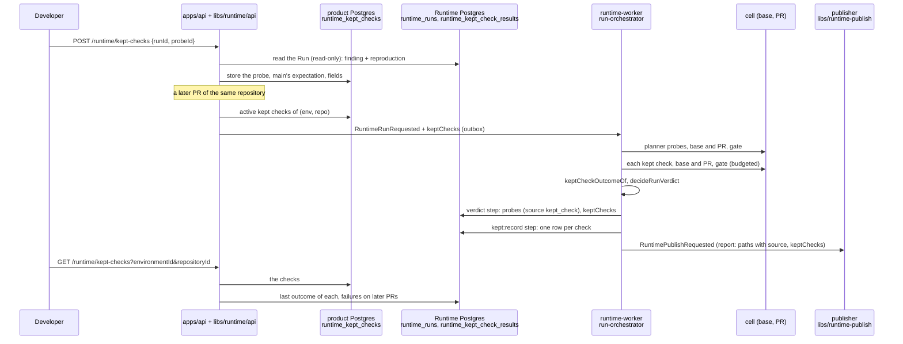

# Kept checks: a proven regression stays guarded

Status: designed 2026-11-17, backend built (section 12 lists what is built). No screen yet: the
product owner picks one of the options in section 11 first.

## 1. Problem

A Run that finds a regression proves it with one probe: the same request on main and on the PR, repeated, compared by
the gate. Once the PR is fixed, that probe is gone. The next PR that breaks the same behaviour has to be caught again,
by a planner that may not think of it.

A kept check is that probe, kept. From then on it runs on every later PR of the repository, in the same environment,
through the same deterministic gate: base against PR, repeated rounds, no LLM in the verdict. When it fails on a later
PR, that is a regression finding like any other, marked as coming from a kept check.

Why now:

- arnx (https://github.com/arnx-dev/arnx) keeps accepted tests as permanent guards, and the required checks of a Git
  platform follow the same idea: what was proven once is asked again on every change.
- Our probes, replay and gate already exist. Keeping one costs a table and a loop.
- It leaves the customer something durable: a list of behaviours Kody guards on their repository.

## 2. How it works today

- **A probe** is `ProbeSchema` (`libs/runtime/probe/probe.schema.ts`): an `http`, `sql` or `browser` spec played by the
  observer outside the machine (only these decide a verdict), or a `shell` spec inside it (evidence only), with
  `purpose`, `expected` and `compare`. The planner returns `PlannedProbe` (`libs/runtime/contracts/run-plan.ts`): the
  probe, optional closed `assertions` (HTTP status, a literal the body includes), the entry point and an optional
  `via`. The worker's plan is `AgentPlan` (`apps/runtime/src/worker/agent/runtime-agent.ts`). A probe has no fixture of
  its own: the data it reads is the environment's seed (the recipe's `seed`, `libs/runtime/protocol/recipe.ts`), the
  seeded user is named by the drawn-identity tokens `{{run.user}}`, `{{run.domain}}`, `{{run.hostname}}`
  (`apps/runtime/src/worker/run/run-identity.ts`) and a login by its role handle, resolved outside the machine.
- **Both sides and the gate.** `runRuntimeRun` (`apps/runtime/src/worker/run/run-orchestrator.ts`) boots base and PR,
  then `testSides` runs `planProbes`, `replayProbes` and `classifyFindings`. `replayProbe`
  (`apps/runtime/src/worker/run/replay.ts`) resets each machine before each round, plays the base twice and the PR
  once, and calls `decideProbe` (`libs/runtime/gate/gate.ts`) after each batch until it gives a verdict (at most 4
  rounds a side). `toGateStep` turns a round into normalized fields (`libs/runtime/gate/probe-fields.ts`). Then
  `decideNewEndpoint`, `decideIntendedChange` and `skewedByIdentity` may change the verdict, and the stability history
  (`StabilityHistory`, ADR-050) is read and written around the loop. `decideRunVerdict`
  (`libs/runtime/run/run-state.ts`) folds the probes into the Run's verdict and `checkConclusionFor` into the check.
- **Findings and the report.** The `verdict` step writes `probes`, `findings` and `reproduction` to the Run projection
  (`runtime.runtime_runs`, `libs/runtime/run/run-projection.ts`). `publish` builds the structured report
  (`apps/runtime/src/worker/run/report.ts` `buildReport`, schema `libs/runtime/run/run-report.ts`) and sends
  `RuntimePublishRequested`; `libs/runtime-publish` renders the check and the comment from it.
- **Replay of a finding.** `reproductionFor` (`libs/runtime/run/reproduction.ts`) keeps, for at most 10 findings, the
  observer probe as sent (spec, purpose, expected), secrets redacted by pattern and canaries redacted, plus what each
  side answered (`Observed`: status, exit code, browser steps passed). `GET /runtime/runs/:id/findings/:probeId/reproduce`
  exports it as data. Nothing replays it today.
- **Environment and repository.** A Run carries `environment.environmentId` and `repository.id` in
  `RuntimeRunRequested` (`libs/runtime/run/run-messages.ts`), built only by `RuntimeRunRequestBuilder`
  (`libs/runtime/api/application/run-request-builder.service.ts`). The environment and its member repositories are
  product rows (`libs/runtime/api/infrastructure/runtime-product.models.ts`).

## 3. What is kept

A kept check holds:

- **The exact probe**, as the Run recorded it in `reproduction`: the spec, `purpose`, `expected`, and the probe's
  compare floor. Placeholders stay placeholders: `{{run.user}}` is replaced by the claim's drawn identity on every
  round, as for a planned probe, and a role stays a handle.
- **The expectation main had**, from the side that was right: for HTTP, the status main answered becomes a closed
  assertion (`assertions.status`); for a browser probe, every step passed on main. This is what lets the gate tell
  "same on both sides, still right" from "same on both sides, both wrong".
- **The fields that diverged** (`differingFields`, names only, at most 5) and the entry point, to say what it guards.
- **Where it came from**: the Run, the probe id, the PR number, who kept it and when.

It is the exact probe, not a normalized form. The gate compares field by field what one request answers. A normalized
route (`/orders/:id`) cannot be sent, and the concrete id in the path or body is the one the seed makes. A normalized
form would need a planner to fill it again, which brings back the LLM the kept check exists to avoid. The normalized
form is used for identity only: the probe key (`probeKeyOf`, `libs/runtime/gate/stability.ts`), so the same request
cannot be kept twice.

What is not kept: the response body, the seed, the recipe, the agent's prose beyond `purpose` and `expected`. The seed
belongs to the environment; a kept check relies on it and detects when it no longer applies (section 5).

Only `http` and `browser` probes can be kept. A `sql` probe's expectation is prose the gate reads as text, so "same on
both sides" cannot be told from "both wrong" (open decision 4). A `shell` probe never decides.

## 4. Where it is stored

| What | Store | Writer | Key |
| --- | --- | --- | --- |
| The kept check | product Postgres `runtime_kept_checks` (TypeORM migration `AddRuntimeKeptChecks2026111710000000`) | API | unique (organization, environment, repository, probe key) among the active ones |
| Each Run's outcome of it | Runtime Postgres `runtime.runtime_kept_check_results` (runtime-schema v37) | runtime-worker, in one step per Run | (organization, Run, kept check) |

Scoped by environment and repository: the same repository can be a member of two environments, and the probe's
target, seed and identity belong to the environment. Removing a check marks it removed (who, when); the row and its
results stay for the metric.

A renamed route or a deleted fixture is never detected by comparing names. It is detected by what main answers, on
every Run (section 5). The probe key exists to refuse a duplicate, not to follow a rename.

## 5. How a Run plays kept checks

- **Always on.** The product puts the repository's active kept checks in `RuntimeRunRequested.keptChecks` when it
  builds the request, as a snapshot: a check kept or removed during the Run does not change it. Every trigger carries
  them except `external_finding`, whose plan is closed. A `simulate` Run plays them but records no outcome.
- **After the planner's probes, before intent.** The planner's probes are what the diff asks; kept checks are extra.
  Playing them after keeps a slow kept check from delaying the diff's own answer. Their findings go through intent
  classification like any other finding: intent only downgrades.
- **Budgeted.** At most 10 per repository (and so per Run). The phase has 5 minutes: before each check, one step reads
  the clock; a check the budget does not reach is `skipped`.
- **Same machinery.** Each check is a `replayProbe` with the probe id `kept:<id>`, at an index after the plan's, so its
  rounds have their own stable step ids. It starts from the stability table's default (two base rounds, nothing known
  to vary) and is not written to the stability history, so a kept check never masks a field because of the planner's
  Runs.

Then each check gets one outcome (`keptCheckOutcomeOf`, `libs/runtime/gate/kept-check.ts`, pure):

| Outcome | When |
| --- | --- |
| `stale` / `target_gone` | the probe's service and port are no longer exposed by the environment; not played |
| `stale` / `route_gone` | every healthy base round answered 404 or 405, and main answered something else when it was kept |
| `stale` / `baseline_changed` | every healthy base round fails the kept expectation: main no longer behaves as it did when it was kept (the regression was merged on purpose, or the seed changed) |
| `failed` | the gate's verdict is `finding`, and intent did not mark it intended |
| `intended` | the gate found a difference the diff spells out, or intent marked it intended |
| `passed` | the gate's verdict is `not_reproduced` |
| `inconclusive` | anything else the gate could not decide |
| `skipped` | the phase budget ran out first |

A stale check is never dropped. It stays in the list with its reason, the Run report names it, and every later Run
says it again until someone removes it or the route comes back.

## 6. Verdict rules

- A kept check that fails is a regression. It enters `decideRunVerdict` as any probe with verdict `finding`, with
  `source: "kept_check"` and its `keptCheckId`. The check run fails.
- A kept check that cannot run is not "no regression". A stale, skipped or inconclusive kept check holds a Run that
  would be green at partly tested, with `N kept checks could not run` among the reasons. Like the exercised-lines rule,
  it never upgrades a Run and never touches a regression.
- A stale check's played verdict is recorded as `inconclusive`, so it never settles an entry point of the diff.
- Its coverage comes from the observer's request log, like any probe (`coveredEntryPoint`): a kept check on a route
  outside the diff is `unmapped` there and shows what it sent (`exercised`).

## 7. Privacy

- What is stored is what `reproduction` already holds on the Run: the redacted spec, `purpose`, `expected`, the status
  or step count main answered. No response body, no header value the redactor marks, no canary.
- A probe that needed redaction cannot be kept. If the recorded spec carries a redaction marker (`[redacted…`), keeping
  it would replay a broken request; the API refuses with 422 instead of storing it. The secret a probe needs reaches
  the machine through the environment's secrets and roles, never through the probe.
- Placeholders stay placeholders: `{{run.*}}` tokens and role handles are stored as such and resolved per Run.
- The results table holds ids, an outcome, a reason code and times. Never a path, a body or a field value.

## 8. Limits and permissions

| Limit | Default | Where |
| --- | --- | --- |
| Active kept checks per environment and repository | 10 | `MAX_KEPT_CHECKS_PER_REPOSITORY`, `libs/runtime/contracts/kept-check.ts` |
| Time for the kept-check phase of one Run | 5 min | `KEPT_CHECKS_BUDGET_MS`, same file |
| Rounds per side | 4 | the gate's default, unchanged |
| Results retention | 180 days | `KEPT_CHECK_RESULTS_RETENTION_DAYS`, swept by the Runtime retention |

Who may do what, with the existing policies (`libs/identity/domain/permissions/policies/role-policies.ts`), no new grant:

| Action | Policy | Who today |
| --- | --- | --- |
| Keep a finding's probe | `Create` on `RuntimeRun`, for the Run's repositories (like "Run again") | owner; repo admin with the repository assigned |
| Remove a kept check | `Create` on `RuntimeRun`, for the check's repository | the same |
| List kept checks and the metric | `Read` on `RuntimeEnvironment` | owner, repo admin, contributor |

Every route is behind `RuntimeReleaseGuard`; another org's check answers 404.

## 9. Flow

## 10. The metric

**Regressions blocked by a kept check**: the number of distinct (kept check, pull request) pairs whose outcome was
`failed`, on a pull request other than the one the check was kept from. A Run again of the same PR head counts once.

Computed from `runtime.runtime_kept_check_results`: `count(DISTINCT (kept_check_id, repository_id, pr_number)) WHERE
outcome = 'failed' AND pr_number <> source_pr_number`, by organization and optionally environment and repository. The
list route returns it next to the checks (`failuresOnLaterPrs`), and each check carries its own count.

## 11. UI options (for the mock-ups)

**Where "Keep this check" lives**

1. On the Run page, on each regression finding, beside "Reproduce" and "This change is intended": a button "Keep as a
   check". After it, the finding shows "Kept · guards later PRs".
2. In the PR comment, under each regression: a link "Keep this check" to the Run page with the action open. The comment
   itself never acts (the publisher has no user session).
3. Automatic proposal: after a PR that had a regression is merged with the regression fixed, the Run page of that PR
   shows "Kody can keep 2 checks from this PR" with one confirm.

**How kept checks are listed and removed**

1. A "Kept checks" tab on the environment page: one row per check (what it sends, what it guards, kept by and from
   which PR, last outcome and when, failures on later PRs), stale rows first with their reason, and "Remove" per row.
2. A section in Settings, Runtime, per repository, with the same rows and the metric as a counter at the top.
3. Inline on the Runs list: a filter "Kept checks" that lists them and their last Runs.

**How a kept-check failure shows on the PR**

1. As a regression like the others, with a "Kept check" badge and "kept from #123" in its line; the check title stays
   "1 regression".
2. In its own block under the PR's findings: "A kept check failed: GET /orders/1 (kept from #123)".
3. The check title names it: "1 regression from a kept check"; stale checks appear as one line in the summary,
   "1 kept check could not run: route gone".

## 12. What is built

- `libs/runtime/contracts/kept-check.ts`: the kept check sent to a Run, its outcomes and stale reasons, the limits.
- `libs/runtime/gate/kept-check.ts` `keptCheckOutcomeOf`: the outcome table of section 5.
- `libs/runtime/run`: `ProbeVerdict.source` and `keptCheckId`; `VerdictInput.keptChecksNotRun`;
  `RuntimeRunRequested.keptChecks`; the report's `paths[].source`, `paths[].keptCheckId` and `keptChecks`; the
  projection's `keptChecks`.
- `apps/runtime/src/worker/run/kept-checks.ts`: the phase (budget, replay, outcomes, verdicts), called from `testSides`;
  `KeptCheckResults` port and `PgKeptCheckResults` store, runtime-schema v37, the reader grant, the retention sweep.
- `libs/runtime/api`: the TypeORM model, store and migration; `KeepRuntimeCheckUseCase`, `ListRuntimeKeptChecksUseCase`,
  `RemoveRuntimeKeptCheckUseCase`; the builder adds `keptChecks`; `PgKeptCheckResultsReader`.
- `apps/api/src/controllers/runtime/runtime-kept-checks.controller.ts`: `POST /runtime/kept-checks`,
  `GET /runtime/kept-checks`, `DELETE /runtime/kept-checks/:id`.
- No protocol change: the cell plays a kept check as any probe.

Gaps:

- A stored check that no longer parses as `KeptCheckSchema` (a later release tightened it) is left out of the Run
  request and logged (`Runtime kept check unreadable`); the list still shows it. It should read as stale instead.
- The cap is checked before the insert, not under a lock: two keeps at the same instant can pass 10 by one.
- `PgKeptCheckResults` and `PgKeptCheckResultsReader` have no run against a real Postgres yet (the integration spec
  needs `RUNTIME_IT_DATABASE_URL`).
- The publisher renders a kept-check finding as any regression and does not name stale checks yet: the wording
  waits for the UI decision (section 11).

## 13. Deploy

- The Run workflow gains steps (`kept:start`, `kept:<n>:budget`, the kept checks' rounds, `kept:record`), only when a
  Run carries kept checks. Deploying the worker needs a new `RUNTIME_RELEASE_VERSION`.
- Order: the runtime-worker first (its strict schema must accept `keptChecks`, and it sends the new report fields only
  when a Run carried kept checks), then the product API and worker together (the publisher accepts the new report
  fields; the API starts sending `keptChecks` once a check is kept).
- Run the reader grants script (`scripts/runtime/runtime-reader-grants.sql`) after the worker's first boot, so the API
  can read the results table.

## 14. Open decisions for the product owner

1. **Who may keep and remove.** Built: whoever may ask "Run again" on the repository. Alternative: owner only, or a new
   grant.
2. **Limits.** Built: 10 per repository, 5 minutes per Run. Is 10 the right cap, and does it count against the org's
   machine minutes like any probe round (today it does)?
3. **Stale holds the Run at partly tested.** Built: yes, until someone removes the check. Alternative: say it once in
   the summary and stay green, or mark the check stale after N Runs and stop playing it (still listed).
4. **SQL probes.** Built: not keepable. Keeping them needs a closed SQL expectation (a row count) in `ProbeAssertions`.
5. **Kept checks on the PR they came from.** Built: they run there too (they prove a fix), but the metric does not count
   that PR. Alternative: skip the source PR.
6. **Automatic keep.** Built: only on request. Alternative: propose or keep automatically every regression that was
   fixed before merge.
7. **Pricing.** A kept check costs machine time on every PR. Free within the cap, or a paid tier above it?
