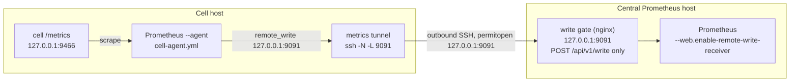

# Kody Runtime observability

What every part of the Kody Runtime records, under one vocabulary, and how an operator and an org owner read it:
the inventory (part 1), the taxonomy (part 2), the trace path (part 3), the hang detector (part 4), the alerts (part 5),
the dashboards (part 6), the Health screen (part 7), what a deploy needs (part 8) and what is still missing (part 9).
Terms are in [glossary.md](glossary.md); the runbook is [alerts.md](alerts.md). Checked against the code of
2026-11-12; every claim names its file.

The stack is the product's: OpenTelemetry (traces over OTLP/HTTP when `OTEL_EXPORTER_OTLP_ENDPOINT` is set, Prometheus
metrics), BetterStack for incidents (Alertmanager routes the Runtime's alerts there), and the product's own records
(the Run projection, the setups, the usage spans in `observability_telemetry`) for the screens. Nothing here adds a
store: the Health screen reads what the Run page, Environment Health and the usage report already read.

## 1. Inventory

Counts, from the code: **19 components** (the table below); **84 named states and reasons** (Run 14, setup 3 and its 8
steps in 4 step states, hub claim 8 with 12 reasons, cell claim 5, admission request 10, DBOS workflow 6 statuses over 5
workflows, dead-man 3, cell session 3, sandbox guest stream 2, pool machine 4 outcomes, egress phase 2); **12 blocker kinds and 103 signature classes**
(`BLOCKER_SIGNATURE_CLASSES`, `libs/runtime/telemetry/catalog.ts`); **106 TS log events and 188 Go log events**
(appendices B and C); **88 metrics in the catalog** (43 control plane, 5 of them product side and never exported; 45 of the cell, the egress
proxy, the injector and the reaper); **spans**: 9 TS span names and 2 Go span names.

### 1.1 Components

| Component | Code | States and transitions | Failure modes (blocker kind / signature class) | Logs, metrics, traces today | Missing |
| --- | --- | --- | --- | --- | --- |
| API Runtime routes | `apps/api/src/controllers/runtime/*`, `libs/runtime/api` | none of its own: reads the Run projection, setups, claims, cells (read-only role, `runtime-read-db.ts`) | 503 without `RUNTIME_DATABASE_READ_URL`; a part of a read that fails is "not measured" | product logger (`createLogger`); the route now sets a `traceparent` on the Runs and setups it starts (`run-request-builder.service.ts`, `runtime-setup-requester.service.ts`) | no meter provider in the API: `runtime.pool_scheduler.tick` is recorded on a no-op meter; no OTel trace SDK in the product |
| Product worker trigger | `libs/runtime/api/infrastructure/runtime-trigger.consumer.ts`, `application/use-cases/pull-request-trigger.use-case.ts`, the GitHub webhook handler | a PR event → skipped (reason) or enqueued | `TriggerOutcome` skip reasons (`libs/runtime-publish/domain/render-skipped-trigger.ts`); `workspace_unresolved` | product logger; the webhook names the trace by its job's correlation id (`githubPullRequest.handler.ts`, `traceparentFor`) and the trigger passes it on | the other platforms' handlers write no Runtime event (GitHub only) |
| Product worker publication | `libs/runtime-publish` | publication pending → publishing → published, failed, redriven, gave up (`publication-redrive.ts`) | `ALERT_REFUSALS` (`publish-runtime-request.use-case.ts`) | `runtime.publish.outcome/duration/redrive/stuck` (`otel-publish.metrics.ts:30-41`) | recorded on a no-op meter: the product worker registers no meter provider |
| runtime-worker: Run workflow | `apps/runtime/src/worker/run/run-orchestrator.ts`, `dbos/run-engine.service.ts` (`runtimeRun`, `runtimeForkGate`, `runtimeRunStop`) | `RUN_STATES` and `TRANSITIONS` (`libs/runtime/run/run-state.ts:9-69`): queued → awaiting_approval / booting → testing → no_regressions, regression, partly_tested, could_not_boot; skipped, superseded, cancelled, timed_out, errored, halted | Run boot blockers (`bootFailure`), security halt (`halted`), queue 30 min, Run 45 min, `never started`, admission refusals | spans `runtime.run`, `runtime.run.boot`, `.agent`, `.replay`, `.intent`, `runtime.run.requested`; metrics `runtime.run.state`, `.verdict`, `.duration`, `.queue_wait`, `runtime.probe.verdict`, `runtime.blocker`, `runtime.security.event`, `runtime.evidence.write_failed` (appendix A) | — |
| runtime-worker: setup workflow | `worker/setup/environment-setup.service.ts` (`runtimeEnvironmentSetup`) | setting_up → active / blocked; steps requested, resolve_ref, recipe, boot, ready, bake, pool, release, each running → done / failed / skipped (`libs/runtime/run/environment-setup.ts:16-18`) | the catalog's classes (`missing_env`, `toolchain:*`, `resources:*`, `external_service*`, `seed_data:schema`, `native_dep`), `setup:*`, `boot_timeout`, admission refusals | span `runtime.setup` (`run-engine.service.ts`); `runtime.setup.outcome` and `runtime.blocker` counted in the save step that ends the setup; logs `setup.*` | no row per setup in the usage data (`usage-report.md`) |
| runtime-worker: admission | `dbos/admission-coordinator.ts`, `shared/admission/*` (`runtimeAdmission`, queues `runtime-admissions`, `runtime-executions`, `runtime-admission-finalizers`) | awaiting_approval, waiting, owned, reserved, dispatched, running, completed, cancelled, expired, rejected (`runtime-schema.ts:276`) | `AdmissionReason` (`admission-contract.ts:41-57`): no_cell, no_capacity, org_capacity, pair_too_large, size_unavailable, owner_changed, ticket_expired, global_limit, org_limit, setup_limit, deadline, attempt_limit, cancelled, unavailable, member_cleanup_pending | logs `admission.ticket_cleanup_failed`, `admission.repair_failed`; new `runtime.admission.queue_depth`, `.oldest_wait` (detector) | — |
| runtime-worker: pool | the API's `runtime-pool-scheduler.cron.ts` (not a DBOS workflow) → hub `pool.target` | pool target per environment; cell pool machines created, failed, adopted, discarded | `pool.fill.failed`, `pool.refused` | `runtime.pool_scheduler.tick` (no-op meter), cell `cell_pool_ready`, `cell_pool_machines_total`, hub `runtime.claim.start{start="pool"}` | the hub keeps no pool count: the Health screen says not measured |
| runtime-worker: maintenance | `run-engine.service.ts` `maintenanceTick` (every 15 s, lock `runtime-worker/maintenance`) | repair admission → sweep → reap → retention → hang detector | `maintenance.failed`, `stuck.pass_failed` | new `runtime.maintenance.pass`, `runtime.stuck.*`, `runtime.claims.open`, `runtime.claim.hard_expired` | — |
| Hub | `apps/runtime/src/hub` | claim states `CLAIM_STATES` (`contracts/enums.ts:76`) pending, bound, held, blocked, failed, compromised, released, terminated; reasons `CLAIM_REASONS` (`hub-store.ts:40-66`) acquired, reacquired, ready, held_for_diagnosis, acquire_unanswered, cell_refused, cell_blocked, not_ready, boot_failed, security_violation, released, cell_revoked; cell session connected → silent (45 s, `CELL_SILENCE_MS`) → disconnected | `cell_lost`, `claim_not_ready`, `boot_timeout`, `machine_minutes_exhausted`, `isolation_unavailable`, `size_unavailable`, `org_capacity`, `no_capacity`, nack codes | span `runtime.hub.claim.acquire`, `runtime.hub.step`; `HubMetrics` (`hub-types.ts`) and the §11 set; 64 log events | cell → hub frames carry no traceparent (the hub correlates by claim and step) |
| Cell agent | `apps/runtime-cell/internal/agent`, `cmd/cell` | cell claim acquiring → ready / failed / held → released (`claims/claim.go:33`); dead-man healthy → lost (5 min) → abandoned (15 min) (`lease/deadman.go:11-26`) | `blockerErr` classes (`compose_*`, `recipe_*`, `repo_*`, `claim_*`, `image_*`, `out_of_memory`, `builder_failed`, `guest_agent`, `sql_*`) | spans `cell.claim.acquire`, `cell.step` (new); `cell_*` (appendix A); 76 log events | — |
| Egress proxy | `internal/egress`, `cmd/egress` | per connection allowed / denied (reason) | `external_service:egress:*`, `external_service:platform_denied:*`, `placeholder_leak` | `egress.*` logs; `kodus_egress_denied_total{reason}`, `_allowed_total`, `_live_connections`, `_bytes_total` (`egress/metrics.go:53-60`) on the mTLS control port; `GET /v1/alerts` | no scrape path for Prometheus without a client certificate |
| Resolver | `internal/resolver`, `cmd/resolver` | per query answered / refused / rate-limited | denied names (`netguard.DenyList`) | `resolver.start`, `resolver.rate_limited` | no metric |
| Injector | `internal/injector`, `cmd/injector` | per request: swapped, no_secret, refused; alert | `credential_exfiltration`, `bait_exfiltration`; credential codes expired, denied, not_configured, cancelled, timeout, unavailable | 20 `injector.*` events; new `cell_injector_swaps_total`, `cell_injector_alerts_total`, `cell_openbao_up` (`injector/metrics.go`), off unless `-metrics-addr` | — |
| Observer | `internal/observer`, `cmd/observer` | per claim provisioned / violation | `observer.violation`, `create_observer`, `sql_provision_failed` | 2 events; `cell_sql_observer_provisions_total` | no metric of its own process |
| Guest agent | `internal/guest`, `cmd/kody-guest` | stream open → closed; per op ok / refused / failed | `guest_agent`; op error codes (`SandboxErrorCode*`) | none inside the machine (no network to a collector, by design); the cell's `cell.step` span and `sandbox.op` log cover each op; new `cell_sandbox_ops_total{op,outcome}` | — |
| Builder and registry | `internal/drivers/dockergvisor` (`build*.go`, `registry*.go`), `internal/buildprogress`, `builder-image` | build steps (BuildKit), export parts (`buildprogress/phases.go:35-44`), registry seed / seal / unseeded | `builder_failed`, `image_load`, `image_too_large`, `out_of_memory` | 50 events (`build.*`, `build.registry.*`, `bake.*`, `pool.*`, `data.*`); claim.ready `timing.phases` → new `runtime.build.export_duration` | — |
| Reaper | `internal/reaper`, `cmd/reaper`, `drivers/dockergvisor/reap.go` | pass ok / failed; machine destroyed past `kodus:hard-expires` | `reaper.pass.failed` | `reaper.*` logs; `cell_reaper_terminated_total`, `cell_reaper_pass_failures_total` registered | `cmd/reaper` serves no `/metrics`: the counters are never scraped |
| OpenBao | `docker/openbao`, read by the injector (`openbao_secrets.go`) and the API (`openbao-secret-vault.adapter.ts`) | sealed / unsealed, reachable or not | `unavailable`, `timeout` credential codes | new `cell_openbao_up` (`sys/health` every 30 s) | the API side has no health metric |
| Sandbox | `worker/sandbox/sandbox.service.ts`, `internal/agent/sandbox*.go`, `drivers/dockergvisor/sandbox.go` | a claim of consumer `sandbox`: pending (2 min ready wait) → bound → released (45 min ceiling); blank pool machines made / taken / destroyed | `sandbox_unsupported`, `guest_agent`, `no_capacity` | `sandbox.op`, `sandbox.pool.*`; `runtime.claim.ready_wait{consumer="sandbox"}` (create latency), `runtime.step.duration{kind="sandbox.op"}`, `cell_sandbox_ops_total` | — |

### 1.2 What was found and fixed while mapping

- The OTel default histogram buckets end at 10 s: every boot (minutes) fell in `+Inf`, no p95 was readable. Each
  histogram of the catalog now names its buckets (`taxonomy.json` `buckets`).
- `runtime.verdict` counted probe verdicts, not Runs: renamed `runtime.probe.verdict`; `runtime.run.verdict` counts Runs.
- Metric labels carried ids (`cellId` on protocol violations and the reaper) and `orgId` on histograms. Ids are on
  spans and logs only; the organization is a label on counters only.
- Hub log lines carried Dockerfile-derived phase names and full blocker signatures (repository text). They now say
  `build step` and the signature class (`telemetryPhaseName`, `blockerSignatureClass`, `telemetryDetail`).
- `ALERTS.md` queried `runtime_runs` in Mongo; the projection is in the Runtime Postgres since `MoveRuntimeProductStoresToPostgres`.
- The cell's log lines had no trace id; the hub's spans stopped at the hub.


## 2. One taxonomy

[`libs/runtime/telemetry/taxonomy.json`](../../libs/runtime/telemetry/taxonomy.json) decides every attribute name and
every metric once; the Go cell embeds a byte-identical copy (`apps/runtime-cell/internal/telemetry/taxonomy.json`,
`TestTaxonomyFileMatchesTS`). TS reads it through `catalog.ts` (`ATTR`, the closed values of each dimension), Go
through `internal/telemetry`.

### 2.1 Rules

- **Names.** OTel semantic conventions where one exists (`vcs.change.id`, `server.address`, `error.type`,
  `gen_ai.request.model`, `gen_ai.token.type`); product-wide ids under `kodus.` (`kodus.organization.id`,
  `kodus.team.id`, `kodus.repository.id`, `kodus.correlation.id`); everything else under `kodus.runtime.`. The same key
  in a span attribute, a log field (TS and Go) and a metric label. Prometheus labels are the mechanical translation (dots
  become underscores: `kodus_runtime_claim_consumer`).
- **Cardinality.** An `id` (run, claim, cell, step, machine, environment, setup key, model, host) goes on spans and log
  lines only. A `dimension` is a closed set decided in code: a value outside it is `other` (`dimension()`). The `tenant`
  (`kodus.organization.id`) is a label on counters only, never on a histogram. A metric-local label (`outcome`, `reason`,
  `code`, `op`, `kind`, `where`, `state`, `type`, `direction`) means what its metric lists.
- **Older names.** A log field written under an older name (`claimId`, `runId`, `organizationId`, Go's `claim`, `run`,
  `cell`, `env`, `side`, `host`, `secret`) is written under its taxonomy key by the TS logger
  (`diagnostic-fields.ts`, `canonicalKey`) and the Go handler (`telemetry.NewHandler`). Code may still pass the short
  names; no line leaves with them.
- **Events.** A log event is `noun.verb[.outcome]` in lower snake case (`claim.acquire`, `claim.renew.failed`,
  `runtime.stuck`); the event is the `msg` field. A span is `runtime.<area>[.<step>]` in TS and `cell.<area>` in Go. An
  event an operator must act on carries `"alarm": true` (cell) or has an alert (part 5).
- **Metrics.** Control-plane metrics are `runtime.<subject>.<measure>` (OTel names; Prometheus `runtime_…`, counters
  `_total`, histograms `_bucket/_sum/_count`, no unit suffix). Cell metrics keep the cell's convention
  `cell_<subject>_<unit>` (`apps/runtime-cell/AGENTS.md`); the egress proxy's are `kodus_egress_*`. A metric exists only
  in the catalog: `CatalogMeter` refuses any other, and its labels go through `metricAttributes`. Every histogram names
  its buckets.

### 2.2 Never in telemetry

No secret value, placeholder (`kph_…`), canary (`npm_`, `kdx_live_`, `seed_` + 32 hex), token (the shared gitleaks
rules, JWT, bearer, Team CLI key `kodus_…`, a URL with a password), repository content, command output or env value
reaches a log line, a span or a metric. Enforced in code, at every sink:

| Signal | Gate | Where |
| --- | --- | --- |
| Metric labels | only the catalog's labels; dimension values closed; the tenant shaped like an id and nothing secret-shaped; ids refused | `metricAttributes` (`libs/runtime/telemetry/telemetry-guard.ts`), `CatalogMeter` |
| TS spans | only taxonomy keys leave the process, each value checked; event attributes the same; no status message | `RedactingSpanExporter` (`redacting-span-exporter.ts`), wired in `otel.ts` |
| TS logs | sensitive keys dropped; every string scrubbed (`scrubText`), the message too | `diagnostic-fields.ts`, `logger.ts` |
| Go spans | only taxonomy keys; a value with anything secret-shaped is dropped; no status message | `telemetry.RedactingExporter` |
| Go logs | sensitive keys dropped; strings, errors and string lists scrubbed | `telemetry.NewHandler` (every binary of `cmd/`) |
| Repository text | phase names from a Dockerfile line become `build step`; a signature keeps its class; a claim detail is closed words | `telemetryPhaseName`, `blockerSignatureClass`, `telemetryDetail` (hub `claim.service.ts`) |

Tests: `apps/runtime/src/shared/observability/telemetry-redaction.spec.ts` (logs, spans, metric labels, every secret shape,
under every field and attribute) and `apps/runtime-cell/internal/telemetry/telemetry_test.go` (`TestNoSecretReachesALogLine`,
`TestNoSecretReachesASpan`). Free text an operator writes into a log message is still the caller's job: the scrub catches
secret shapes, not every possible secret.

### 2.3 Renames

| Before | After | Kind |
| --- | --- | --- |
| `protocol.violation{cellId,code}` | `runtime.hub.protocol_violation{code}` | metric |
| `reaper.terminated{cellId,orgId,reason}` | `runtime.claim.hard_expired{reason}` | metric |
| `egress.blocked{orgId,phase}` | `runtime.egress.denied{kodus.organization.id,kodus.runtime.egress.phase}` | metric |
| `llm.gateway.budget{orgId,state}` | `runtime.llm.budget_used{outcome}` | metric |
| `runtime.queue.wait{orgId}` | `runtime.run.queue_wait{kodus.runtime.run.trigger}` | metric |
| `runtime.verdict{orgId,verdict}` (probe verdicts) | `runtime.probe.verdict{kodus.runtime.probe.verdict}` | metric |
| `cell.connected{owner}` | `runtime.cell.connected{kodus.runtime.cell.owner}` | metric |
| `runtime.run.state{orgId,state}`, `runtime.run.duration{orgId,state}` | same names, labels `kodus.runtime.run.state`, `kodus.runtime.run.trigger` (+ org on the counter) | labels |
| hub metrics' `consumer`, `driver`, `phase`, `kind`, `to`, `reason` | `kodus.runtime.claim.consumer`, `kodus.runtime.driver`, `kodus.runtime.boot.phase`, `kodus.runtime.step.kind`, `kodus.runtime.claim.state`, `kodus.runtime.claim.reason` | labels |
| span attributes `runtime.run.id`, `runtime.org.id`, `runtime.cell.id`, `runtime.claim.id`, `runtime.claim.side`, `runtime.step.*`, `correlation.id`, `x-correlation-id`, `runtime.error.code`, `runtime.hub.duration_ms`, `runtime.cell.duration_ms` | `kodus.runtime.*`, `kodus.organization.id`, `kodus.correlation.id`, `kodus.runtime.error.code` | span attributes (the exporter maps the old keys) |
| log fields `claimId`, `cellId`, `runId`, `organizationId`, … (TS); `claim`, `cell`, `run`, `env`, `side`, `host`, … (Go) | their taxonomy keys | log fields (written by the sink) |

Nothing outside the repository read the old metric names: no dashboard or rule was installed (`ALERTS.md` said its rules
were proposals). The tests that read them were updated (`hub-metrics.spec.ts`, `runtime-telemetry.spec.ts`,
`logger.spec.ts`, `go-cell-hub.integration.spec.ts`). The product-side `runtime.publish.*` and
`runtime.pool_scheduler.tick` keep their names.

### 2.4 The catalog

Generated from `taxonomy.json`; `catalog.spec.ts` checks it (no id as a label, the tenant on counters only, every alias
one attribute, the Prometheus names as the exporter writes them, every histogram with buckets) and
`catalog_test.go` checks that the cell registers no metric outside it.

#### Attributes

| Key | Group | Cardinality | Meaning | Older names it replaces |
| --- | --- | --- | --- | --- |
| `kodus.organization.id` | who | tenant | The organization the work belongs to. | `organizationId`, `orgId`, `org`, `runtime.org.id` |
| `kodus.team.id` | who | id | The team of the repository that asked. | `teamId` |
| `kodus.correlation.id` | what | id | The product correlation id a Run was requested with; the Run's trace id is derived from it. | `correlationId`, `correlation.id`, `x-correlation-id` |
| `kodus.repository.id` | what | id | The Kodus repository id (not its name). | `repositoryId` |
| `kodus.runtime.claim.consumer` | what | dimension | Who holds the claim (CLAIM_CONSUMERS). | `consumer` |
| `kodus.runtime.claim.id` | what | id | One lease on a cell. | `claimId`, `claim`, `runtime.claim.id` |
| `kodus.runtime.claim.side` | what | dimension | What a claim boots: base, pr or setup (CLAIM_SIDES). | `side`, `runtime.claim.side` |
| `kodus.runtime.claim.state` | what | dimension | A claim state (CLAIM_STATES). |  |
| `kodus.runtime.environment.id` | what | id | The environment a Run, setup or claim boots. | `environmentId`, `env` |
| `kodus.runtime.machine.id` | what | id | A machine (container or VM) on a cell. | `machineId`, `machine` |
| `kodus.runtime.run.attempt` | what | id | The Run's attempt (Run again increments it). |  |
| `kodus.runtime.run.id` | what | id | The Run. | `runId`, `run`, `runtime.run.id` |
| `kodus.runtime.run.state` | what | dimension | A Run state (RUN_STATES). |  |
| `kodus.runtime.run.trigger` | what | dimension | What started the Run (RUN_TRIGGERS). |  |
| `kodus.runtime.secret.id` | what | id | An org secret's id. Never its value or its placeholder. | `secretId`, `secret` |
| `kodus.runtime.setup.key` | what | id | The idempotency key of an environment setup. | `setupKey` |
| `kodus.runtime.setup.state` | what | dimension | An environment setup state (setting_up, active, blocked). |  |
| `kodus.runtime.step.id` | what | id | One step (probe, exec, browser, reset, sandbox op) on a claim. | `stepId`, `step`, `runtime.step.id` |
| `kodus.runtime.step.kind` | what | dimension | The step's message type (probe.run, exec, browser.explore, machine.reset, upload, sandbox.op). | `runtime.step.kind` |
| `vcs.change.id` | what | id | The pull request number (OTel VCS semantic conventions). | `prNumber` |
| `kodus.runtime.cell.id` | where | id | The cell. | `cellId`, `cell`, `runtime.cell.id` |
| `kodus.runtime.cell.owner` | where | dimension | Whose cell it is: kodus or customer. |  |
| `kodus.runtime.driver` | where | dimension | The cell driver (METRIC_DRIVERS, else other). | `driver` |
| `kodus.runtime.hub.replica.id` | where | id | The hub replica. | `replicaId` |
| `kodus.runtime.isolation.backend` | where | dimension | The machine backend (gvisor, firecracker, other). |  |
| `kodus.runtime.isolation.level` | where | dimension | What the cell's hello says it runs claims under (CELL_ISOLATIONS). |  |
| `server.address` | where | id | The outbound host of an egress event (OTel). Logs and spans of the egress path only. | `host` |
| `error.type` | why | dimension | The failure category (safeFailure: timeout, cancelled, network, permission_denied, invalid_input, unexpected). |  |
| `kodus.runtime.blocker.kind` | why | dimension | A blocker's kind (BLOCKER_KINDS). |  |
| `kodus.runtime.blocker.signature` | why | dimension | A blocker's signature class: the catalog prefix, never its repository-derived suffix (blockerSignatureClass). |  |
| `kodus.runtime.boot.phase` | why | dimension | A boot phase the cell timed (prepare, boot, build, up, seed, ready, snapshot). |  |
| `kodus.runtime.build.export_step` | why | dimension | A part of an image export (export_layers, send_tarball, push_layers, export_cache, unpack_image). |  |
| `kodus.runtime.cell.duration_ms` | why | id | How long the cell says the step took. | `runtime.cell.duration_ms` |
| `kodus.runtime.claim.reason` | why | dimension | Why a claim is in its state (CLAIM_REASONS). |  |
| `kodus.runtime.claim.start` | why | dimension | How the claim's workload came to be: cold, pool or bake. |  |
| `kodus.runtime.egress.phase` | why | dimension | When the proxy denied a request (the egress.blocked phase). |  |
| `kodus.runtime.error.code` | why | dimension | The allowlisted Node error code of a failure (ETIMEDOUT, ECONNRESET, ...). | `runtime.error.code` |
| `kodus.runtime.hub.duration_ms` | why | id | How long the hub waited for a step. | `runtime.hub.duration_ms` |
| `kodus.runtime.probe.verdict` | why | dimension | What the gate decided for one probe (VERDICTS). |  |
| `kodus.runtime.recipe.origin` | why | dimension | Where the recipe came from: committed, inferred, authored, or none. |  |
| `kodus.runtime.run.phase` | why | dimension | The part of a Run a span or event is about (boot, agent, replay, intent). |  |
| `kodus.runtime.setup.outcome` | why | dimension | How a setup ended: active or blocked. |  |
| `kodus.runtime.step.outcome` | why | dimension | How the hub saw the step end. | `runtime.step.outcome` |
| `kodus.runtime.step.reason` | why | dimension | The closed reason of a step that did not end ok. | `runtime.step.reason` |
| `kodus.runtime.stuck.age_ms` | why | id | How long the item has been in its state. |  |
| `kodus.runtime.stuck.bound_ms` | why | id | The longest the code lets the item stay in its state. |  |
| `kodus.runtime.stuck.state` | why | dimension | The state the stuck item is in. |  |
| `kodus.runtime.stuck.subject` | why | dimension | What the hang detector found past its bound: run, setup, claim, sandbox, admission, workflow, cell, setup_queue. |  |
| `kodus.runtime.verdict` | why | dimension | A Run's computed verdict: no_regressions, regression, partly_tested, could_not_boot. |  |
| `gen_ai.request.model` | model | id | The model asked (OTel GenAI semantic conventions). | `model` |
| `gen_ai.token.type` | model | dimension | input or output (OTel GenAI semantic conventions). |  |
| `kodus.llm.task` | model | dimension | What the model call was for (recipe_author, planner, run_agent, intent, setup_learn, other). |  |

#### Metric-local labels

| Label | Meaning |
| --- | --- |
| `direction` | up (to the host) or down (to the machine). |
| `type` | The message type a cell nack answered. |
| `outcome` | How the operation the metric counts ended; its values are listed with the metric. |
| `reason` | Why, from a closed set listed with the metric. |
| `code` | A protocol or refusal code from a closed set. |
| `op` | The background operation that failed. |
| `kind` | The sub-kind the metric lists (security event kind, evidence kind, step kind on cell metrics). |
| `where` | The side a security event was seen on. |
| `state` | The producer's own state of what it counts: cell_claims the cell's claim states (acquiring, ready, failed, held, released, not the hub's), runtime.admission.queue_depth the admission request states. |

#### Metrics

| Name (OTel) | Prometheus | Type | Unit | Labels | Producer | Meaning |
| --- | --- | --- | --- | --- | --- | --- |
| `runtime.run.state` | `runtime_run_state_total` | counter | {run} | `kodus.runtime.run.state`, `kodus.runtime.run.trigger`, `kodus.organization.id` | runtime-worker | Runs entering each state. |
| `runtime.run.verdict` | `runtime_run_verdict_total` | counter | {run} | `kodus.runtime.verdict`, `kodus.runtime.run.trigger`, `kodus.organization.id` | runtime-worker | Runs that reached a computed verdict, by trigger. |
| `runtime.run.duration` | `runtime_run_duration` | histogram | ms | `kodus.runtime.run.state`, `kodus.runtime.run.trigger` | runtime-worker | Run wall time from start to its final state. |
| `runtime.run.queue_wait` | `runtime_run_queue_wait` | histogram | ms | `kodus.runtime.run.trigger` | runtime-worker | Time from RuntimeRunRequested to the Run leaving the fair queue. |
| `runtime.probe.verdict` | `runtime_probe_verdict_total` | counter | {probe} | `kodus.runtime.probe.verdict` | runtime-worker | What the gate decided for each probe. |
| `runtime.setup.outcome` | `runtime_setup_outcome_total` | counter | {setup} | `kodus.runtime.setup.outcome`, `kodus.runtime.recipe.origin`, `kodus.organization.id` | runtime-worker | Environment setups that ended, by outcome and where their recipe came from. |
| `runtime.blocker` | `runtime_blocker_total` | counter | {blocker} | `kodus.runtime.blocker.kind`, `kodus.runtime.blocker.signature`, `kodus.runtime.claim.consumer`, `kodus.organization.id` | runtime-worker | Blockers recorded on a setup or a Run, by kind and signature class. |
| `runtime.llm.budget_used` | `runtime_llm_budget_used` | histogram | 1 | `outcome` | runtime-worker | Fraction of the Run token budget used after each LLM gateway call (outcome: ok, near_limit, exhausted). |
| `runtime.llm.tokens` | `runtime_llm_tokens_total` | counter | {token} | `kodus.llm.task`, `gen_ai.token.type`, `kodus.organization.id` | runtime-worker | Tokens the product's LLM gateway reported for the worker's own calls (Run agent, intent, setup learning). |
| `runtime.security.event` | `runtime_security_event_total` | counter | {event} | `kind`, `where`, `kodus.organization.id` | runtime-worker,runtime-hub | Runs halted because a canary or a credential crossed a boundary (kind: canary, exfiltration). |
| `runtime.evidence.write_failed` | `runtime_evidence_write_failed_total` | counter | {write} | `kind` | runtime-worker | Run evidence the worker could not write (kind: probe, exploration, test). |
| `runtime.claim.hard_expired` | `runtime_claim_hard_expired_total` | counter | {claim} | `reason` | runtime-worker | Claims the maintenance loop released past their hard expiry (reason: hard_expired). |
| `runtime.stuck.items` | `runtime_stuck_items` | gauge | {item} | `kodus.runtime.stuck.subject`, `kodus.runtime.stuck.state` | runtime-worker | Items the hang detector saw past their bound at its last pass. |
| `runtime.stuck.detected` | `runtime_stuck_detected_total` | counter | {item} | `kodus.runtime.stuck.subject` | runtime-worker | Items the hang detector saw cross their bound (once per item and state). |
| `runtime.claims.open` | `runtime_claims_open` | gauge | {claim} | `kodus.runtime.claim.state`, `kodus.runtime.claim.consumer` | runtime-worker | Open claims by state at the hang detector's last pass. |
| `runtime.admission.queue_depth` | `runtime_admission_queue_depth` | gauge | {request} | `kind`, `state` | runtime-worker | Admission requests not yet running, by kind (run, setup) and admission state (awaiting_approval, waiting, owned, reserved, dispatched), at the detector's last pass. |
| `runtime.admission.oldest_wait` | `runtime_admission_oldest_wait` | gauge | ms | `kind` | runtime-worker | Age of the oldest admission request still waiting, by kind. |
| `runtime.maintenance.pass` | `runtime_maintenance_pass_total` | counter | {pass} | `outcome` | runtime-worker | Maintenance passes (outcome: ran, skipped (another replica holds the lock), failed). |
| `runtime.claim.ready_wait` | `runtime_claim_ready_wait` | histogram | ms | `outcome`, `kodus.runtime.claim.consumer`, `kodus.runtime.driver` | runtime-hub | claim.acquire to claim.ready, failed or lost (outcome: ready, failed, lost, released). With consumer sandbox, the sandbox create latency. |
| `runtime.claim.boot_phase` | `runtime_claim_boot_phase` | histogram | ms | `kodus.runtime.boot.phase`, `kodus.runtime.claim.consumer`, `kodus.runtime.driver` | runtime-hub | Each boot phase the cell measured for a claim that became ready. |
| `runtime.build.export_duration` | `runtime_build_export_duration` | histogram | ms | `kodus.runtime.build.export_step`, `kodus.runtime.claim.consumer`, `kodus.runtime.driver` | runtime-hub | Image export time of a claim that became ready, by export step (from claim.ready timing.phases). |
| `runtime.claim.start` | `runtime_claim_start_total` | counter | {claim} | `kodus.runtime.claim.start`, `kodus.runtime.claim.consumer` | runtime-hub | Claims that became ready, by how their workload came to be (pool hits: start pool). |
| `runtime.claim.transition` | `runtime_claim_transition_total` | counter | {transition} | `kodus.runtime.claim.state`, `kodus.runtime.claim.reason` | runtime-hub | Claim state changes, by state reached and reason. |
| `runtime.claim.renew` | `runtime_claim_renew_total` | counter | {renewal} | `outcome`, `kodus.runtime.claim.consumer` | runtime-hub | claim.renew sent for a live claim (outcome: renewed, ceiling, gone, failed). |
| `runtime.claim.capacity_wait` | `runtime_claim_capacity_wait_total` | counter | {round} | `kodus.runtime.claim.consumer` | runtime-hub | claim.acquire rounds refused for memory before anything started. |
| `runtime.claim.reconciled` | `runtime_claim_reconciled_total` | counter | {claim} | — | runtime-hub | Claims a cell held that the hub had finished: released on heartbeat. |
| `runtime.machine.gb_minutes` | `runtime_machine_gb_minutes_total` | counter | GBy.min | `kodus.runtime.claim.consumer`, `kodus.runtime.cell.owner`, `kodus.organization.id` | runtime-hub | Machine memory time of claims that ended, as the usage report counts it (claimMbMinutes / 1024). |
| `runtime.machine.vcpu_minutes` | `runtime_machine_vcpu_minutes_total` | counter | {vcpu}.min | `kodus.runtime.claim.consumer`, `kodus.runtime.cell.owner`, `kodus.organization.id` | runtime-hub | vCPU time of claims that ended whose size is known, as the usage report counts it. |
| `runtime.step.duration` | `runtime_step_duration` | histogram | ms | `kodus.runtime.step.kind`, `outcome` | runtime-hub | Step sent to step.result (outcome: ok, timeout, refused, transport_lost, security_violation). With kind sandbox.op, the sandbox operations. |
| `runtime.egress.denied` | `runtime_egress_denied_total` | counter | {request} | `kodus.runtime.egress.phase`, `kodus.organization.id` | runtime-hub | Outbound requests the cell proxy denied and reported. |
| `runtime.hub.protocol_violation` | `runtime_hub_protocol_violation_total` | counter | {frame} | `code` | runtime-hub | Cell frames refused: outside the schema, or answering a step that is not the cell's. |
| `runtime.hub.background_error` | `runtime_hub_background_error_total` | counter | {error} | `op` | runtime-hub | Failures of background work (pins, revocation, stream, session, frame). |
| `runtime.hub.connection_overload` | `runtime_hub_connection_overload_total` | counter | {connection} | `reason` | runtime-hub | Cell connections closed at an outgoing byte or in-flight work ceiling (reason: buffer, frame, requests, steps). |
| `runtime.cell.connected` | `runtime_cell_connected` | updowncounter | {cell} | `kodus.runtime.cell.owner` | runtime-hub | Cells connected to this hub replica (sum the replicas). |
| `runtime.cell.sessions` | `runtime_cell_sessions` | gauge | {cell} | `kodus.runtime.cell.owner`, `kodus.runtime.isolation.level`, `kodus.runtime.driver` | runtime-hub | Cells with a live session on this hub replica, by isolation and driver. |
| `runtime.cell.free_slots` | `runtime_cell_free_slots` | gauge | {claim} | `kodus.runtime.cell.owner` | runtime-hub | Claims the connected cells of this replica can still take, from their last heartbeat. |
| `runtime.cell.full` | `runtime_cell_full` | gauge | {cell} | `kodus.runtime.cell.owner` | runtime-hub | Connected cells of this replica whose last heartbeat had no free slot. |
| `runtime.cell.heartbeat_age` | `runtime_cell_heartbeat_age` | gauge | ms | `kodus.runtime.cell.owner` | runtime-hub | Age of the oldest last frame among the connected cells of this replica (a heartbeat is due every 10 s). |
| `runtime.publish.outcome` | `runtime_publish_outcome_total` | counter | {publication} | `kind`, `outcome`, `reason` | product-worker | Publications the product worker handled. Not exported: the product processes register no meter provider. |
| `runtime.publish.duration` | `runtime_publish_duration` | histogram | ms | `kind`, `outcome` | product-worker | Publication handling time. Not exported (see runtime.publish.outcome). |
| `runtime.publish.redrive` | `runtime_publish_redrive_total` | counter | {redrive} | `kind`, `outcome` | product-worker | Publication redrives. Not exported (see runtime.publish.outcome). |
| `runtime.publish.stuck` | `runtime_publish_stuck` | gauge | {publication} | — | product-worker | Stale final publications in the sweeper's batch. Not exported (see runtime.publish.outcome). |
| `runtime.pool_scheduler.tick` | `runtime_pool_scheduler_tick_total` | counter | {tick} | `outcome` | product-api | Pool scheduler ticks (ok, failed, lock_failed, skipped). Not exported (see runtime.publish.outcome). |
| `cell_claims` | `cell_claims` | gauge | {claim} | `state` | cell | Claims the cell holds, by its own claim state (acquiring, ready, failed, held, released). |
| `cell_free_slots` | `cell_free_slots` | gauge | {claim} | — | cell | Claims the cell can still take. |
| `cell_memory_committed_mb` | `cell_memory_committed_mb` | gauge | MBy | — | cell | Memory the cell's claims are counted for. |
| `cell_memory_allocatable_mb` | `cell_memory_allocatable_mb` | gauge | MBy | — | cell | Memory the cell may commit to claims. |
| `cell_deadman_state` | `cell_deadman_state` | gauge | 1 | — | cell | 0 healthy, 1 lost (no new work), 2 abandoned (every machine destroyed). |
| `cell_pool_ready` | `cell_pool_ready` | gauge | {machine} | — | cell | Warm pool machines ready, every environment. |
| `cell_pool_machines_total` | `cell_pool_machines_total` | counter | {machine} | `outcome` | cell | Warm pool machines (outcome: created, failed, adopted, discarded). |
| `cell_claims_reaped_total` | `cell_claims_reaped_total` | counter | {claim} | `reason` | cell | Claims the cell tore down without a claim.release. |
| `cell_claim_cleanup_errors_total` | `cell_claim_cleanup_errors_total` | counter | {error} | — | cell | Errors tearing a claim down. |
| `cell_disk_relief_freed_bytes_total` | `cell_disk_relief_freed_bytes_total` | counter | By | rung | cell | Bytes the disk watchdog's relief ladder freed before it stopped a claim (rung: fstrim, build_cache, reclaim; seal_fstrim before a template seal). |
| `cell_steps_total` | `cell_steps_total` | counter | {step} | `kind`, `outcome` | cell | Steps run, by kind and outcome. |
| `cell_sandbox_ops_total` | `cell_sandbox_ops_total` | counter | {op} | `op`, `outcome` | cell | Sandbox operations the guest agent ran (op: the sandbox.op kind; outcome: ok, refused, failed). |
| `cell_sandbox_op_milliseconds_total` | `cell_sandbox_op_milliseconds_total` | counter | ms | `op` | cell | Time in sandbox operations; divide by cell_sandbox_ops_total for the mean. |
| `cell_egress_seals_total` | `cell_egress_seals_total` | counter | {seal} | `outcome` | cell | Sandbox egress seals (egress.policy sealed): the policy pushed to the enforcers allows nothing (outcome: ok, failed). |
| `cell_image_bakes_total` | `cell_image_bakes_total` | counter | {bake} | `outcome` | cell | Image bakes, by outcome. |
| `cell_exfiltration_alerts_total` | `cell_exfiltration_alerts_total` | counter | {alert} | `kind` | cell | Injector alerts the agent acted on: a claim's credential or bait left for a host it was not for. |
| `cell_alert_source_available` | `cell_alert_source_available` | gauge | 1 | — | cell | Whether the configured alert sources have verified continuity; zero until negotiated or while unavailable. |
| `cell_alert_source_failures_total` | `cell_alert_source_failures_total` | counter | {failure} | `reason` | cell | Alert source failures, by closed reason. |
| `cell_egress_hosts_denied_total` | `cell_egress_hosts_denied_total` | counter | {request} | — | cell | Egress policy hosts the cell refused to open (platform deny list). |
| `cell_injector_swaps_total` | `cell_injector_swaps_total` | counter | {request} | `outcome` | injector | Requests whose placeholders the injector swapped for a secret (outcome: swapped, no_secret, refused). |
| `cell_injector_alerts_total` | `cell_injector_alerts_total` | counter | {alert} | `kind` | injector | Placeholders or credentials the injector saw going to a host they were not for. |
| `cell_hub_deliveries_total` | `cell_hub_deliveries_total` | counter | {frame} | `kind`, `outcome` | cell | Claim frames delivered to the hub (outcome: acked, nacked, gave_up, dropped). |
| `cell_hub_delivery_retries_total` | `cell_hub_delivery_retries_total` | counter | {frame} | `kind` | cell | Resends of claim frames the hub did not ack. |
| `cell_hub_frames_refused_total` | `cell_hub_frames_refused_total` | counter | {frame} | `code` | cell | Frames from the hub the decoder refused or that named another cell. |
| `cell_driver_calls_total` | `cell_driver_calls_total` | counter | {call} | `op`, `outcome` | cell | Driver calls, by operation and outcome. |
| `cell_driver_not_owned_total` | `cell_driver_not_owned_total` | counter | {call} | `op` | cell | Driver calls refused because the machine is another cell's. |
| `cell_cert_seconds_left` | `cell_cert_seconds_left` | gauge | s | — | cell | Seconds until the client certificate expires. |
| `cell_cert_renew_failures_total` | `cell_cert_renew_failures_total` | counter | {renewal} | — | cell | Failed client certificate renewals. |
| `cell_reaper_terminated_total` | `cell_reaper_terminated_total` | counter | {machine} | — | reaper | Machines the independent reaper destroyed past kodus:hard-expires. |
| `cell_reaper_pass_failures_total` | `cell_reaper_pass_failures_total` | counter | {pass} | — | reaper | Reaper passes that ended with an error. |
| `cell_browser_explorations_total` | `cell_browser_explorations_total` | counter | {exploration} | `outcome` | cell | Browser exploration completions (outcome: observed, blocked, timeout, unavailable, failed). |
| `cell_step_conflicts_total` | `cell_step_conflicts_total` | counter | {step} | — | cell | Steps refused because their stepId was seen with another command. |
| `cell_sql_observer_provisions_total` | `cell_sql_observer_provisions_total` | counter | {provision} | `outcome` | cell | Managed SQL observer provisioning attempts. |
| `cell_sql_observer_provision_duration_ms_total` | `cell_sql_observer_provision_duration_ms_total` | counter | ms | — | cell | Time spent provisioning SQL observers. |
| `cell_hub_nacks_sent_total` | `cell_hub_nacks_sent_total` | counter | {frame} | `type`, `code` | cell | Nacks the cell sent to the hub. |
| `cell_hub_nacks_received_total` | `cell_hub_nacks_received_total` | counter | {frame} | `code` | cell | Nacks the hub sent to the cell. |
| `cell_hub_unmatched_acks_total` | `cell_hub_unmatched_acks_total` | counter | {frame} | — | cell | Acks or nacks for a frame already answered or no longer waited for. |
| `cell_driver_call_milliseconds_total` | `cell_driver_call_milliseconds_total` | counter | ms | `op` | cell | Time in driver calls; divide by cell_driver_calls_total for the mean. |
| `cell_cert_renewals_total` | `cell_cert_renewals_total` | counter | {renewal} | — | cell | Client certificate renewals. |
| `cell_mirror_cache_evictions_total` | `cell_mirror_cache_evictions_total` | counter | {blob} | — | cell | Blobs evicted from the OCI mirror cache. |
| `cell_mirror_cache_bytes` | `cell_mirror_cache_bytes` | gauge | By | — | cell | Bytes held by the OCI mirror cache. |
| `kodus_egress_denied_total` | `kodus_egress_denied_total` | counter | {connection} | `reason` | egress | Connections the egress proxy denied, by its closed reason. Served on the proxy's mTLS control port (GET /metrics). |
| `kodus_egress_allowed_total` | `kodus_egress_allowed_total` | counter | {connection} | — | egress | Connections the egress proxy allowed. |
| `kodus_egress_live_connections` | `kodus_egress_live_connections` | gauge | {connection} | — | egress | Connections the egress proxy holds open. |
| `kodus_egress_bytes_total` | `kodus_egress_bytes_total` | counter | By | `direction` | egress | Bytes the egress proxy relayed (direction: up, down). |
| `cell_mirror_cache_requests_total` | `cell_mirror_cache_requests_total` | counter | {request} | `kind`, `outcome` | cell | OCI mirror requests by what the cache did. |
| `cell_openbao_up` | `cell_openbao_up` | gauge | 1 | — | injector | 1 when the injector's last OpenBao health read answered unsealed, 0 when sealed or unreachable. |

## 3. Trace path

One trace from the webhook to the cell's machine. The product exports no live span (it has no OTel trace SDK), so where
there is no span the trace id is named by the request's correlation id (`traceparentFor`): a person can join the
product's own log lines (their `correlationId`) to the Runtime's trace.

```mermaid
sequenceDiagram
    participant W as Webhook (GitHub handler)
    participant T as Product worker trigger
    participant A as Product API
    participant R as runtime-worker
    participant H as Hub
    participant C as Cell agent (Go)
    participant G as Guest agent
    W->>T: RuntimePullRequestObserved.traceparent (from the job's correlationId)
    T->>R: RuntimeRunRequested.traceparent (the webhook's)
    A->>R: RuntimeRunRequested / EnvironmentSetupRequested.traceparent (a new trace)
    Note over R: runtime.run.requested, runtime.run (+ boot, agent, replay, intent), runtime.setup
    R->>H: HTTPS + W3C traceparent of the active span (traceHeaders)
    Note over H: TraceContextInterceptor → runtime.hub.claim.acquire, runtime.hub.step
    H->>C: envelope.traceparent of the sending span (feature traceContext)
    Note over C: cell.claim.acquire, cell.step; slog lines carry traceId/spanId
    C->>G: sandbox.op envelope.traceparent (with -sandbox-guest-trace)
```

| Hop | Carrier | Code |
| --- | --- | --- |
| webhook → trigger | `RuntimePullRequestObserved.traceparent` | `githubPullRequest.handler.ts` `recordPullRequestEventForRuntime` |
| trigger, API → runtime-worker | `RuntimeRunRequested.traceparent`, `RuntimeEnvironmentSetupRequested.traceparent` | `run-request-builder.service.ts`, `runtime-setup-requester.service.ts`, `pull-request-trigger.use-case.ts` |
| runtime-worker spans | the parent is the command's traceparent, else the correlation id's trace | `runContext`, `withRunSpan` (`libs/runtime/telemetry/runtime-telemetry.ts`), `run-orchestrator.ts`, `run-engine.service.ts` |
| runtime-worker → hub | `traceparent` header of the active span | `traceHeaders`, `hub-environment-runtime.ts` |
| hub | the header becomes the parent | `trace-context.interceptor.ts`, `inSpan` |
| hub → cell | `envelope.traceparent` (optional, validated in zod and Go), only to a cell naming `traceContext` | `envelope.ts`, `cell-connections.ts` `send`, `internal/protocol/codec.go` |
| cell | the claim's and each step's span; every claim log line carries `traceId`/`spanId` | `internal/telemetry`, `agent/acquire.go`, `agent/steps.go` |
| cell → guest | `envelope.traceparent` on `sandbox.op` | `guest/stream.go`, `agent.Config.GuestTraceContext` |

Proved by `go-cell-hub.integration.spec.ts` ("carries the worker's trace through the hub into the Go cell's spans and log
lines"): the hub span is the worker span's child, the cell's `claim.acquire` line carries the trace id, and the cell's
OTLP export reaches a collector stand-in with the trace id and the hub span as parent. Shared fixtures
`envelope-traceparent*.json` run in jest and `go test`.

Deploy order: the runtime-worker before the product (its strict schemas must know `traceparent`); the hub before the
cells is not needed (a cell names `traceContext`, the hub sends it only then). Turn `-sandbox-guest-trace` on only once
the sandbox image is rebuilt from this commit (an older `kody-guest` refuses the field).

## 4. Hang detection

For every state that is not final, the longest the code lets an item stay in it, from the code's own limits
([`libs/runtime/health/stuck.ts`](../../libs/runtime/health/stuck.ts); `stuck-bounds.spec.ts` keeps the limits equal to
the worker's and the hub's constants). An item is stuck past its bound plus a grace of four maintenance ticks and a
minute (2 min, `STUCK_GRACE_MS`).

| Subject | State | Bound | From | Source |
| --- | --- | --- | --- | --- |
| Run | queued | 35 min | requestedAt | `QUEUE_TIMEOUT_MS` (30 min) + `queuedPastLimit` margin (5 min) |
| Run | awaiting_approval | 7 d | requestedAt | `APPROVAL_WAIT_SECONDS` |
| Run | booting, testing | 45 min | max(bootingAt, capacityWait.at) | `RUN_TIMEOUT_MS`, `runPastLimit` |
| Setup | setting_up | 6 h 36 min | requestedAt | `ADMISSION_WAIT_MS` 30 + `SETUP_CAPACITY_WAIT_MS` 30 + (1 + `SETUP_AUTHOR_REPAIRS_MAX` 5) × (`RECIPE_AUTHOR_CLIENT_TIMEOUT_MS` 11 + `HARD_EXPIRY_MINUTES.setup` 45) |
| Setup | no_progress | 56 min | updatedAt | one boot's ceiling + one author call |
| Setup queue | no_progress | 56 min | the newest updatedAt of the setups setting up (two or more) | as setup no_progress |
| Claim | pending | ready wait + 1 min: runtime base 16, PR 31, setup 45, mcp 16, custom_agent 16 min | stateChangedAt | `READY_TIMEOUT_MINUTES`, `PR_BUILD_READY_TIMEOUT_MINUTES` |
| Claim | bound, held, blocked, failed, compromised | its `hard_expires_at` (runtime 60, setup 45, mcp 240, custom_agent 45 min after creation) | hardExpiresAt | `HARD_EXPIRY_MINUTES`; the reap releases it |
| Sandbox | pending | 3 min | stateChangedAt | `READY_TIMEOUT_MINUTES.sandbox` (2) + 1 |
| Sandbox | any open state | 45 min after creation | hardExpiresAt | `HARD_EXPIRY_MINUTES.sandbox` |
| Admission request | waiting, owned, reserved, dispatched | its `deadline_at` (30 min) | deadlineAt | `ADMISSION_WAIT_MS` |
| Admission request | awaiting_approval | its `approval_deadline_at` (7 d) | approvalDeadlineAt | `ADMISSION_APPROVAL_MS` |
| DBOS workflow | ENQUEUED | 35 min | createdAt | as the Run queue |
| DBOS workflow | PENDING runtimeRun | 1 h 25 min 35 s | createdAt | queue 30 + Run 45 + `PUBLISH_STEP_RETRY` (5+10+…+320 s) |
| DBOS workflow | PENDING runtimeEnvironmentSetup | 6 h 36 min | createdAt | as setup setting_up |
| DBOS workflow | PENDING runtimeRunStop | 10 min 35 s | createdAt | `PUBLISH_STEP_RETRY` |
| DBOS workflow | PENDING runtimeForkGate | 7 d + 1 h 25 min 35 s | createdAt | approval, then the Run it waits for |
| DBOS workflow | PENDING runtimeAdmission | 30 min | createdAt | `ADMISSION_WAIT_MS` |
| Cell | connected_silent | 55 s | lastHeartbeatAt | `CELL_SILENCE_MS` (45 s) + 2 × `SILENCE_TICK_MS` |

The detector (`apps/runtime/src/worker/maintenance/stuck-detector.ts`) is the last step of the maintenance pass, on the
replica holding the maintenance lock. It reads the live Runs, the setups setting up, the open claims, the admission
requests, the connected cell sessions (Runtime Postgres) and the PENDING/ENQUEUED workflows (DBOS's public
`listWorkflows`). For an item crossing its bound it logs one `runtime.stuck` line (`kodus.runtime.stuck.subject`,
`.state`, `.age_ms`, `.bound_ms`, `since` and the ids) and counts `runtime.stuck.detected`; `runtime.stuck.items` is the
last pass (a replica that stopped running passes reports 0). It never stops, releases or retries anything. A source it
cannot read is listed as unread for the pass, never counted as empty.

In the product: the Run page and Environment Health show a "looks stuck" notice from the same rule
(`get-run.use-case.ts` and `environment-view.ts` add `stuck`), and Settings → Health lists every stuck item with its link.
Tests: `libs/runtime/health/stuck.spec.ts` crosses every bound with a fake clock (one millisecond inside it, one past it),
`stuck-detector.spec.ts` the event, the metrics and the stale replica.

## 5. Alerts

Prometheus rules ([runtime-alerts.rules.yml](../../apps/runtime/observability/prometheus/runtime-alerts.rules.yml)), one
promtool unit test per rule, run by `scripts/runtime/test-alert-rules.sh` (local promtool, else the pinned
`prom/prometheus:v3.5.0` image). The product's own alerting path is BetterStack (`IncidentManagerService`, crons in the
product worker that read Mongo); the Runtime's processes are Prometheus-native, so its rules go through Alertmanager to
BetterStack. Every rule links its entry in [alerts.md](alerts.md); `observability-as-code.spec.ts` checks the links, that
every alert has a test, and that rules and dashboards read only catalog metrics and labels.

| Alert | Severity | Rule |
| --- | --- | --- |
| RuntimeItemStuck | warning | `max by (subject, state) (runtime_stuck_items{subject!="cell"}) > 0` for 5 m |
| RuntimeHangDetectorNotRunning | warning | no `runtime_maintenance_pass_total{outcome="ran"}` in 10 m, for 10 m |
| RuntimeClaimsPastHardExpiry | warning | `increase(runtime_claim_hard_expired_total[30m]) > 3` |
| RuntimeBlockerSignatureSpike | warning | a signature class ≥ 5 in an hour |
| RuntimeSetupSuccessRateLow | warning | active / all setups over 6 h < 0.5 with ≥ 4 setups, for 15 m |
| RuntimeBootP95Regression | warning | Run `ready_wait` p95 > 1.5 × a day before and > 2 min, for 30 m |
| RuntimeNoKodusCellConnected | page | no Kodus cell connected for 5 m |
| RuntimeCellSilent | warning | heartbeat age > 60 s or a `connected_silent` cell, for 2 m |
| RuntimeCellsFull | warning | no free slot on any connected cell of an owner, for 15 m |
| RuntimeCellDeadman | page | `cell_deadman_state == 2` |
| RuntimeAdmissionNotDraining | warning | oldest admission wait > 20 min, for 10 m |
| RuntimeSecurityEvent | page | any `runtime_security_event_total` in 5 m |
| RuntimeCellExfiltrationAlert | page | any `cell_exfiltration_alerts_total` or `cell_injector_alerts_total` in 5 m |
| RuntimeOpenBaoDown | page | `cell_openbao_up == 0` for 2 m |
| RuntimeDailyCostHigh | warning | 24 h machine time and tokens at the configured prices > the threshold, for 15 m (off at threshold 0) |

## 6. Dashboards

Grafana JSON in [`apps/runtime/observability/grafana`](../../apps/runtime/observability/grafana) (datasource input
`DS_PROMETHEUS`), every query a catalog metric, every query parsed by promtool in `test-alert-rules.sh`:

- **Kody Runtime · Overview** (`kody-runtime-overview`): Kodus cells connected, stuck now, Runs and regressions in 24 h,
  Runs by verdict and by trigger, Run boot p50/p95 against a day before, boot phases p95, Run duration p95 by final
  state, queue wait, setups by outcome and recipe origin, setup success rate, probe verdicts, export p95 by step.
- **Kody Runtime · Cost** (`kody-runtime-cost`): machine and LLM US$ of 24 h at the configured prices, GB·min and tokens
  of 24 h, GB·min and tokens by org (top 10), GB·min and vCPU·min by consumer, machine time by cell owner, tokens by task
  and type, LLM budget used, sandbox operations.
- **Kody Runtime · Cells** (`kody-runtime-cells`): full cells, free slots, oldest heartbeat, OpenBao up, sessions by
  isolation and driver, open claims by state and consumer, claim transitions, pool and bake hits, warm pool per cell,
  memory committed and allocatable, capacity waits and renewals, sandbox create latency, egress denied (hub and proxy),
  injector swaps and alerts, dead-man state, hub delivery and refused frames.
- **Kody Runtime · Stuck and errors** (`kody-runtime-stuck-errors`): stuck now, security events, maintenance passes,
  oldest admission wait, stuck items by subject and state, newly stuck, blockers by signature class (top 15) and by kind
  and consumer, admission queue, steps by kind and outcome, claims past their ceiling, hub background errors and
  overloads, security events, evidence write failures.

## 7. The Health screen

Kody Runtime → Settings → Health (`apps/web/src/app/(app)/runtime/settings/health`), for the org's owner, over
`GET /runtime/settings/health` (`checkRole(OWNER)`, in the RBAC manifest: owner allow, every other role deny;
`runtime-health.use-case.ts`, `domain/runtime-health.ts`, `infrastructure/pg-runtime-health.reader.ts`). It reads the
tables the Run page, Environment Health and the usage report read, plus `runtime_cell_sessions` (granted to the read-only
role in `scripts/runtime/runtime-reader-grants.sql`), and no new store. Self-hosted admins without Grafana get the same
answers here.

- **At a glance**: environments ready, blocked and setting up; the week's Runs by verdict; boot median and p95 against
  the week before; how many items are stuck; today's cost (UTC) with a link to Usage.
- **Stuck**: each item past its bound (the rule of part 4) with its age, the longest it should take, and a link to the
  Run, the environment or the cells list. It says what this screen cannot check (admission requests and DBOS workflows:
  the API cannot read them; the worker's detector and alerts watch them).
- **What stopped setups and Runs**: the last 7 days by blocker signature, with the catalog's title and a link to the card
  that explains the fix (Environment Health, else the Run page).
- **Your cells**: the org's own cells: connected, free slots, the largest machine, isolation and driver, last heard from.
  Warm machines ready: not measured (the cell keeps that count to itself).
- **Cost today**: the total only when both the LLM part (the usage spans) and the machine part (at the unit prices) are
  priced; otherwise what is known and what is not.

A part whose source cannot be read says "Not measured" with its reason; nothing is shown as zero for it. Tests:
`runtime-health.spec.ts` (the domain), `health.spec.ts` (the screen's words), `health-page.spec.tsx` (the screen).

### 7.1 Speed: the numbers we quote

The Health screen's **Speed** card, over `GET /runtime/settings/health/speed?windowDays=7|30` (owner only, the same
check as the Health screen; `runtime-speed.use-case.ts`, `domain/runtime-speed.ts`,
`infrastructure/pg-runtime-speed.reader.ts`). It reads what the Runtime already records and adds no store: the org's
`runtime_runs` requested in the window (by `runtime_runs_org_requested_idx`, newest first, at most 10,000, said when cut),
each side's first probe from `runtime_run_events`, and the start source and cell owner of each claim that became ready
(`runtime_claims.start_source`, `runtime_cells.owner`). Every duration counts from `requested_at`, when the Runtime
recorded the request (the PR event or the `@kody` request it came from).

| Number | From | Until |
|---|---|---|
| Request to verdict | `requested_at` | `finished_at` of a Run that ended in a verdict |
| Request to both sides ready | `requested_at` | the later of the two sides' first probe step (`step.started` with a `probeId`): both machines were up and had executed a probe, the point a sandbox benchmark calls "ready" |
| Queue wait | `requested_at` | `started_at`, when a worker took the Run (a fork Run's wait for approval is in it) |

- **Counted**: Runs that ended in a verdict: no regressions, regression, partly tested, could not boot, nothing to test.
  Ready is the time to both sides' first probe, so a Run that never probed both sides (nothing to test, could not boot)
  counts in the other two numbers and as "missing" in ready.
- **Left out, and counted**: cancelled and superseded, skipped, not finished (queued, awaiting approval, booting,
  testing), and errored, timed out or halted (no verdict). A counted Run whose timestamp for one number is absent, or
  earlier than its request, is left out of that number only and counted as missing for it.
- **Percentiles**: nearest-rank (the value at rank ⌈p/100·n⌉ of the sorted durations), p50 and p95, always with n. A
  bucket of fewer than 20 Runs shows "too few Runs" and no number.
- **Machine source**: warm pool when every ready claim of the Run came from the pool, cold boot when any side booted
  cold, baked image for a pool and bake mix; "source not reported" when a cell did not say (older cells) or no claim
  became ready.
- **Host**: Kodus cloud when every side ran on a Kodus cell, own host when any side ran on the customer's.
- **By environment**: in the API answer (the 20 busiest), not on the card.

To quote a number publicly, quote p50 and p95 with n, the window and the bucket (for example "warm pool, Kodus cloud,
last 30 days"), and say it excludes cancelled, superseded and verdict-less Runs. Tests: `runtime-speed.spec.ts` (the
domain and the use case), `pg-runtime-speed.reader.integration.spec.ts` (the query), `speed.spec.ts` (the sentence),
`health-page.spec.tsx` (the card).

## 8. What a deploy needs

| Need | What | Where it is configured |
| --- | --- | --- |
| Metrics, control plane | `RUNTIME_METRICS_PORT` on the runtime-worker and the hub; Prometheus scrapes each replica | `apps/runtime/src/shared/config.ts`, `otel.ts` |
| Metrics, cells | the cell's `-metrics-addr` (default `127.0.0.1:9466`), the injector's `-metrics-addr` (off by default; e.g. `127.0.0.1:9467`); a Prometheus agent on each cell host remote-writing to the central Prometheus through the cell's outbound connection, never an inbound port (8.1) | `cmd/cell/config.go`, `cmd/injector/main.go`, `apps/runtime/observability/prometheus/cell-agent.yml` |
| Egress proxy counters | on the proxy's mTLS control port: a scrape needs a client certificate of the agent's group, or a relay through the cell | `cmd/egress/main.go` |
| Traces | an OTLP/HTTP collector (OpenTelemetry Collector, Apache-2.0) and `OTEL_EXPORTER_OTLP_ENDPOINT` on the runtime-worker, the hub, the preview edge and the cells; a trace backend behind it (Tempo, Jaeger) | the standard `OTEL_*` variables |
| Service names | each process names itself: `service.name` `runtime-hub`, `runtime-worker`, `runtime-preview-edge` (`apps/runtime/src/shared/observability/resource.ts`) and `runtime-cell` (`cmd/cell/main.go`, `internal/telemetry`; the cell exports traces only with `OTEL_EXPORTER_OTLP_ENDPOINT` set); `service.instance.id` the hub's and the edge's `RUNTIME_REPLICA_ID` (a random UUID per process on the worker), `service.version` the worker's `RUNTIME_RELEASE_VERSION`. `OTEL_RESOURCE_ATTRIBUTES` adds attributes (`deployment.environment.name=…`) and `OTEL_SERVICE_NAME` overrides the name: set it per service, never in an env file several services share (`$CERTS/container.env` is shared by the three TS services) | the standard `OTEL_*` variables |
| Rules | load `runtime-alerts.rules.yml` and an edited `runtime-settings.rules.yml` (the cost threshold and prices) | Prometheus `rule_files` |
| Alert routing | Alertmanager: `severity="page"` to the on-call, `warning` to the team channel, both to BetterStack's Alertmanager integration | Alertmanager config (outside this repo) |
| Dashboards | import the four JSON files, choose the Prometheus datasource | Grafana |
| Health screen | the read-only role re-granted (`runtime-reader-grants.sql` now lists `runtime_cell_sessions`) | run the grants after the release |
| Deploy order | runtime-worker before the API and the product worker (the `traceparent` fields); hub and cells in any order | — |
| Guest trace | `-sandbox-guest-trace` only with a sandbox image built from this commit or later | `cmd/cell/sandbox.go` |

No new environment variable: the switches are the standard `OTEL_*`, the existing `RUNTIME_METRICS_PORT` and flags.

### 8.1 Cell metrics without an inbound port



- **Agent.** Prometheus in agent mode (`--agent`, the same release as the central one, Apache-2.0) scrapes the
  cell on loopback and keeps a WAL, so samples survive a dropped tunnel. Its config is
  `apps/runtime/observability/prometheus/cell-agent.yml`: label `cell` and `instance` = the cell's id (the alerts group
  by `instance`), metric names untouched (the dashboards and rules query `cell_*` as the cell writes them).
- **Path.** Where the cell host reaches the metrics host over an SSH tunnel, a tunnel of its own that forwards a
  loopback port to the write gate's port, with the hub tunnel's key, not one more forward on the hub tunnel: adding a
  forward there means restarting the tunnel that carries the cell's hub session.
- **Gate.** The forward reaches a write-only nginx (BSD-2-Clause) in front of Prometheus: `POST /api/v1/write` passes,
  everything else answers 403. A forward straight to Prometheus's 9090 would let the cell host read every series and,
  with `--web.enable-lifecycle`, stop Prometheus.
- **Why not OTLP.** Prometheus's OTLP receiver and an OpenTelemetry Collector between them rename the metrics (unit
  and `_total` suffixes) and the collector's Prometheus receiver is only in the contrib build; remote write keeps the
  names the dashboards use.
- **What only the operator grants.** A `permitopen` for the write gate's loopback port on the cell tunnel key's
  `authorized_keys` line on the metrics host. Without it each send is refused ("administratively prohibited") and the
  agent keeps retrying from its WAL. No security group, IAM or egress change: the connection is the SSH one the cell
  already makes. For the cell's traces (`OTEL_EXPORTER_OTLP_ENDPOINT` on the cell, unset today), the same shape needs
  a `permitopen` for the OTLP HTTP port and a forward to the collector.

## 9. What is still missing

- The product processes (API, product worker) register no meter provider: `runtime.publish.*`,
  `runtime.pool_scheduler.tick` and the external-maintenance counters are recorded and lost. Exporting them needs a
  product decision (a metrics port in the API and the worker).
- The product has no OTel trace SDK: the webhook and the trigger name the trace but write no span of their own.
- LLM US$ is not a metric: the worker counts its gateway's tokens; the recipe author and the test planner (in the
  product) are counted only in the usage spans. The cost alert's LLM part is an estimate at a blended price.
- `cmd/reaper` serves no `/metrics`; the resolver and the observer have no metrics; the egress proxy's counters need an
  mTLS scrape.
- Cell metrics reach the central Prometheus only once the cell host runs the agent of 8.1 and the owner adds its
  `permitopen`.
- The cell's warm pool count, admission requests and DBOS workflows are not readable from the API (Health says so).
- Cell → hub frames carry no traceparent (the hub's spans join by claim and step).
- Nothing here has run on the dev cell or in production: no collector, no Prometheus, no alert fired, no dogfood week
  (§11).

## Appendix A. Where each control-plane metric is recorded

| Recorder | Metric | Call sites |
| --- | --- | --- |
| `recordRunState` | `runtime.run.state` | `apps/runtime/src/worker/run/run-orchestrator.ts:131` (inside the `state:<to>` step) |
| `recordQueueWait` | `runtime.run.queue_wait` | `run-orchestrator.ts:593` |
| `recordRunDuration`, `recordRunVerdict`, `recordBlocker` | `runtime.run.duration`, `.verdict`, `runtime.blocker` | `run-orchestrator.ts:629-633` (the `log:finished` step) |
| `recordVerdict` | `runtime.probe.verdict` | `run-orchestrator.ts:895` |
| `recordSecurityEvent` | `runtime.security.event` | `run-orchestrator.ts:449`, `:458`, `hub/claims/claim.service.ts:219` |
| `recordEvidenceWriteFailed` | `runtime.evidence.write_failed` | `run-orchestrator.ts:508` |
| `recordSetupOutcome`, `recordBlocker` | `runtime.setup.outcome`, `runtime.blocker` | `worker/setup/setup-journal.ts:13-14` (`countSetupOutcome`, in the save step that ends the setup) |
| `recordLlmBudget`, `recordLlmTokens` | `runtime.llm.budget_used`, `.tokens` | `worker/agent/http-llm-gateway.ts:70-83`, `llm-gateway.ts:61-72` |
| `recordReaperTerminated` | `runtime.claim.hard_expired` | `worker/dbos/run-deps.factory.ts:239` |
| `recordMaintenancePass` | `runtime.maintenance.pass` | `worker/dbos/run-engine.service.ts:491-494` |
| `recordStuckDetected`, `gauge(...)` | `runtime.stuck.detected`, `.items`, `runtime.claims.open`, `runtime.admission.*` | `worker/maintenance/stuck-detector.ts:70-129` |
| `recordProtocolViolation` | `runtime.hub.protocol_violation` | `hub/claims/claim-image.service.ts:33`, `claim.service.ts:171`, `:311`, `step-dispatcher.ts:76`, `gateway/cell-connections.ts:101` |
| `recordEgressBlocked` | `runtime.egress.denied` | `hub/cell-hub.ts:295` |
| `cellConnectedDelta` | `runtime.cell.connected` | `hub/cell-hub.ts:348`, `gateway/cell-connections.ts:217` |
| `observeCells` | `runtime.cell.sessions`, `.free_slots`, `.full`, `.heartbeat_age` | `hub/cell-hub.ts:100` |
| `claimReadyWait`, `claimBootPhases`, `claimExport`, `claimStarted` | `runtime.claim.ready_wait`, `.boot_phase`, `runtime.build.export_duration`, `runtime.claim.start` | `hub/claims/claim.service.ts:638`, `:699-701` |
| `claimTransition` | `runtime.claim.transition` | `claim.service.ts:157` |
| `machineTime` | `runtime.machine.gb_minutes`, `.vcpu_minutes` | `claim.service.ts:843` (on release) |
| `claimRenew` | `runtime.claim.renew` | `hub/claims/claim-lease.ts:55`, `:72`, `:79` |
| `claimCapacityWait`, `claimReconciled` | `runtime.claim.capacity_wait`, `.reconciled` | `claim.service.ts:443`, `:890` |
| `step` | `runtime.step.duration` | `hub/claims/step-dispatcher.ts:92-134` |
| `backgroundError` | `runtime.hub.background_error` | `hub/cell-gateway.service.ts:80-97`, `cell-hub.ts:215`, `:379`, `enrollment/cell-identity.service.ts:163`, `gateway/cell-connections.ts:214` |
| `connectionOverload` | `runtime.hub.connection_overload` | `gateway/cell-connections.ts:83` |

Cell metrics are registered at `apps/runtime-cell/internal/agent/metrics.go:27-41`, `agent/agent.go:179-185`,
`agent/outbox/outbox.go:63-64`, `hubclient/conn.go:158-161`, `driver/observed.go:56-58`, `enrollment/renewer.go:137-139`,
`reaper/reaper.go:60,90`, `mirror/cachemetrics.go:16-18`, `injector/metrics.go:25-27`, `cmd/cell/main.go:282`, and the
egress proxy's at `egress/metrics.go:53-60`.

## Appendix B. Log events of the TypeScript processes

Every `msg` the Runtime TS code writes (`RuntimeLogger`, Nest `Logger`, `HubLog`), with where. Fields are written under their taxonomy key.


**runtime-worker (other)** (17)

| Event | Where |
| --- | --- |
| `egress_policy.push_failed` | `apps/runtime/src/worker/commands/command-handlers.ts:81` |
| `environment_setup.enqueued` | `apps/runtime/src/worker/commands/command-handlers.ts:176` |
| `environment_setup.no_service` | `apps/runtime/src/worker/commands/command-handlers.ts:175` |
| `evidence.sweep_failed` | `apps/runtime/src/worker/evidence/evidence.service.ts:60` |
| `fork_approval.ignored` | `apps/runtime/src/worker/commands/command-handlers.ts:54` |
| `lesson.no_store` | `apps/runtime/src/worker/commands/command-handlers.ts:211` |
| `lesson.not_found` | `apps/runtime/src/worker/commands/command-handlers.ts:213` |
| `message.dead_lettered` | `apps/runtime/src/worker/consumer/run-request.consumer.ts:148` |
| `pool.request.deferred` | `apps/runtime/src/worker/commands/command-handlers.ts:110` |
| `pool.request.refused` | `apps/runtime/src/worker/commands/command-handlers.ts:116` |
| `pool.request.sent` | `apps/runtime/src/worker/commands/command-handlers.ts:115` |
| `run.enqueued` | `apps/runtime/src/worker/commands/run-requested.handler.ts:192` |
| `run.ignored` | `apps/runtime/src/worker/commands/run-requested.handler.ts:160` |
| `run.no_active_setup` | `apps/runtime/src/worker/commands/run-requested.handler.ts:74` |
| `run.refused` | `apps/runtime/src/worker/commands/run-requested.handler.ts:165` |
| `runtime.command.retry` | `apps/runtime/src/worker/consumer/runtime-run-retry.ts:99`, `apps/runtime/src/worker/consumer/runtime-run-retry.ts:138`, `apps/runtime/src/worker/consumer/runtime-run-retry.ts:146` |
| `stop.cleared` | `apps/runtime/src/worker/commands/command-handlers.ts:156` |

**runtime-worker (setup)** (7)

| Event | Where |
| --- | --- |
| `setup.capacity_waited` | `apps/runtime/src/worker/setup/boot-once.ts:67` |
| `setup.learn_failed` | `apps/runtime/src/worker/setup/learn-from-failure.ts:65` |
| `setup.learn_tokens_unavailable` | `apps/runtime/src/worker/setup/setup-tokens.ts:57` |
| `setup.lessons_failed` | `apps/runtime/src/worker/setup/learn-from-failure.ts:47` |
| `setup.recipe_author_unavailable` | `apps/runtime/src/worker/setup/resolve-recipe.ts:225` |
| `setup.recipe_reauthor_unavailable` | `apps/runtime/src/worker/setup/resolve-recipe.ts:257` |
| `setup.recipe_repair_unavailable` | `apps/runtime/src/worker/setup/author-repair.ts:81` |
| `setup.repair_tokens_unavailable` | `apps/runtime/src/worker/setup/author-repair.ts:68` |

**runtime-worker (Run)** (8)

| Event | Where |
| --- | --- |
| `claim.release_failed` | `apps/runtime/src/worker/runtime-worker.module.ts:185` |
| `claim.renew_missed` | `apps/runtime/src/worker/runtime-worker.module.ts:189` |
| `evidence.write_failed` | `apps/runtime/src/worker/run/run-orchestrator.ts:507` |
| `run.claim.renewed` | `apps/runtime/src/worker/run/run-orchestrator.ts:252` |
| `run.finished` | `apps/runtime/src/worker/run/run-log.ts:64` |
| `run.phase` | `apps/runtime/src/worker/run/run-log.ts:53` |
| `setup.dev_override` | `apps/runtime/src/worker/runtime-worker.module.ts:243` |
| `stream.event_dropped` | `apps/runtime/src/worker/runtime-worker.module.ts:183` |

**runtime-worker (DBOS workflows, maintenance)** (9)

| Event | Where |
| --- | --- |
| `admission.repair_failed` | `apps/runtime/src/worker/dbos/run-engine.service.ts:470` |
| `admission.ticket_cleanup_failed` | `apps/runtime/src/worker/dbos/run-engine.service.ts:291`, `apps/runtime/src/worker/dbos/run-engine.service.ts:371` |
| `dbos.launched` | `apps/runtime/src/worker/dbos/run-engine.service.ts:192` |
| `maintenance.failed` | `apps/runtime/src/worker/dbos/run-engine.service.ts:495` |
| `retention.applied` | `apps/runtime/src/worker/dbos/run-engine.service.ts:485` |
| `runtime.stuck` | `apps/runtime/src/worker/maintenance/stuck-detector.ts:132` |
| `stuck.pass_failed` | `apps/runtime/src/worker/dbos/run-engine.service.ts:488` |
| `sweep.finalize` | `apps/runtime/src/worker/dbos/run-engine.service.ts:518` |
| `sweep.never_started` | `apps/runtime/src/worker/dbos/run-engine.service.ts:526` |

**runtime-worker (sandbox, sessions)** (1)

| Event | Where |
| --- | --- |
| `env_session.sweep_failed` | `apps/runtime/src/worker/env-session/env-session.listener.ts:40` |

**hub** (64)

| Event | Where |
| --- | --- |
| `cell.connected` | `apps/runtime/src/hub/cell-gateway.service.ts:108` |
| `cell.disconnect_unrecorded` | `apps/runtime/src/hub/gateway/cell-connections.ts:215` |
| `cell.disconnected` | `apps/runtime/src/hub/cell-gateway.service.ts:111` |
| `cell.frame_failed` | `apps/runtime/src/hub/cell-hub.ts:216` |
| `cell.frame_refused` | `apps/runtime/src/hub/gateway/cell-connections.ts:103` |
| `cell.build_states_evicted` | `apps/runtime/src/hub/cell-hub.ts:395` |
| `cell.build_states_evicted.unsaved` | `apps/runtime/src/hub/cell-hub.ts:398` |
| `cell.hello` | `apps/runtime/src/hub/cell-hub.ts:349` |
| `cell.insecure_isolation` | `apps/runtime/src/hub/cell-hub.ts:322` |
| `cell.overloaded` | `apps/runtime/src/hub/gateway/cell-connections.ts:84` |
| `cell.pins_reload_failed` | `apps/runtime/src/hub/enrollment/cell-identity.service.ts:164` |
| `cell.registered` | `apps/runtime/src/hub/enrollment/cell-identity.service.ts:131` |
| `cell.send_failed` | `apps/runtime/src/hub/gateway/cell-connections.ts:93` |
| `cell.silence_check_failed` | `apps/runtime/src/hub/cell-gateway.service.ts:98` |
| `cell.silent` | `apps/runtime/src/hub/cell-hub.ts:176` |
| `claim.acquire` | `apps/runtime/src/hub/claims/claim.service.ts:497` |
| `claim.acquire.joined` | `apps/runtime/src/hub/claims/claim.service.ts:291` |
| `claim.acquire.nacked` | `apps/runtime/src/hub/claims/claim.service.ts:616` |
| `claim.acquire.unanswered` | `apps/runtime/src/hub/claims/claim.service.ts:571` |
| `claim.authored_files_unsupported` | `apps/runtime/src/hub/claims/claim.service.ts:408` |
| `claim.blocked` | `apps/runtime/src/hub/claims/claim.service.ts:609` |
| `claim.build_state_eviction.unread` | `apps/runtime/src/hub/claims/claim.service.ts:753` |
| `claim.blocker_unrecorded` | `apps/runtime/src/hub/claims/claim.service.ts:265` |
| `claim.compromised` | `apps/runtime/src/hub/claims/claim.service.ts:220` |
| `claim.egress_policy` | `apps/runtime/src/hub/claims/claim-egress.service.ts:56`, `apps/runtime/src/hub/claims/claim-egress.service.ts:59`, `apps/runtime/src/hub/claims/claim-egress.service.ts:81` … |
| `claim.egress_policy.fork_skipped` | `apps/runtime/src/hub/claims/claim-egress.service.ts:75` |
| `claim.egress_policy.unread` | `apps/runtime/src/hub/claims/claim-egress.service.ts:29`, `apps/runtime/src/hub/claims/claim-egress.service.ts:45` |
| `claim.failed` | `apps/runtime/src/hub/claims/claim.service.ts:675` |
| `claim.held` | `apps/runtime/src/hub/claims/claim.service.ts:671` |
| `claim.isolation_unavailable` | `apps/runtime/src/hub/claims/claim.service.ts:372` |
| `claim.machine_minutes_cancel_failed` | `apps/runtime/src/hub/claims/claim.service.ts:322` |
| `claim.machine_minutes_exhausted` | `apps/runtime/src/hub/claims/claim.service.ts:355` |
| `claim.memory_admitted` | `apps/runtime/src/hub/claims/claim.service.ts:450` |
| `claim.memory_unavailable` | `apps/runtime/src/hub/claims/claim.service.ts:439` |
| `claim.missing_on_cell` | `apps/runtime/src/hub/claims/claim.service.ts:897` |
| `claim.no_capacity` | `apps/runtime/src/hub/claims/claim.service.ts:444` |
| `claim.not_ready` | `apps/runtime/src/hub/claims/claim.service.ts:645` |
| `claim.ready` | `apps/runtime/src/hub/claims/claim.service.ts:688` |
| `claim.ready_after_release` | `apps/runtime/src/hub/claims/claim.service.ts:681` |
| `claim.rebind_refused` | `apps/runtime/src/hub/claims/claim.service.ts:820` |
| `claim.rebound` | `apps/runtime/src/hub/claims/claim.service.ts:757` |
| `claim.recipe_capability_refused` | `apps/runtime/src/hub/claims/claim.service.ts:378` |
| `claim.reconciled_release` | `apps/runtime/src/hub/claims/claim.service.ts:891` |
| `claim.release` | `apps/runtime/src/hub/claims/claim.service.ts:870`, `apps/runtime/src/hub/claims/claim.service.ts:873` |
| `claim.released_while_booting` | `apps/runtime/src/hub/claims/claim.service.ts:640` |
| `claim.renew` | `apps/runtime/src/hub/claims/claim-lease.ts:80` |
| `claim.renew.consumer_mismatch` | `apps/runtime/src/hub/claims/claim-lease.ts:53` |
| `claim.renew.failed` | `apps/runtime/src/hub/claims/claim-lease.ts:73` |
| `claim.renew.gone` | `apps/runtime/src/hub/claims/claim-lease.ts:56` |
| `claim.sandbox_unsupported` | `apps/runtime/src/hub/claims/claim.service.ts:413` |
| `claim.scope_refused` | `apps/runtime/src/hub/claims/claim.service.ts:172` |
| `claim.secrets` | `apps/runtime/src/hub/claims/claim.service.ts:595` |
| `claim.secrets.unread` | `apps/runtime/src/hub/claims/claim.service.ts:598` |
| `claim.size_unavailable` | `apps/runtime/src/hub/claims/claim.service.ts:403` |
| `claim.transition` | `apps/runtime/src/hub/claims/claim.service.ts:158` |
| `claim.violation_refused` | `apps/runtime/src/hub/claims/claim.service.ts:196` |
| `claim.workspace_unsupported` | `apps/runtime/src/hub/claims/claim.service.ts:418` |
| `revocation.enforce_failed` | `apps/runtime/src/hub/cell-gateway.service.ts:89` |
| `sandbox.audit_unrecorded` | `apps/runtime/src/hub/claims/step-dispatcher.ts:341` |
| `step.compromised` | `apps/runtime/src/hub/claims/step-dispatcher.ts:100` |
| `step.lost` | `apps/runtime/src/hub/claims/step-dispatcher.ts:126` |
| `step.refused` | `apps/runtime/src/hub/claims/step-dispatcher.ts:110` |
| `step.result` | `apps/runtime/src/hub/claims/step-dispatcher.ts:135` |
| `step.sent` | `apps/runtime/src/hub/claims/step-dispatcher.ts:83` |
| `step.timeout` | `apps/runtime/src/hub/claims/step-dispatcher.ts:93` |
| `stream.append_failed` | `apps/runtime/src/hub/cell-hub.ts:380` |
| `tls.peer_refused` | `apps/runtime/src/hub/cell-gateway.service.ts:64` |
| `ws.upgrade_failed` | `apps/runtime/src/hub/cell-gateway.service.ts:81` |

## Appendix C. Log events of the cell (Go, slog)

Every event the cell binaries log (`log().Info(`, `Warn(`, `Error(`), by component. Paths are under `apps/runtime-cell/`.


**docker-gvisor driver (builder, registry, bake, pool, data)** (50)

| Event | Where |
| --- | --- |
| `bake.cache.failed` | `internal/drivers/dockergvisor/bake.go:217` |
| `bake.cleanup.failed` | `internal/drivers/dockergvisor/bake.go:97` |
| `bake.cleanup.pending` | `internal/drivers/dockergvisor/bake.go:124` |
| `bake.data.stop` | `internal/drivers/dockergvisor/data.go:265` |
| `bake.named` | `internal/drivers/dockergvisor/bake.go:146` |
| `bake.prune.failed` | `internal/drivers/dockergvisor/bake.go:139` |
| `bake.service.skipped` | `internal/drivers/dockergvisor/bake.go:197` |
| `browser.remove.failed` | `internal/drivers/dockergvisor/browser.go:110` |
| `build.builder_log` | `internal/drivers/dockergvisor/build.go:708`, `internal/drivers/dockergvisor/build.go:710` |
| `build.builder_log.unreadable` | `internal/drivers/dockergvisor/build.go:694` |
| `build.cache.input` | `internal/drivers/dockergvisor/build.go:479` |
| `build.cache.promote.failed` | `internal/drivers/dockergvisor/build.go:410` |
| `build.cache.promoted` | `internal/drivers/dockergvisor/build.go:413` |
| `build.disk.stopped` | `internal/drivers/dockergvisor/build.go:487` |
| `build.done` | `internal/drivers/dockergvisor/build.go:87`, `internal/drivers/dockergvisor/build.go:124` |
| `build.fingerprint.failed` | `internal/drivers/dockergvisor/build.go:81` |
| `build.registry.ready` | `internal/drivers/dockergvisor/registry.go:220` |
| `build.registry.remove_failed` | `internal/drivers/dockergvisor/registry.go:276` |
| `build.registry.seal_failed` | `internal/drivers/dockergvisor/registry.go:291` |
| `build.registry.sealed` | `internal/drivers/dockergvisor/registry.go:294` |
| `build.registry.seed_blob_changed` | `internal/drivers/dockergvisor/registry.go:453` |
| `build.registry.seed_link_failed` | `internal/drivers/dockergvisor/registry.go:182` |
| `build.registry.seed_past_bound` | `internal/drivers/dockergvisor/registry.go:314` |
| `build.registry.seed_wipe_failed` | `internal/drivers/dockergvisor/registry.go:344`, `internal/drivers/dockergvisor/registry.go:354` |
| `build.registry.seed_wiped` | `internal/drivers/dockergvisor/registry.go:357` |
| `build.registry.storage_remove_failed` | `internal/drivers/dockergvisor/registry.go:284` |
| `build.registry.unseeded` | `internal/drivers/dockergvisor/build.go:282` |
| `build.registry.untag_failed` | `internal/drivers/dockergvisor/registry.go:257` |
| `build.cache.remote` | `internal/drivers/dockergvisor/driver.go:464` |
| `build.cache.remote.none` | `internal/drivers/dockergvisor/cache_remote.go:110` |
| `build.cache.remote.pull_failed` | `internal/drivers/dockergvisor/cache_remote.go:100`, `:113`, `:119`, `:123` |
| `build.cache.remote.pulled` | `internal/drivers/dockergvisor/cache_remote.go:126` |
| `build.cache.remote.push_failed` | `internal/drivers/dockergvisor/build.go:449`, `internal/drivers/dockergvisor/cache_remote.go:146` |
| `build.cache.remote.pushed` | `internal/drivers/dockergvisor/cache_remote.go:149` |
| `build.state` | `internal/drivers/dockergvisor/build.go:235` |
| `build.state.busy` | `internal/drivers/dockergvisor/buildstate/store.go:187` |
| `build.state.evicted` | `internal/drivers/dockergvisor/buildstate/store.go:509` (with `reported`: the state named its owner, so the ledger keeps it, [build-cache.md](build-cache.md)) |
| `build.state.evicted.forget_failed` | `internal/drivers/dockergvisor/buildstate/evicted.go:141` |
| `build.state.missing` | `internal/drivers/dockergvisor/buildstate/store.go:244` (a build found its environment's state evicted) |
| `build.state.failed` | `internal/drivers/dockergvisor/buildstate/store.go:193` |
| `build.state.fallback` | `internal/drivers/dockergvisor/build.go:316` |
| `build.state.fallback.skipped` | `internal/drivers/dockergvisor/build.go:308` |
| `build.state.store` | `internal/drivers/dockergvisor/driver.go:440` |
| `build.state.unmount.failed` | `internal/drivers/dockergvisor/buildstate/store.go:241`, `internal/drivers/dockergvisor/buildstate/overlays.go:81` |
| `build.state.view` | `internal/drivers/dockergvisor/buildstate/store.go:227` |
| `build.steps` | `internal/drivers/dockergvisor/build.go:681` |
| `build.timing` | `internal/drivers/dockergvisor/build.go:389` |
| `data.golden.drop.failed` | `internal/drivers/dockergvisor/up.go:451` |
| `data.golden.off` | `internal/drivers/dockergvisor/up.go:453` |
| `data.golden.restored` | `internal/drivers/dockergvisor/up.go:289` |
| `data.golden.taken` | `internal/drivers/dockergvisor/up.go:310` |
| `data.restore.failed` | `internal/drivers/dockergvisor/data.go:227` |
| `data.restored` | `internal/drivers/dockergvisor/up.go:320` |
| `disk.reclaim.failed` | `internal/drivers/dockergvisor/sweep.go:138` |
| `health.fast_start.off` | `internal/drivers/dockergvisor/driver.go:471` |
| `pool.created` | `internal/drivers/dockergvisor/pool.go:62` |
| `recipe.steps` | `internal/drivers/dockergvisor/recipe_steps.go:107` |
| `recipe.unapplied` | `internal/drivers/dockergvisor/recipe_steps.go:241` |

**reaper** (5)

| Event | Where |
| --- | --- |
| `reaper.machine.destroyed` | `internal/drivers/dockergvisor/reap.go:294` |
| `reaper.pass` | `cmd/reaper/main.go:57` |
| `reaper.pass.failed` | `internal/reaper/reaper.go:94` |
| `reaper.state.mounted` | `internal/drivers/dockergvisor/reap.go:360` |
| `reaper.terminated` | `internal/reaper/reaper.go:76` |

**other drivers** (6)

| Event | Where |
| --- | --- |
| `localdocker.boot.phase` | `internal/drivers/localdocker/boot_report.go:93` |
| `localdocker.boot.phase_failed` | `internal/drivers/localdocker/boot_report.go:85` |
| `localdocker.boot.plan` | `internal/drivers/localdocker/boot.go:131` |
| `localdocker.recipe.ignored` | `internal/drivers/localdocker/boot.go:128` |
| `localdocker.reset.snapshot_fallback` | `internal/drivers/localdocker/boot.go:78`, `internal/drivers/localdocker/boot.go:178` |
| `localdocker.sweep` | `internal/drivers/localdocker/machines.go:301` |

**cell agent (hub link)** (4)

| Event | Where |
| --- | --- |
| `hub.ack.unmatched` | `internal/hubclient/conn.go:252` |
| `hub.frame.refused` | `internal/hubclient/conn.go:279` |
| `hub.nack.sent` | `internal/hubclient/conn.go:267` |
| `hub.reply.failed` | `internal/hubclient/conn.go:270` |

**egress** (7)

| Event | Where |
| --- | --- |
| `control.peer.unpinned` | `cmd/egress/main.go:178` |
| `egress.accept_retry` | `internal/egress/proxy.go:159` |
| `egress.allowed` | `internal/egress/proxy.go:468` |
| `egress.blocked` | `internal/egress/proxy.go:259` |
| `egress.placeholder_leak` | `cmd/egress/main.go:98` |
| `egress.start` | `cmd/egress/main.go:72` |
| `mirror.oci.start` | `cmd/egress/main.go:166` |

**cell libraries** (2)

| Event | Where |
| --- | --- |
| `driver.call_failed` | `internal/driver/observed.go:71` |
| `driver.not_owned` | `internal/driver/observed.go:69` |

**cell agent (identity)** (2)

| Event | Where |
| --- | --- |
| `cert.renew.scheduled` | `internal/enrollment/renewer.go:147` |
| `cert.renewed` | `internal/enrollment/renewer.go:165` |

**cell agent** (76)

| Event | Where |
| --- | --- |
| `alert.unknown_claim` | `internal/agent/alerts.go:69` |
| `alerts.source_available` | `internal/agent/source_health.go:91` |
| `alerts.source_unavailable` | `internal/agent/source_health.go:114` |
| `bake.catalog.cleanup_pending` | `internal/agent/image_policy.go:169` |
| `bake.cleanup_pending` | `internal/agent/image_policy.go:159` |
| `bake.done` | `internal/agent/image_policy.go:173` |
| `bake.failed` | `internal/agent/image_policy.go:163` |
| `bake.refused` | `internal/agent/image_policy.go:88`, `internal/agent/image_policy.go:122` |
| `browser.artifact.dropped` | `internal/agent/browser.go:75` |
| `browser.unavailable` | `internal/agent/browser.go:69` |
| `bundle.denied_egress` | `cmd/cell/main.go:502` |
| `bundle.diagnose` | `internal/agent/bundle.go:45` |
| `cell.revoked` | `internal/agent/handle.go:105` |
| `cell.start` | `cmd/cell/main.go:77` |
| `claim.acquire` | `internal/agent/acquire.go:132` |
| `claim.alert_source_unavailable` | `internal/agent/source_health.go:121` |
| `claim.cleaned` | `internal/agent/release.go:99` |
| `claim.cleanup.egress` | `internal/agent/release.go:79` |
| `claim.cleanup.machines` | `internal/agent/release.go:62`, `internal/agent/settle.go:94` |
| `claim.compromised` | `internal/agent/alerts.go:75` |
| `claim.failed` | `internal/agent/settle.go:55` |
| `claim.held` | `internal/agent/hold.go:31` |
| `claim.hold.refused` | `internal/agent/hold.go:27` |
| `claim.memory_over` | `internal/agent/memory.go:113`, `internal/agent/memory.go:143` |
| `claim.no_capacity` | `internal/agent/acquire.go:81` |
| `claim.phase` | `internal/agent/prepare.go:372` |
| `claim.pool.adopt_failed` | `internal/agent/prepare.go:112` |
| `claim.pool.adopted` | `internal/agent/prepare.go:117` |
| `claim.ready` | `internal/agent/settle.go:37` |
| `claim.reaped` | `internal/agent/release.go:120`, `internal/agent/release.go:132` |
| `claim.rejoin.ready_failed` | `internal/agent/acquire.go:171` |
| `claim.rejoined` | `internal/agent/acquire.go:165`, `internal/agent/acquire.go:168` |
| `claim.release` | `internal/agent/release.go:46` |
| `claim.release.prepare_still_running` | `internal/agent/release.go:38`, `internal/agent/source_health.go:127` |
| `claim.renew` | `internal/agent/handle.go:126` |
| `claim.renew.failed` | `internal/agent/handle.go:133` |
| `claim.secrets.dropped` | `internal/agent/acquire.go:137` |
| `claim.token.revoke_failed` | `internal/agent/workspace.go:113` |
| `claim.workspace` | `internal/agent/workspace.go:71` |
| `compose.up` | `internal/agent/compose_boot.go:83` |
| `egress.policy` | `internal/agent/egress_sync.go:29` |
| `egress.policy.apply` | `internal/agent/egress_sync.go:43` |
| `egress.policy.denied_hosts` | `cmd/cell/main.go:442` |
| `egress.policy.stale` | `internal/agent/egress_sync.go:26` |
| `evidence.logs.unavailable` | `internal/agent/evidence/evidence.go:150` |
| `evidence.outbound.unavailable` | `internal/agent/evidence/evidence.go:290` |
| `evidence.upload` | `internal/agent/evidence/evidence.go:348` |
| `evidence.upload.failed` | `internal/agent/evidence/evidence.go:344` |
| `exec.transport_failed` | `internal/agent/steps.go:261` |
| `hub.connected` | `internal/agent/session.go:150` |
| `hub.disconnected` | `internal/agent/session.go:96` |
| `hub.version` | `internal/agent/session.go:135` |
| `machine.reset` | `internal/agent/steps.go:292`, `internal/agent/steps.go:297` |
| `memory.admission` | `cmd/cell/main.go:304` |
| `memory.admission_off` | `cmd/cell/main.go:301` |
| `metrics.listening` | `cmd/cell/main.go:368` |
| `metrics.serve` | `cmd/cell/main.go:365` |
| `mirror.go_pins` | `internal/agent/prepare.go:273` |
| `mirror.image_pins` | `internal/agent/prepare.go:279` |
| `observer.sql_provision` | `internal/agent/observer_sql.go:91` |
| `observer.unavailable` | `internal/agent/steps.go:199` |
| `observer.violation` | `internal/agent/steps.go:206` |
| `pool.discard.failed` | `internal/agent/pool/pool.go:321`, `internal/agent/pool/pool.go:324` |
| `pool.discarded` | `internal/agent/pool/pool.go:326` |
| `pool.fill.done` | `internal/agent/pool/pool.go:242` |
| `pool.fill.failed` | `internal/agent/pool/pool.go:217`, `internal/agent/pool/pool.go:239` |
| `pool.refused` | `internal/agent/image_policy.go:183` |
| `pool.target` | `internal/agent/pool/pool.go:130` |
| `pool.target.clamped` | `internal/agent/pool/pool.go:115` |
| `probe.refused` | `internal/agent/steps.go:237`, `internal/agent/browser.go:45`, `internal/agent/browser.go:65` |
| `resource.cleanup_pending` | `internal/agent/release.go:71` |
| `step.cancel` | `internal/agent/handle.go:94` |
| `step.cancelled` | `internal/agent/steps.go:118` |
| `step.conflict` | `internal/agent/steps.go:68` |
| `step.result` | `internal/agent/steps.go:179` |
| `step.start` | `internal/agent/steps.go:85` |

**sandbox** (7)

| Event | Where |
| --- | --- |
| `sandbox.op` | `internal/agent/sandbox.go:286`, `internal/agent/sandbox.go:295` |
| `sandbox.pool.destroy_failed` | `internal/agent/sandbox_pool.go:285` |
| `sandbox.pool.made` | `internal/agent/sandbox_pool.go:218` |
| `sandbox.pool.make_failed` | `internal/agent/sandbox_pool.go:214` |
| `sandbox.pool.network_failed` | `internal/agent/sandbox_pool.go:288` |
| `sandbox.pool.no_memory` | `internal/agent/sandbox_pool.go:212` |
| `sandbox.pool.taken` | `internal/agent/sandbox.go:168` |

**cell agent (lease, dead-man, sweep)** (3)

| Event | Where |
| --- | --- |
| `deadman.abandoned` | `internal/lease/deadman.go:132` |
| `deadman.lost` | `internal/lease/deadman.go:128` |
| `sweep.destroy` | `internal/lease/lease.go:204` |

**resolver** (3)

| Event | Where |
| --- | --- |
| `control.peer.unpinned` | `cmd/resolver/main.go:89` |
| `resolver.rate_limited` | `internal/resolver/resolver.go:301` |
| `resolver.start` | `cmd/resolver/main.go:50` |

**injector** (20)

| Event | Where |
| --- | --- |
| `control.peer.unpinned` | `cmd/injector/main.go:123` |
| `injector.alert` | `internal/injector/injector.go:356` |
| `injector.bad_proxy_line` | `internal/injector/injector.go:239` |
| `injector.handshake` | `internal/injector/injector.go:264` |
| `injector.no_credential` | `internal/injector/injector.go:379` |
| `injector.no_secret` | `internal/injector/placeholders.go:60`, `internal/injector/placeholders.go:70` |
| `injector.refused_destination` | `internal/injector/injector.go:248` |
| `injector.response_cut` | `internal/injector/injector.go:467` |
| `injector.response_refused` | `internal/injector/injector.go:446` |
| `injector.secrets.unconfigured` | `cmd/injector/main.go:87` |
| `injector.start` | `cmd/injector/main.go:56` |
| `injector.unknown_source` | `internal/injector/injector.go:244` |
| `injector.untrusted_peer` | `internal/injector/injector.go:232` |
| `injector.upstream` | `internal/injector/injector.go:432` |
| `injector.vault.unconfigured` | `cmd/injector/main.go:82` |
| `metrics.listening` | `cmd/injector/main.go:170` |
| `metrics.serve` | `cmd/injector/main.go:167` |
| `vault.management.request` | `internal/injector/management/server.go:75` |
| `vault.management.started` | `internal/injector/management/server.go:50` |
| `vault.management.stopped` | `internal/injector/management/server.go:54` |

**mirror** (1)

| Event | Where |
| --- | --- |
| `mirror.manifest.stale` | `internal/mirror/cache.go:113` |

**observer** (2)

| Event | Where |
| --- | --- |
| `observer.insecure_dev` | `cmd/observer/main.go:68` |
| `observer.start` | `cmd/observer/main.go:45` |
