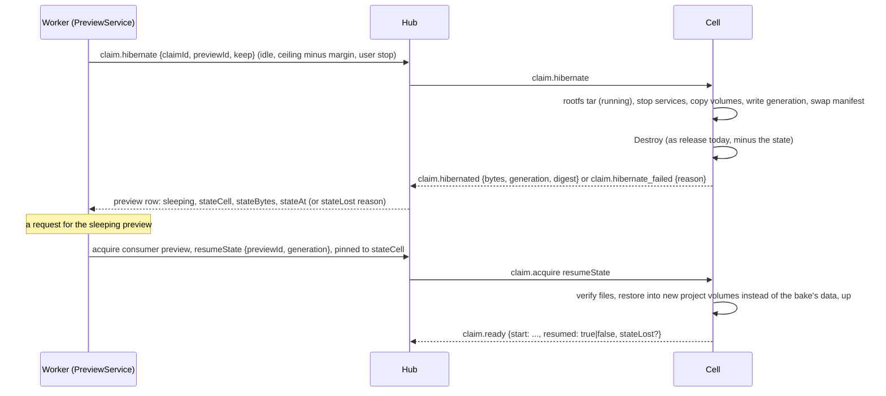

# Persistent preview state and the custom agent tool layer

Status: design of 2026-11-22, nothing built. Terms are in [glossary.md](glossary.md). Two features that share one
idea (disk state that outlives a machine, kept on the cell, never in memory) and one rule (state is per org, and
what an untrusted run writes is never read back by anything that trusts it):

- **A. A preview that hibernates and keeps its state.** Today a sleeping preview forgets what the reviewer did in it.
- **B. A tool layer for the custom agent's CLI.** Today every review installs the CLI again, before the seal.

The ideas come from [CubePod](https://github.com/cubeplexai/cubepod) (Apache-2.0). We took concepts from its README
only, never its code. Everything below is fitted to this repository.

## 0. Answer first

- **A:** at sleep the cell stops the preview's services, copies each compose project volume (and, if the spike in 6.1
  passes, each container's gVisor rootfs delta; dropped by U1) into a host directory under its work dir, and removes the machines
  (0 CPU, 0 RAM). Wake boots a new claim on the same cell from the bake as today, but puts the kept data where the
  bake's data would go. State is pinned to the cell, per preview, per org, expires with the record (7 days), and goes
  with the org purge. A cell that is gone, a full disk or a corrupt copy means a cold wake that says so. No memory is
  ever written.
- **B:** the cell builds the CLI once, in a clean builder sandbox that never sees PR code or a secret, copies the
  result out through a validating extractor into a content-addressed, per-org layer on its disk, and mounts that
  layer read-only into each review sandbox of that org. Key: installer argv, package pins, sandbox image digest,
  platform. A miss, a bad digest or any error falls back to today's install, so the layer can only make a review
  faster, never fail it. The naive "persistent system disk" is refused: the review's sandbox stays throwaway.
- **Order:** spikes S1, S2 (2 days), then B (about 11 days), then A (about 18 days). About 31 engineer-days, 3.5
  weeks with two people. Section 8.

## 1. Research

Read for this design; nothing else is relied on.

### 1.1 gVisor: where a container's writes go

| Fact | Source |
|---|---|
| The rootfs overlay keeps all modifications in the overlay and leaves the underlying filesystem unmodified. `--overlay2={root\|all}:{medium}`, medium `memory`, `self` (a file in the container root, the default for root) or `dir=/host/path` | [gVisor filesystem](https://gvisor.dev/docs/user_guide/filesystem/) |
| "To propagate rootfs changes to the host filesystem, disable it with `--overlay2=none`" (the page implies, and does not say, that with the overlay on they stay in the sandbox). The page does not say what happens to the overlay file when the container stops | same |
| Bind mounts are served by the gofer in shared mode and revalidated against the host; `--file-access-mounts=exclusive` is unsafe if anything else changes the files; external mounts are always shared | same |
| `runsc tar rootfs-upper --file <tar> <container-id>` saves the rootfs upper layer; the annotation `dev.gvisor.tar.rootfs.upper=<tar>` restores it into a new sandbox, and only when runsc runs with `--allow-rootfs-tar-annotation` (in Docker, in the runtime's `runtimeArgs`). Needs the default rootfs: overlay over a tmpfs upper layer. The page does not address extended attributes, size, or whether the source must be running | [Rootfs tar snapshots](https://gvisor.dev/docs/user_guide/rootfs_snapshot/) |

Consequence, to be proven in S1: under runsc a `docker compose stop` keeps the container record but the sandbox that
held the rootfs delta is gone, so the delta is not in Docker's writable layer and a start does not bring it back.
Fly says the same of its own rootfs: "Stop resets the rootfs" while suspend keeps it ([Fly suspend and resume](https://docs.fly.io/reference/suspend-resume)).
Only volumes and bind mounts live on the host and survive. `docker compose stop` itself "stops running containers
without removing them" ([compose stop](https://docs.docker.com/reference/cli/docker/compose/stop/)) and says nothing
about layers.

### 1.2 Docker volumes

A named volume is "stored within a directory on the Docker host" (`/var/lib/docker/volumes/<name>/_data`), outlives
its containers, anonymous volumes persist after the container is removed unless `--rm`, tmpfs is by definition not
kept, and the documented backup and restore is a helper container that mounts the volume and a host directory and tars
one into the other ([volumes](https://docs.docker.com/engine/storage/volumes/)). The cell already copies volumes with a
no-network helper (`dockercli/copy_helper.go`); A uses the same shape with a host directory as the other end.

### 1.3 How others keep disk without memory (concepts only)

| Product | What is kept | Where, how long | What we take |
|---|---|---|---|
| CubePod | Two block volumes: the OverlayFS upper and work dirs of the rootfs, and `/workspace`. The base image is the read-only lower. On idle, `sync` and `fsfreeze`, then the pod is deleted: "100% persistent disk state with zero CPU/RAM". A new pod re-attaches the volumes on any node, fsck, builds the overlay, about 1 s ([README](https://github.com/cubeplexai/cubepod)) | Volumes in a CSI backend (Longhorn, Mayastor, local loopback); the base image can be re-imaged without touching `/workspace` | The split "delta of the rootfs plus the data", the quiesce before delete, wake on the next request. We do not copy its PVC design to docker-gvisor |
| E2B | Pause saves filesystem and memory by default; a filesystem-only pause reboots on resume and loses memory. Paused sandboxes are kept with no TTL until killed; "a pause can be refused" while the node finishes a snapshot ([persistence](https://docs.e2b.dev/sandbox/persistence)) | Their storage | The filesystem-only mode is our mode; their unlimited retention is not (our 7 days) |
| Fly | Suspend saves a whole-VM snapshot (memory too); "Snapshots aren't guaranteed to persist" and a cold start follows a migration to another host or a lost file. Stop resets the rootfs; volumes are kept either way ([suspend and resume](https://docs.fly.io/reference/suspend-resume)) | Not on the volume | Disk state is pinned to a host; losing it is a cold start that must be visible |
| Codespaces | A stopped codespace keeps its saved files, loses processes; deleted after 30 days idle by default; stopped ones pay only storage ([lifecycle](https://docs.github.com/en/codespaces/about-codespaces/understanding-the-codespace-lifecycle)) | Their storage | A bounded retention and a visible cost of kept data |

[isolation-p3-snapshots.md](isolation-p3-snapshots.md) already settles the other family: memory snapshots, with the
rule that "a snapshot holds nothing a restored machine's workload may not know". Disk-only state avoids that whole
class, since a sleeping preview's memory (placeholders, tokens, canaries) is never written.

### 1.4 npm and pnpm as the model of an immutable layer

| Fact | Source |
|---|---|
| npm's cache is content-addressable (cacache); "all data that passes through the cache is fully verified for integrity on both insertion and extraction", and `npm cache verify` garbage-collects and re-verifies offline | [npm cache](https://docs.npmjs.com/cli/v10/commands/npm-cache) |
| pnpm: "every file of every package inside `node_modules` is a hard link to the content-addressable store", the nested graph is symlinks | [pnpm layout](https://pnpm.io/symlinked-node-modules-structure) |
| `pnpm store prune` removes unreferenced packages and is safe; `pnpm store status` fails when a file no longer matches what was unpacked | [pnpm store](https://pnpm.io/cli/store) |
| `ignore-scripts`: npm does not run package.json scripts; `prefix` places global installs at `{prefix}/lib/node_modules` and bins at `{prefix}/bin`; `cache` sets the cache dir; `offline` forbids network | [npm config](https://docs.npmjs.com/cli/v10/using-npm/config) |
| An interpreter script needs the execute bit; `EACCES` when "the filesystem is mounted noexec" or exec permission is missing on the script or its interpreter | [execve(2)](https://man7.org/linux/man-pages/man2/execve.2.html) |

What we take: a layer is a tree of files named by their hashes (a per-org file store, layers as hard links into it),
verified when read, garbage-collected by "nothing links to it", never edited after it is written. We do not take
pnpm's shared global store: it is per org here (section 5).

## 2. Today

### 2.1 Preview (A)

- Worker: `apps/runtime/src/worker/preview/preview.service.ts`. `tick` sleeps a `ready` preview after the idle minutes
  or at the claim ceiling (`sleepOne`: state `sleeping`, `claimId`, `cellId`, `target` cleared, then `releaseClaim`),
  wakes on `wakeRequestedAt` (`startAgain`), expires at `expiresAt` (created plus `PREVIEW_RECORD_DAYS` = 7), and `end`
  (stopped, expired) releases. `LEASE_TTL_MINUTES.preview` 15, `HARD_EXPIRY_MINUTES.preview` 120. See
  [preview-urls.md](preview-urls.md) 5.2, 14, 15.
- A wake is a new claim of consumer `preview`, booted from the environment's recorded setup at the preview's sha. It
  adopts a pool machine only for the base side when the bake still matches.
- Cell, docker-gvisor (`apps/runtime-cell/internal/drivers/dockergvisor`): a claim is a compose project named after
  the machine (`kodus-<claim>-<role>`, `machineName`, `projectVolume` = `<machine>_<key>`). `Destroy` takes the project
  down, removes the holder, then `removeProjectVolumes` (every volume with the compose project label), golden data,
  built images and the decoy file. `Suspend` and `Resume` are only `pause` and `start` of the holder.
- Data: with `data.reset: snapshot` a bake copies each project volume into `kodus-bake-<hash>` volumes
  (`data.go` `bakeData`), and `restoreData` copies them into the new claim's volumes before `up` (`copyVolumeGuarded`,
  no-network helper image pinned by digest, `dockercli/copy_helper.go`). The Docker volumes of a recipe with
  `data.reset: recreate` start empty or from golden data (`golden.go`, postgres only).
- The compose file is rewritten and checked by `internal/compose/sandbox`: every key on an allowlist (new keys are
  closed), `external`, `driver_opts` and host binds outside the checkout refused, tmpfs allowed, no `annotations`.
- Disk: `diskfloor.go` refuses a new workload under the floor plus one Run's room (`-disk-per-run-free-gb`, one floor
  when 0: twice `-disk-min-free-gb`) on the work dir or Docker's root, the agent's watchdog stops claims under the floor,
  `ClaimDiskUsage` measures each claim's volumes and writable layers. Build states and exported caches are evicted by cost
  under the floor ([build-cache.md](build-cache.md) 1).
- The watchdog frees before it stops (`agent/disk_watch.go`). Free space is the smaller of the inner filesystem
  (Docker's root) and the outer one under the build-state volume's sparse file (`-disk-outer-path`): the file can be
  full while the inner filesystem shows room. Under the margin or the floor, a ladder runs, each rung measuring free
  space again and the ladder stopping at the first that clears the line: (1) `fstrim` of the work dir and Docker's
  root (the sparse file only grows until its free blocks are discarded; a mount with `discard` is the host recipe's),
  (2) the cell's own BuildKit states (`buildstate.EvictOlderThan`, 7 days, 1 day, 1 hour, then all, least recently
  used first, a state a live build holds stays) and the host Docker's build cache, (3) `ReclaimDisk` in D7's order
  (exported caches, then build states; preview states do not exist yet). Only then a victim: the claim whose disk grew
  most, or every claim at the floor. A claim that turned ready within `-disk-ready-grace` (2 min) is passed over for
  the next one, and stopped only when nothing else is left (`disk.victim_in_grace`, alarm, and the reason on the stop).
  Each rung's freed bytes are in `disk.rung` and `cell_disk_relief_freed_bytes_total{rung}`. The template seal runs
  `fstrim` first (`cell.seal.trim`, `seal_fstrim`).
- The org purge: `apps/runtime/src/worker/commands/organization-purge.handler.ts` stops Runs, releases live claims,
  throws `OrganizationPurgeNotReadyError` until none is live, then deletes evidence by prefix and every row
  (`purge.deleteOrganization`). It never talks to a cell about data at rest.

### 2.2 Custom agent CLI (B)

- `libs/code-review/infrastructure/agents/custom-agent-cli/cli-command.ts` `planRuntimeCliInstall` turns an agent's
  CLI into a `PreSealCliInstall {id, argv, binary, egressAllow}`: only npm and pnpm, no `allowedDomains`, no secrets,
  every package pinned (`libs/core/infrastructure/config/types/general/cli-install.ts`), flags from a short allowlist,
  `--ignore-scripts` added only when the CLI `runsProjectCode`.
- `libs/sandbox/infrastructure/providers/runtime-sandbox.service.ts` `createSandboxWithRepo`: opens the sandbox with
  `egressAllow` = git host plus the registry, clones, then `installClis` runs `buildCliPrefixInstallScript`
  (`cli-prefix-install.ts`) as the sandbox user into `/workspace/.kcli/<id>` with HOME, npm prefix and cache inside it,
  detects the entry file, refuses an ELF binary, reads the shebang to pick `node`, `python3`, `bash` or `sh`, and only
  then `client.seal`. A failed install is a result, not an error.
- The sandbox container (`dockercli/sandbox.go` `SandboxArgs`): read-only root, user 1000, `--cap-drop ALL`,
  `no-new-privileges`, `/workspace` and `/tmp` as tmpfs in the sandbox's own memory (`nosuid,nodev`, size capped), and
  `Mounts` appended as `-v host:ctr:ro` (today the cell trust files). So a read-only host bind into a sandbox is an
  existing mechanism.
- The CLI runs as `<interpreter> <script>` with `env -i` (`buildRuntimeRunCommand`), because `/workspace` is noexec.
- Custom agents are configured in the app only: the repository's `kodus-config.yml` does not carry them and a
  `customAgents` key there is ignored with a warning (`review-warnings.ts` `CONFIG_FILE_KEY_IGNORED`). A PR cannot
  choose a CLI or its pin. This is the premise of B's threat model and has its own test (7.2).
- `sandbox.acquire` (`libs/runtime/protocol/messages.ts`) already has `prepares`, `templateKey` and `resumeFrom`: a
  sandbox that makes an org's template and runs only what a setup runs, with no PR code and no secret.

## 3. Feature A: design

### 3.1 What "the state" is

For a compose project, in this order of certainty:

| Part | Kept? | How |
|---|---|---|
| Named and anonymous volumes of the project (an image's `VOLUME`, a postgres data dir) | Yes, always | Copied at sleep into the state directory, restored at wake. This is the whole value for databases and uploads |
| Container rootfs delta (files an app wrote outside volumes: `/var/lib/...` of a service with no volume, `apt` installs, sqlite in `/app`) | Yes if S1 passes, per service | `runsc tar rootfs-upper` at sleep, `dev.gvisor.tar.rootfs.upper` at wake. If S1 fails, no, and the card says "only data in volumes is kept" |
| tmpfs, process memory, open connections, sessions held in a process | No | By definition. The edge's browser sessions live in Runtime Postgres and survive as today |
| Network identity, claim network, placeholders, canaries, the decoy | No | New per claim. Placeholders in kept data are stale and fail closed at the injector (an unknown placeholder maps to nothing) |

The build state, the bake, the built images and the golden data are not part of it: a wake rebuilds none of them (the
images come from the bake or the build state, as today).

A crash-consistent copy is the worst case. The cell stops services with their `stop_grace_period` (at most 10 s,
`MaxStopGrace`), so a database flushes in the usual case, and copies volumes only after every container of the project
has exited, so no file changes under the copy. The rootfs delta is taken before the stop (a tar needs a running
container), so it can be at most the grace period older than the volumes. Documented, accepted.

### 3.2 Where it lives, and how it is written

```
<workDir>/preview-state/o-<hash(org)>/p-<hash(previewId)>/
    manifest.json            written last, atomically (rename)
    gen-0007/
        vol-<key>.tar        one per volume, numeric owners, modes, links; the volume's contents
        rootfs-<service>.tar one per service, only if kept
```

- The root and its children are the cell's own real directories, mode 0700, the rules `hostdirs.go` applies to the
  build directories (a link or a foreign owner is refused at start). The helper that tars writes through a bind of
  its own generation directory only.
- `manifest.json`: `v`, `org`, `previewId`, `cell`, `generation`, `createdAt`, `expiresAt` (the preview's), `sha`,
  `inputsDigest` (sha256 of the compose file as rewritten, the recipe, and the service image digests: if any differs
  at wake, the state is stale and is dropped, not applied), and per file `name`, `bytes`, `sha256`. Total bytes.
- Generation swap: write `gen-N+1/` fully, `fsync`, write the manifest naming it, rename over the old manifest, then
  remove `gen-N`. A cell that dies half way leaves the previous generation valid, so an interrupted sleep reverts to
  the previous wake's starting state, never to a torn one. A directory without a manifest naming it is garbage the
  sweep removes.
- Capture and restore use the pinned no-network helper (`copyVolume` family): a new `CopyVolumeOut` and
  `CopyVolumeFrom` with one writable host bind (the generation directory, for capture) or one read-only (for restore),
  never both volumes and the host tree at once. tar, not `cp -a`, because the destination is a file, so a restore
  needs no other volume and a digest can name it. No compression in the first cut (the pinned busybox has none); size
  is counted as written.
- Restore verifies each file's sha256 against the manifest before the helper sees it, and extracts into an empty new
  volume. A mismatch, a missing file or a stale `inputsDigest` drops the state and the wake is cold
  (`stateLost: corrupt|stale`).

### 3.3 Flow



- A new row state `hibernating` between `ready` and `sleeping`, shown to viewers as "Sleeping". A wake request in
  that window waits for `claim.hibernated` (the same conditional-update pattern as today's states). Without it the
  wake would race the copy.
- Hibernating is bounded by the claim's own lease (the claim is held until the copy ends). To keep the capture inside
  `HARD_EXPIRY_MINUTES.preview`, the tick hibernates at the ceiling minus 10 minutes when the org keeps state. A
  `lease_lost` sleep (cell or worker lost the claim) cannot capture: the preview wakes from the previous generation or
  cold, and says which.
- Wake pins the claim to `stateCell` (a `cellId` hint on `claim.acquire`; the hub today picks by capacity). While that
  cell is connected but full, the wake waits in the existing capacity wait (10 min) and then shows "No capacity right
  now". If the cell has been disconnected for 30 minutes, the wake is cold with `stateLost: cell_unreachable`, and the
  row keeps `stateCell` for the cell's own sweep to clean up if it returns.
- `startAgain` after `stopped` also restores (a stop by the opener is "end the session", not "delete my data"). A
  `fresh: true` on open drops the state first ("Start fresh" on the card). A `security_violation` stop and every
  `end(expired)` delete the state.
- **Canaries.** `canaries(previewId, start)` is drawn per start. Kept data can hold a canary the app stored in an
  earlier start; a claim that only knows its own start's canaries would not see it cross egress. A wake's claim gets
  the canaries of every earlier start of that preview (bounded by the 7 days, a handful of starts), so a stored decoy
  still compromises the claim. Test in 7.1.

### 3.4 Components that change

| Component | Change |
|---|---|
| `libs/runtime/protocol` | Feature `previewState`. `claim.hibernate`, `claim.hibernated`, `claim.hibernate_failed`; `claim.acquire.resumeState {previewId, generation}` and `cellId`; `claim.ready.resumed`, `stateLost`; `state.delete {orgId, previewId?}` and `state.deleted {files, bytes}`; `state.inventory` at connect (`{org, previewId, generation, bytes}` list). Fixtures shared by TS and Go like the preview ones. Hello `capabilities.previewState {maxBytes}` |
| Cell, `dockergvisor` | New `previewstate` subpackage (own lock, handed what it reads of the driver, per the AGENTS rules): the store (paths, manifest, generation swap, sweep, budget, eviction), `Hibernate` and `ResumeState` on the driver, the helper calls, a restore step in `Up`'s `data` step before `restoreData`. New flags `-gvisor-preview-state` (off by default), `-gvisor-preview-state-max-gb` (per preview, 5), `-gvisor-preview-state-org-gb` (per org on this cell, 20), `-gvisor-preview-state-budget-gb` (cell total, 100). `Destroy`, `SweepExpired` and the reaper know the directory so an orphan is never left |
| Cell, `agent` | Handles `claim.hibernate` (async: ack, work, then the result message), `state.delete`, the inventory, and the compose rewrite that adds `annotations` to the services that restore a rootfs tar |
| Cell, `internal/compose/sandbox` | Keep refusing a user's `annotations`; add the one the cell sets itself after the check, so the rule "every key on an allowlist" holds for input |
| Host | If S1 passes: a second runtime in `daemon.json`, `runsc-restore`, the same runsc with `--allow-rootfs-tar-annotation`, used only by the services that restore a tar. The flag is per runtime registration, so no other claim can set the annotation. Installer and `cell preflight` check it |
| Hub | Pins `claim.acquire` to the state's cell, forwards `claim.hibernate`, records the cell's answers, keeps `runtime_cell_purges` (7). Admission is unchanged: a hibernating claim still counts until `claim.hibernated` |
| Worker | `sleepOne` calls hibernate first when the org keeps state and waits for the answer (state `hibernating`); `end` and `security stop` delete state; the tick reconciles `state.inventory`; a wake passes `resumeState` and carries `stateLost` to the row |
| Postgres (Runtime) | Next migration after 46, on `runtime_previews`: `state_cell_id`, `state_generation`, `state_bytes`, `state_at`, `state_lost` (enum text), and the `hibernating` state value; table `runtime_cell_purges (org_id, cell_id, requested_at, acked_at)` |
| API (`runtime-previews.controller.ts`) | `PreviewView.state {kept, bytes, at, lost?}`; `POST open { fresh }`; owner setting `keepData` (default on) in `PreviewSettingsSchema`, applied at the next open like the other policy fields; RBAC as stop (opener or owner) |
| Web | Run card and environment page: "Sleeping, data kept (340 MB)", "Data not kept: too large / expired on its cell / changed setup", button "Start fresh"; Settings, Preview: the toggle and the cell limits in words. Edge wake page text: "Starting preview, restoring data" |
| Edge | No change |
| Usage | `previews.stateBytesHeld` as a gauge row; no new price. Not billed by Kodus Cloud in this cut, visible to the owner |

### 3.5 Limits and disk pressure

- Per preview 5 GiB (flag), per org on a cell 20 GiB, per cell 100 GiB. Sizes are measured before copying with
  `ClaimDiskUsage` (volumes plus layers of the claim); a preview over its cap is not captured and its row says
  `state_lost: too_large` with the size. Nothing is truncated: a half state is worse than none.
- Free space: a capture is refused unless the work dir keeps twice the cell's floor free after it (`diskShort`'s
  margin). Refused is not an error: the preview sleeps cold with `state_lost: disk`.
- Under the floor, after fstrim and the build cache rungs (the ladder under Disk, above), eviction order: exported caches nobody reads, then **preview states, oldest sleep first**, then the
  build states by cost (`buildstate/cost.go`). Reason: a preview state is a reviewer's test data, bounded by the 7 day
  expiry and visible when lost; a build state protects every later pull request of the environment with minutes of
  build. Each eviction writes `preview.state.evicted` and, on the next hub contact, `state_lost: evicted`.
- The Docker side is unchanged: the host's Docker root only ever holds the running claim's volumes, never sleeping
  data, so the 2x floor margin on Docker's root is not consumed by sleepers.

### 3.6 TTL and expiry

State lives exactly as long as its record: it carries the preview's `expiresAt` (created plus 7 days). Sleeping does
not extend it. Deleted at: `end(expired)` (newer Run, PR closed, newer bake, 7 days), a `security_violation`, "Start
fresh", the org purge. The cell's sweep also deletes any generation past `expiresAt` or without a record the hub
confirms in the inventory after a 1 hour grace, so a lost `state.delete` never leaves data behind. A `stopped` preview
keeps its state until `expiresAt`.

### 3.7 Cell restart, another cell

- Restart: the directory is the source of truth. At start the store lists manifests (sanity of the manifest only, like
  `RecoverBakes`; file digests are checked when used) and sends `state.inventory`. Running previews are the reaper's
  as today; their last committed generation stays valid.
- Another cell: **no, it cannot move.** The copy is customer data (test accounts, uploads, whatever the app wrote) and
  the rule of this runtime is that only code leaves the machine; a registry or object store would put it outside the
  cell, in a place the org purge does not reach by file. Pinning is the decision. A decommissioned cell loses its
  previews' data and says so.
- If this is later wanted, the missing piece is not the format (a generation is already a verified, relocatable
  directory) but a per-org encrypted destination and its purge. It is not in this plan.

### 3.8 Other drivers

- **Kubernetes** (out of scope, no driver exists): one PVC per preview with the preview's labels, mounted where the
  compose volumes are; hibernate deletes the pod and keeps the PVC, wake schedules a pod that re-attaches it. A zonal
  volume pins the wake to a zone, not a node; a CSI `VolumeSnapshot` is the way across zones. Quota is a
  `ResourceQuota` per org namespace; expiry and purge delete PVCs by label. The rootfs delta is not kept (a read-only
  root with volumes for every writable path), the CubePod idea of a second PVC for an overlay upper dir being the
  option if wanted. The protocol above is driver-neutral: only the cell's `previewstate` changes.
- **microVM** (`internal/drivers/microvm`, no KVM host in CI): the machine already has `rootfs.ext4` and `data.ext4`
  as reflinked disks ([isolation-p3-snapshots.md](isolation-p3-snapshots.md)). State is those two files after a clean
  guest shutdown, no memory snapshot, a reflink so the copy is instant on XFS. The rootfs delta comes free, which makes
  this the best fit. Same pinning, same directory rules, same manifest.

## 4. Feature B: design

### 4.1 The layer, and where it is built and stored

A **tool layer** is the tree an install leaves, built once per `(org, cell, key)` and mounted read-only.

- **Key** = sha256 of a canonical record: `layerFormat`, installer, the argv after `planCliInstall` (so
  `--ignore-scripts` is part of it), the binary name, the sandbox image's content digest (the cell resolves
  `-gvisor-sandbox-image` to its image id and refuses a layer build when it cannot), `GOARCH` of the cell, and the
  registry host. Not the org: the org is the directory.
- **Layer digest** = sha256 of the canonical tree manifest: every entry's path, type, normalized mode (files 0444, a
  script's exec bit removed too, directories 0555), size, file sha256 or link target, sorted. The layer is named by it.
- **Store**, on the cell host, per org, under the same private-root rules as `hostdirs.go`:

```
<workDir>/toollayers/o-<hash(org)>/
    files/<sha256>               the org's file store; every file of every layer is a hard link to one of these
    layers/<digest>/tree/        the mounted directory; hard links into files/
    layers/<digest>/layer.json   the manifest, the key, imageDigest, builtAt, binaryPath, interpreter, bytes
    keys/<key>                   one line: the digest it points to (swapped atomically)
```

  pnpm's store is the model (1.4): identical files across an org's layers are stored once, a layer is a set of links,
  and a file is garbage when only `files/` links to it (`st_nlink == 1`).
- **Mount point** `/opt/kcli/<id>`, the same absolute path in the builder and in every review. `HOME` is a separate
  writable `/workspace/.kcli/<id>` (empty, throwaway). `cliPrefixEnv` takes `{prefix, home}`: `NPM_CONFIG_PREFIX`,
  `PNPM_HOME` and `PATH` point into the prefix, `HOME` and the npm cache into the home. A read-only prefix means a CLI
  that writes into its own install directory fails, as one on a read-only root does today.
- `layer.json` also stores what `buildCliPrefixInstallScript` detects (entry script, interpreter), so a hit returns the
  same `{home, binaryPath, interpreter}` the install does and the code downstream of `installClis` is unchanged.

### 4.2 The builder

A builder is a sandbox claim, so it is admitted, leased, bounded and visible like any other.

- Opened with `sandbox.acquire { layerBuild: {key, id, installer, argv, binary, registry} }` (feature `toolLayers`).
  The hub admits it like a sandbox. No caller ever gets `sandbox.op` on it: the cell itself runs the build through the
  guest agent, then the claim ends. This is `prepares` for layers: a machine that runs only what an install runs.
- Clean: no PR code and no checkout, no org secret (`secrets` refused, `CellTrust` false), egress allowlist = the one
  registry host (plus the platform base list), a tmpfs at `/opt/kcli` sized by the layer cap, `/tmp` as usual, the same
  limits, pids, memory and 300 s timeout as an install today, user 1000, no capability.
- The argv is the API's plan, and the cell **re-validates it in Go** against the same rules as
  `checkCliInstallCommand` (npm or pnpm, one install command, no shell syntax, every package pinned, allowed flags
  only). Shared test fixtures hold both validators to the same answers. The cell never executes a string it cannot
  validate itself, whatever the hub sent.
- **Lifecycle scripts** run exactly as in today's install (parity: a layer must equal what the review would have
  installed; `--ignore-scripts` only when the CLI `runsProjectCode`). They are contained, not trusted:
  - the builder is a gVisor sandbox with no secret, no PR code, a one host allowlist that is closed by `seal` the
    moment the install command returns, and no host mount of any kind;
  - nothing leaves the builder but the bytes of one tar stream, read by the cell's own extractor (4.3);
  - the layer is mounted only into sandboxes of the org that configured the CLI, read-only;
  - a script that tries to reach another host fails at the egress; one that spins is killed by the timeout.
  Whether to run them at all for CLIs that do not need to is open (section 9).
- After the install the builder is sealed, then `tar` streams `/opt/kcli/<id>` out through `ExecStream`
  (`dockercli`), the same exec path as the guest, never a shell on the cell host.

### 4.3 The extractor (the only door into the store)

The cell reads the tar into a staging directory under the store (0700) with its own Go code, never `tar -x`, and
refuses the whole layer on any of:

- an entry that is not a regular file, directory or symlink (devices, fifos, sockets);
- an absolute path, a `..` segment, a name over 255 bytes, a path over 4096, a duplicate path, or an entry whose
  parent is a symlink;
- a symlink whose target is absolute, or whose lexical resolution leaves the layer root. Reason: a link to
  `/workspace/...` would be resolved inside the review sandbox, where that path is the PR's checkout and PR-written
  JavaScript would run as part of the CLI;
- a hard link entry (links in the layer are the store's, never the archive's);
- setuid, setgid or sticky bits (cleared, and a file that had them is refused);
- more than the entry cap (100,000), the byte cap (256 MiB by default, `-gvisor-toollayer-max-mb`), or a stream that
  runs past the build's deadline.

Then it normalizes modes, hashes every file into `files/`, links the tree, computes the layer digest, checks that the
entry script exists, is a regular file, is not an ELF binary (the same refusal as today) and has a supported shebang,
writes `layer.json`, fsyncs, and swaps `keys/<key>` last. Files and layer are mode 0444 and directories 0555, owned
by the cell.

### 4.4 Mount, integrity, the seal and noexec

- At `sandbox.acquire` the review asks for `toolLayers: [{key, id}]`. For each, the cell looks up `keys/<key>` in the
  org's store, **recomputes the layer digest from the tree it is about to mount** (hash every file, compare with
  `layer.json`; at most 256 MiB, a warm-cache fraction of a second), and refuses the layer on any difference: the
  layer is evicted, the answer is `miss`, and `preview.toollayer.corrupt` is logged. A held reference
  (`kodus.tool-layers` label on the sandbox container) protects it from GC while the sandbox lives.
- The bind is `-v <store>/layers/<digest>/tree:/opt/kcli/<id>:ro` through the existing `Spec.Mounts` path; the host path
  is built by the cell from a digest it just verified, under the store root, through real directories only
  (`ResolveInside`). The review user cannot write it (read-only mount, files 0444, owner the cell), cannot see another
  org's layer (it is not mounted, and its path is not derivable from anything inside), and cannot change what a
  later review mounts (the host tree is not what it wrote).
- gVisor: the bind is served by the gofer as any `-v` is today; read-only is enforced by the mount, not by the
  workload. The layer does not depend on `--file-access-mounts` or on any overlay medium (1.1). Whether `noexec` can be
  set on a Docker bind is unproven (S2); the design does not need it: every file is 0444 and every script's exec bit is
  removed, so `execve` fails with `EACCES` exactly as on the noexec workspace (1.4), and the CLI keeps running as
  `<interpreter> <script>` from the image. A native addon (`dlopen` of a `.node`) is not promised to work, as today.
- The seal is unchanged and not involved: the mount exists before the sandbox starts, nothing in a hit needs the
  network, and the registry host leaves `egressAllow` for the CLIs that hit. A review of only hits opens egress for the
  git host alone.

### 4.5 Miss, invalidation, size, garbage collection

- **Miss** (no key, a corrupt layer, a layer evicted between check and mount, the feature off, no digest for the
  image): the answer in `claim.ready` is per layer `{id, state: 'miss'}` and the provider runs today's
  `installClis` for exactly those, with the registry host in `egressAllow` as before. Nothing is new on that path. The
  review is never held for a build.
- **Build on miss**: the cell asks the hub, which opens a builder claim on that cell, single-flight per
  `(org, cell, key)`, at most one at a time per cell and two per org, queued behind reviews. A failed build is
  remembered for 10 minutes (no loop); a successful one swaps `keys/<key>`.
- **Invalidation**: a new package version, a different argv or a new sandbox image digest is a different key, so the
  old layer is simply not asked for again. A layer is also rebuilt after 7 days (stale-while-revalidate: the old one
  serves until the new key pointer is swapped), because an unpinned transitive dependency would otherwise stay as
  resolved at the first build. The pins of the CLI itself never change under one key.
- **Limits**: per layer 256 MiB, per org 2 GiB and 32 layers, per cell 20 GiB. Over a limit, the least recently
  mounted layer without a hold goes first; a layer that does not fit alone is refused (`too_large`, the miss path).
- **GC**: a layer with no key pointing to it, no hold and 24 h unused; a key unused for 30 days; files with link count
  1. Under the disk floor, tool layers go before everything else (a rebuild is a minute and invisible to a reviewer).

### 4.6 Components that change

| Component | Change |
|---|---|
| `libs/runtime/protocol` | Feature `toolLayers`. `sandbox.acquire.toolLayers [{key, id}]` (reviews) and `layerBuild` (builders, excludes `secrets`, `templateKey`, `resumeFrom`); `claim.ready.toolLayers [{id, state: hit\|miss, binaryPath, interpreter, digest}]`; `toollayer.built` and `toollayer.failed` (builder result, no content). Fixtures in TS and Go |
| Cell, `dockergvisor` | New `toollayer` subpackage: store, key, extractor, verifier, GC, single-flight; `CreateSandbox` gains the mounts and the label; a builder path that runs the install and the export; flags `-gvisor-toollayer`, `-gvisor-toollayer-max-mb`, `-gvisor-toollayer-org-gb`, `-gvisor-toollayer-budget-gb`; the Go install validator with shared fixtures |
| Cell, `dockercli` | `SandboxSpec` carries a tmpfs list (for `/opt/kcli` in a builder) and layer mounts; both stay validated like every other argument |
| Hub | Carries the new fields only to a cell whose hello names `toolLayers`; admits a builder as a sandbox; single-flights builds; the per-sandbox audit row records layer keys and states, never content |
| `libs/sandbox` | `createSandboxWithRepo` computes the plan's key (needs the image digest: cell hello `capabilities.sandboxImageDigest`), sends `toolLayers`, installs only the misses, requests a build for them, and for hits skips `installClis`; `cliPrefixEnv({prefix, home})` |
| Custom agent provisioner | Uses the returned `{home, binaryPath, interpreter}` as today; one warning kind when a layer was corrupt |
| Org purge | 7 |

**As built (B, hub and provider).** Three places differ from the table above, each for a reason found while building:

- **The hub computes the key, not `createSandboxWithRepo`.** The key needs the chosen cell's image digest and arch (its hello), and the worker picks the cell after the provider has built its request. So the provider sends the plan (`SandboxOpen.toolLayers`: id, installer, argv, binary, registry), the hub keys it with `computeToolLayerKey` (`libs/runtime/protocol/tool-layer-key.ts`, held to the cell's `ComputeKey` by `tool-layer-key-cases.json`) and sends the cell `{key, id}` only when the cell names `toolLayers` and sent a digest. The answer comes back in the sandbox view (`toolLayers`, per layer hit or miss with the CLI's path and interpreter).
- **The registry host leaves the egress on a hit; it is not added on a miss.** The provider keeps putting the registry in `egressAllow`, as an install needs it, and the hub sends an `egress.policy` without the host of every held layer once `claim.ready` says which are held (a host a missed layer still needs stays). A policy that cannot be pushed only leaves the registry open until the seal, as it was before layers, so an install never fails for it.
- **The org purge waits for the connected cells only.** `org.purge` goes to every connected cell that names `toolLayers` and may hold the org's data; `org.purged` is the per-cell acknowledgement; the worker's purge asks every replica that holds a connected cell and throws until none is pending. The hub keeps the acknowledgements in memory, not in `runtime_cell_purges`, so a cell that is offline is not reached when it returns; that table (and the purge on connect) is still to build, and until then an offline cell's layers go with its own GC and its retirement.

## 5. Threat model

### 5.1 Feature A

| Threat | Control |
|---|---|
| State of org A restored for org B, or for another preview | The path is derived from the cell's own org and preview ids, never from a name the hub or a client sends; `claim.acquire.resumeState` is accepted only when the preview's org equals the claim's org and the manifest's `org`, `previewId` and `cell` equal the claim's. One preview, one state; a new sha is a new preview with no state (data written by old code never meets new code or a different PR) |
| Hub or API asks the cell to restore an arbitrary path | The message carries `previewId` and `generation`, never a path; unknown ids answer `miss` |
| A tampered or bit-rotten copy | Manifest digests checked before the helper reads a file; any mismatch drops the state (`corrupt`) and boots cold. Only the cell can write the tree (0700, own directory) |
| A restore that attacks the host | The helper is the pinned no-network image under runsc with the target volume and a read-only bind of one generation directory, nothing else; it writes only an empty volume of this claim. The data inside is the app's own, which could always write anything there |
| A restored rootfs tar (S1) | Made by the cell from the same preview, restored only through the dedicated runtime and only for its services; the user compose file cannot set `annotations` (refused, tested) |
| Fork PR code writes poison, a later wake reads it | The next boot is the same preview's own services on the same data, which is the point; nothing outside that preview reads it. No setup, bake, build state or other preview ever takes it as input (the bake and golden paths do not know the directory; test) |
| A secret or canary persists in the data | Real secrets never enter the machine (injector swap); placeholders are stale after a wake and fail closed. Canaries of earlier starts stay in the claim's policy (3.3). A `security_violation` deletes the state |
| Memory leaks through the copy | No memory is written; rootfs tars hold files, not process state |
| Disk exhaustion by one org | Per preview, per org and per cell caps, refusal rather than truncation, the diskfloor margin, eviction (3.5) |
| Data outlives the right to it | Expiry with the record, a cell sweep that does not trust the hub, the org purge below |

Residual risk accepted: a customer's own data is at rest in plain files on the cell host for up to 7 days; the cell
host is the customer's (self-hosted) or Kodus's (Cloud) trust boundary already for volumes and bakes. Encryption at
rest is the host's disk; it is not added here.

### 5.2 Feature B

Premise: the spec is org settings (2.2), never PR content. Who can write a layer: only the cell's store code, from the
output of a builder claim that the hub opened for an org's configured CLI. Not a review sandbox, not PR code, not the
API directly, not another org.

| Threat | Control |
|---|---|
| A PR poisons a layer that a later review loads (the reason the naive persistent disk is refused) | The review's sandbox has no writable path into the store: the layer is mounted read-only, the host tree is owned by the cell and mode 0444, and a review never writes to the host. The review keeps its own throwaway `/workspace`. Nothing a review does is read back by the store |
| The builder is attacked by a package script | Clean builder (4.2): no PR code, no secret, one registry host closed by seal after the install, no host mount, timeout, pids, memory, tmpfs cap. What it produces is only bytes in one tar stream |
| The tar stream attacks the cell | Own Go extractor with the refusal list of 4.3, into a 0700 staging directory, never executed, never `tar -x` |
| A symlink in the layer steers the CLI at the PR's files | Refused: absolute or escaping targets (4.3). Test |
| A malicious or compromised package version | As today's per-review install, but amplified in time: one bad build serves reviews for up to 7 days. Pins (cannot be a tag or range), the 7 day rebuild, the layer digest in the audit row, and eviction on report limit it. Registry signature or provenance checks are open (section 9) |
| Layer of org A used by org B | No. Per-org directories, the key does not name another org's path, the hub passes `orgId` from the claim and the cell derives the path itself |
| Digest sharing across orgs | Not done. Sharing the file store across orgs would make "was this CLI already built" a timing oracle on another customer's configuration (an instant start reveals a configured package), and a layer is not provably identical for two orgs: unpinned transitive dependencies resolve at build time. A per-org copy costs about 50 to 150 MB per CLI, which is cheap. If a later measurement says otherwise, the only safe form is sharing blobs whose sha256 is checked against the registry's published integrity, with a per-org layer and no cross-org existence signal |
| Tampered layer on disk | Digest recomputed at every mount (4.4); mismatch evicts and falls back |
| A review reaches the registry or a host because of the layer | A hit shrinks `egressAllow`; the seal is unchanged |
| Exec on a layer | Exec bits stripped, read-only, run through the image's interpreter; ELF entries refused at build. Noexec on the bind is a bonus if S2 proves it |
| Build abuse (one org fills the cell or loops builds) | Single-flight, 10 minute negative cache, per-cell and per-org build concurrency, caps and GC (4.5), hub admission |
| Cross-version confusion | The key includes the image digest and arch: a new image never mounts an old layer |

## 6. Spikes (before the build; each decides a line above)

- **S1 (A): where does a runsc container's rootfs delta go on `stop` and `start`?** On a Linux Docker with runsc:
  write a file in a container's rootfs, `docker compose stop`, `start`: is it there? Run `runsc tar rootfs-upper`
  against a running container and restore it with the annotation on a second runtime with
  `--allow-rootfs-tar-annotation`; check owners, modes, symlinks, hard links, sparse files, extended attributes, size
  of a 500 MB delta, and that the cell can run `runsc` at all (its user, `--root`). Pass: the rootfs delta ships for
  services. Fail: A ships volumes-only and the card says so. 1 day.
- **S2 (B): the mount.** In a sandbox of the cell's shape: a `-v host:ctr:ro` of a 0555 tree of 0444 files, user 1000:
  read works, write is `EROFS`, `execve` of a script fails, `node script.js` works; whether Docker can add `noexec` to
  the bind; hash-all time for 256 MiB cold and warm; hard links in the tree across the bind. 1 day.

  **S2 result (2026-11-22, runsc with `--oci-seccomp`, the sandbox image, user 1000, 4 vCPU host):** `node
  /opt/kcli/a/bin/cli.js` works and its `require` of a sibling file works; creating or touching a file is denied;
  `execve` of the 0444 script fails with 126 (`Permission denied`); `chmod` inside fails with `Read-only file system`;
  hard links cross the bind (link count 2 seen inside). Docker refuses `noexec` on a bind (`invalid mode: ro,noexec`),
  so D11's mode-bit parity is the control, as planned. Hashing 256 MiB takes 1.53 s cold and 0.92 s warm, a stat of
  the same files takes no measurable time: this is why U8 verifies by fingerprint per mount. Finding: on a host where
  the cell's user is uid 1000, the files show inside as owned by the sandbox user; the read-only mount still blocks
  every write and `chmod`, so the control is the mount, not the owner. The store still sets owner to the cell's user
  and the installer should keep the cell's user off uid 1000.

## 7. Deletion and the org purge

One mechanism for both features: **cell-held data of an org**.

- New hub-to-cell message `org.purge {orgId}` answered `org.purged {files, bytes}`: the cell removes
  `preview-state/o-<hash>/` and `toollayers/o-<hash>/`, after refusing to start if a claim of that org is live on the
  cell. A cell that is offline gets it when it connects (the hub keeps `runtime_cell_purges`, a row per org and cell
  that holds data per the cell's `state.inventory` and layer inventory, deleted on `org.purged`).
- `OrganizationPurgeRequestedHandler` gets a port (`CellDataPurger`). After the claims are released and before the
  evidence and the rows go (the rows are how it finds the cells), it requests the purge on every cell with a row and
  throws `OrganizationPurgeNotReadyError`, carrying a third count (`cellsPending`), until all acknowledged. A cell
  marked retired in `runtime_cells` is skipped and logged. The purge is idempotent: a second command sends nothing to
  acknowledged cells.
- Expiry deletes through `state.delete`; the sweeps on the cell remove what the hub never told it.

## 8. Tests that must fail first, and validation

Lowest layer first. Each row is written and seen red before its code.

### 8.1 A

| Behaviour (stated as a sentence) | Layer | Where |
|---|---|---|
| A preview's kept state restores only into a claim of the same org, preview and cell; another org's, another preview's and a path in the message are refused | Go unit | `previewstate` |
| An interrupted write leaves the previous generation valid; a directory without a manifest is garbage | Go unit with injected failures | `previewstate` |
| A file whose digest differs, a missing file, or a changed `inputsDigest` drops the state and boots cold with the right reason | Go unit, `memdocker_test.go` | `dockergvisor` |
| Capture refuses over the preview, org or cell cap and under twice the floor; it never truncates | Go unit | `dockergvisor` (`diskfloor` style hooks) |
| Under the floor, preview states go before build states, oldest first, and a held one never | Go unit | `previewstate`, `buildstate/cost` neighbour |
| `Destroy`, `SweepExpired` and the reaper never delete a sleeping state before its expiry and always after it; the sweep removes a state the hub does not confirm after the grace | Go unit | `sweep_test.go` neighbour |
| The compose check refuses a user's `annotations`; the cell's own is added after it | Go unit | `compose/sandbox` |
| `claim.hibernate`, `claim.hibernated`, `state.*`, `org.purge`, `resumeState` and `cellId` round trip identically in TS and Go | fixtures | `libs/runtime/protocol`, `internal/protocol` |
| `sleepOne` hibernates first and the preview is `hibernating` until the answer; a wake in that window waits; a failure still ends in `sleeping` with a reason; `end` and security stop delete | TS unit | `preview.service.spec.ts` |
| A wake is pinned to the state's cell; with the cell disconnected 30 minutes it is cold with `cell_unreachable` | TS unit | hub `claim.service` spec, `preview.service.spec.ts` |
| The wake's claim policy holds the canaries of every earlier start | TS unit | `preview.service.spec.ts`, `cell-hub.canaries` neighbour |
| New columns, enum value and `runtime_cell_purges` on Postgres 16 | integration | `pg-preview-store.integration.spec.ts` |
| The purge waits for every cell, sends to offline cells on connect, skips a retired one, is idempotent | TS unit, then integration | `organization-purge.handler.spec.ts` |
| `keepData`, `fresh`, the view's `state` and RBAC | TS unit | `libs/runtime/api/__tests__/previews`, `preview-settings` |
| Card words for kept, lost (each reason) and "Start fresh" | web unit | `model/preview.spec.ts` |
| gVisor: a row written to a postgres service's volume survives hibernate and wake, no container of the project exists while asleep, the wake restores before `up` | gVisor regression | `test/gvisoregress/preview_state_linux_test.go` (`KODY_E2E_GVISOR=1`) |
| gVisor: a flipped byte in a kept tar boots cold and deletes the state; a new Driver on the same work dir (cell restart) still restores | gVisor regression | same |
| gVisor: a rootfs-only write survives for a service (only if S1 passes; otherwise the test asserts it does not, so the card's claim stays true) | gVisor regression | same |
| gVisor: another preview's claim on the same cell cannot read this state; the golden and bake paths never see the directory | gVisor regression | same |

Validate through the product, on the QA environment, with a repository that has a database (the demo shop) and the
cell flag on: open the PR side, create an account and a record through the page, set the idle time to the 5 minute
minimum, wait for the sleep, confirm on the host that nothing of the project runs and the state directory has the
manifest, open it again from the card, find the record and a still-valid login, then "Start fresh" and find it gone.
Then close the PR and check the directory is gone, and run an org purge on a test org and check the cell's tree.

### 8.2 B

| Behaviour | Layer | Where |
|---|---|---|
| The key changes with the argv, a package pin, the image digest, the arch and `--ignore-scripts`, and with nothing else | Go unit | `toollayer` |
| The Go install validator answers the same as `checkCliInstallCommand` on a shared fixture set (tags, ranges, URLs, flags, shell syntax, scoped names) | Go unit plus TS unit on the same JSON | `toollayer`, `cli-install.spec.ts` |
| The extractor refuses each of: device, fifo, absolute path, `..`, duplicate, escaping or absolute symlink, hard link, setuid, over the entry and byte caps, over the deadline; and accepts a normal npm tree | Go unit | `toollayer` |
| A layer whose file changed on disk is refused at mount, evicted and answered `miss` | Go unit | `toollayer` |
| Two simultaneous misses run one build; a failure is not retried for 10 minutes; org and cell caps hold | Go unit | `toollayer` |
| GC never removes a held layer, removes files with link count 1 only, and removes a layer only when nothing points to it | Go unit | `toollayer` |
| Org A's key never resolves to org B's directory | Go unit | `toollayer` |
| `sandbox.acquire` with `toolLayers` and `layerBuild` round trips; a builder with `secrets` is refused | fixtures, hub spec | protocol, `cell-hub` |
| On a hit the provider does not run the install script and the registry is not in `egressAllow`; on a miss it installs as today and asks for a build; a mix of both works per CLI | TS unit | `runtime-sandbox.service.spec.ts` |
| The env splits prefix and home and the run command is unchanged otherwise | TS unit | `cli-prefix-install.spec.ts`, `cli-command.spec.ts` |
| A `customAgents` key in the repository's `kodus-config.yml` never produces a spec | TS unit | `review-warnings.spec.ts` neighbour |
| gVisor: the mounted layer is read-only (write is `EROFS`), has no exec bit, `node <script>` runs, an ELF entry was refused at build | gVisor regression | `test/gvisoregress/tool_layer_linux_test.go` |
| gVisor: a review that tries to modify the layer fails, and the next sandbox of the org mounts the original bytes | gVisor regression | same |
| gVisor: a package whose postinstall reaches another host, writes outside the prefix, forks, or emits a symlink to `/workspace` is contained or refused, and the extractor's refusal leaves no layer | gVisor regression | same |
| gVisor: a sealed review with a mounted layer runs the CLI with no network | gVisor regression | same |

Validate through the product: configure a custom agent with a pinned npm CLI on the QA org, run a review twice, see
`installClis` absent from the second one (the audit row shows layer key, `hit`, digest), the review's setup time
drop by the install time, and the CLI's finding present. Then change the pin, see one miss and a build, then a hit;
then run the org purge and see the layer tree gone.

## 9. Decided and open

### Decided

| # | Decision | Reason |
|---|---|---|
| D1 | State is disk only: volumes, plus rootfs delta if S1 passes. No memory | Memory holds secrets and canaries; invariant 1 of [isolation-p3-snapshots.md](isolation-p3-snapshots.md) |
| D2 | Host directory of tars under the cell's work dir, copied by the pinned no-network helper, not Docker volumes kept alive | Independent of Docker names and prune; verifiable by digest; the reaper and the orphan sweep keep their rule that Docker volumes belong to a claim |
| D3 | A state is per preview and never carried to another sha, preview or org | Old data and new code, or a poisoned run, never meet something that trusts them |
| D4 | State is pinned to its cell and cannot move; a lost cell means a cold wake that says so | Customer data stays on the cell; Fly and E2B give the same answer for host-local state |
| D5 | State dies with the record (7 days), a security stop, "Start fresh", the org purge; the cell sweeps without trusting the hub | A lost message must not leave data behind |
| D6 | Over a cap or the disk margin, no capture and a cold wake with a reason; never a partial state | A half state is worse than none |
| D7 | Eviction under the floor: caches, then preview states, then build states | See 3.5 |
| D8 | B builds in a clean builder claim, copies out through the cell's own validating extractor, stores content-addressed per org, mounts read-only | The review never gets a writable path into anything it later reads |
| D9 | B is per org and per cell, never shared across orgs, not even by digest | Timing oracle on another org's configuration and non-reproducible transitive dependencies |
| D10 | A miss, a corrupt layer or the feature off runs today's install unchanged; builds never block a review | The layer can only speed a review up |
| D11 | The layer mounts at `/opt/kcli/<id>`, HOME stays a throwaway workspace directory; noexec parity by mode bits, not by the mount | Same absolute path in builder and review; works even if Docker cannot noexec a bind |
| D12 | Lifecycle scripts run in the builder as today's install does (parity), contained there | The layer must equal what the review would install |
| D13 | One `org.purge` for both features, acknowledged per cell, the org purge waits for it | One place that knows where an org's data at rest is |

### Decided with the user (2026-11-22): performance, security, low cost

| # | Decision | Reason |
|---|---|---|
| U1 | **A is volumes-only.** No rootfs delta, no second runsc runtime, no host `daemon.json` change; S1 is dropped | Volumes hold what a reviewer cares about (database, uploads); a second runtime on every host is cost and attack surface for little gain. A service that writes state outside a volume wakes without it, and the card says so |
| U2 | **A's data is kept 72 h after the preview goes to sleep**, never past the record's `expiresAt`. After 72 h asleep the state is deleted and the next wake is cold, with a reason | Covers a weekend; halves the at-rest exposure and the disk of the 7 day plan |
| U3 | **Kept data is shown (bytes per preview, per org) and not charged.** The caps of 3.5 bound the cost | No billing surface to build; the caps keep the disk small |
| U4 | **B runs lifecycle scripts in the builder** (D12) | The builder has no secret, no PR code and one registry host: running them there is strictly safer than today's install inside the review |
| U5 | **B checks package integrity and signatures in the builder.** npm's `integrity` (sha512) is always enforced; `npm audit signatures` runs after the install and an *invalid* signature refuses the layer; an unsigned package is allowed and recorded in `layer.json` | Cheap, catches a tampered registry answer; refusing unsigned packages would break legitimate CLIs |
| U6 | **The image digest is resolved at cell start; no digest, no layers** (fail closed to today's install) | A layer must never meet an image it was not built for |
| U7 | **Native binaries keep today's parity**: an ELF entry is refused, exec bits are stripped | Today's install already refuses them on the noexec workspace, so nothing regresses; allowing exec from a layer is a separate review |
| U8 | **Mount-time verification is a stat fingerprint, the full rehash is periodic.** At build the cell records, per file, `(inode, size, mtime, ctime)`; each mount compares that fingerprint (microseconds for thousands of files). The full sha256 of the tree runs at the first mount after a cell start, every 24 h per layer, and whenever the fingerprint differs | Rehashing up to 256 MiB on every review costs CPU and latency on the hot path. Changing a 0444 file owned by the cell needs the cell's user or root on the host, which already owns every sandbox; the periodic rehash still catches bit rot |
| U9 | **A layer is built on the second miss of the same key within 7 days**, not the first | The first miss already pays one install inside the review; building in parallel would double the cost for a CLI used once. A CLI used twice pays one build and then saves every later install |
| U10 | **A's copies are compressed with zstd level 1** | Database volumes compress well; level 1 costs little CPU at sleep and wake |

## 10. Effort and order

One engineer-day = a day of one engineer including tests and review. Both features are complete here: nothing is
deferred to a later phase.

| Work | Days |
|---|---|
| S2 spike (S1 dropped, U1) | 1 |
| **B** protocol, fixtures, hub fields and builder admission | 2 |
| **B** cell: store, key, extractor, verifier, GC, Go validator, mounts, builder path | 5 |
| **B** provider, env split, provisioner, org purge hook, audit | 2 |
| **B** gVisor suite and product validation | 2 |
| **B subtotal** | 11 |
| **A** protocol, fixtures, `org.purge` shared with B | 2 |
| **A** cell: `previewstate`, helper calls, `Hibernate`, `Up` restore step, sweep, budget, eviction, reaper | 6 |
| **A** hub pinning, hibernating state, inventory, purges table; worker; migration | 4 |
| **A** API, web, settings, copy | 2 |
| **A** gVisor suite and product validation | 2 |
| **A subtotal** | 16 |
| **Total with the spike** | 28 |

Order: S1 and S2 first (one day each, they can run in parallel with the protocol work). **B before A**: B is smaller,
it is security-sensitive so it gets the most review time, it pays on every review rather than on some previews, and it
builds the two things A reuses (the cell-held data tree under the work dir with its sweep and budget, and `org.purge`).
A follows. With two engineers, B and the shared protocol start together and A's cell work starts when `org.purge` lands.
Both ship off by default (`-gvisor-toollayer`, `-gvisor-preview-state`) and turn on per cell after the QA run in 8.
