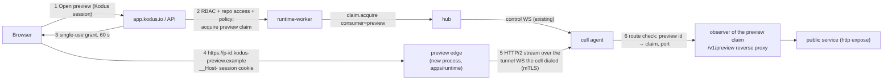
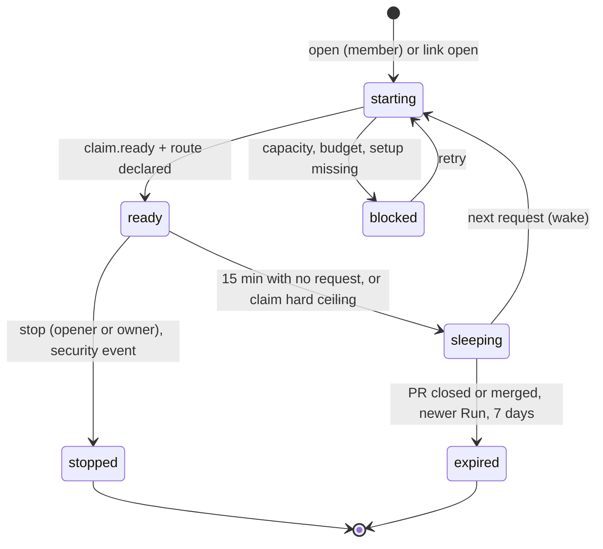
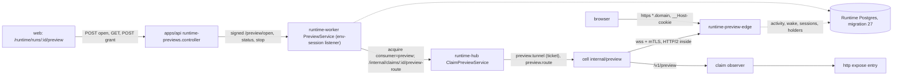

# Preview URLs: open the running system of a Run in a browser

Design of 2026-11-12. Phases 1 and 2 are built (§14 and §15 say what, how each differs from
this design, and the deploy delta); §13's recommendations were accepted as the defaults. Terms are in [glossary.md](glossary.md); the
machine model is in [isolation-architecture.md](isolation-architecture.md) and [sandbox.md](sandbox.md).

A preview URL lets a developer open, in a browser, the system a Run booted: the PR side, and the base side to compare.
It exposes a customer's unreviewed PR code to the internet, so the design starts from what must never happen:

1. Someone outside the org, or inside it without access to the repository, opens it.
2. The PR's JavaScript reads or sets a cookie of `app.kodus.io`, of the customer's other apps, or of another preview.
3. A preview becomes a phishing page on a Kodus domain, or a way to drive the org's secrets against third parties.
4. A preview keeps a machine alive that nobody uses, or delays a Run.
5. Preview traffic changes a Run's verdict.

## 1. Research

Sources read on 2026-11-12. "Unconfirmed" marks what no fetched page stated.

### 1.1 Who does it, and how

| Product | URL and access | Forks, expiry, idle | Source |
|---|---|---|---|
| Vercel | `*.vercel.app`. Deployment Protection: Vercel Authentication (only logged-in users with access to the deployment; it sets a cookie for that one URL, "not reusable across different URLs"), Password (Pro add-on), Trusted IPs (Enterprise). Bypass for automation is a per-project secret in `x-vercel-protection-bypass`, which can set a `SameSite=Lax` cookie. Shareable links work through a query string | A fork PR needs a team member to authorize the deploy, so env vars and the OIDC token don't leak (Git Fork Protection) | [protection](https://vercel.com/docs/deployment-protection), [Vercel Authentication](https://vercel.com/docs/deployment-protection/methods-to-protect-deployments/vercel-authentication), [bypass](https://vercel.com/docs/deployment-protection/methods-to-bypass-deployment-protection/protection-bypass-automation), [links](https://vercel.com/docs/deployment-protection/methods-to-bypass-deployment-protection/sharable-links), [forks](https://vercel.com/docs/git/vercel-for-github) |
| Netlify | `deploy-preview-42--site.netlify.app` and an immutable `<deployid>--site` permalink. Protection is a password or team login (SSO); SSO authorization lasts 1 h | Untrusted deploys (forks, unknown authors) default to **Require approval**. Other options: build without sensitive variables, or without restrictions | [deploy previews](https://docs.netlify.com/site-deploys/deploy-previews/), [untrusted deploys](https://docs.netlify.com/deploy/deploy-overview/), [protection](https://docs.netlify.com/manage/security/secure-access-to-sites/password-protection/) |
| Render | Own `onrender.com` URL with `X-Robots-Tag: noindex` | Deleted when the PR merges or closes. `expireAfterDays` is optional and every push resets it. Billed per second at the base service's rate | [service previews](https://render.com/docs/service-previews), [preview environments](https://render.com/docs/preview-environments) |
| Signadot | `https://<endpoint>--<sandbox>.preview.signadot.com`. Every request needs `signadot-api-key` or a login cookie | The control plane keeps "a secure tunnel connection with each Kubernetes cluster". It validates the user, strips the auth, adds routing headers and forwards the request | [preview URLs](https://www.signadot.com/docs/reference/sandboxes/preview-urls), [control plane](https://www.signadot.com/docs/concepts/architecture/control-plane) |
| Coder | Share levels `owner` (default), `organization`, `authenticated`, `public`. An admin can cap the level, and the default cap is owner. Needs a wildcard access URL, because "applications run in isolated subdomains with separate browser security contexts". Path-based apps should then be disabled | Autostop on inactivity. Direct port URLs without a session don't count as activity | [port forwarding](https://coder.com/docs/user-guides/workspace-access/port-forwarding), [admin](https://coder.com/docs/admin/networking/port-forwarding), [wildcard](https://coder.com/docs/admin/networking/wildcard-access-url), [scheduling](https://coder.com/docs/user-guides/workspace-scheduling) |
| Gitpod / Ona | `3000-<ws>.ws-….gitpod.io`. Ports are private (users with workspace access) by default, or public | — | [ports](https://ona.com/docs/configure/workspaces/ports) |
| Daytona | `https://{port}-{sandboxId}.{proxyDomain}`. A private sandbox needs `x-daytona-preview-token`, which is sandbox-wide and can't be revoked. A signed URL is bound to one port, revocable, 60 s by default (up to 24 h). A warning page shows on the first browser visit | Auto-stop 15 min by default, and preview requests reset it. Auto-archive after 7 days | [preview](https://www.daytona.io/docs/en/preview-and-authentication/), [sandboxes](https://www.daytona.io/docs/en/sandboxes.md) |
| E2B | `getHost(port)`. With `allowPublicTraffic: false`, requests need `e2b-traffic-access-token`, else 403. New projects default to private | Timeout 5 min by default, 1 h or 24 h cap by plan. `onTimeout: "pause"` saves memory and disk (about 4 s per GiB, resume about 1 s). `autoResume` is off by default | [getHost](https://docs.e2b.dev/sdk-reference/js-sdk/v2.24.0/sandbox), [restrict access](https://docs.e2b.dev/network/restrict-public-access), [persistence](https://docs.e2b.dev/sandbox/persistence) |
| Fly.io | Fly Proxy, with `fly-replay` to re-route a request to another instance or app | `auto_stop_machines` (`stop` / `suspend`) after a few idle minutes. With `auto_start_machines` the proxy wakes the machine on a request: cold start about 2 s, resume a few hundred ms. A stopped machine pays only for its rootfs | [replay](https://docs.fly.io/networking/dynamic-request-routing/), [autostop](https://docs.fly.io/launch/autostop-autostart) |
| GitHub Codespaces | `https://NAME-PORT.app.github.dev`, visibility private (default), organization or public. Org owners can restrict the visibility. Private ports use an auth cookie that lasts 3 h, and a public port reverts to private on restart. The VMs take no inbound traffic | Idle timeout defaults to 30 min (5–240), and an org maximum overrides it | [port forwarding](https://docs.github.com/en/codespaces/developing-in-a-codespace/forwarding-ports-in-your-codespace), [security](https://docs.github.com/en/codespaces/reference/security-in-github-codespaces), [timeout](https://docs.github.com/en/codespaces/setting-your-user-preferences/setting-your-timeout-period-for-github-codespaces) |

Common pattern: private by default, a separate wildcard domain, one random host per preview and port, a cookie bound to
that host, approval or no secrets for forks, and an idle stop with wake-on-request.

### 1.2 Traffic to a box with no inbound port

- **Cloudflare Tunnel**: `cloudflared` makes outbound-only connections over QUIC, falling back to HTTP/2, and requests
  arrive over those existing connections. With Cloudflare Access in front, the origin must verify the
  `Cf-Access-Jwt-Assertion` JWT (`aud`, `iss`) itself.
  ([tunnel](https://developers.cloudflare.com/cloudflare-one/networks/connectors/cloudflare-tunnel/),
  [run parameters](https://developers.cloudflare.com/tunnel/advanced/run-parameters/),
  [Access JWT](https://developers.cloudflare.com/cloudflare-one/access-controls/applications/http-apps/authorization-cookie/validating-json/))
- **ngrok**: the agent "dials out to ngrok's network over TLS on port 443", and every endpoint shares that link. The
  OAuth traffic-policy action adds session cookies with a maximum and an idle duration.
  ([agent](https://ngrok.com/docs/agent/), [OAuth](https://ngrok.com/docs/traffic-policy/actions/oauth/))
- **Tailscale Funnel**: public DNS points at a relay that proxies encrypted TCP. TLS terminates on the device, and the
  relay "cannot decrypt data". Only `*.ts.net` and ports 443, 8443 and 10000. ([funnel](https://tailscale.com/kb/1223/funnel))
- **Reverse tunnels over one outbound connection**:
  - frp multiplexes every logical connection on one TCP connection ([frp](https://github.com/fatedier/frp));
  - inlets runs over a TLS WebSocket ([inlets](https://docs.inlets.dev/));
  - Kubernetes Konnectivity agents "initiate connections to the Konnectivity server", and all control-plane-to-node
    traffic rides them ([k8s](https://kubernetes.io/docs/concepts/architecture/control-plane-node-communication/));
  - Microsoft Dev Tunnels: outbound only, TLS terminated at the service, HSTS for one year
    ([dev tunnels](https://learn.microsoft.com/en-us/azure/developer/dev-tunnels/security)).

The edge terminates TLS and authenticates the user, and the box only answers streams that arrive on a connection it
dialed. §4 uses the same shape.

### 1.3 Security practices

- **Re-verify at the origin.** Google IAP says to check the signed `x-goog-iap-jwt-assertion` in the app, because
  someone who bypasses IAP "can forge the IAP unsigned identity headers"
  ([IAP](https://docs.cloud.google.com/iap/docs/signed-headers-howto)). Here the cell is the origin, and it serves only
  routes the hub declared (§4.2).
- **Signed short-lived links.**
  - Cloudflare's token authentication is an HMAC over the path plus a timestamp, with a lifetime
    ([token auth](https://developers.cloudflare.com/waf/custom-rules/use-cases/configure-token-authentication/)).
  - Daytona signs per port, 60 s by default, revocable.
  - Dev Tunnels puts its token in its own `X-Tunnel-Authorization` header, so it doesn't collide with the app's
    `Authorization` ([dev tunnels](https://learn.microsoft.com/en-us/azure/developer/dev-tunnels/security)).
- **A separate registrable domain, on the PSL, a random host per item.**
  - A sandbox domain isolates user content from the main site "but not from other user content". Putting the domain on
    the PSL and giving each item its own subdomain fixes that ([web.dev](https://web.dev/articles/securely-hosting-user-data)).
  - GitHub moved raw content off github.com for the same reason ([GitHub CSP](https://github.blog/engineering/githubs-csp-journey/)).
  - Checked against the [current PSL](https://publicsuffix.org/list/public_suffix_list.dat) on 2026-11-12: `vercel.app`,
    `netlify.app`, `ngrok.app`, `ngrok-free.app`, `ts.net`, `e2b.app`, `onrender.com`, `fly.dev`, `githubpreview.dev`
    and `trycloudflare.com` are listed; `app.github.dev` and `gitpod.io` are not.
  - Inclusion needs a `_psl` TXT record kept in place and 2+ years of registration left, and propagation can't be
    expedited ([PSL guidelines](https://github.com/publicsuffix/list/wiki/Guidelines)).
- **Cookies.**
  - `__Host-` cookies must be Secure, have no `Domain` and use `Path=/`; a cookie without `Domain` is host-only; a
    `Domain` can't be a public suffix ([MDN](https://developer.mozilla.org/en-US/docs/Web/HTTP/Reference/Headers/Set-Cookie)).
  - SameSite is "scoped to the registrable domain, not the origin", so a sibling subdomain is same-site
    ([OWASP CSRF](https://cheatsheetseries.owasp.org/cheatsheets/Cross-Site_Request_Forgery_Prevention_Cheat_Sheet.html)).
- **Clickjacking.** Use `frame-ancestors` in a CSP header, with `X-Frame-Options` as the fallback and no `ALLOW-FROM`.
  Neither stops DoubleClickjacking ([OWASP](https://cheatsheetseries.owasp.org/cheatsheets/Clickjacking_Defense_Cheat_Sheet.html)).
- **Abuse.**
  - ngrok's free tier puts an interstitial in front of every HTML browser request "to deter phishing attacks"
    ([ngrok limits](https://ngrok.com/docs/pricing-limits/free-plan-limits)); Dev Tunnels shows one on the first HTML GET.
  - A Vercel-hosted campaign (Nov 2025 to Jan 2026) used the "inherited trust" of `*.vercel.app` to get past mail filters
    ([Cloudflare report](https://www.cloudflare.com/es-es/cloudforce-one/research/report/vercel-hosted-rmm-abuse-campaign-evolves-with-telegram-c2-for-victim-filtering/)).
  - Front-end hosting `.app`/`.dev` domains were about 20% of 9,100 phishing domains in one study
    ([Forescout](https://www.forescout.com/blog/revamped-phishing-techniques-how-telegram-and-front-end-hosting-platforms-scale-campaigns/)).
- **Forks.**
  - `pull_request_target` with a fork checkout runs attacker code with secrets, and label gating can be bypassed by a
    push after approval ([GitHub Security Lab](https://securitylab.github.com/resources/github-actions-preventing-pwn-requests/)).
  - Vercel and Netlify both gate fork builds.
  - Kodus already gates a fork Run and keeps secrets off its PR side. A preview of a fork must also be tied to the
    approved sha, not to the PR.
- **Audit and expiry.** Vendors list active share links and grants (Vercel's Access page). No vendor's access-log
  documentation was fetched (unconfirmed). Expiry is per link (Daytona, Cloudflare) or per session (Netlify SSO 1 h,
  Codespaces 3 h).

### 1.4 Cost

- Every product stops idle machines:
  - Daytona after 15 min, and preview requests count as activity;
  - Codespaces after 30 min;
  - E2B after 5 min;
  - Fly after a few minutes;
  - Coder's activity bump is 1 h, and bare port traffic doesn't count.
- Wake-on-request comes from the proxy (Fly, E2B `autoResume`).
- Render bills previews per second at the service rate and deletes them when the PR closes.

For Kodus, that means preview traffic counts as activity, an idle stop around 15 min, a wake from the edge, and machine
time on the existing meter (§5.4).

## 2. Where Kodus starts from

Read in the code of 2026-11-12:

| Fact | Where |
|---|---|
| The recipe declares the ports the probes reach: `services.expose: [{service, port, kind: http\|postgres\|mysql\|grpc}]`, at most 32; the public service's `health` path goes over its `http` entry | `libs/runtime/protocol/recipe.ts:65`, `:170`, `:400`; `libs/runtime/contracts/enums.ts:7` |
| `claim.acquire` carries `expose`, and `claim.ready`'s manifest returns it | `libs/runtime/protocol/messages.ts:518`, `:607` |
| Nothing is reachable from outside a claim. The claim network has no route out (a /24 with egress only through the proxy); every HTTP probe goes worker → hub → cell agent → **observer** (`POST /v1/run`) → the service | `internal/placement/placement.go`, `internal/observer/server.go:38`, `internal/observerclient/configure.go` |
| The observer is the only thing on the claim network the agent talks to, over HTTPS with mTLS (`observerauth`), redirects refused | `internal/observerclient/configure.go:20-75` |
| The cell has one connection to the hub: an outbound WebSocket with mTLS, no compression, 1 MiB frames, strict JSON, every request acked in 5 s | `internal/hubclient/conn.go:1-3`, `libs/runtime/protocol/envelope.ts:10` |
| The hub has replicas; the store records which replica holds each cell (`replicaId`, `replicaUrl`) | `apps/runtime/src/hub/cell-hub.ts:46`, `hub-store.ts:13` |
| Claims have a consumer (`runtime`, `setup`, `mcp`, `custom_agent`, `sandbox`), a lease and a hard ceiling: Run 45/60 min, MCP 120/240 min | `libs/runtime/contracts/enums.ts:118`, `libs/runtime/environment/environment-runtime.ts:264-266` |
| MCP `env_up` sessions already release on idle (`ENV_SESSION_IDLE_MS`) or lease end | `apps/runtime/src/worker/env-session/env-session.service.ts:164` |
| A fork's PR side never gets the org's secrets nor its approved egress hosts, and a fork Run waits on an approval gate | `environment-runtime.ts:48`, `apps/runtime/src/worker/dbos/run-engine.service.ts:26` |
| Org secrets reach a claim as placeholders; the real value is added by the injector for the secret's hosts only | `internal/injector/placeholders.go` |
| The observer records what the probes did (`GET /v1/requests`, DB effects); the verdict is built from it | `internal/observer/server.go:77`, `observer/dbeffects.go`, `libs/runtime/gate/gate.ts` |
| RBAC: `runtime_run` and `runtime_environment` are read org-wide by repo admins and contributors; Create Run is repo-scoped; stop, cells and egress are owner-only | `libs/identity/domain/permissions/policies/role-policies.ts:70-75`, `:106-107` |
| The usage report counts machine time of every claim by consumer | [usage-report.md](usage-report.md), `runtime.machine.gb_minutes` |

Two consequences shape everything below:

- **Preview traffic never touches a Run's machines while it probes.** The observer records requests and DB effects for
  the verdict; a person clicking through the app would write into the evidence. A preview gets its own claim.
- **There is no inbound path, and none is added on the cell.** Traffic rides an outbound connection the cell opens, like
  Cloudflare Tunnel, ngrok or Tailscale Funnel, and the last hop is the observer, the one component already on the
  claim network and already authenticated to the agent.

## 3. Recommended design in one page

- **Own claim, on demand.** "Open preview" asks the worker for a claim of a new consumer, `preview`, at the Run's sha
  and side, with the Run's pinned recipe, size and egress policy. The base side adopts a warm pool machine when the
  bake still matches; the PR side builds on the environment's build state, as the Run did. It boots behind a
  "Starting preview" page served by the edge, then the page reloads into the app.
- **Transport.** A new `runtime-preview-edge` role of `apps/runtime` (same image, its own deployment) terminates TLS for
  a wildcard on a **separate registrable domain**. A cell holding a preview claim dials one extra outbound WebSocket
  to the edge, with its existing mTLS certificate, and serves HTTP/2 over it (the cell is the HTTP/2 server; the edge
  the client), one stream per browser request. The control WebSocket is untouched: no preview byte competes with acks,
  renewals or probes. The cell maps a stream's preview id to a claim and a port only if the hub declared that route,
  then proxies through the claim's observer to the `http` expose entry. Same path on gVisor, Firecracker (the observer
  is outside the VM on the tap network) and Kubernetes; self-hosted runs the edge as one more container, or inside the
  hub process for a small install.
- **Access.** Never anonymous by default. The PR comment and the Run page link to `app.kodus.io`, never to the preview
  host: the app checks the session, `runtime_preview` read on the repository, the org's preview policy and the fork
  rule, then mints a single-use grant (Ed25519, 60 s, audience = the preview host, bound to user, org, preview, side)
  and redirects. The edge exchanges it for a host-only `__Host-kodus_preview` cookie (Secure, HttpOnly, SameSite=Lax),
  strips that cookie before the request reaches the app, and refuses everything else. "Anyone with the link" exists
  only when an owner turns it on: at most 24 h, revocable, never on a fork's PR side, never on a claim that holds
  secrets, behind an interstitial that names the org and repo.
- **Isolation of origins.** One host per preview and side (`p-<26 random>-pr.<domain>`). The domain is not a subdomain
  of `kodus.io` and goes on the Public Suffix List, so every preview is its own site. Until the PSL entry ships, every
  org's previews are one site, and the edge bounds what a preview's page can do to the others: it drops any
  `Set-Cookie` with a `Domain` attribute, refuses a request whose `Sec-Fetch-Site` is `same-site` unless it is a
  top-level GET navigation (a sibling preview's script, form, image or frame), and answers a `Cookie` header past 8 KiB
  (cookies tossed onto the whole domain by `document.cookie`) by expiring every cookie in it but its own session,
  instead of passing it on. A deletion must match the cookie's name, domain and path, and the header carries only
  names, so each name is expired on the preview domain and host-only, at every prefix of the request's path (a cookie
  the browser sent has one of them), the largest cookies first, within 32 KiB of `Set-Cookie` per answer; a browser
  holding more gets the rest on its next request (`apps/runtime/src/edge/cookie-clearing.ts`). The browser listener
  reads headers up to 1 MiB, above the roughly 180 cookies of 4 KiB a browser keeps per site; past that cap it answers
  its own 431 page asking the viewer to clear the site's cookies. A load balancer in front must accept headers that
  large too, or it answers first and the edge cannot clear anything. What none of that stops is a sibling page planting a cookie this app then reads (session
  fixation): only the PSL entry, or a registrable domain per org, does. The edge adds `frame-ancestors 'self'`, HSTS, `noindex` and
  `Referrer-Policy: no-referrer` on its own pages, and never forwards the viewer's IP to PR code.
- **Lifecycle and cost.** The preview claim's lease is 15 min, renewed by traffic; no request for 15 min releases it;
  the hard ceiling is 120 min. The preview record lives on (until the PR closes, a newer Run replaces it, or 7 days), so
  the next request wakes it. Admission ranks a preview below every Run and setup. Machine time shows up as its own
  consumer in the usage report, with an optional monthly cap.
- **Secrets.** A preview claim gets no org secret by default; an owner can set an environment to "same as the Run".
- **Audit.** Every grant, session, link and stop is a row in a `runtime_preview_audit` table, shown on the existing
  owner audit screen; request counts go in the row when the session ends. No path, query string, cookie or token ever
  reaches telemetry.

## 4. Transport

### 4.1 Why not the control WebSocket

The control connection carries 1 MiB strict-JSON frames and a 5 s ack rule (`hubclient/conn.go`). A browser downloads
multi-megabyte bundles, keeps WebSockets open and uploads files; on the same connection a slow download would delay a
`claim.renew` ack, and the hub already counts overload (`runtime.hub.connection_overload`). Encoding bytes as base64 JSON
would also cost a third more bandwidth. So data goes on a second connection, and the control connection only says
which routes exist.

### 4.2 The tunnel

| | Choice | Why |
|---|---|---|
| Who dials | The cell, outbound, only while it holds a preview claim; closed 5 min after its last preview claim ends | No inbound port; nothing open when nobody previews |
| Where | `wss://<edge>/v1/cells/tunnel`, from `preview.tunnel` (hub → cell) with a one-time ticket (60 s) | The edge can be a different host from the hub (Cloud: behind the same LB; self-hosted: anywhere the cell reaches) |
| Authentication | The cell's existing client certificate (mTLS, TLS 1.3), plus the ticket; the edge checks that the cell id in the certificate matches the ticket | Same identity as the control connection; a stolen ticket alone opens nothing |
| Framing | Binary WebSocket messages carrying a byte stream (`websocket.NetConn`, already in `coder/websocket` v1.8.15); HTTP/2 over it: Go `golang.org/x/net/http2` `Server.ServeConn` on the cell, Node `http2.connect({ createConnection })` on the edge | Standard multiplexing with per-stream flow control and back-pressure; one slow response does not stall the others; no new protocol to write or fixture |
| Routing on the cell | Each stream carries `kodus-preview-id`; the cell serves it only if a live `preview.route` names that id, its claim and port; any other id gets 404 and a counter | Even a compromised edge reaches only what the hub declared |
| Last hop | The claim's observer gains `/v1/preview/` (a reverse proxy to the routed `http` expose target, nothing else: not another port, not the observer's own API, not another address) | The observer is already on the claim network, mTLS'd to the agent, outside the workload machine on every backend |
| Limits | 64 concurrent streams per preview, 32 MB request body, 5 min per request, 30 min per WebSocket upgrade; response size unlimited but metered | Bounded per preview; a large file still downloads |
| WebSocket upgrades from the app | Phase 4: HTTP/2 extended CONNECT (RFC 8441) end to end, or refused with 501 until then | Apps with live updates need it; bundles and APIs do not |

The edge replicas keep, in the Runtime Postgres, which replica holds which cell's tunnel, as the hub does for control
connections (`hub-store.ts`). A browser request that lands on another replica is forwarded once over the internal
network to the holder.

### 4.3 Hub and edge load

What a viewer costs, in round numbers: first load of a single-page app 2–5 MB, then 1–5 requests a second of
10–50 KB while someone clicks, near zero when the tab sits. Assume Kodus Cloud reaches 200 concurrent active viewers:

- bandwidth: 200 × ~0.4 Mbit/s steady ≈ 80 Mbit/s, bursts of first loads (20 at once × 5 MB in 2 s) ≈ 400 Mbit/s;
- requests: 200 × 3/s = 600 req/s.

A Node process proxies streams at several hundred Mbit/s and a few thousand req/s a core, so two edge replicas of
1 vCPU cover this with room, and the hub's control path does not change. What grows is internet egress through the
LB, billed per GB, and small next to machine time (§5.4). The edge records bytes per preview, so the number is measured
before Cloud scales it.

### 4.4 Topologies

| Topology | Edge | DNS and TLS | Notes |
|---|---|---|---|
| Kodus Cloud, cells on EC2 (gVisor today, Firecracker in P2) | `runtime-preview-edge` service behind the ALB | Kodus-owned preview domain, wildcard certificate (ACM), HSTS preload | Cells reach the edge over the same egress they use for the hub |
| Self-hosted, Docker (kodus-installer) | One more container, or `RUNTIME_PREVIEW_EDGE=embedded` in the hub process | The customer's wildcard DNS and certificate: `RUNTIME_PREVIEW_DOMAIN`, `RUNTIME_PREVIEW_TLS_CERT/KEY` or their own TLS-terminating proxy in front | Off until the domain is set |
| Self-hosted, Kubernetes | A Deployment in the chart; exposed by the customer's Ingress like the web app | Same variables; cert-manager is the customer's | The cells still use the tunnel: one Ingress per claim would create objects per click, need inbound to claim pods and a second auth path |
| Hybrid (control plane in Kodus Cloud, cells at the customer) | Default: the Cloud edge, so preview bytes of the customer's code transit Kodus. Option: a **local edge** next to the cells, on the customer's domain, that checks the same grants with the Cloud's public key | The customer's | Decision 8 |

The edge refuses to start when the preview domain is the same site as the web app (same eTLD+1, read from a bundled
PSL copy), unless `RUNTIME_PREVIEW_ALLOW_SAME_SITE=true`. Nothing shows that override yet (not Health, not a startup
warning): a deployment that sets it must say so in its own runbook.

## 5. Lifecycle

### 5.1 Which side

Both, each its own preview and host, each started only when opened. The PR side is the point; the base side lets a
reviewer compare behaviour. An environment preview (the default-branch head the last setup baked) is the same thing with
side `base` and no Run.

### 5.2 States

- **Preview record** (Runtime Postgres, `runtime_previews`): id, org, environment, Run, side, sha, host, state, opener,
  created, expires. It outlives its claims. A newer Run of the same PR marks the old Run's previews `expired`; their
  links answer "This preview is of an older commit" with a link to the newest.
- **Claim**: consumer `preview`. `LEASE_TTL_MINUTES.preview = 15`, `HARD_EXPIRY_MINUTES.preview = 120`. The edge
  reports activity per preview at most once a minute; the worker renews the lease on activity, never past the ceiling.
  When the ceiling ends a claim with viewers on it, the next request wakes a new one.
- **Wake on request**: a request for a `sleeping` preview by a viewer with a valid session gets the edge's "Starting
  preview" page (HTML for navigations, 503 + `Retry-After` for anything else), which polls `/__kodus/status` and reloads
  when ready.
- **Admission**: through the same admission tickets as every claim, with the lowest priority: a preview never makes a
  Run or a setup wait, and with no capacity it shows "No capacity right now" and retries.
- **Pool**: a base-side preview adopts a ready pool machine when the bake generation still matches its sha; the PR side
  builds the changed layers on the environment's build state, as the Run's PR side did.
- **Keep after the Run** (optional, decision 2): an environment setting that, instead of booting on open, keeps a Run's
  claims for N minutes after the verdict is published. It saves the boot at the cost of machine time on every Run, and
  needs a handover of a claim from consumer `runtime` to `preview` with the observer's evidence cleared. Not in v1.

### 5.3 Security events

A preview claim gets the Run's canaries (ADR-043). A canary or a placeholder crossing the egress boundary compromises
the claim as on a Run (`security_violation`): the preview goes `stopped`, every session ends, and the event lands in
`runtime.security.event` with `where=preview`.

### 5.4 Cost

An environment machine is 4–8 vCPU and 8–16 GB ([isolation-architecture.md](isolation-architecture.md)). With the
15-minute idle timeout, one opened preview of one side costs its boot plus at least 15 machine-minutes; a typical
review (open, click for 10 minutes, leave) is about 25–30 machine-minutes, that is 200–480 GB-min and 100–240
vCPU-min, priced by `RUNTIME_MACHINE_USD_PER_GB_MINUTE` and `..._PER_VCPU_MINUTE` like any claim.

Keeping every Run's two claims 30 minutes after the verdict costs 60 machine-minutes per Run whether anyone looks or not;
if one Run in ten is previewed, on-demand costs about a fifth of that. That is why on demand is the default.

Visible to the owner:

- the usage report gains `preview` as a consumer row (sessions, machine time, bytes out), from `runtime_claims` and the
  audit table, with no new formula;
- an optional monthly cap per org (`previewMachineMinutesPerMonth`); past it, opening shows "This month's preview time
  is used up" and the owner sees why on the settings page.

## 6. Access

### 6.1 Who may open a preview

| Viewer | PR from the repository | PR from a fork | Environment (default branch) |
|---|---|---|---|
| Org member whose role has `runtime_preview` read on the repository | Yes | Only when the owner enabled fork previews, and only for the sha the approval gate passed: a later push needs its own approved Run | Yes |
| Org member without access to the repository | No | No | No |
| Member of another org | No, whatever the link | No | No |
| Anyone with a share link | Only when the owner enabled links; at most 24 h; not on a claim with secrets | Never | Only when enabled |
| Not signed in | Sent to sign in, then back | | |

The check happens at the app, before any grant: session → org → role policy (repo scope) → the preview belongs to this
org → the org and environment settings → the fork rule. The edge checks the grant's signature, audience (its own host),
expiry and single use (its `jti` stored until expiry), and that the preview is still `ready` or `sleeping` in that org.

### 6.2 Domain layout

- A separate registrable domain, not `kodus.io` (example: `kodus-preview.app`; the name is decision 1).
- Host per preview and side: `p-<26 lowercase base32>-pr.<domain>` and `-base`; for a second `http` expose,
  `-pr-2`. Random, not derived from the org, repo or PR, so the host names nothing. The host is not a secret; the cookie is.
  Until the PSL entry ships, the edge refuses a `same-site` request that is not a top-level navigation
  (`isSiblingPreviewRequest`), and that includes a frontend on `-pr` calling its own API on `-pr-2`: the second expose
  must exempt the sibling hosts of the same preview and side before it ships.
- The domain goes on the PSL's private section, as hosting providers do for theirs, so browsers treat each preview as its
  own site for cookies and Safe Browsing. Inclusion takes weeks, so it starts in phase 0.
- The apex and `www` serve a static page that says what the domain is and how to report abuse.

### 6.3 TLS

A wildcard certificate for `*.<domain>` (one label; the host scheme above keeps everything at one level), HSTS with
`includeSubDomains; preload`, TLS 1.2+ at the LB. The edge never terminates TLS for an app's own certificate; the app
sees plain HTTP from the observer, with `X-Forwarded-Proto: https` and `X-Forwarded-Host` set by the edge.

### 6.4 Session and headers

| What | Rule |
|---|---|
| Grant | `POST /runtime/previews/:id/grant` from the app (bearer auth, so no CSRF); JWS (EdDSA), 60 s, single use, `aud` = preview host; returned as a redirect URL `https://<host>/__kodus/session?grant=…` |
| Exchange | The GET verifies the grant and shows a prompt naming the repository and PR (no cookie); only the prompt's POST from the same origin (`Sec-Fetch-Site: same-origin`, or an `Origin` of this host) stores the `jti`, sets the cookie and redirects (303) to the path asked for. A grant is a bearer credential any API caller mints for their own previews, so a cross-site redirect to it alone never opens a session (review 2026-11-14, #4). The 303 has `Referrer-Policy: no-referrer` and `Cache-Control: no-store` |
| Cookie | `__Host-kodus_preview`: opaque id, Secure, HttpOnly, SameSite=Lax, Path=/, no Domain; lives until the preview record expires or 12 h, whichever is first |
| Forwarded to the app | Every header but the edge's own cookie, `Forwarded`/`X-Forwarded-*` from the client, and hop-by-hop headers. The viewer's IP is not forwarded. The edge adds `X-Kodus-Preview: 1` |
| From the app | Passed through, except a `Set-Cookie` with a `Domain` attribute (dropped and counted) |
| Added by the edge | `Content-Security-Policy: frame-ancestors 'self'` as a separate header (it only narrows what the app sets), `X-Frame-Options: SAMEORIGIN` when absent, `X-Robots-Tag: noindex, nofollow`, `Strict-Transport-Security` |
| Edge pages (`/__kodus/*`) | Strict CSP, `X-Frame-Options: DENY`, no third-party resources |
| Links from Kodus | `target=_blank rel="noopener noreferrer"`, so the preview cannot reach the Kodus tab |
| Embedding in the Run page | Not in v1. A cross-site iframe would need `SameSite=None` and partitioned cookies, and widens clickjacking |

`/__kodus/` is reserved on every preview host. An app path under it is not reachable; the Run page says so if the
recipe's health path starts with it.

### 6.5 Share links

- Org setting `preview.links: off | owners | repo admins` (default off). TTL chosen at creation: 15 min, 1 h (default),
  8 h, 24 h.
- The link is `https://<host>/__kodus/link/<32-byte token>`; the token is stored hashed; revoking deletes it and ends
  its sessions.
- The first open shows an interstitial: "You are opening a preview of unreviewed code from `<org>/<repo>` pull request
  #`<n>`, hosted by Kodus for its review. Kodus did not write this page and it may ask for nothing you would not give
  `<org>`. Continue / Report abuse." The viewer's session is then scoped to the link and ends with it.
- Refused: a fork's PR side; a claim with secrets; an org past its abuse limit.

### 6.6 Abuse controls

- Rate limits per preview (600 requests/min, 64 concurrent streams), per link (30 new sessions/hour), per org (new
  previews per hour), at the edge, in memory with the Postgres holder table as the shared view.
- A kill switch per org and a global one (`RUNTIME_PREVIEW_DISABLED`) that stops every preview and refuses new ones.
  Not built (phase 4): no code reads `RUNTIME_PREVIEW_DISABLED` yet; setting it changes nothing.
- An abuse report link on the apex page and on every interstitial, to the security inbox, with the host; the operator
  can stop a preview by host from the admin route.
- Member-only by default means a phishing page needs an org member to send it, and a share link carries the
  interstitial. The separate domain keeps a Safe Browsing listing of a preview from taking down `app.kodus.io`; the PSL
  entry keeps it from taking down every other preview.

### 6.7 Audit

`runtime.runtime_preview_audit`: at, org, preview, Run, side, actor (user id or link id), action (`grant_issued`,
`session_opened`, `session_refused` + reason, `link_created`, `link_revoked`, `stopped`, `expired`, `woken`), and on
`session_closed` the request count, bytes in and out. The viewer's IP is kept as a keyed hash for 30 days, for abuse
only. Read by the existing owner audit screen (`GET /runtime/audit`), filterable by preview.

## 7. Secrets

A preview is someone driving the app by hand. With the org's secrets, every click that calls a third party (send an
email, charge a test card, write to a CRM) runs with the org's real credential, added by the injector on the way out.
The value still never enters the machine, and the egress allow-list still holds, so the risk is what the app does with
the credential, not that it leaks.

| Option | Effect |
|---|---|
| **No secrets (recommended default)** | The app boots as a fork PR's side does. Integrations that need a credential fail; the Run page says "Started without secrets" next to the preview |
| Same as the Run, owner-enabled per environment | The preview behaves like the Run; the audit row names the secrets by id; share links are refused on it |
| Per-secret opt-in for previews | Finer, but a second list to keep in sync; later if asked |

A fork's PR side never gets secrets, as today.

## 8. UX

### 8.1 PR comment

Under the verdict, one line per side, only when the org has previews on:

> **Preview** · [Open the PR version](https://app.kodus.io/runtime/runs/RUN/preview?side=pr) ·
> [Open main](https://app.kodus.io/runtime/runs/RUN/preview?side=base) · Signed-in members of `<org>` only.
> Starts in about a minute, stops after 15 idle minutes.

For a fork PR without fork previews: "Preview is off for pull requests from forks. An owner can turn it on in Kody
Runtime settings." For an older Run: the comment is replaced by the newer one, so the line always opens the newest Run.

### 8.2 Run page

A "Preview" card beside the verdict:

- two buttons, "Open PR version" and "Open main", each with its state: Not started · Starting (with the boot phase the
  claim reports) · Ready · Sleeping, wakes on open · Stopped · Expired;
- "Stops after 15 minutes without use. Up to 2 hours per start.";
- for owners and, when allowed, repo admins: "Share a link…" (TTL picker, the interstitial text, "Anyone with this
  link can use the app until <time>. It cannot be used to reach Kodus."), the active links with "Revoke", and "Stop
  preview";
- "Started without secrets" when that applies, with a link to the setting;
- the last opens (who, when) for owners, from the audit.

### 8.3 Environment page

"Preview main" on the environment, for the head the last setup baked, with the same states; disabled with the reason
when the environment has no active setup.

### 8.4 Settings (owner)

Kody Runtime → Settings → Preview:

- Previews: on / off for the org (default on in Cloud once shipped; off in self-hosted until the preview domain is set,
  with "Set `RUNTIME_PREVIEW_DOMAIN` to a domain other than the one Kodus runs on");
- Who can open: members with access to the repository (fixed text, not a toggle);
- Pull requests from forks: off / members, after approval;
- Share links: off / owners / owners and repo admins; longest TTL;
- Secrets in previews: none / same as the Run (per environment, on the environment page);
- Idle timeout (5–60 min, default 15) and monthly preview time cap (off by default).

### 8.5 Preview host pages

- Starting: "Starting the PR version of `<repo>` #`<n>`… this takes about as long as the Run's boot." with the phase.
- No access: "You don't have access to this preview. Ask an owner of `<org>` for access to `<repo>`." (no detail on
  whether the preview exists for a viewer outside the org: the same 404 page for a wrong host).
- Expired: "This preview has ended. Open the newest Run." with the link when the viewer has access.
- No capacity / cap reached: the reason and when to retry.

## 9. Contracts

### 9.1 Protocol (hub ↔ cell), feature `preview`

Sent only to a cell whose hello names `preview` (`CELL_FEATURES`); fixtures for each, read by Jest and Go.

| Message | Direction | Body |
|---|---|---|
| `claim.acquire` | hub → cell | `consumer: 'preview'` (new `CLAIM_CONSUMERS` value); the rest as a Run's side, `runId` set, `canaries` set, `secrets` per §7 |
| `preview.tunnel` | hub → cell | `{ url, ticket, expiresAt }`: dial the edge; sent when the cell's first preview route is declared and when the edge asks for a reconnect |
| `preview.route` | hub → cell (`claimId` set) | `{ previewId, target: { service, port }, until }`: serve streams of this preview id to this claim's `http` expose entry; `target` must be in the claim's `expose` with `kind: http` or the cell nacks |
| `preview.unroute` | hub → cell | `{ previewId }`: refuse the id from now on, close its streams |

Tunnel (cell → edge): `GET /v1/cells/tunnel` WebSocket, mTLS, `Authorization: KodusTunnel <ticket>`, binary messages,
HTTP/2 inside with the cell as server. Stream headers set by the edge only: `kodus-preview-id`, `kodus-preview-session`
(for the cell's logs, an id).

### 9.2 Worker and edge (internal, mTLS like `internal.controller.ts`)

- `POST /internal/previews` `{ organizationId, runId?, environmentId, side, actor }` → `{ previewId, host, state }`
  (idempotent per Run, side and sha);
- `POST /internal/previews/:id/wake`, `POST /internal/previews/:id/activity` (edge, batched), `POST
  /internal/previews/:id/stop`;
- `GET /internal/previews/by-host/:host` (edge) → org, state, claim, cell, route.

### 9.3 API (`apps/api`, `runtime-previews.controller.ts`)

| Route | Policy |
|---|---|
| `POST /runtime/runs/:runId/previews` `{ side }` → preview and state | `runtime_preview` read, repo scope of the Run's repository |
| `POST /runtime/environments/:environmentId/previews` → environment preview | `runtime_preview` read, repo scope |
| `GET /runtime/previews/:previewId` → state, phase, links (links only for managers) | `runtime_preview` read |
| `POST /runtime/previews/:previewId/grant` → `{ redirectUrl }` | `runtime_preview` read |
| `POST /runtime/previews/:previewId/stop` | the opener, or `runtime_preview` manage |
| `POST /runtime/previews/:previewId/links` `{ ttlMinutes }` / `DELETE …/links/:linkId` | `runtime_preview` create (share), repo scope, and the org setting |
| `GET /runtime/settings/preview`, `PUT /runtime/settings/preview` | `checkRole(OWNER)` |
| The web route `/runtime/runs/:runId/preview?side=` | the page that calls the two above and redirects |

Every route goes into `rbac-matrix.manifest.json`. A preview id of another org answers 404, not 403.

### 9.4 RBAC

New `ResourceType.RuntimePreview = 'runtime_preview'` (`permissions.enum.ts`), in `role-policies.ts`:

| Role | Read (open) | Create (share link) | Manage (stop any, settings) |
|---|---|---|---|
| Owner | org | org | org |
| Repo admin | repo | repo, when the org allows | — |
| Contributor | repo (decision 7: contributors read Runs org-wide today) | — | — |
| Billing manager | — | — | — |

Repo scope here is deliberate: a preview runs the repository's code and its data, which is more than reading a Run.

### 9.5 Settings stored

`runtime_settings.preview` (org): `{ enabled, forks, links, linkMaxTtlMinutes, idleMinutes, monthlyMachineMinutes }`;
environment: `{ previewSecrets: 'none' | 'run' }`. Validated with zod, strict, like the other Runtime settings.

## 10. Test plan

Each case is a behaviour sentence, tested at the lowest layer that can show it.

**Unit**

- a grant past its expiry, for another host, signed by another key, or used twice is refused;
- the cookie the edge sets is `__Host-`, Secure, HttpOnly, SameSite=Lax, with no Domain;
- the edge never forwards its own cookie, the client's `X-Forwarded-For`, or a hop-by-hop header, and drops an app
  `Set-Cookie` with a Domain;
- a host that does not match the scheme, or names no live preview, gets the same 404;
- the edge refuses to start with a preview domain of the same site as the web app, unless allowed;
- the RBAC matrix: each role against each route, repo scope included;
- a share link cannot be created on a fork's PR side or a claim with secrets;
- `preview.route` with a target outside the claim's `http` expose is refused (TS and Go fixtures).

**Integration (API → worker → hub → fake cell)**

- a preview URL refuses a user without access to the repository;
- a preview of another org's Run is refused, by preview id and by host;
- a preview link stops working after its TTL, and at once when revoked;
- a fork's PR-side preview is refused while fork previews are off, and before the approval gate when on;
- a preview with no request for the idle time releases its claim; the next request wakes a new one;
- a preview never makes a queued Run wait (admission order);
- a newer Run of the PR expires the older previews;
- a security event on the preview claim stops the preview and ends its sessions;
- every open writes one audit row, and a refused one writes the reason.

**Cell conformance (Go, per backend: gVisor, Firecracker, Kubernetes)**

- a stream for a preview id with no route is refused;
- a routed preview reaches its claim's `http` expose and nothing else: not another port, not the observer's control
  API, not another claim's address, not the host, not the metadata address;
- `preview.unroute` closes open streams within a second;
- a slow preview response does not delay a control-connection ack (the two connections are independent);
- a released claim leaves no route and no tunnel stream.

**Security suite** (new cases after S-52): cookie tossing between two previews; reading `app.kodus.io` cookies from
preview JavaScript (`document.cookie`, a fetch with credentials); framing a preview from another origin; grant replay;
host header spoofing to reach another preview; request smuggling between HTTP/1.1 at the LB and HTTP/2 in the tunnel.

**Product** (the existing rule): a connected repository, a PR, the link in the comment, the preview opened from a
member's browser and refused from another org's account, on the dev stack and then in QA.

## 11. Observability

Added to `libs/runtime/telemetry/taxonomy.json` (and the Go copy):

| Kind | Name | Labels / type | Meaning |
|---|---|---|---|
| attribute | `kodus.runtime.preview.id` | id | The preview; spans and logs only |
| attribute | `kodus.runtime.preview.access` | dimension: `member`, `link` | How the viewer got in |
| value | `preview` in `kodus.runtime.claim.consumer` | dimension | So every claim metric splits by it |
| metric | `runtime.preview.session` | counter; `outcome` (opened, refused), `reason`, tenant | Sessions opened and refused, by reason (`no_access`, `other_org`, `expired`, `fork`, `link_revoked`, `capacity`, `cap`) |
| metric | `runtime.preview.requests` | counter; `outcome` (ok, upstream_error, timeout, rate_limited, no_route), tenant | Requests through the edge |
| metric | `runtime.preview.bytes` | counter; `direction`, tenant | Bytes through the edge |
| metric | `runtime.preview.wake_duration` | histogram, no tenant | Open or wake to ready |
| metric | `runtime.preview.open` | gauge; `state` | Previews by state |
| metric | `runtime.preview.tunnels` | gauge | Cell tunnels connected to the edge |
| metric | `cell_preview_streams_total` | `outcome` | Streams the cell served or refused |
| metric | `cell_preview_bytes_total` | `direction` | Bytes through the observer's preview proxy |
| security | `runtime.security.event` gains `where=preview` | | |

Log events: `preview.open`, `preview.wake`, `preview.ready`, `preview.session.opened`, `preview.session.refused`,
`preview.link.created`, `preview.link.revoked`, `preview.stopped`, `preview.expired`, `preview.tunnel.connected`,
`preview.tunnel.closed`, `preview.route.refused` (`alarm: true` on the cell: the edge asked for a route the hub never
declared). Spans: `runtime.preview.open` in TS, `cell.preview` in Go.

Never in telemetry, added to §2.2 of [observability.md](observability.md): grants, link tokens, the preview cookie, any
request path, query string, header value or body. A request is counted by outcome only.

Alerts: refused routes on a cell above zero (an edge or hub bug, or an attack); wake p95 over the Run's boot p95 by 2×;
preview bytes per org over a threshold (abuse or a runaway download).

## 12. Phases

| Phase | Delivers | Estimate | Exit |
|---|---|---|---|
| 0 | Decisions below; the domain bought; PSL request opened; threat model reviewed by security | 2 days | Decisions recorded |
| 1 | Consumer `preview`, `preview.route/unroute/tunnel`, the cell tunnel and observer proxy, the edge (grant, cookie, headers, holder table), member-only open of a finished Run's either side, idle release, wake, audit, metrics. Cloud, gVisor | 2 weeks | Integration and conformance tests above green; a member opens a PR preview on the dev stack, another org is refused |
| 2 | UX: PR comment line, Run page card, environment page, settings, usage report row, monthly cap | 1 week | Product test in QA |
| 3 | Self-hosted: installer variables, embedded edge, same-site check, Helm chart Deployment; Firecracker conformance run once isolation P2 lands | 1 week | A self-hosted install on Docker and on kind serves a preview on its own domain |
| 4 | Share links with interstitial, rate limits, kill switches, abuse inbox; WebSocket upgrades through the tunnel | 1 week | Security cases above green |
| 5 (only if asked) | Keep after the Run, a bypass token for the customer's own E2E tools, local edge for hybrid, per-secret opt-in | 1–2 weeks | — |

About five engineer-weeks to phase 4.

## 13. Decisions for the user

1. **The preview domain** (a new registrable domain, for example `kodus-preview.app`), and whether Kodus submits it to
   the Public Suffix List.
2. **On demand vs kept after the Run.** Recommended: on demand only in v1; keeping is phase 5.
3. **Idle timeout and ceiling.** Recommended 15 min idle, 120 min per start, 7 days or PR closed for the record.
4. **Secrets in previews.** Recommended none by default, owner can set "same as the Run" per environment.
5. **Share links at all**, who may create them and the longest TTL. Recommended: off by default, owners only, 24 h.
6. **Fork PR previews.** Recommended: off by default; when on, members only, after the approval gate, never links.
7. **Contributors.** They read Runs org-wide today; recommended: opening a preview is repo-scoped for every role but
   owner.
8. **Hybrid traffic.** Preview bytes of a customer cell through the Kodus Cloud edge, or a local edge at the customer.
9. **A separate edge process vs inside the hub.** Recommended separate in Cloud, embedded allowed in self-hosted.
10. **Billing.** Preview machine time on the same meter as Runs, or free up to a cap.
11. **WebSocket upgrades in v1** or phase 4.

## 14. Phase 1 as built (2026-11-12)

### 14.1 Spike

Go serves HTTP/2 over a `coder/websocket` `NetConn` and Node's `http2.connect({ createConnection })` drives it over a
`ws` `createWebSocketStream`. Measured on the Mac: one request, a 64 MiB response in 0.13–0.16 s, and 53 concurrent
streams (50 of 500 ms each) in 0.51 s, a small request finishing in 2 ms beside a 32 MiB one. `x/net/http2`
`Server.ServeConn` is deprecated ([pkg.go.dev](https://pkg.go.dev/golang.org/x/net/http2#Server.ServeConn)); Go 1.24
added unencrypted HTTP/2 to `net/http` (`Server.Protocols` with `UnencryptedHTTP2`, prior knowledge, no `Upgrade: h2c`,
[Go 1.24 notes](https://go.dev/doc/go1.24)). The cell uses the standard library over a one-connection listener, so no
new Go dependency. The cross-language test (`apps/runtime/src/edge/preview-edge.go-tunnel.integration.spec.ts`) runs
the real Go tunnel (`apps/runtime-cell/test/preview-tunnel-probe`) against the Node edge.

### 14.2 What runs where

| Part | Where |
|---|---|
| Contract: ids, hosts, grant (JWS EdDSA, `typ` `kodus-preview-grant+jwt`), cookie, header rules, worker bodies | `libs/runtime/contracts/preview.ts` |
| Protocol: consumer `preview`, feature `preview`, `preview.tunnel`/`route`/`unroute` and their fixtures | `libs/runtime/protocol/messages.ts`, `fixtures/preview-*.json` |
| Cell: routes, tunnel, stream handler, observer `/v1/preview` proxy, `-preview` flag | `apps/runtime-cell/internal/preview`, `internal/agent/preview.go`, `internal/observer/preview.go` |
| Hub: routes only a bound preview claim on a cell naming the feature; one-time ticket stored hashed | `apps/runtime/src/hub/claims/claim-preview.service.ts`, `internal.controller.ts` |
| Worker: open, status, stop; a 10 s tick that wakes, sleeps after 15 idle min or at the ceiling, renews on traffic, re-routes a lost tunnel, expires after 7 days | `apps/runtime/src/worker/preview/preview.service.ts` |
| Edge: grant exchange, sessions, pages, HTTP/2 proxy over the tunnels, holder rows | `apps/runtime/src/edge/` |
| Store and migration 27 | `apps/runtime/src/shared/persistence/preview-store.ts`, `runtime-schema.ts` |
| API: RBAC `runtime_preview`, the four routes of §9.3 that phase 1 needs, grant signing | `apps/api/src/controllers/runtime/runtime-previews.controller.ts`, `libs/runtime/api/application/use-cases/previews.use-cases.ts` |
| Web: "Open PR version" / "Open base" on the Run page, the preview route | `apps/web/src/app/(app)/runtime/runs/[runId]/preview/` |

### 14.3 Choices the design left open

| Choice | Decision | Source |
|---|---|---|
| Grant format | Compact JWS, `alg` fixed to EdDSA by the key, never by the header; explicit `typ`; `aud` = host; `exp − iat` ≤ 60 s; `jti` stored until `exp` | [RFC 8037](https://www.rfc-editor.org/rfc/rfc8037), [RFC 8725 §3.1, §3.9, §3.11, §3.12](https://www.rfc-editor.org/rfc/rfc8725) |
| Headers stripped both ways | Hop-by-hop (`Connection` and the fields it lists, `Keep-Alive`, `TE`, `Transfer-Encoding`, `Upgrade`, `Proxy-*`), which HTTP/2 also forbids | [RFC 9110 §7.6.1](https://www.rfc-editor.org/rfc/rfc9110#section-7.6.1), [RFC 9113 §8.2.2](https://www.rfc-editor.org/rfc/rfc9113#section-8.2.2) |
| `frame-ancestors` beside the app's own CSP | A second `Content-Security-Policy` header: every policy is enforced, so it can only narrow | [CSP3 §3.1](https://www.w3.org/TR/CSP3/#multiple-policies) |
| Edge pages' script | One inline script by nonce, `default-src 'none'`, `frame-ancestors 'none'` | [CSP3 nonces](https://www.w3.org/TR/CSP3/#security-nonces) |
| Same-site check | The last two labels (three under a two-letter ccTLD's `co`/`com`/…), not a bundled PSL copy; enough to refuse a subdomain of the app's domain | — |
| Tunnel ticket | 32 random bytes, SHA-256 stored by the hub, deleted by the edge on first use, 60 s | — |

### 14.4 Deviations from this design

- **Tunnel on its own listener and port** (`RUNTIME_PREVIEW_TUNNEL_PORT`, 3431), not a path on the browser host: the
  browser's TLS may end at a load balancer, a cell's mTLS never may. The edge checks OU=cell, the serial pinned on the
  cell's `runtime_cells` row, and a ticket the hub issued to that cell.
- **Worker and edge talk through Postgres**, not `/internal/previews/*`: the worker's only listener is the signed
  env-session one, which now also carries `/preview/open|status|stop` for the API. The edge writes
  `last_activity_at` (at most once a minute per preview) and `wake_requested_at`; the worker's tick reads them; every
  state change is a conditional update, so two replicas never both start or stop one preview.
- **No redial by the cell** (its ticket is single-use). A ready preview whose cell no edge replica has held for 90 s is
  routed again (fresh ticket), at most every 30 s.
- **`preview.unroute` is claim-scoped** like `preview.route`.
- **A preview boots from the environment's current active setup** (recipe, expose, size) at the Run's sha for that
  side, as `env_up` does, not from a recipe pinned on the Run. Multi-repository environments and halted Runs are
  refused in phase 1.
- **A wake needs a fresh download token.** The API seals one per open; a wake more than 50 minutes after the last open
  shows "Open it again from Kodus", which mints a new one.
- **No admission ticket**: a preview waits for room like `env_up` (memory admission, 10 min), so the "below every
  Run" order of §5.2 is not enforced yet. A cell without the feature blocks the preview (`preview_unsupported`); cell
  selection does not filter on it.
- **No canaries and no security-event stop** on preview claims yet; a preview gets no org secret at all (decision 4's
  default), so the injector has no value to send.
- **One edge replica.** The holder table is written and read by the worker, but a request on a replica that does not
  hold the cell's tunnel answers "reconnecting" rather than being forwarded.
- **Audit**: `runtime_preview_audit` gets `started`, `woken`, `slept`, `stopped`, `expired`, `session_opened`,
  `session_refused` with the reason. The grant is logged by the API (`runtime.preview.grant_issued`, ids only), not
  audited in the Runtime table, which the API cannot write. No IP is stored, hashed or not. The owner audit screen does
  not read the table yet.
- **Expiry** is the 7-day record only; "newer Run" and "PR closed" are not wired.
- **RBAC side effect**: Contributor now has a repo-scoped grant, so `roleUsesRepoAssignment` is true for it and user
  management shows the repository chip for contributors.
- **Dev only**: `RUNTIME_PREVIEW_PUBLIC_PORT` puts the local edge's port in the grant URL.

### 14.5 Tests

| Behaviour | Where | Result |
|---|---|---|
| A grant past 60 s, for another host, of another key, another `alg`/`typ`, or used twice is refused | `libs/runtime/contracts/preview.spec.ts`, `apps/runtime/src/edge/preview-edge.spec.ts` | pass |
| The cookie is `__Host-`, Secure, HttpOnly, SameSite=Lax, no Domain, and never reaches the app; no viewer IP, client `X-Forwarded-*` or spoofed preview id is forwarded | same, and the Go tunnel spec | pass |
| `frame-ancestors`, HSTS, noindex added; an app cookie with a Domain dropped | same | pass |
| Another org's grant, a wrong host and an unknown host get the same 404 | edge spec | pass |
| A route the hub never declared is refused by the cell | Go `internal/preview`, Go tunnel spec | pass |
| The hub routes only a bound preview claim of a cell naming the feature, and refuses another org's claim first | `claim-preview.service.spec.ts` | pass |
| Idle 15 min releases the claim; the next request wakes a new one; traffic renews the lease and re-declares the route | `preview.service.spec.ts`, edge spec | pass |
| No path, query, cookie or grant in logs or audit rows | edge spec, Go `internal/preview` | pass |
| A request, a streamed 64 MiB response and 50 concurrent streams through the real Go tunnel | `preview-edge.go-tunnel.integration.spec.ts` | pass |
| Refuses a user without access to the repository, another org's Run (by run and by preview id), a fork's PR side, an unfinished Run; RBAC matrix per role and route | `libs/runtime/api/__tests__/previews.use-cases.spec.ts`, `rbac-matrix.manifest.json` | pass |
| The store's transitions, single-use grants and tickets, holders, on Postgres 16 and in memory | `pg-preview-store.integration.spec.ts` (opt-in) | pass |
| Cell conformance per backend | gVisor needs `runsc` (not on macOS Docker); Firecracker needs the KVM host in use by another agent | not run |
| golangci-lint | not installed on this machine; `go vet` (darwin, linux) and staticcheck clean | not run |
| Product test (a member opens a PR preview on the dev stack, another org refused) | needs the dev stack, DNS and certificates | not run |

### 14.6 Deploy delta

- **Migration 27** (Runtime Postgres): `runtime_previews`, `runtime_preview_sessions`, `runtime_preview_grants_used`,
  `runtime_preview_tunnel_tickets`, `runtime_preview_tunnels`, `runtime_preview_audit`; retention purges the audit at
  the usual age and expired grants and tickets at once. Applied by the hub and the worker at boot. Numbered 27
  after the cell registration tokens, which took 26.
- **New process** `runtime-preview-edge`: image target in `docker/Dockerfile`, nest project of the same name, one
  replica. It needs the Runtime database (read-write role), browsers on `RUNTIME_PREVIEW_EDGE_PORT` (3430, wildcard DNS
  `*.<domain>`), and cells on `RUNTIME_PREVIEW_TUNNEL_PORT` (3431) as TCP passthrough.
- **Variables**

| Process | Variable | Value |
|---|---|---|
| API | `RUNTIME_PREVIEW_GRANT_PRIVATE_KEY` | Ed25519, PKCS8 PEM or base64 of its DER. Unset: grants answer `preview_off` |
| Worker | `RUNTIME_PREVIEW_DOMAIN` | the preview domain; unset: open answers `preview_off`. Needs `RUNTIME_ENV_SESSION_PORT` |
| Hub | `RUNTIME_PREVIEW_TUNNEL_URL` | `wss://<edge>:3431/v1/cells/tunnel`; unset: nothing is routed |
| Cell | `-preview` | names the feature; the edge's tunnel certificate must chain to its `-ca` |
| Edge | `RUNTIME_PREVIEW_DOMAIN`, `RUNTIME_PREVIEW_APP_URL`, `RUNTIME_PREVIEW_GRANT_PUBLIC_KEY`, `RUNTIME_PREVIEW_TLS_CERT`/`_KEY` or `RUNTIME_PREVIEW_TLS_UPSTREAM=1`, `RUNTIME_PREVIEW_TUNNEL_TLS_CERT`/`_KEY`, `RUNTIME_TLS_CA`, `RUNTIME_DATABASE_URL`, `RUNTIME_REPLICA_ID`; optional `RUNTIME_PREVIEW_ALLOW_SAME_SITE`, `RUNTIME_METRICS_PORT` | see `apps/runtime/README.md` |

- **Order**: hub and worker (migration, preview variables still unset) → cells with `-preview` → the edge (domain, DNS,
  certificates: phase 0) → `RUNTIME_PREVIEW_TUNNEL_URL` on the hub and `RUNTIME_PREVIEW_DOMAIN` on the worker → the
  grant key on the API and the web. Unsetting the worker's domain turns previews off again.
- **Dev**: `scripts/runtime/dev-ca.sh` also writes the tunnel certificate, a self-signed `*.kodus-preview.localhost`
  and the grant pair; `docker compose -f docker-compose.dev.yml --profile preview up runtime-preview-edge`.

### 14.7 Left for phases 2–4

Phase 2 is built: §15.

- Phase 2 (as planned): the PR comment line, the Run page card with state and stop, the environment page, the settings (forks,
  secrets "same as the Run", idle minutes, monthly cap), `preview` in the usage report, the audit on the owner screen,
  expiry on a newer Run or a closed PR, admission below Runs, canaries and the security-event stop, multi-repository
  environments, edge replicas forwarding to the holder, environment previews.
- Phase 3: installer variables, the edge embedded in the hub for small installs, the bundled PSL same-site check, the
  Helm chart, Firecracker and gVisor conformance runs.
- Phase 4: share links with the interstitial, rate limits, the per-org and global kill switches, the abuse inbox,
  WebSocket upgrades through the tunnel (RFC 8441); the security suite cases of §10.

## 15. Phase 2 as built (2026-11-13)

Everything stays off until `RUNTIME_PREVIEW_DOMAIN` is set; phase 2 also reads it on the API and the product worker, so
no screen, comment or check offers a preview where the worker would refuse one.

### 15.1 What runs where

| Part | Where |
|---|---|
| Settings (owner): on/off (on by default), forks `off`/`members`, idle 5–60 min (15), ceiling 30–120 min (120), monthly cap in machine-minutes (none); `GET`/`PUT /runtime/settings/preview` with this month's use | `libs/runtime/contracts/preview.ts` (`PreviewSettingsSchema`), `libs/runtime/api/application/use-cases/preview-settings.use-cases.ts`, `runtime_settings.preview` |
| Secrets "same as the Run" per environment, owner only (`PATCH /runtime/environments/:id/settings { previewSecrets }`) | `update-environment-settings.use-case.ts`, `runtime_environments.preview_secrets`; hub `claim.service.ts` `secretsFor` (`previewSecrets` on the acquire, never a fork's PR side) |
| Policy per open (idle, ceiling, secrets, fork, cap) decided by the API, kept on the preview so a wake applies it | `PreviewPolicySchema`; `apps/runtime/src/worker/preview/preview.service.ts` |
| Monthly cap at open and at every wake, counted as the usage report counts held minutes (`claimHeldMinutes`) over the org's `preview` claims of the UTC month | `preview.service.ts` `capReached`, `preview-store.ts` `previewClaimsSince` |
| Run page card: both sides, state, Open (new tab, through the app), Stop (opener or owner), refusals in words; `GET /runtime/runs/:id/previews` | `apps/web/src/core/components/runtime/run-preview.tsx`, `previews.use-cases.ts` `forRun` |
| Environment preview (base at the last setup's commit, no Run); a newer bake's preview ends the older one; `GET`/`POST /runtime/environments/:id/previews`, page `/runtime/environments/:id/preview` | `environmentPreviewIdFor`, `previews.use-cases.ts`, `environment-preview.tsx` |
| PR comment line under the verdict and a check link, to the app's preview pages; a fork's PR side says why it is off | `libs/runtime-publish/domain/render-runtime-comment.ts` (`previewLine`), `infrastructure/product-preview-offer.reader.ts` |
| Expiry: a newer Run of the PR ends the older Runs' previews (Run request handler); the PR closing ends all (cancel handler, `pr_closed`); a closed PR with nothing live now still sends its cancel | `apps/runtime/src/worker/commands/run-requested.handler.ts`, `pull-request-trigger.use-case.ts` |
| Admission: a preview claim waits behind every non-preview waiter on the cell and is never ahead of one | `apps/runtime/src/hub/claims/cell-memory.ts` `admit` |
| Canaries per start, and the security stop: a `security_violation` on the claim stops the preview, ends its sessions, unroutes it and keeps the machines (no release) until the lease ends; the hub counts it `where=preview` | `preview.service.ts` `securityStop`, runtime-worker module, `claim.service.ts` |
| Owner activity: `GET /runtime/audit?kind=preview[&previewId=]` from `runtime_preview_audit`, shown under Settings → Preview | `env-audit.use-case.ts`, `pg-runtime-preview-audit.reader.ts`, `preview-settings.tsx` |
| Usage: `previews { starts, heldMinutes, sessions }` and a Previews tile; machine time also stays in `byConsumer` | `libs/runtime/api/domain/usage-report.ts` |
| Edge forwarding: a request for a tunnel another replica holds goes once to that replica's internal URL, which checks the session again | `apps/runtime/src/edge/preview-edge.ts` `forward` |

### 15.2 Choices the design left open

| Choice | Decision | Source |
|---|---|---|
| "Ranks below every Run and setup" | Waiter order in the hub's cell book, with no preemption of a running preview: a lower class waits while a higher one waits, like a non-preempting priority class. Run and setup admission tickets already bypass that line | [Kubernetes pod priority](https://kubernetes.io/docs/concepts/scheduling-eviction/pod-priority-preemption/) ("pending Pods ordered by priority"; `preemptionPolicy: Never` "cannot preempt other pods") |
| How a replica forwards (§4.2 says "over the internal network") | The browser request as it came, to the holder's browser listener (`RUNTIME_PREVIEW_EDGE_INTERNAL_URL`), one hop (`x-kodus-preview-forwarded`); over TLS with SNI and `checkServerIdentity` against the preview host, so the holder must present the wildcard certificate | [Node `tls.connect` `servername`, `checkServerIdentity`](https://nodejs.org/api/tls.html) |
| What the monthly cap counts | Held machine-minutes of `preview` claims (admission to release), the usage report's own formula; the API shows the same figure | §5.4 ("no new formula") |
| Fork previews when on | Only for a Run that tested its commit (`no_regressions`, `regression`, `partly_tested`), so the approval gate passed for that sha; never with secrets or approved hosts | §6.1, decision 6 |

### 15.3 Deviations from this design

- **Multi-repository environments are refused, in words**, on the card, the environment page and the API: the design
  boots one claim per side, with no plan for the other repositories' commits and tokens.
- **Halted Runs have no preview** ("stopped by a security event"): rebooting code that leaked a decoy is what the halt
  prevents. A preview stopped by a security event cannot be reopened from the card.
- **Ceiling 30–120 min**, not more: the claim's own hard expiry is 120 (`HARD_EXPIRY_MINUTES.preview`).
- **Settings apply at the next open**: a running preview keeps the idle stop and ceiling of its last open.
- **The fork flag on the card and the comment comes from the product's run target** (`runtime_run_targets.fork`, new);
  opening still asks the Git API. Older targets have no flag and offer the PR side; the open refuses it if it is a fork.
- **No bytes per session** in the usage row: the edge does not write `session_closed` counts yet (sessions are counted
  from `session_opened` rows).
- **No "last opens" list on the Run card**; the owner reads them in Settings → Preview → Activity, which shows ids.
- **Forwarding needs no new auth between replicas**: the holder re-checks the cookie, as for a direct request; inside a
  VPC behind a TLS-terminating LB the hop is plain HTTP, like LB → edge already is.

### 15.4 Tests

| Behaviour | Where | Result |
|---|---|---|
| Idle and ceiling per org; the cap refuses an open and blocks a wake; a fork's PR side boots without approved hosts or secrets and "same as the Run" with them; canaries per start; a security event stops and keeps machines; newer Run / PR closed; newer bake | `preview.service.spec.ts` | pass |
| The PR flow ends previews: newer Run keeps its own, closing ends all, a push alone does not | `worker/commands/run-previews-expiry.spec.ts` | pass |
| A preview ranks below a setup that asked after it | `hub/claims/cell-memory.spec.ts` | pass |
| A preview gets secrets only when asked, never on a fork's PR side | `hub/cell-hub.secrets.spec.ts` | pass |
| A request on a replica without the tunnel is served through the holder; no session is refused there; never forwarded twice | `edge/preview-edge.spec.ts` | pass |
| PR / environment lookups, holder URL, org-scoped violations, month's preview claims, migration 28 on Postgres 16 | `pg-preview-store.integration.spec.ts` | pass |
| API: policy per open, org off, deployment off, forks, card refusals, environment preview and its scope, settings bounds, activity org-scoped, previewSecrets owner only, usage row | `libs/runtime/api/__tests__/` (`previews`, `preview-settings`, `environments-settings`, `usage-report`, `pull-request-trigger`) | pass |
| Comment line and check link on the dashboard only; fork off; absent when off, halted, untested, multi-repository | `render-runtime-comment.spec.ts`, `publish-runtime-report.spec.ts` | pass |
| Card states, stop rights, hint text, activity words, settings form bounds, usage tile; RBAC and route manifests | web `model/preview.spec.ts`, `model/usage-report.spec.ts`, manifests | pass |
| Product test in QA, cell conformance | needs DNS, certificates and a host | not run |

### 15.5 Deploy delta (on top of §14.6)

- **Runtime migration 28** (after 26 and 27): preview
  `pr_number`, `idle_minutes`, `ceiling_minutes`, `monthly_machine_minutes`, `fork_pull_request`; `run_id` nullable;
  `runtime_preview_tunnels.edge_url`; two partial indexes.
- **Product migration `2026111400000000-AddRuntimePreviewSettings`**: `runtime_settings.preview`,
  `runtime_environments.preview_secrets`, `runtime_run_targets.fork`.
- **Reader grant**: `scripts/runtime/runtime-reader-grants.sql` adds `runtime_preview_audit`; run it after the Runtime's
  boot of this release (without it the activity answers 503 and the usage row says sessions not measured).
- **Variables**: `RUNTIME_PREVIEW_DOMAIN` also on the **API** (with the grant key it turns the card and settings on) and
  on the **product worker** (the comment line); `RUNTIME_PREVIEW_EDGE_INTERNAL_URL` per edge replica (each replica's own
  browser listener, for example `http://10.0.1.5:3430`); unset, one replica as in phase 1.
- **More than one edge replica** now works once each has its internal URL and the replicas reach each other's browser
  port.

