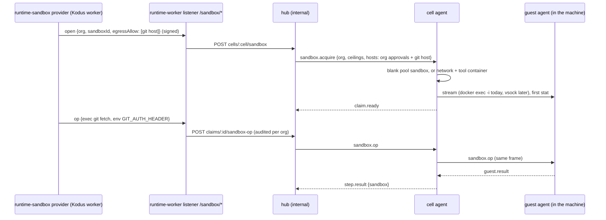

# Code sandbox on the cell

> The isolation backends (gVisor and Firecracker), the contracts, the topologies and the test plan that this sandbox
> grows into are in [isolation-architecture.md](isolation-architecture.md). The steps below are its phase P0.

Plan of 2026-11-12 for §9e: Kody and custom agents run code in an isolated sandbox in Kodus Cloud and in
self-hosted, on the same cell the Runtime uses. Terms are in [glossary.md](glossary.md).

## Why

- `ISandboxProvider` (`libs/sandbox/domain/contracts/sandbox.provider.ts`) has three providers: `e2b` (Cloud), `local`
  and `null`. Self-hosted runs `local`: commands run in the worker's own container with dropped privileges. There is
  no isolation boundary between the agent's code and Kodus.
- E2B is a third-party service and key; self-hosted ships nothing that needs one (ADR-048).
- The cell already has the boundary and the controls a sandbox needs: gVisor, claims with a lease and a hard ceiling,
  the reaper, egress allow-list with admin approval, the credential injector, fresh repo tokens, exec through the
  observer, MCP `env_exec`/`env_fix` with audit.

## What a sandbox needs, and what the cell has

| Concept | Meaning | Cell today | Plan |
|---|---|---|---|
| Isolation boundary | The agent's code never reaches the host kernel | ✅ gVisor (`runsc`), never `runc` | Keep; a microVM driver is a later option for hosts with `/dev/kvm` |
| Prepared image | Tools built once, reused | ✅ bake for environments | A tool image (git, ripgrep, node, python, the review's tools) |
| Fast start | A sandbox ready in about a second | ✅ warm pool for Runs; 🟡 blank sandbox pool | Measured under runsc |
| Process and file API | Run a command; read, write, list, stat files | ✅ guest agent (steps 1–2 below) | — |
| Lifecycle | Timeout, automatic end, nothing forgotten | ✅ lease, ceiling, reaper; consumer `sandbox` | — |
| Controlled egress | Only allowed hosts | ✅ proxy SNI+IP, resolver | Allow-list per sandbox (agent or task), on top of the org's |
| Secret outside the machine | The real value never enters | ✅ OpenBao, placeholder per claim, injector swap (below) | Installer and Cloud KMS plugin |
| Memory snapshot | Resume a running machine in milliseconds | ❌ spike only (Postgres 0.14 s vs 1.8 s) | `runsc checkpoint`/`restore` in the pool |
| Pause and resume | A long agent session stops and comes back where it was | ❌ | Idle session checkpointed to disk, restored on the next call |

Where this goes beyond hosted sandboxes: the secret never enters the machine; egress needs an admin's approval and is
recorded; the snapshot is per repository, made by the setup with the repo cloned and dependencies installed, so nobody
writes a template; it runs on any host with Docker, self-hosted included, without a third-party key.

## Secrets: OpenBao

OpenBao (MPL-2.0, Linux Foundation, Vault-compatible API) is the store in Kodus Cloud and in self-hosted. It runs as a
separate, unmodified service; the injector talks to it over HTTP through its `Vault` interface
(`apps/runtime-cell/internal/injector/injector.go:56`). The admin writes secrets through the Kodus screen; Kodus writes
them to OpenBao; a value never returns to a screen or a log.

- Storage: the Postgres Kodus already ships, database `kodus_openbao` with its own role
  (`docker/openbao/create-database.sql`), so its backup covers the vault.
- Unseal: OpenBao 2.7 builds in only `static` and `transit`; the cloud KMS seals (`awskms`, `gcpckms`, `azurekeyvault`,
  `ocikms`, `alicloudkms`) left the binary in v2.7.0 and are KMS plugins now
  ([seal stanza](https://openbao.org/docs/configuration/seal/),
  [deprecations](https://openbao.org/community/deprecation/)). Self-hosted default: `static`, a 32-byte key the
  installer generates and keeps outside the database
  ([static seal](https://openbao.org/docs/configuration/seal/static/)); losing it loses the vault, so it goes in the
  customer's own backup, apart from Postgres. Kodus Cloud: the `awskms` plugin with the AWS KMS key of the deployment.
- Bootstrap: [self-initialization](https://openbao.org/docs/configuration/self-init/) on the first start
  (`docker/openbao/config/initialize.hcl`): KV v2 at `runtime-kv`, the two policies, an AppRole per client. No root
  token survives it and none is ever printed.
- Layout: `runtime-kv/data/orgs/<organizationId>/secrets/<secretId>`, the record
  `{value, hosts, organizationId, secretId}`. The injector refuses any other shape, an org or id that is not the
  path's, a value that would break a header, and a host not in `hosts`.
- Policies (`docker/openbao/policies/`): the API (`kodus-runtime-api`) has create, update, patch on the data path and
  delete on the metadata path, and no read or list anywhere: it cannot read a value back. The injector
  (`kodus-runtime-injector`) has read on the data path only. A dedicated cell (self-hosted, or one org's own cell)
  narrows the org segment to its own organization id.
- A customer with its own Vault or OpenBao points the injector at it (`-openbao-addr`, same layout and policy).

How a secret reaches a request, and only that request:

1. The admin writes name, allowed hosts and value on the Runtime settings screen ("Secrets"). The API
   (`/runtime/secrets`, org owner only) writes the value to OpenBao and keeps name, hosts, who and when in the product
   Postgres (`runtime_secrets`), with every change in `runtime_secret_audit`. No answer or log carries the value.
2. The hub reads the org's secret references from the product Postgres (`runtime_secrets`: id, name, hosts; the
   role `kodus_runtime_secrets_reader` may read those columns and nothing else,
   `scripts/runtime/runtime-secrets-reader-grants.sql`, `RUNTIME_PRODUCT_SECRETS_READ_URL`) and sends them in
   `claim.acquire` and `sandbox.acquire` `secrets: [{id, name, hosts}]` (at most 100), only to a cell whose hello
   names the feature `secrets` (a cell advertises it only when it pushes egress policies). Never to the PR side of a
   fork; to a sandbox only when its caller opens it with `secrets: true` (a review sandbox holds any PR's code).
   For a claim, the cell gives each secret a placeholder: `kph_` and 32 base32 characters (160 random bits,
   `policy.NewPlaceholder`), new per claim (`internal/agent/org_secrets.go`). The machine gets the placeholder in the
   env var named after the secret: every compose service's environment (Run sides and setups) and every sandbox
   exec's env. The signed claim policy carries `secrets: [{id, placeholder, hosts}]` (`agent.PolicySpec`);
   `policy.Build` puts those hosts on the allowlist and on `credentialHosts`. A host the platform denies is dropped,
   and a secret left with no host is not handed to the claim at all (logged `claim.secrets.dropped`).
   Naming: the env var is the secret's name (`^[A-Z][A-Z0-9_]{0,63}$`; the id is the name in lower case, so two
   secrets of an org never collide). A name the machine's tooling owns (`PATH`, `HOME`, the proxy and TLS variables,
   `LD_*`, `KODUS_*`, `KODY_*`, `RUNTIME_*`) is refused by the API and dropped again by the cell. In a compose service
   the secret replaces what the compose file or the recipe set under the same name, and the canary env is set after
   it. In a sandbox exec the caller's own env wins over a secret of the same name. Build steps (`RUN` in a
   Dockerfile) get no secret.
3. A credentialed host goes to the injector, which terminates the machine's TLS with the cell CA, as it already did
   for credentials. The machines of a claim with secrets trust that CA through the files the cell mounts in them
   ("The machine trusts the injector" below). In plaintext it swaps a placeholder of a secret allowed for
   that host for the value read from OpenBao (no cache), in any header, Authorization Bearer and Basic included, and
   goes on over its own verified TLS to the address the proxy validated. The URI and the body are sent as written.
4. A placeholder of a secret not allowed for that host, or a real value the machine should never have known, raises
   `credential_exfiltration` and the request stops. A deleted secret, or one whose host was removed, is refused on
   the next request.
5. Over plain HTTP the proxy reads the request head and refuses one carrying a placeholder (`placeholder_leak` on the
   egress feed). It also raises it on its own alert feed (`GET /v1/alerts` on the proxy's control port, the
   injector's format); the cell agent watches both feeds, and either one makes the claim `compromised` with a
   `security_violation` blocker whose signature is the alert kind, as a canary or an injector alert does. The cell
   takes no work while either feed is unproven. Over TLS to a host without a secret the proxy only reads the SNI
   (ADR-040) and does not see the request: a placeholder there is not swapped and not seen, and it is worthless
   outside the claim.

Stored: credentials a machine uses outward on the customer's behalf, each bound to an org and its allowed hosts.

- Private package registries (npm, GitHub Packages, Artifactory, internal PyPI).
- Private image registries (ECR, GHCR, Harbor).
- External APIs the app or the agent calls (a test payment key, a tracker token for a custom agent).
- Test credentials of the app itself (a test account, a staging token).

Not stored:

- Git tokens: short-lived, minted per setup or Run by the GitHub App.
- LLM keys (BYOK): model calls run in the worker, outside the machine; BYOK is unchanged.
- Secrets the app needs to boot (`JWT_SECRET`, the local database password): they are visible inside the machine, so
  they must be fake and generated per Run.
- Canaries: generated per Run and discarded.
- The product's existing integrations: unchanged until an agent needs one inside a sandbox.

Later, optionally: OpenBao's PKI engine could issue cell certificates and keep the CA key.

## Steps

| # | Delivers | Estimate |
|---|---|---|
| 1 | `runtime-sandbox` provider in `libs/sandbox` on a `sandbox` claim; file API through the hub; tool image. Unblocks the review and custom agents in self-hosted | 3–5 days. 🟡 built 12/11 (below), not yet run on a gVisor cell |
| 2 | Pool of blank sandboxes: create in about a second | 2–3 days. 🟡 built 12/11 (below), latency not measured under runsc |
| 3 | OpenBao operated in Cloud and in the installer; placeholder secrets through the injector; the Kodus screen for secrets | 3–4 days. 🟡 built 12/11: dev compose, policies, API, screen, injector swap, the claim handoff (hub → cell → env and policy), `placeholder_leak` as a security event; proven from the API to the allowed host on a real OpenBao (below). 13/11: the machines of a claim with secrets trust the injector's CA. Left: Cloud's KMS plugin, build-time secrets, Java's truststore |
| 4 | Checkpoint/restore in the pool; pause and resume of sessions. Least certain: network and open files on restore | 4–6 days |
| 5 | A cell installable in self-hosted (kodus-installer: Docker with `runsc` and the cell container next to Kodus) | In parallel; the largest unknown on the customer side |

Estimates are rough and assume agents in parallel.

## Steps 1 and 2 as built (12/11)



- **Claim.** Consumer `sandbox` (`CLAIM_CONSUMERS`), lease 30 min, ceiling 45 min, ready wait 2 min. The hub sends
  `sandbox.acquire` (no repository, no recipe, no Run) only to a cell whose hello names the feature `sandbox`; the cell
  answers claim.ready or claim.failed like any claim, and renew, release, the lease, the sweep, the reaper and machine
  minutes are the claim's. A `claim.acquire` of consumer `sandbox` is refused. Probes, exec, resets and browser frames
  are refused on a sandbox claim; `sandbox.op` is refused on any other.
- **Code.** Not the cell's tarball: the review needs git history (`origin/<base>`, `git show`, submodules). The
  provider runs the E2B provider's shallow fetch inside the sandbox with the auth header in that command's env only,
  then the base branch and the shared submodule fetch. The guest agent masks every env value of 8+ characters in
  what a command prints.
- **Egress.** The claim's allow-list is the hosts approved for sandboxes (environment `sandbox`, never another
  environment's: G5 in `egress-allowlist.md`) plus the clone's git host, on top of the cell's base list; the platform
  deny list still applies.
- **Guest agent.** `cmd/kody-guest` (`internal/guest`) runs inside the machine and serves `sandbox.op` frames on a byte
  stream: length-prefixed protocol frames, the wire format in `libs/runtime/protocol/sandbox.ts`, fixtures shared by
  TS and Go (`fixtures/sandbox-*.json`, `guest-result-*.json`). Ops: `exec`, `read`, `write`, `list`, `stat`,
  `remove`. Every path is opened one segment at a time with `O_NOFOLLOW` from the root (`/workspace`), so no
  symlink, committed or made a moment ago, takes an op out of it; a fifo is refused, never waited on. Bounds: 512 KiB
  per read or write, 192 KiB stdout and 32 KiB stderr per exec, 5,000 list entries, 16 ops at once per stream; the
  frame is trimmed to fit 1 MiB. A command past its timeout is killed with its process group.
- **Machine (docker-gvisor).** One container of the tool image (`apps/runtime-cell/sandbox-image/Dockerfile`: git,
  ripgrep, ast-grep, betterleaks, osv-scanner, kodus-graph, node, python3; no set-id file) under the cell's runtime on
  the claim network: read-only root, user 1000, `--cap-drop ALL`, `no-new-privileges`, memory and CPU of the claim,
  `/workspace` (half the memory) and `/tmp` (512 MiB) as tmpfs in the sandbox's own memory, never a host directory.
  `dockercli.SandboxArgs`, `dockergvisor.CreateSandbox`, `DialGuest` (new files; one field in `dockergvisor.Config`).
  Flags: `-gvisor-sandbox-image`, `-sandbox-pool`, `-sandbox-memory-mb` and `-sandbox-cpus` (the size of a sandbox
  that asks none, 2048 MB and 2 CPUs by default, never the cell's Run size). Since P1 the driver asks the isolation backend for the container and
  the guest stream (`isolation/gvisor`, [isolation-architecture.md](isolation-architecture.md) "P1 as built").
- **Provider.** `runtime-sandbox` keeps the review's behaviours: `read` goes through the guest agent's no-follow read;
  `grep`, `listDir`, `exec` are the E2B provider's commands; `run` returns output up to 5 MiB (a large one is written
  to `/workspace/.kody-run` and read back); `privilegesDropped` is checked (not root, `NoNewPrivs: 1`, no set-id
  file); `asRoot` is refused, so custom-agent CLIs do not install there yet. Its lease is renewed every 10 minutes
  and released on cleanup; the lease manager and its reaper end a `runtime:<org>:<uuid>` sandbox at once, as a local
  one, never through E2B. `CreateSandboxParams.organizationId` is new and set by the four callers.
- **Selection.** `SANDBOX_PROVIDER` = `null` | `local` | `e2b` | `runtime`, else `auto`: E2B when `API_E2B_KEY` is
  set, else `local`. `auto` never picks `runtime`: the provider is one per deployment while the Kody Runtime is
  released per org, so picking it would put every org's code review on the Runtime's cells. Only
  `SANDBOX_PROVIDER=runtime` (with `RUNTIME_SANDBOX_URL` or `RUNTIME_ENV_SESSION_URL`, and `RUNTIME_SECRET_SEAL_KEY`)
  opts the deployment in.
- **Audit.** The hub writes one row per op to `runtime.runtime_sandbox_audit` (migration 22, kept 30 days): org,
  claim, op, the command redacted or the path, outcome, exit code, bytes, duration. Never output, content or env.
- **Size.** A sandbox that asks no size runs at the cell's sandbox size (`-sandbox-memory-mb`, `-sandbox-cpus`,
  announced in hello `capabilities.sandboxSize`); a caller may ask a larger one, up to the cell's maximum
  (`-gvisor-mem-max`, `-gvisor-cpus-max`). The cell and the hub count it at its whole memory from boot to release (it
  builds nothing, so it has no ready size). The hub admits a sandbox that asks none at the cell's `sandboxSize`, else at
  `RUNTIME_SANDBOX_MEMORY_MB` (2048) for a cell that names none.
- **Capacity.** A sandbox never waits in the hub's line (`apps/runtime/src/hub/claims/cell-memory.ts`). When it does
  not fit, or a Run or setup claim is waiting for the cell, it is refused at once: `resources/no_capacity` with what
  it needs and what is free. Its caller opens a new sandbox later. Every open is a new claim id, so a waiter would
  never be asked for again and would only block the claims behind it until `WAITER_TTL_MS` (60 s). A sandbox never
  goes ahead of a waiting claim either, so the order of Run and setup claims stays the same.
- **Pool.** The cell keeps `-sandbox-pool` blank sandboxes (role pool, org `kodus-sandbox-pool`, 2 h ceiling,
  replaced after 50 min) of the sandbox size, with their guest agent already answering. A `sandbox.acquire` of that
  size (or of none) takes one; its memory passes to the claim at the same figure. It joins that claim's lease, is
  destroyed on its release and never returns to the pool, so no two claims, orgs or sessions share one.

Measured on a laptop (no gVisor): the tool container plus the guest agent's first answer in 0.9–1.7 s (Docker,
runc); provider → worker → hub → Go cell → guest, with a git clone of a small PR, base branch and checks, in 0.3 s
(fake driver, no container). Not measured: runsc on a cell, with and without the pool.

The tool image builds with `docker buildx bake runtime-sandbox` (`docker-bake.hcl`, both platforms; in the
`runtime` group). Blank sandboxes count in the cell's memory admission: each at the default size's ready figure
under its pool id, so the pool makes only what fits and gives way to claims; a claim that takes one is counted for it
from then on (`sandboxPool.Mem`, `countSandbox`). A sandbox claim is counted at its ready size, never its build size.

## Step 3: the claim handoff as built (12/11)

```mermaid
sequenceDiagram
    participant A as API /runtime/secrets
    participant B as OpenBao
    participant P as product Postgres
    participant H as hub
    participant C as cell agent
    participant M as machine
    participant X as proxy + injector
    A->>B: value + hosts (API AppRole, write-only)
    A->>P: runtime_secrets (id, name, hosts, who, when)
    H->>P: SELECT id, name, hosts (kodus_runtime_secrets_reader)
    H->>C: claim.acquire / sandbox.acquire secrets [{id, name, hosts}]
    C->>C: placeholder per secret per claim; drop denied hosts and reserved names
    C->>M: env NAME=kph_... (compose services, sandbox execs)
    C->>X: signed policy secrets [{id, placeholder, hosts}]
    M->>X: request to an allowed host with the placeholder
    X->>B: read the value (injector AppRole, no cache)
    X-->>X: swap, send over verified TLS; mask the value in the answer
    X-->>C: alerts: credential_exfiltration (injector), placeholder_leak (proxy)
    C-->>H: blocked security_violation; the claim is compromised
```

Proven by `libs/runtime/api/__tests__/org-secret-to-cell.integration.spec.ts`: the API's use case writes the secret
to a real OpenBao and to a throwaway product database; the hub's reader, as the role the grants script makes, gets
the reference and is refused every other column; the Go half (`internal/agent/org_secrets_smoke_test.go`, the real
agent with fake sandboxes, the in-process proxy and injector) gives a sandbox the placeholder, a `curl` there reaches
the secret's host, which receives the value the API wrote; the machine's env and what it reads back never hold the
value; the same placeholder over plain HTTP compromises the claim through the proxy's feed. The Go half also runs
alone (`go test -tags dockersmoke`), starting its own OpenBao.

Left for later:

- Step 1 on a real cell: the egress allow-list end to end (a host off the list refused), latency under runsc.
- Reuse of one sandbox across the review's passes (the lease manager's joiner path is E2B-only; a runtime sandbox
  joiner gets no sandbox, as a local one does today).
- Custom-agent CLIs on the runtime sandbox: a root channel or a per-CLI user made at image build.
- The pool's size is not per org.
- A secret during a build (`RUN npm install` from a private registry): build steps get no secret yet.
- The review provider does not open its sandbox with `secrets: true`; a custom agent that needs one will.
- Steps 3–5 of the table above.

### The machine trusts the injector (13/11)

Before this, nothing put the cell CA in a machine: the in-process tests passed it to `curl --cacert`, and on the dev
cell a sandbox's `curl https://<secret's host>` failed certificate verification (`injector.handshake ... unknown
certificate authority`).

- **When.** Only for a claim with org secrets (`c.OrgSecrets`, after the cell dropped the reserved names and denied
  hosts) on a cell started with `-cell-ca-cert`. The agent asks it in that claim's `Up` and `CreateSandbox`
  requests (`driver.UpRequest.CellTrust`, `driver.SandboxRequest.CellTrust`; a sandbox only from a driver whose
  `Capabilities.SandboxCellTrust` says its sandboxes take the files); a claim without secrets is booted exactly as before.
- **What.** `cmd/cell` reads the injector's CA certificate (`-cell-ca-cert`, the file the injector's own
  `-cell-ca-cert` names; a key in it stops the cell) and its own public roots (`-machine-roots`, else the first of
  `machinetrust.SystemRootFiles` that holds a certificate: Debian's `/etc/ssl/certs/ca-certificates.crt`, RHEL's,
  Alpine's), never from the network. It writes, once at start, `<workdir>/trust/ca-bundle.pem` (every root, then the
  cell CA) and `cell-ca.pem` (the CA alone), 0644, certificates only (`internal/machinetrust`).
- **Compose services** (Run sides and setups, recipe fakes included). `compose/sandbox.Apply` binds both files
  read-only at `/etc/kodus/ca-bundle.pem` and `/etc/kodus/cell-ca.pem` and sets in every service's environment
  `SSL_CERT_FILE`, `REQUESTS_CA_BUNDLE`, `CURL_CA_BUNDLE`, `GIT_SSL_CAINFO` (the bundle) and `NODE_EXTRA_CA_CERTS`
  (the CA alone: Node adds it to its own roots). The cell's values replace the compose file's and the recipe's,
  which reach the service's environment earlier; `environment` also wins over `env_file`. `VerifyCanonical` checks
  both binds and every value again on what compose will run. A compose file may not mount anything under
  `/etc/kodus`, with or without secrets. Recipe steps and `exec` run in those containers and inherit the variables.
- **Code sandboxes.** The tool container gets the two binds and the bundle over its system store
  (`/etc/ssl/certs/ca-certificates.crt`), all read-only. The guest agent sets the same variables for every command when
  both files are there (`guest.MountedTrustEnv`); a caller's own env still wins. A blank pool sandbox was made before
  any claim, without the binds, so a sandbox with secrets never takes one (`takesBlankSandbox`, admission included)
  and boots its own.
- **Names.** The five variables are reserved: the API refuses a secret named after one
  (`libs/runtime/api/domain/secrets.ts`) and the cell drops it (`machinetrust.EnvNames`).
- **Without the flag.** A cell that pushes policies and has no `-cell-ca-cert` logs `machine_trust.unconfigured`
  (alarm); its claims with secrets boot as before and their HTTPS to a secret's host fails verification.

Proven: `internal/agent/org_secrets_smoke_test.go` (`-tags dockersmoke`, real OpenBao) now runs `curl` in the sandbox
with no `--cacert`. It reaches the secret's host through the injector, the host receives the stored value, and a
public host's own certificate still verifies through the same bundle. With the cell's trust off, the same `curl`
fails with `SSL certificate problem: unable to get local issuer certificate`, the failure seen on the dev cell. Unit
tests: `machinetrust` (the bundle trusts the injector's leaf and the public roots; key, two certificates or a non-CA
refused), `compose/sandbox` and `compose` (binds and env on every service; none without secrets; recipe env cannot
replace the variables; nothing mounts under `/etc/kodus`), `dockergvisor` and `dockercli` (the sandbox's binds, Up
refused without the trust files), `guest`, the agent (`cell_trust_test.go`: only a claim with secrets is marked, a
sandbox with secrets skips the pool).

Known limits:

- **Java.** The JVM reads none of these variables: it trusts its own `cacerts`. `JAVA_TOOL_OPTIONS` with a converted
  truststore was not built: Go's standard library writes no PKCS#12 (a new dependency), and the variable belongs to the
  app (the recipe may not set it; a compose file that does would lose its own flags), and the JVM prints it on every
  start. A Java service that calls a secret's host needs the CA in its truststore itself, from the mounted file, for
  instance `keytool -importcert -noprompt -cacerts -alias kodus-cell -file /etc/kodus/cell-ca.pem` in its entrypoint,
  or `-Djavax.net.ssl.trustStore=` on its own command line pointing at a store made from `/etc/kodus/ca-bundle.pem`.
- **Other trust stores.** A runtime that ignores the variables and the system store keeps failing: Deno
  (`DENO_CERT`), a Rust binary built with `webpki-roots`, Python code that passes `certifi.where()` itself, a
  service image whose system store is elsewhere (the services' system store is the repository's image and is left
  alone; only the sandbox's, ours, is replaced).
- **Drivers.** docker-gvisor and the fake. local-docker mounts nothing.
- **Build steps.** A `RUN` in a Dockerfile gets no secret, so no CA either.
- **Rotation.** The bundle is built once at start: a new injector CA or new public roots reach machines after the cell
  restarts (the injector restarts with it on the dev cell and in the installer).

## Open questions

- Which consumer goes first: the review sandbox or custom agents. Step 1 serves both through the same contract.
- Which self-hosted customer waits, and on what hosts (plain VM, Kubernetes, on-premise). Decides how step 5 ships.
- Whether a Run gets every org secret or the ones its environment names. Every one for now: a secret is bound by its
  hosts, not by the environment.
- Whether a review sandbox of a PR from the repository itself (not a fork) should get the org's secrets by default.
  Off for every review sandbox today: the provider does not know whether the PR is a fork.
