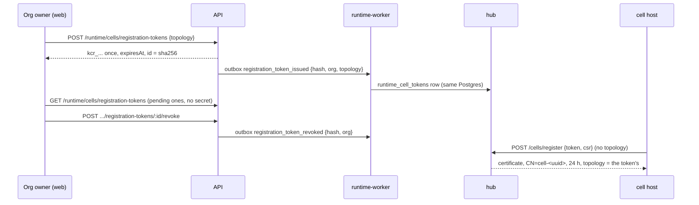

# Self-hosted cells: registration and trust roots

Design for two security-sensitive parts of a self-hosted Kody Runtime: how a customer cell gets its identity
(the registration token), and which certificate authority vouches for what on a cell host. Status: built; the design
(registration token, the three trust roots, the defaults of a fresh cell) **accepted 2026-11-13**. Line references are to the code as of 2026-11-13.

## What exists

- The org owner asks the API for a token (`POST /runtime/cells/registration-tokens`,
  `libs/runtime/api/application/use-cases/cells.use-cases.ts`). It is `kcr_` + 32 random bytes, valid 15 minutes,
  single use, bound to the org and a topology (`hybrid` | `self_hosted`). The plain token is in the response only; its
  SHA-256 goes to the Runtime through the outbox (`runtime.cell.registration_token_issued`) into
  `runtime.runtime_cell_tokens`.
- `cell register` makes the key on the host, sends the token and a CSR to the hub's only unauthenticated route
  (`POST /cells/register`, rate-limited). The hub burns the token and inserts the cell row in one transaction, signs
  a 24 h client certificate (CN = new cell id, OU = cell, EKU clientAuth), and pins its serial
  (`apps/runtime/src/hub/enrollment/cell-identity.service.ts`). The cell renews over mTLS; revoking the cell row
  drops it at the next handshake.
- The hub CA file reaches the cell host out of band: the installer's `runtime/state/cell-host/hub-ca.pem`.

## How others do it

| System | Join credential | Lifetime / use | List, revoke | How the agent trusts the server | What the server binds |
|---|---|---|---|---|---|
| GitHub Actions runners | registration token from the REST API | "expires after one hour" ([REST docs][gh]) | no revoke endpoint; it expires | public TLS (github.com) | repo/org from the token; labels from the runner |
| GitLab runners (16.0+) | runner authentication token `glrt-` from a runner created in the UI | until reset | reset, delete the runner | public or the instance's TLS | configuration is set in the UI; `register --token` does not accept those values ([GitLab][gl]) |
| Buildkite | long-lived agent token per cluster; exchanged for a session token "for the lifetime of the agent connection" | never expires by default, optional expiry, optional CIDR allow-list | revoke ([Buildkite][bk]) | public TLS | cluster from the token |
| Tailscale | auth key: one-off or reusable, 1 to 90 days | one-off keys are revoked after use | revoke; "Revoking a key does not deauthorize nodes using the key" ([Tailscale][ts]) | coordination server TLS | tags, pre-approval from the key |
| Teleport | join token (`tctl tokens add --ttl=5m --type=node`), reusable within its TTL | TTL | `tctl tokens ls`, `tctl tokens rm` ([Teleport][tp]) | `--ca-pin=sha256:...` of the cluster CA | role from the token |
| Kubernetes bootstrap tokens | `[a-z0-9]{6}.[a-z0-9]{16}`: public token id + secret ([bootstrap tokens][kbt]) | expiration field; token cleaner | delete the Secret | `--discovery-token-ca-cert-hash` (SPKI SHA-256), or a discovery file; skipping it "weakens the kubeadm security model since other nodes can potentially impersonate the Kubernetes Control Plane" ([kubeadm join][kj]) | group from the token; the kubelet sends a CSR for a key it made ([TLS bootstrapping][ktb]) |

What the Runtime takes from this:

1. **The server binds the attributes, the agent does not restate them** (GitLab 16, Teleport, Kubernetes). Our
   token already carries the topology, yet `cell register` defaulted to `-topology single-vm`, a value no token can
   have; the mismatch burns the token. A fresh install that runs `cell register` without hand-written flags failed and
   lost its token.
2. **Outstanding join credentials are listed and revocable** (Teleport, Tailscale, Buildkite). Ours could only expire.
3. **Revoking the credential does not touch what joined with it** (Tailscale, Kubernetes: the kubelet keeps its
   certificate). A cell is revoked by its own row, as today.
4. **The token never vouches for the server.** Kubernetes' token-signed discovery lets anyone holding the token
   impersonate the control plane to other joiners ([bootstrap tokens][kbt], "Warning"). Our cell verifies the hub
   with a CA file carried out of band, the kubeadm "file-based discovery" mode. Kept.
5. **One CA per trust relationship.** Kubernetes: "use different CA certs for the --client-ca-file option ... and the
   --requestheader-client-ca-file option" and "Do not reuse a CA that is used in a different context unless you
   understand the risks" ([aggregation layer][kag]). The kubelet's
   bootstrapped certificate "is signed, by default, for client auth only, and thus cannot be used as serving
   certificates" ([TLS bootstrapping][ktb]); the hub's cell certificates are clientAuth-only for the same reason.

## Decision 1: registration



- `cell register` sends no topology unless `-topology` is given; the hub then takes the token's. A topology that is
  given must still match (the old refusal, and the token is still burned).
- Owner: the hub registers every redeemed token's cell as `customer` and refuses a hello whose owner differs. The
  agent used to say `kodus` always, so no registered cell ever connected (found by the local install test).
  `cell register` now writes `owner` (customer) next to the certificate and the agent reads it; `-owner` overrides;
  a cell without that file (managed, enrolled out of band) stays `kodus`.
- Rollout: hub before cells, as always. A hub from before this change refuses a register without a topology at the
  body parse (400), before the token is redeemed, so the token is kept; `-topology self_hosted` works with both.
- Revoke: the owner revokes a pending token of their own org. The runtime-worker sets `revoked_at` only on a row of that
  org that is neither used nor revoked; redemption skips a revoked row in the same `UPDATE ... RETURNING` that burns
  it, so revoke and register cannot both win. Revocation goes through the outbox like a cell revoke: the response
  says `revoke_requested`, and a register in the seconds before the command lands still succeeds; the cell it made
  is listed and revoked as a cell.
- List: the API reads the org's tokens of the last 24 h from the Runtime database (read-only role, new grant on
  `runtime_cell_tokens`): id, topology, issuer, issued/expiry, state (`pending`, `used`, `expired`, `revoked`). The
  token is never stored, so it is never listed. The id is the SHA-256 the Runtime already stores: knowing it does
  not let anyone register (redemption hashes the plain token), the same role as Kubernetes' public token id.
- Screen: Runtime settings, "Cells" (`/runtime/settings/cells`): the org's cells with Revoke, "Connect a cell" with
  the topology (default `self_hosted`), the token shown once with the installer commands, and the pending tokens with
  Revoke.

Not changed, with the reason:

| Option | Why not now |
|---|---|
| Reusable tokens for a fleet (Teleport, Tailscale reusable) | Tailscale itself warns they are "very dangerous if stolen"; a fleet asks for N tokens |
| Longer TTL (GitHub 1 h) | 15 minutes covers a scripted install; the screen makes another in one click |
| A CA pin in the token's output (`--ca-pin`) | The API does not know the hub's CA; the installer bundle carries the CA file. Worth adding when the API can read the hub CA's SPKI |
| Topology changing what the cell may do | Today it is a label (`runtime_cells.topology`); owner is `customer` either way |

## Decision 2: three trust roots on a cell host

| Root | Key lives | Signs | Trusted by, and only for |
|---|---|---|---|
| Hub CA | control plane (`runtime/state/pki/ca.key`) | the hub's server certificate; cells' client certificates (clientAuth only) | the agent, for the hub (`-ca`); the cell's enforcers, for the agent's client certificate pinned to its CN |
| Cell-local CA | cell host, `/etc/kodus/cell/local-ca.key`, never in a container | the egress, injector and observer server certificates; the observer client certificate | the agent, for its enforcers' control ports (`-local-ca`, new); observers |
| Injector CA | inside the injector (hot: it mints a leaf for any secret host) | leaves for secret hosts shown to machines | machines of a claim with org secrets (`-cell-ca-cert`) |

Before this change the installer gave the agent one pool, `trust.pem` = hub CA + cell-local CA, for both the hub and
the enforcers. So a certificate from the cell-local CA was a valid hub to the agent, and the hub's certificate
(SANs include `127.0.0.1`) a valid enforcer. On an all-in-one host where the hub is dialled at a loopback or bridge
address, the egress (the process that faces machine traffic) holds a key the agent would accept as the hub's.

Rules, enforced by the cell at start (it refuses to start and names the rule):

1. The hub connection (WebSocket and renewal) verifies with `-ca` only; the enforcer control ports with `-local-ca`
   only.
2. `-ca` and `-local-ca` share no public key (compared by SPKI SHA-256, so a CA re-issued on the same key is the same
   root).
3. The injector CA (`-cell-ca-cert`) is neither in `-ca`, `-local-ca`, `-issuer`, nor the observer CA: a machine that
   trusts the injector never trusts a key that vouches for the hub, the agent, the enforcers or the observers.
4. Without `-local-ca` the cell keeps the single pool (dev cells, which use one dev CA for everything), and logs
   `trust.shared_pool` as an alarm. `-egress-control` without `-local-ca` and without `-dev` is refused.

Not changed: the enforcers still accept the agent's client certificate by the hub CA, pinned to the cell's CN
(`-agent-cn`). Another cell's certificate has another CN; only the hub can mint this one, and the hub is trusted
anyway. A cell-local client certificate for the agent would remove that edge; it is not needed for the rules above.

## Decision 3: defaults of a fresh cell

- `-isolation-backend auto` (the new default, `internal/isolation/choose.go`): `firecracker` only when `/dev/kvm`
  opens read-write, a microVM kit is given (`-firecracker-kit` and its digest) **and** the microVM driver runs
  environments. P2 is built, but a microVM cell takes code sandboxes only and refuses Runs
  (`internal/drivers/microvm` `RunsEnvironments = false`), so today `auto` is gVisor on every host; the cell logs the
  backend and why (`isolation.backend`). Flipping that constant when compose boots inside a VM makes `auto` pick
  microVMs with no other change. The installer's `--profile` defaults to `auto` the same way (docker-gvisor, saying
  when KVM is there).
- Capacity: `-gvisor-mem-max` empty means the host's allocatable memory (MemTotal less `-memory-reserve-mb`), never
  below `-gvisor-mem-limit`; `-gvisor-cpus-max` 0 means the host's CPU count, never below the default 2. A claim that
  asks no size still gets the default; only the ceiling (and the hello's `maxClaimSize`) follows the host.
  Admission counts memory only; CPU is bounded where it saturates first, the builds: `-gvisor-max-builds` (0: half
  the host's CPUs, at least one) is how many image builds the cell runs at once, and a build past it waits for a slot
  (`build.slot.waited` in the cell's log). `-gvisor-claim-builds` (0: 4, the most) is how many of one claim's builds
  run at once under that bound; they share the claim's memory, each at least 2 GB.

## Sizing sandbox capacity

A review holds one sandbox (2048 MB / 2 CPUs by default, `-sandbox-memory-mb` / `-sandbox-cpus`) for its whole run.
The cell admits claims until its memory is full (`-memory-allocatable-mb`, by default the host's MemTotal less
`-memory-reserve-mb`, 1024 MB) and then answers `no_capacity`. With N pull requests open at once, size the install so
the reviews wait in line instead of failing:

1. Memory for sandboxes = host RAM, minus what the Kodus stack needs (API, worker, web, Postgres, Mongo, RabbitMQ: plan
   for the whole compose stack, typically 6 to 8 GB), minus `-memory-reserve-mb`.
2. `SANDBOX_MAX_CONCURRENT` = that memory divided by the sandbox size, rounded down. A 16 GB host with 8 GB for the
   stack and 1 GB reserved leaves 7 GB, so 3 sandboxes of 2 GB. Leave room for one Run claim too: a Run asks for the
   environment's machine size (up to 12 GB), and it is refused with `size_unavailable` when the cell's allocatable
   memory is smaller. Lower the cap, or raise the host, until one 12 GB claim still fits when the sandboxes are idle.
3. `-sandbox-pool` (warm sandboxes kept ready) costs memory even when idle: use 0 or 1 on small hosts and count the
   pooled sandboxes against the same budget.

| Setting | Where | Default | Effect |
|---|---|---|---|
| `SANDBOX_MAX_CONCURRENT` | API/worker env | unset (no cap) | Sandboxes held at once by the whole install, across every worker. Reviews over it wait in line. |
| `SANDBOX_QUEUE_MAX_WAIT_MS` | API/worker env | `600000` (10 min) | The longest a review waits for a sandbox, in this line or on a full cell (`no_capacity`, `org_capacity`). After it the review runs without a sandbox and its status carries a SANDBOX_UNAVAILABLE warning saying it waited for capacity. |
| `sandbox_concurrency` global parameter | database | no cap | The older cap per worker process; independent of the two above. |

How it behaves:

- With the cap set, the line lives in Mongo next to the sandbox leases: each waiting review inserts a ticket
  (`sandbox_capacity_tickets`), only the oldest live ticket (createdAt, then `_id`) may take a slot, so the order is
  first in, first out across every worker. Taking a slot is one atomic update of a single document
  (`sandbox_capacity`), so racing workers never exceed the cap. Workers heartbeat their tickets and slots every 15 s;
  one silent for 45 s belongs to a crashed worker and stops counting, so nothing leaks and no database connection is
  held while a sandbox runs.
- A full Runtime cell is waited out with backoff (5 s doubling to 60 s) until `SANDBOX_QUEUE_MAX_WAIT_MS`; before, the
  review retried once after 10 s and then ran without a sandbox.
- A PR closed or force-pushed deletes the queued ticket of its older review, whichever worker holds it. A plain newer
  push does not: reviews of the same PR on one worker already share one sandbox (one slot).
- Unset `SANDBOX_MAX_CONCURRENT` is today's behavior; E2B and local providers wait as they did.
- The numbers a screen can show (in use, queued, oldest wait, deployment-wide, read from Mongo) come from `SandboxLeaseManager.capacityNumbers()`.


The same two numbers are editable without a deploy under Runtime > Settings > Sandboxes (owner only, self-hosted
only; the API is `GET/PUT /sandbox-capacity`). They are stored in the `sandbox_capacity` global parameter
(`{ "maxConcurrent": 5 | null, "maxWaitMs": 600000 }`); the database value wins over `SANDBOX_MAX_CONCURRENT` and
`SANDBOX_QUEUE_MAX_WAIT_MS`, which stay as the defaults, and workers pick a change up within about 10 seconds. The
suggested cap and the sandbox size and pool shown there appear only when the deployment reports the cell's memory;
until then they read "unknown" and the size is still set on the cell host.

## Docker host disk (docker-gvisor)

Every claim's containers, volumes and logs share the disk of Docker's data root, so one PR service that writes
without end can fail every tenant's claims on the cell. The cell bounds what it can:

- Every compose service logs through the `local` driver with at most `-gvisor-service-log-max-size` (10m) times
  `-gvisor-service-log-max-file` (3), whatever the compose file says; a smaller bound of the file's is kept
  (`internal/compose/sandbox`, checked again on `compose config`).
- With `-gvisor-container-disk` (for example `20G`), every holder, builder and compose service gets
  `storage_opt: {size: ...}` on its writable layer. Docker applies it only on overlay2 over XFS mounted with
  `pquota`, btrfs, zfs (and the old devicemapper); on any other storage driver the daemon refuses the container,
  so it stays off by default.
- A free-disk watchdog reads `-docker-data-root` (`/var/lib/docker`) every 15 s. Under `-disk-min-free-gb` (5;
  0 turns it off) the cell stops its claims: a booting one fails as `resources/cell_disk_full`, a ready or held
  one is torn down (the hub sees its next step find the claim gone). At the floor it stops them all. Under twice
  the floor, when the driver measures each claim's disk, it first stops the one claim whose disk grew the most
  since its last look, as `resources/disk_top_writer`: that claim's own doing, which excuses no PR's boot.

The host must do the rest, in `/etc/docker/daemon.json`:

```json
{
  "data-root": "/var/lib/docker",
  "storage-driver": "overlay2",
  "log-driver": "local",
  "log-opts": { "max-size": "10m", "max-file": "3" }
}
```

- `log-driver` `local` (or `json-file`) with `log-opts` `max-size` and `max-file`: the default for every container
  the cell does not start through compose (egress, mirror, registry, observers).
- `data-root` on its own filesystem, not the root one, so a full Docker disk never stops the host or the cell's
  state directory. For `-gvisor-container-disk`, that filesystem is XFS mounted with `pquota`
  (`/etc/fstab`: `... /var/lib/docker xfs defaults,pquota 0 0`).
- Named volumes have no quota on any of these drivers: the watchdog is what bounds them.

## Host preflight

`cell preflight` checks a host against what the cell would need, without starting it. Run it on a new host before
the install, and after any change to Docker, the kernel or the cell's settings. It takes the cell's own flags and
`-config` file (default `$KODUS_CELL_CONFIG`), so give it what the unit gives the cell:

```sh
sudo cell preflight -config /etc/kodus/cell/config.yaml          # one line per check, then the verdict
sudo cell preflight -config /etc/kodus/cell/config.yaml -json    # one JSON object: ok, driver, checks[], notes[]
sudo cell preflight -config /etc/kodus/cell/config.yaml -network # also what the cell reaches (the network rows below)
```

Each line is `ok`, `warn` or `fail`, the check's name, what it found and, for a warn or a fail, how to fix it. A
`fail` is what the cell refuses at start, or what breaks every claim; a `warn` is what it starts with but runs
worse. The exit code is 1 when a check failed, 0 otherwise (warnings included), 2 for a usage error.

| Check | Driver | Fails or warns when | The runtime code that needs it |
|---|---|---|---|
| `settings` | all | the cell refuses a flag or config key | `parseSettings`, `selectDriver` |
| `cell-cert`, `cell-id`, `cell-cert-validity` | all | the key pair does not load, `-cell-id` is not its CN, it expired or is not yet valid (fail), it is past its renewal point (warn) | `enrollment.LoadCertHolder`, `resolveCellID`, `enrollment.RenewAt` |
| `trust-roots`, `machine-trust`, `policy-key`, `observer-tls` | all, when set | a CA, key or certificate file does not load, or two roots share a key | `loadRoots`, `trustSettings.write`, `tlsutil` |
| `clock` | all, Linux | the kernel says its clock is not synchronized (warn) | the 24 h certificate, lease ceilings (`driver.Ceiling`), the release index expiry |
| `host-policy` | docker-gvisor, microvm | SMT, KSM or swap on, or an unmitigated CPU vulnerability: fail on a shared cell, warn on a dedicated one | `checkSharedHost`, `firecracker.Missing` |
| `docker`, `docker-api`, `docker-compose`, `runsc` | docker-gvisor | Docker does not answer, its API is below 1.44 (warn: no fast healthcheck), compose is missing, no `runsc` runtime | `gvisor.New`, `healthStartInterval`, `composecmd` |
| `claim-limits-socket`, `claim-limits-cgroup`, `claim-limits-root` | docker-gvisor with `-gvisor-claim-limits required` | not a local Unix socket, not rootful cgroup v2 with the backend's cgroup driver, `runsc` without `--systemd-cgroup` (systemd) or without `--oci-seccomp` (any backend: runsc otherwise ignores the containers' seccomp profile, and a sandbox command can unshare a user namespace), the root or slice missing | `configureClaimLimits`, `dockergvisor.ValidateClaimLimitDaemon`, `claimlimits.New`, `NewSystemd` |
| `docker-data-root`, `disk-docker`, `disk-build-state` | docker-gvisor | `-docker-data-root` is not Docker's (warn), free space under `-disk-min-free-gb` (fail) or under `-gvisor-build-state-min-free-gb` (warn) | `diskWatch`, `buildstate` |
| `kvm`, `microvm-kit`, `root`, `cgroup-v2`, `binaries`, `tun`, `microvm-state-dir` | microvm | each line `microvm.Open` would refuse the cell with | `microvm.Prerequisites` (`firecracker.Missing`) |
| `disk-microvm` | microvm | the state disk has less than one `-firecracker-data-gb` data disk free (warn) | firecracker `diskRoom` |
| `memory-admission` | docker-gvisor, microvm | no memory figure: fail when claim limits require admission, warn otherwise | `observeDriver`, `allocatableMemoryMB` |
| `hub` | all, `-network` | `-hub-url` does not resolve, connect, or present a certificate that chains to `-ca` over TLS 1.3 with the cell's certificate (fail); `GET /health` is not 200 (warn). Reports each step's time | `agent.Run` (`hubclient.Dial`) |
| `git-api` | all, `-network` | `-git-api` (and `codeload.github.com` on github.com) gives no HTTP answer over TLS the system roots trust (fail) | `gitsource.TarballURL`, `tarball.FetchExtractRevoke` |
| `image-holder`, `image-observer`, `image-builder`, `image-registry`, `image-helper`, `image-sandbox`, `image-browser` | docker-gvisor, `-network` | the image is not on the host and `docker manifest inspect` cannot read it: fail for the holder and the observer (every claim runs them), warn for the others | the driver's first `docker run` of each |
| `egress-container` | docker-gvisor with `-gvisor-egress-container`, `-network` | no container by that name, or not running (fail) | `PrepareClaim` (`AttachEgress`) |
| `build-cache-remote`, `bake-share`, `bake-share-pull` | docker-gvisor when set, `-network` | its credential file does not load or the store does not open (fail: the cell refuses to start); `GET /v2/` with the credential is not 200 (warn: builds run cold, bakes stay local) | `wireDockerGVisor` `readAuthFile`, `remotecache.New`, `Registry.Check` |

The checks only read the host, except on a microVM cell: as at start, the state directory is created and a probe
file cloned in it to test reflinks. Not checked here: that a systemd claim slice is active (read over D-Bus at start)
and, without `-network`,
anything off the host: whether the images pull, whether `-gvisor-egress-container` runs, the hub, the Git API and the
registries. The report's notes say so.

`-network` adds the network rows, read only: the hub is asked `GET /health` on its public listener with no hello
(whether it accepts the cell's certificate is decided at the WebSocket, at cell start), an image is looked up on the
host or its manifest read (no layer pulled), a registry is asked `GET /v2/` with the cell's basic-auth credential
(nothing pushed), the Git API is asked `GET` with no token and no redirect followed. The checks run at once, 15 s
each, 45 s for the run; one still running at the bound is reported at its own severity. The images are checked the
way the cell's docker reaches them: with `DOCKER_CONFIG` from the environment and no `~/.docker` (the cell runs docker
with its own `HOME`), so a login only in root's home does not count. On `microvm` none goes through this host's Docker: only the hub and the Git API are checked. Not
checked even with `-network`: the egress enforcers' control endpoints (`-egress-control`) and the preview edge, which
the cell also reaches, and the package mirrors, which only claims reach. The installer (`cell-host.sh`, in the installer
repository, not changed here) can run `cell preflight -network -config /etc/kodus/cell/cell.yaml` once the egress
container is up and before it starts `kodus-cell.target`, the step where a fresh install fails on the network.

`cell update` runs the staged release's `cell preflight -config <-preflight-config>` (default
`$KODUS_CELL_CONFIG`) after every file matched the signed manifest and before it swaps `current`: the new release
judges the host, since its requirements may be new. A failed check keeps the installed release current and leaves
the staged one for the next try. With no config (no `-preflight-config` and no `$KODUS_CELL_CONFIG`) the update is
refused (exit 2) with a message naming both and the one escape, `-skip-preflight`, which swaps without the check and
says so; `-verify-only` installs nothing and needs no config. The installer's `cell-host.sh upgrade --from` passes
`-preflight-config /etc/kodus/cell/cell.yaml` on every `cell update` it runs.
Before that, it refuses a release whose signed `PROTOCOL` the hub the cell last reached would refuse at hello
(`hub-protocol.state` under the cell's `-state-dir`; [cell-distribution.md](cell-distribution.md), "Keeping hub,
worker, API and cell compatible"): upgrade the hub first. `-skip-protocol-check` installs without that check.

After the swap the new release has `-rollback-window` (default 10 minutes) to complete an accepted hello with the
hub (its agent's `hub-protocol.state` `at` newer than the swap). If it does not, `kodus-cell-update-watch.timer` runs
the release before (`previous/bin/cell update-watch`), which puts it back as current with its own settings and units,
restarts `kodus-cell.target`, logs one line naming both releases and why, and lists the failed release so that
`cell update` refuses it until `-retry-rolled-back`. It never goes back to a release below the highest `minimum`
of the release indexes the host accepted, or to one signed with a key revoked since: it keeps the new release and
exits 1 instead. It needs no network. Design, prior art and limits:
[cell-distribution.md](cell-distribution.md), "Updating a host, and rolling back by itself".

Prior art, kept to what fits a single host: `kubeadm init` runs named preflight checks and stops on an error, with
`--ignore-preflight-errors` to skip one; `k3s check-config` reads the kernel's configuration and prints each
requirement as present or missing; `docker info` prints `WARNING:` lines for what the daemon runs without. The cell
takes the named checks and the stop on a fail, and has no ignore list: a fail is the cell's own refusal, read ahead.

## Air-gapped host

A host with no network installs and updates a cell from one offline bundle per release, made by the release owner
with the release key and verified on the host with the pinned public key only.

What the bundle holds (`release-sign bundle`, `apps/runtime-cell/internal/releasesig/bundle.go`):

| Path | What |
|---|---|
| `BUNDLE` | `kodus-cell-bundle v1`, `release <name>`, then one tab-separated `<sha256> <kind> <name> <path> <ref>` line per artifact, sorted by path |
| `BUNDLE.sig` | ed25519 signature with the release key over `kodus-cell-release-bundle v1` + `release <name>` + `BUNDLE`; its own prefix, so it never passes for a `SHA256SUMS` or `RELEASE-INDEX` signature, nor theirs for it |
| `release/` | the signed release as `cell update -from` reads it: `SHA256SUMS(.sig)`, `RELEASE-INDEX(.sig)`, `PROTOCOL`, `<command>-linux-<arch>` |
| `images/<component>.oci.tar` | each image the host runs (builder, sandbox, browser, holder, helper, registry, as `runtime/images.lock` pins them), an OCI archive whose `index.json` lists the pinned digest; the observer is not one, the installer builds it from the release's binary |
| `gvisor/<arch>/gvisor.tar.bz2` | the gVisor archive of `runtime/gvisor.tsv` (runsc, its shim and `gvisor-bin/`) |

Making it: save each image by digest with every platform (`skopeo copy --all docker://<repo@sha256:...>
oci-archive:<file>`), list them in a TSV, then `RUNTIME_CELL_RELEASE_SIGNING_KEY_FILE=<key>
apps/runtime-cell/scripts/sign-release.sh bundle <release-dir> <release> <images.tsv> x86_64=<gvisor.tar.bz2> <out>`,
and `tar -cf` the directory. The tool refuses a release whose `SHA256SUMS` signature or index does not verify with
that key, an index already expired, and an archive whose `index.json` does not list its digest; it then verifies the
bundle it wrote as a host would.

On the host (the installer repository's `scripts/runtime/cell-host.sh`): `install --release-bundle PATH` (with `--bundle`, the control
plane's cell-host directory, as before) and `upgrade --release-bundle PATH`. Before anything is loaded the installer
verifies `BUNDLE.sig` with the keys in `runtime/cell/cell-release.pub` (vendored from
`internal/releasesig/keys/cell-release.pub`) using OpenSSL 3, hashes every artifact, and reads the release index:
refused when it is expired or issued in the future, revokes the bundle's key, does not admit the release (above
`latest`, below `minimum`), or is older than the index the host accepted (`/opt/kodus-cell/release-index.state`, the
file `cell update` keeps). Then each image is `docker load`ed and must resolve by its pinned digest, which needs
Docker's containerd image store (the classic store drops a loaded image's digest; the installer says so and stops);
`--registry-mirror` also pushes each one to the registry the host pulls through and refuses a push that changes the
digest. Install takes runsc from the bundle's gVisor archive (still checked against `gvisor.tsv`) and the binaries
from `release/`, and records the index. Upgrade hands `release/` to `cell update -from`, so the running cell checks
the release again with its compiled-in keys, runs the new release's preflight and arms the automatic rollback.

Not covered: the control plane's own images (hub, worker, OpenBao) go through `bundle-export.sh` and
`bundle-import.sh` into the customer's registry; a release key revoked after the bundle was made is only known to a
host that has seen a newer index; no workflow produces the bundle yet (the image archives need registry access the
`sign` job does not have).

## Tests that would fail on the old behaviour

| Behaviour | Where |
|---|---|
| A cell that names no topology registers with the token's | `apps/runtime/src/hub/cell-hub.spec.ts`, Go `cmd/cell/register_test.go` |
| A revoked token registers nothing; another org's token cannot be revoked | `libs/runtime/contracts`, API use-case spec, worker handler spec |
| The agent refuses a cell-local CA as its hub, and a hub CA as its enforcer | Go `cmd/cell` trust tests |
| A cell CA that is the hub CA is refused at start | Go `cmd/cell` trust tests |
| `auto` picks gVisor without KVM, without a kit, or while microVMs take sandboxes only | Go `internal/isolation` |
| A claim may ask up to the host's allocatable memory and CPUs when no ceiling flag is set | Go `internal/drivers/dockergvisor` size test |
| The installer writes no single CA pool and the enforcers do not verify with the hub CA | the installer repository's `scripts/runtime/test-cell-host.sh` |
| `cell update` with no cell config is refused unless `-skip-preflight` | Go `internal/cellupdate` `TestAnUpdateWithoutTheCellsConfigIsRefused` |
| A release with no accepted hello within the window is rolled back; one that connected after the swap is kept; a rolled-back release is not retried by itself; no rollback goes below the floor or to a revoked key | Go `internal/cellupdate` `watch_test.go`, `test/integration` `TestTheWatchReadsTheAgentsHelloAfterTheSwap` |
| Every `cell update` the installer runs carries `-preflight-config` | the installer repository's `scripts/runtime/test-cell-host-update.sh` |
| A bundle with a changed or missing artifact, an edited manifest, an unpinned key or an expired index is refused; an image archive that does not list its digest is not bundled | Go `internal/releasesig` `bundle_test.go` |
| The installer verifies a Go-signed bundle offline and loads nothing from one that fails, refuses an index older than the host's, and upgrades through `cell update -from` | the installer repository's `scripts/runtime/test-cell-host-bundle.sh` |

[gh]: https://docs.github.com/en/rest/actions/self-hosted-runners#create-a-registration-token-for-a-repository
[gl]: https://docs.gitlab.com/ci/runners/new_creation_workflow/
[bk]: https://buildkite.com/docs/agent/self-hosted/tokens
[ts]: https://tailscale.com/kb/1085/auth-keys
[tp]: https://goteleport.com/docs/enroll-resources/agents/join-token/
[kbt]: https://kubernetes.io/docs/reference/access-authn-authz/bootstrap-tokens/
[kj]: https://kubernetes.io/docs/reference/setup-tools/kubeadm/kubeadm-join/
[ktb]: https://kubernetes.io/docs/reference/access-authn-authz/kubelet-tls-bootstrapping/
[kag]: https://kubernetes.io/docs/tasks/extend-kubernetes/configure-aggregation-layer/
