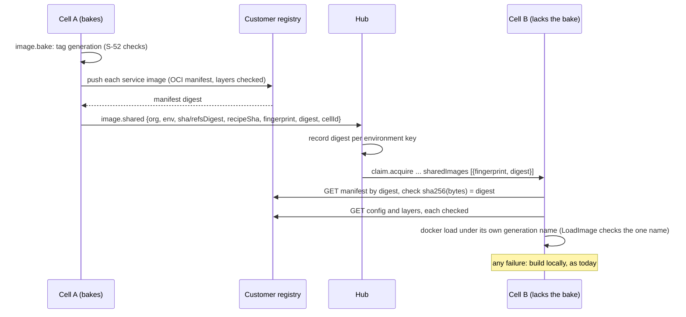

# Shared baked environments

Status: built on docker-gvisor, off by default (`-gvisor-bake-share`); not yet run against a customer registry.
Kubernetes is out of scope (section 11, decision 6). What is built and what is not: section 10.

## 1. Problem and what exists

A bake keeps what the clean setup claim built (S-52) on the host that baked it. A self-hosted customer with several
cells, or with Kubernetes, bakes the same environment on every host, and a new host starts cold. Sandbox providers keep
snapshots in central storage valid for the whole fleet; the self-hosted equivalent is a registry the customer controls.

What a bake is today (docker-gvisor):

- The hub asks `image.bake` only for the default-branch commit a setup claim booted
  (`apps/runtime/src/hub/claims/claim-image.service.ts:23-47`); the agent checks the claim never ran PR code, pins the
  machine's output and runs the bake in the background (`apps/runtime-cell/internal/agent/image_policy.go:38,151-181`).
  The command is acked when accepted: the hub never hears the bake's result, only `pool.target` follows it
  (`image_policy.go:184-213`).
- The driver tags each service image of the setup machine as one immutable generation,
  `kodus-bake/<cell>/<org>/<env>:<nonce>-<fingerprint>`, and keeps data volumes and caches beside it
  (`apps/runtime-cell/internal/drivers/dockergvisor/bake.go:19-30,86-150`, `generation.go:28`). The catalog
  (`internal/bakecatalog`) restores verified generations after a restart (`driver.BakeCatalog`,
  `internal/driver/driver.go:257-267`).
- The key: the generation is the environment's at a commit (`BakeSpec.SHA`, or `RefsDigest` for several repositories,
  plus `RecipeSHA`, `driver.go:219-232`). A claim reuses a baked image only when its build fingerprint matches
  (`internal/buildfingerprint/fingerprint.go:1-4`: context, Dockerfile, target, args, builder image). Lockfiles are part
  of the context, so they are in the fingerprint.
- The build cache already lives off the cell when `-gvisor-build-cache-remote` is set: the default branch's setup
  pushes its BuildKit cache to the org's repository of an OCI registry, and an evicted state pulls it
  ([build-cache.md](build-cache.md), `dockergvisor/cache_remote.go:15-30`). That moves layers to rebuild, not images to
  boot: a cell still builds.

## 2. Flow

## 3. The key

One shared image is `(org, environment, fingerprint)`; the hub keeps it under the environment key the bake had
(`sha` or `refsDigest`, `recipeSha`). The fingerprint alone decides reuse, as it does on the baking cell, so a cell
never boots an image built from other inputs. The cell id is recorded, not part of the key: any cell of the org may
use it. Registry layout (`remotecache.ImageKey`): `<prefix>/o-<hash(org)>/b-<hash(org, env)>:fp-<hash(fp)>`, the org's
hash its own segment so one access rule per org holds both this and the build cache.

## 4. Push after bake

After `publishGeneration` succeeds, off the bake's path: `docker save` each generation image, extract it, and
`PushImage`. Only blobs the registry lacks move. The image is pushed as an ordinary OCI image manifest (config +
layers, layer media type read from the blob), so `docker pull <repo>@<digest>`, `crane` and `cosign` see a normal image
(verified against `registry:2` and Docker 29, `image_docker_test.go`). A push failure is logged and the bake still
succeeds; nothing else pushes (a PR claim never does, S-52).

## 5. Pull before boot

When a claim's build has a fingerprint with a recorded digest and this cell holds no matching image, the driver pulls
by digest (`PullImage`) into an archive whose one name is the cell's own generation name and loads it through
`dockercli.LoadImage`, whose tarball check refuses any other name. Then the build of that service is skipped as on the
baking cell. Timeout or any error: the build runs locally, as today.

## 6. Verification

- The digest comes from the hub, never from the registry: the pull asks for `manifests/<digest>` and refuses bytes
  that hash to anything else (`ErrDigestMismatch`, `remotecache/image_test.go`); each layer is hashed on the way in.
- The hub records a digest only from an `image.shared` the cell sends for a bake the hub itself asked (`claim-image`
  already checks setup claim and default-branch commit), and only for that org: a digest is never taken from another
  org's record, and another org's digest names nothing in this org's repository (`TestAnotherOrgsBakedImageIsNotFound`).
- Signature (optional, decision 4): the cell signs the digest with a per-org key the hub holds, or the customer runs
  cosign with their own key on push and a policy on pull. A signature adds protection against a compromised hub record;
  the digest pin already protects against a compromised or wrong registry.

## 7. What may and may not go in the registry

| Goes | Never goes |
| --- | --- |
| The service images the setup claim built from the default branch | Data volumes and seeded databases (`bakeData`): may hold customer data; stay per cell (decision 2) |
| Their config as the build wrote it | Secrets: build secrets are BuildKit mounts, never layers; the image is checked for none of the claim's secret values before push (to build) |
| | Placeholder values the cell replaced at boot, `.env` files the recipe renders, credentials, the cell's certificates |
| | Anything a PR claim built (S-52) |

A secret a Dockerfile copies into a layer is already in the image on the baking cell; sharing widens who can read it
to anyone with pull on the org's repository. The pre-push check scans each layer for the claim's secret values (the
redactor's list) and refuses to push on a match.

## 8. Configuration, retention, hub record

- Cell flags (off by default): `-gvisor-bake-share URL` (`http(s)://host[:port]/<prefix>`, plain HTTP only on
  loopback, as `remotecache.New`), `-gvisor-bake-share-pull URL` (optional: where pulls go instead, a read-only mirror
  or pull-through cache near the cell such as registry:2 in proxy mode, Harbor or an ECR pull-through rule; pushes
  still go to `-gvisor-bake-share`; the digest pin is what makes a mirror safe, and a mirror miss builds locally, with
  no fallback to the origin) and `-gvisor-bake-share-auth-file` (user:password for both, the same file mechanism as the
  build cache, mounted by the installer from the customer's secret store). Preflight and start refuse a URL
  `remotecache.New` refuses, and a mirror or an auth file without `-gvisor-bake-share`. A new hello feature `bakeShare` says the cell
  pushes and pulls; the 64-feature limit and the older-hub trim (`internal/agent/agent.go:47,276,332-335`) keep it
  additive: an older hub never sees it and never sends `sharedImages`.
- Hub record (migration 38): `runtime_shared_images (org_id, environment_id, env_key, recipe_sha, fingerprint,
  digest, cell_id, asked_at, pushed_at, last_pulled_at)`, unique on `(org_id, environment_id, fingerprint)` with the
  newest bake winning: the bake whose image.bake the hub sent last (`asked_at`), not the record that arrived last.
  `runtime_bake_asks (cell_id, org_id, environment_id, env_key, recipe_sha, asked_at)` holds each image.bake the hub
  sent to a cell naming `bakeShare`; an image.shared is recorded only against one of the last 6 hours
  (`BAKE_ASK_TTL_MS`), and `applyRetention` drops asks after a day. `last_pulled_at` exists and is not written yet.
- Retention: the hub keeps the last N bakes per environment (`SHARED_IMAGE_BAKES_KEPT`, 2) and the registry's
  lifecycle rule removes tags unused for 14 days; the hub drops an environment's records through
  `CellHub.forgetSharedImages` (the product has no environment removal yet that calls it). A pull of a removed digest
  is a 404: build locally. On the pulling cell, the copy is `kodus-shared/<cell>/<org>/<env>:<fingerprint>`; a pull
  removes the environment's copies the claim's `sharedImages` no longer name.
- Air-gap: the registry is the customer's internal one; nothing reaches Kodus. Cell images in the offline bundle
  (`release-sign bundle`, `cell-host.sh --release-bundle`, [self-hosted.md](self-hosted.md) "Air-gapped host") are
  Kodus's release; baked images are the customer's and never ride in it.

## 9. Failure modes

| Case | Behaviour |
| --- | --- |
| Registry down, slow, auth refused | Push: logged, bake done. Pull: build locally |
| Digest mismatch, manifest not an image, layer hash wrong | Refused, nothing loaded, build locally, alarm log |
| Archive names another image | `LoadImage` refuses it |
| Older hub | Never sends `sharedImages`; cell bakes as today |
| Image too large (`maxBytes`, 40 GiB) | Not pushed / not pulled |

## 10. What is built and what is not

Built:

- Registry layer: `remotecache.ImageKey`, `PushImage`, `PullImage` (`remotecache/image.go`), tests in-process and
  against `registry:2`; `CheckImageSecrets` reads the saved image's config and each layer (gzip decompressed, zstd
  refused as unscannable) through `redact.ReaderContains`, every spelling of each value.
- Driver (`dockergvisor/share.go`): after `publishGeneration`, `shareGeneration` holds the generation, `docker save`s
  each image (`dockercli.SaveImage`), checks it against `BakeSpec.Secrets` and pushes it, off the bake's path
  (`d.bg`, waited by `WaitRemotePushes`); a failure is logged (`bake.share.push_failed`, alarm on a secret) and the
  bake stands. `BakeSpec.Shared` hears what was pushed. In `build`, a fingerprint with a digest in
  `UpRequest.SharedImages` and no image here is pulled by that digest (`sharePull`: the mirror when set), loaded
  through `dockercli.LoadImage` under `kodus-shared/<cell>/<org>/<env>:<fp>`, tagged as the claim's image and not
  built (`build.done source=shared`); one pull per name at a time; any error builds locally.
- Cell: `-gvisor-bake-share`, `-gvisor-bake-share-pull`, `-gvisor-bake-share-auth-file`, checked by preflight;
  `Capabilities.ShareBakes` names hello feature `bakeShare` (34th name: a hello trimmed for a hub before the 64
  limit drops it with `exercisedLines`). The agent gives the bake the setup claim's redactor list and placeholders,
  and sends `image.shared` through the outbox only to a hub whose ack accepts `bakeShare`; a Run's claim passes
  `claim.acquire sharedImages` to its builds, a setup never.
- Protocol: `image.shared` (cell to hub), `claim.acquire sharedImages`, `SharedImageSchema`, `MAX_SHARED_IMAGES` (64),
  feature `bakeShare` in `CELL_FEATURES` and `HUB_ACCEPTED_FEATURES`; fixtures `image-shared*`,
  `claim-acquire-shared-images*`.
- Hub: migration 38, `SharedImageRepository` (Pg and in-memory), the ask recorded in `ClaimImageService.bake`,
  `image.shared` handled in `cell-hub.ts` (refused: `feature_not_named`, `wrong_org`, `bake_not_asked`),
  `sharedImages` on claim.acquire (`ClaimService.sharedImagesFor`).

Tests: `dockergvisor/share_test.go` (two cells over one in-process registry: cell B boots from cell A's bake without
building; registry down, digest mismatch, another org's digest, a secret in a layer, the mirror and its miss),
`agent/bake_share_test.go`, `agent/hello_test.go`, `cmd/cell/preflight_test.go`, `hub/cell-hub.bake-share.spec.ts`,
the Postgres case in `hub/pg-hub-store.integration.spec.ts`.

Not built: a caller of `forgetSharedImages` (no environment removal exists in the product), writes of
`last_pulled_at`, a separate credential for the pull mirror, signing (decision 4), Kubernetes (decision 6), a run
against a real customer registry. `docker save` writes the image once more beside the extracted blobs: the push
needs twice the image's size free on the cell's disk for its duration.

## 11. Open decisions

Built with the default of each; each is still open to change.

1. Hub record: a new cell-to-hub `image.shared` message (built) or a field on the heartbeat.
2. Data volumes: never shared (built) or shared opt-in per environment, encrypted with an org key.
3. Layer compression on push: plain tar as `docker save` writes it (built) or recompressed zstd (smaller, CPU).
4. Signing: digest pin only (built), a hub-held per-org key, or customer cosign with an admission policy.
5. Retention: the last 2 bakes per environment (built) and a 14-day registry lifecycle rule (the customer's).
6. Kubernetes: out of scope (built nowhere): the same registry used directly by the kubelet (image pull by digest)
   instead of the cell loading it.
7. The pull mirror takes the same credential as the store (built); a read-only credential of its own is not.
