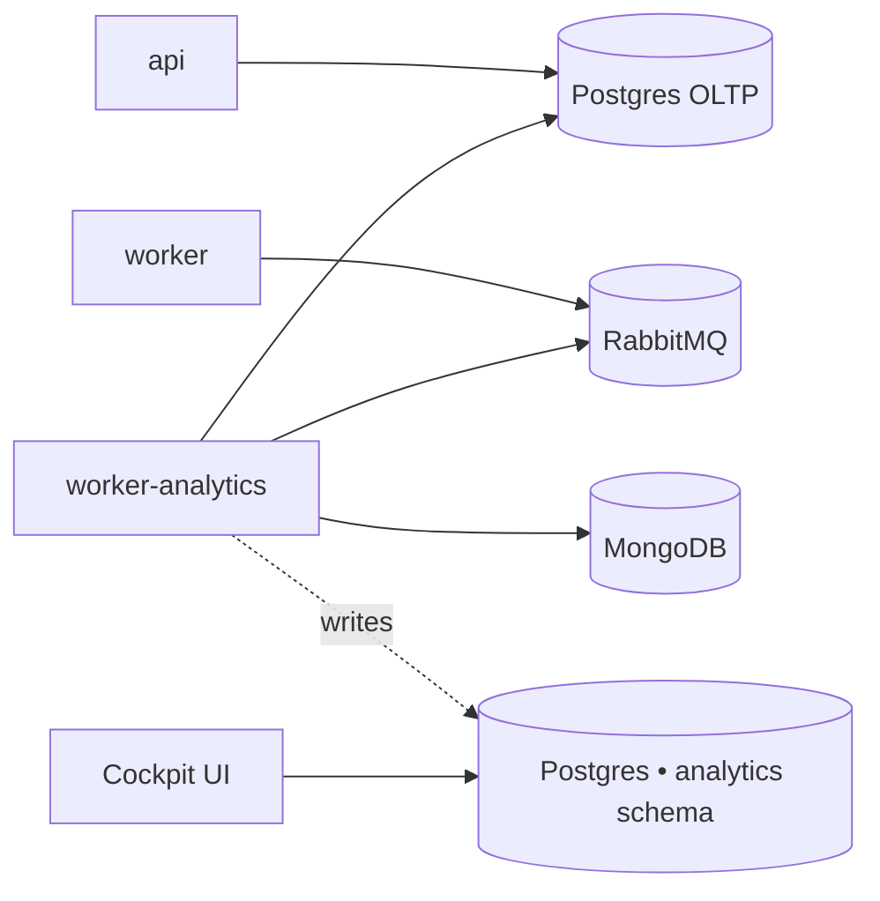

Analytics worker 是**仅限 Enterprise** 的附加组件。它运行摄取 cron，为 [Cockpit](/zh/how_to_use/cockpit/overview) 仪表板（DORA 风格的指标、PR 生命周期、基于 LLM 的 PR 分类器）提供数据。

适用于有有效许可证的自托管 Enterprise。使用 Docker Compose 时，启动 `analytics` 配置档。[Helm Chart](/zh/how_to_deploy/deploy_kodus/kubernetes)默认启用 `worker-analytics`。

## 它做什么

这是一个独立的 Node 进程，运行与 `worker` **相同的镜像**（`kodus-ai-worker`），
通过 `WORKER_ROLE=analytics` 在启动时选定角色。两个 cron 只从这个进程触发：

- **摄取**（`ANALYTICS_INGESTION_CRON`，默认每 30 分钟） — 从 Mongo + OLTP Postgres 读取
  pull request 和审查会话，并将它们投影到 `analytics` schema 中。容器启动时也会运行一次。
- **分类器**（`ANALYTICS_CLASSIFIER_CRON`，默认每 30 分钟） — 调用
  LLM 为每个 PR 标记类型（feature/bugfix/refactor 等）。它使用通过环境变量配置的模型（请参阅 [LLM 提供商配置](/zh/how_to_deploy/deploy_kodus/generic_vm#llm-提供商配置)），而不是在 **AI providers** 页面连接的模型。

把它与主 `worker` 隔离，可以让 code review 的事件循环
不受长时间运行的摄取查询影响。

## 拓扑

分析数据仓库是一个 Postgres **schema**，而不是单独的数据库。
支持两种布局：

- **共享 Postgres（自托管推荐）** — 将
  `ANALYTICS_PG_DB_HOST` 留空。配置加载器会回退到主
  `API_PG_DB_*` 变量，并在同一实例中创建 `analytics` schema。
  只需备份和运维一个数据库。
- **专用 Postgres** — 设置完整的 `ANALYTICS_PG_DB_*` 块，指向
  一个单独的实例。当你希望分析查询与 OLTP 写入路径完全
  隔离时使用。



## 在自托管 Enterprise 上启用

### 1. 激活你的许可证

启动服务前，在 `.env` 中设置 `KODUS_LICENSE_KEY`，或在 **Subscription** 中激活 Enterprise 许可证。应用中保存的许可证优先于环境变量。

### 2. 将 analytics 块添加到 `.env`

**共享 Postgres（推荐）：**

```bash
# Empty ANALYTICS_PG_DB_HOST → loader reuses API_PG_DB_* and creates the
# `analytics` schema in the main instance.
ANALYTICS_PG_DB_HOST=
ANALYTICS_PG_DB_SCHEMA=analytics

# Cron schedules (UTC).
ANALYTICS_INGESTION_CRON=*/30 * * * *
ANALYTICS_CLASSIFIER_CRON=*/30 * * * *
```

**专用 Postgres：**

```bash
ANALYTICS_PG_DB_HOST=your-analytics-host
ANALYTICS_PG_DB_PORT=5432
ANALYTICS_PG_DB_USERNAME=analytics
ANALYTICS_PG_DB_PASSWORD=...
ANALYTICS_PG_DB_DATABASE=kodus_analytics
ANALYTICS_PG_DB_SCHEMA=analytics

ANALYTICS_INGESTION_CRON=*/30 * * * *
ANALYTICS_CLASSIFIER_CRON=*/30 * * * *
```

### 3. 启动 worker

`analytics` profile 是安装程序 `docker-compose.yml` 的一部分。在 `kodus-installer` 目录中启动该服务：

```bash
docker compose --profile analytics up -d worker-analytics
```

容器名为 `kodus-worker-analytics`。它与 `worker` 使用相同的镜像和 `.env`，由 Compose 设置 `WORKER_ROLE=analytics`。升级后，再次运行该命令即可用新版本重新创建它。

### 4. 迁移在 `api` 容器中运行

只有 `api` 容器会运行迁移。当 `RUN_MIGRATIONS=true`（默认值）时，它会在启动时创建 `analytics` schema 并运行数据仓库迁移。worker 容器从不执行迁移，因此在全新安装时请先启动 `api`，再启动 `worker-analytics`。

## 参考

| 变量 | 说明 | 默认值 |
|---|---|---|
| `WORKER_ROLE` | 由 Compose 在此容器上设置为 `analytics`。 | _必填_ |
| `ANALYTICS_PG_DB_HOST` | Analytics Postgres 主机。为空 → 复用主 Postgres。 | _空_ |
| `ANALYTICS_PG_DB_PORT` | Analytics Postgres 端口。为空 → `API_PG_DB_PORT`。 | _空_ |
| `ANALYTICS_PG_DB_USERNAME` | Analytics Postgres 用户。为空 → 复用 `API_PG_DB_USERNAME`。 | _空_ |
| `ANALYTICS_PG_DB_PASSWORD` | Analytics Postgres 密码。为空 → 复用 `API_PG_DB_PASSWORD`。 | _空_ |
| `ANALYTICS_PG_DB_DATABASE` | Analytics Postgres 数据库。为空 → 复用 `API_PG_DB_DATABASE`。 | _空_ |
| `ANALYTICS_PG_DB_SCHEMA` | 数据仓库表的 schema 名称。 | `analytics` |
| `ANALYTICS_PG_POOL_MAX` | Analytics Postgres 连接池的上限。 | `5` |
| `ANALYTICS_INGESTION_CRON` | 摄取运行的 cron 计划（UTC）。 | 每 30 分钟 |
| `ANALYTICS_CLASSIFIER_CRON` | LLM PR 类型分类器的 cron 计划（UTC）。 | 每 30 分钟 |
| `ANALYTICS_INGESTION_RUN_ON_BOOT` | 设为 `false` 可跳过容器启动时的摄取运行。 | 启动时运行 |

### 暂停摄取（高级）

要暂停摄取或分类，请在 `.env` 中设置 `ANALYTICS_INGESTION_DISABLED=true`、`ANALYTICS_CLASSIFIER_DISABLED=true` 或两者，然后运行 `docker compose --profile analytics up -d worker-analytics` 应用更改。

## 验证是否正常工作

启动后，查看 analytics worker 的日志：

```bash
docker compose --profile analytics logs -f worker-analytics
```

启动后你应该立刻看到 `analytics ingestion (startup) done in NNNms`，之后每次调度
都会出现 `analytics ingestion (cron) done ...` 和 `analytics classifier done ...`。
这些是 info 级别的日志行，而安装程序的 `.env` 设置了 `API_LOG_LEVEL=error`，因此请设置
`API_LOG_LEVEL=info` 并重新创建容器才能看到它们。同一时间只有一个副本运行一次处理。如果看不到这些日志行，请检查
`WORKER_ROLE=analytics` 是否只设置在这个容器上（而不是主 `worker`，它必须
保持为 `code-review`）。该 worker 还会在容器内的 3334 端口响应 `GET /health`。
