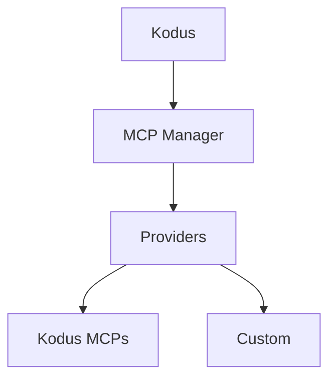

## 什么是 MCP？

Model Context Protocol (MCP) 是一个开放标准，让 LLM 应用通过统一的服务器接口连接外部工具和数据源。MCP
服务器会发布工具 schema 和端点，让 Kodus/Kody 这样的客户端可以在工作流中获取
上下文或执行操作。

## MCP Manager 架构

MCP Manager 是为 Kodus 代理这些 MCP 连接的后端服务。它按
工作区跟踪提供商、集成和允许的工具，然后将该目录暴露给 Kodus API。它监听 3101 端口，
响应 `GET /health`，并将数据保存在你的
PostgreSQL 数据库的 `mcp-manager` schema 中。该 schema 由它在启动时自行创建和迁移。

- MCP 提供商（Kodus 和自定义）的中央注册表
- 存储集成元数据（连接状态、MCP URL、允许的工具）
- 处理各提供商特定的认证流程和工具发现
- 暴露 Kodus 用来列出和调用 MCP 工具的 API



## 启用 MCP Manager

MCP Manager 是可选的。

<Tabs>
  <Tab title="Docker Compose">
    在 `.env` 中设置以下变量，然后运行 `./scripts/install.sh`。当 `API_MCP_SERVER_ENABLED` 为 `true` 时，安装程序会启动 `kodus-mcp-manager` 容器。

    ```env
    API_MCP_SERVER_ENABLED=true
    API_KODUS_SERVICE_MCP_MANAGER=http://kodus-mcp-manager:3101
    API_KODUS_MCP_SERVER_URL=https://kodus-api.yourdomain.com/mcp
    API_MCP_MANAGER_REDIRECT_URI=https://kodus-web.yourdomain.com/setup/mcp/oauth
    ```

    - `API_KODUS_SERVICE_MCP_MANAGER` 是 API 和 worker 访问该服务的方式。请使用容器名，而不是 `localhost`。
    - `API_KODUS_MCP_SERVER_URL` 是你的 API 上 Kodus MCP 服务器的公开 URL。
    - `API_MCP_MANAGER_REDIRECT_URI` 是 OAuth 登录后浏览器返回的地址。请使用你的公开 Web URL。
    - `API_MCP_MANAGER_JWT_SECRET` 和 `API_MCP_MANAGER_ENCRYPTION_SECRET` 由 `./scripts/generate-secrets.sh` 生成。
  </Tab>
  <Tab title="Kubernetes">
    Chart 默认部署 MCP Manager，并启用 API 的 `/mcp` 端点。它根据 Web 主机推导 `API_MCP_MANAGER_REDIRECT_URI`。要停用 MCP Manager，请设置 `services.mcp-manager.enabled=false`。若要同时关闭 API 端点，请将 `global.config.API_MCP_SERVER_ENABLED` 设为 `"false"`。请参阅 [Kubernetes & OpenShift](/zh/how_to_deploy/deploy_kodus/kubernetes)。
  </Tab>
</Tabs>

`API_MCP_SERVER_ENABLED=true` 还会在 API 的 `POST /mcp` 上开启 Kodus MCP 服务器。它接受来自 MCP 客户端的团队 API 密钥（`x-team-key: kodus_...` 或 `Authorization: Bearer kodus_...`）。

要将 Cursor 或 Claude Desktop 等客户端连接到自己的实例，请参阅 [Kodus MCP server](/zh/how_to_deploy/deploy_kodus/mcp_server)。

## Kodus 中的插件

在 MCP Manager 中注册的所有内容都会出现在 Kodus 的 **Plugins** 页面
（侧边栏 → **Plugins**），因此你的团队可以安装、管理和启用每个工作区
可用的 MCP。如果 Web 应用无法访问 MCP Manager（例如
它没有部署），侧边栏中的 **Plugins** 项会被隐藏。


## 提供商

`API_MCP_MANAGER_MCP_PROVIDERS` 列出 MCP Manager 加载的提供商。默认值为 `kodusmcp,custom`，且只接受这两个值。

### Kodus 提供商

Kodus 提供商是第一方和精选 MCP 的目录：Kodus Docs、Git Issues、Sentry、Exa Search、Kodus OSV、Linear、Atlassian Rovo、Notion 和 Fireflies。Git Issues 由你自己的 API 提供。其他的连接到供应商托管的 MCP 端点，因此 worker 需要对它们有出站 HTTPS 访问权限。登录方式是 OAuth、令牌或无，取决于具体的 MCP。

### 自定义提供商

在 **Plugins** 页面，通过 **Add Custom Plugin** 下的 **Add Plugin** 添加你自己的 MCP 服务器。提供名称、服务器 URL 和协议（`http` 或 `sse`），然后选择其认证方式：无、bearer token、basic、API key header 或 OAuth 2.0。自定义插件属于你的组织。请参阅[安装自定义插件](/zh/cookbook/custom-plugin-install)。
