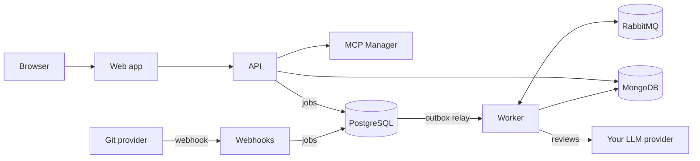

## 概述

Kodus 以一组容器的形式运行：一个 Web 应用、一个 API、一个执行审查的 worker、一个 webhooks 接收器，以及三个数据存储（PostgreSQL、MongoDB 和 RabbitMQ）。相同的镜像可同时运行在 Docker Compose 和 Kubernetes 上。

## 服务

| 服务 | 镜像 | 端口 | 作用 |
| --- | --- | --- | --- |
| `kodus-web` | `kodus-ai-web` | 3000 | 仪表盘。其服务端代表浏览器调用 API。 |
| `api` | `kodus-ai-api` | 3001 | 身份验证、设置、Kody Rules 和集成。在 Docker Compose 上，它还会在启动时运行数据库迁移和种子数据。 |
| `worker` | `kodus-ai-worker` | 3334（健康检查，内部） | 消费作业队列并执行代码审查。需要 `WORKER_ROLE=code-review`。 |
| `webhooks` | `kodus-ai-webhook` | 3332 | 接收来自 GitHub、GitLab、Bitbucket、Azure Repos 和 Forgejo 的事件，并为每个事件入队一个作业。 |
| `kodus-mcp-manager` | `kodus-mcp-manager` | 3101 | 可选。负责代理 MCP 插件。参阅 [MCP Manager](/zh/how_to_deploy/deploy_kodus/mcp_manager)。 |
| `worker-analytics` | `kodus-ai-worker` | 3334（健康检查，内部） | 可选，Enterprise。与 `worker` 使用相同的镜像，设置 `WORKER_ROLE=analytics`。参阅 [Analytics Worker](/zh/how_to_deploy/deploy_kodus/analytics_worker)。 |

镜像发布为 `ghcr.io/kodustech/<image>`。五个应用镜像在每次发布中共用同一个版本标签；RabbitMQ 镜像（`kodus-rabbitmq`）有自己的版本。

worker 是唯一执行审查的服务，因此它需要对外访问您的 Git 提供商和 LLM 提供商。它在沙箱中解析仓库；参阅 [Sandbox & AST Graph](/zh/how_to_deploy/deploy_kodus/sandbox)。

### 健康检查端点

| 服务 | 端点 |
| --- | --- |
| Web | `GET /api/health` |
| API | `GET /health`（检查 RabbitMQ 和 PostgreSQL），`GET /health/simple` |
| Webhooks | `GET /health`、`/health/live`、`/health/ready` |
| Worker | 端口 3334 上的 `GET /health`，安装器不会发布该端口 |
| MCP Manager | `GET /health` |

## 审查如何启动

1. Git 提供商调用 webhooks 服务。它会检查事件，并在同一个事务中，在 PostgreSQL 中记录一个作业和一条 outbox 消息。
2. worker 把 outbox 消息中继到 RabbitMQ，这样即使 broker 短暂不可用，事件也不会丢失。
3. worker 从 RabbitMQ 消费该作业，加载 pull request，使用您的 LLM 提供商执行审查，并把结果发布到 pull request 上。

worker 在首次连接时创建 `workflow.jobs.*` 队列。如果它从未启动，例如因为没有设置 `WORKER_ROLE`，webhooks 和 API 会因 `QueueBind 404` 错误而失败。

## 数据存储

- **PostgreSQL**（带 pgvector 扩展）：应用数据、工作流作业和 outbox、每个仓库的 AST graph，以及 MCP Manager 和 analytics warehouse 的 schema。
- **MongoDB**：pull request 和审查数据、Kody Rules 以及沙箱租约。
- **RabbitMQ**：worker 发布和消费的作业队列。Kodus RabbitMQ 镜像内置了延迟消息交换插件，并创建了 `kodus-ai` 和 `kodus-ast` 虚拟主机。如果您使用自己的 broker，请启用 `rabbitmq_delayed_message_exchange` 插件，创建这两个虚拟主机，并设置 `consumer_timeout = 7200000`。

使用 Docker Compose 时，您可以让 Kodus 指向自己的 PostgreSQL、MongoDB 或 RabbitMQ；参阅[安装](/zh/how_to_deploy/deploy_kodus/generic_vm#数据库配置)。

## 网络

安装器会创建三个外部 Docker 网络：

- `shared-network`：web、api、worker、webhooks、MCP Manager 和 RabbitMQ。
- `kodus-backend-services`：每个 Kodus 服务，以及 PostgreSQL 和 MongoDB。
- `monitoring-network`：仅 RabbitMQ。

PostgreSQL 和 MongoDB 仅连接到 `kodus-backend-services`。RabbitMQ 在端口 15692 上暴露 Prometheus 指标；Kodus 不附带 Prometheus 或 Grafana。

## Enterprise 功能

许可证密钥可在自托管实例上解锁 Enterprise 功能。在 `.env` 中设置 `KODUS_LICENSE_KEY`，或在 **Subscription** 页面粘贴该密钥。Cockpit 分析和 SSO 需要它。

## 下一步
<CardGroup cols={2}>
  <Card title="本地运行 Kodus" icon="laptop" href="/zh/how_to_deploy/local_quickstart/orchestrator">
    非常适合本地开发和熟悉完整的 Kodus 堆栈。
  </Card>
  <Card title="将 Kodus 部署到生产环境" icon="rocket" href="/zh/how_to_deploy/deploy_kodus/generic_vm">
    非常适合生产部署和体验 Kodus 的全部功能。
  </Card>
</CardGroup>
