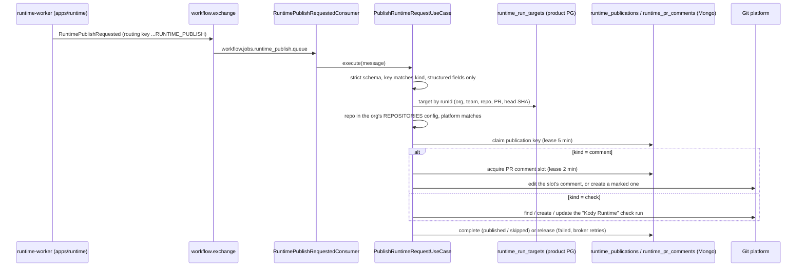

# libs/runtime-publish

The product side of Kody Runtime. When the Runtime finishes a step of a Run, it asks the product to publish. This lib takes that request and posts the PR comment, the check run and the replies on review suggestions. It posts with the product's Git credentials (ADR-052), and the Runtime never holds them. The lib also contains the two gates that keep the Runtime at zero cost for repos that do not use it.

It runs in the code-review worker (`apps/worker/src/worker.module.ts`). The HTTP routes are in `apps/api/src/controllers/runtime/` and are described at the end.

## From a publish request to the PR



### 1. Message and target

- **Message.** `RuntimePublishRequested` (`libs/runtime/run/run-messages.ts`) names a Run, a kind (`comment` or `check`), an idempotency key and structured fields. It never names a target.
- **Target.** The org, team, repo, PR and head SHA come only from `runtime_run_targets`. The API writes that row (`RuntimeRunEnqueuer.enqueue`, `libs/runtime/api/application/runtime-run-enqueuer.service.ts`) before the outbox row of the Run. The publisher reads it by `runId` and never reads the Runtime's `runtime_runs` projection.
- **Conflicts.** A second record for the same `runId` that names another target throws `RunTargetConflictError` (`domain/run-target.ts`).
- **Simulations** are enqueued without a target. Everything they ask to publish is refused with `target_not_found`.
- **Defense in depth.** Before anything is posted, `resolveTarget` checks three things. The stored repo must still be in the org and team's REPOSITORIES config (`infrastructure/integration-config-repository.resolver.ts`). Its name must match. The org's platform must equal the stored one.

### 2. Consumer and refusals

- **Consumer.** `RuntimePublishRequestedConsumer` (`infrastructure/runtime-publish-requested.consumer.ts`) acks every refusal. On a thrown error, the shared RabbitMQ error handler retries through `workflow.exchange.delayed` and then dead-letters the message. Prefetch is 5 on `channel-runtime-publish`.
- **Refusals.** Every refusal is a `RefusalReason` in `application/publish-runtime-request.use-case.ts`. These can only mean a bug or tampering on the Runtime side, so they log at error level with `metadata.alert = 'runtime_publish_refused'`:
  `invalid_message`, `key_mismatch`, `unstructured_body`, `attempt_mismatch`, `incomplete_record`, `repository_not_in_org`, `repository_mismatch`, `platform_mismatch`.
  The other refusals log at warn level.
- **Logged invalid messages** carry only Zod issue paths and codes, never values. The publisher never handles the Run's repo token or run token: they travel in `RuntimeRunRequested`, a different message.

### 3. Idempotency: publication keys

- **Keys.** `runtime_publications` holds one row per key, under a unique `publication_key` index:
  - `runId:attempt:check`;
  - `runId:attempt:comment` and `runId:attempt:comment:<phase>`;
  - `runId:attempt:check:awaiting_approval`;
  - `runId:attempt:reply:<suggestionId>`.
- **Claims.** `claim` is atomic (`infrastructure/mongo-publication.store.ts`):
  - a live claim answers `busy`, which throws so the broker retries;
  - a published or skipped key answers `duplicate`;
  - a check key moves forward only to a later status: queued < in_progress < completed.
- **Startup.** If the index cannot be created, the worker does not start (`runtime-publish.module.ts`).
- **Deferred:** `runtime_publications` has no TTL (`updatedAt` is stored as a string).

### 4. One comment per PR: the comment slot

Publication keys are per message, so on their own they cannot stop two phases of the same PR from both creating a comment. `runtime_pr_comments` (`domain/pull-request-comment-slot.ts`, `infrastructure/mongo-comment-slot.store.ts`) holds one row per (org, repo, PR), under the unique index `pr_comment_slot`.

- **Acquire.** An upsert takes the slot when there is no lease or the lease has expired. A live lease makes the upsert hit the unique key, which answers `null`. The use case asks again for up to 10 s (`DEFAULT_SLOT_WAIT`, token `RUNTIME_PUBLISH_SLOT_WAIT_TOKEN`), since a Run's last progress and its report arrive about a second apart. A slot still held after that throws `PublicationBusyError`, and the broker retries.
- **Order.** `commentOrderOf` is the Run's `requestedAt` in milliseconds × 10, plus the phase (1 to 4) or 9 for the result. A message with an order lower than the slot's is completed as `skipped: stale_comment`. An older Run or a late phase never overwrites a newer one.
- **Edit vs create.**
  - With a comment id in the slot, the comment is edited.
  - An edit that fails with 403, 404 or 410 means the comment is gone or no longer Kody's, so a new one is created. Any other error is thrown and retried; it never creates a duplicate.
- **Crash-safe create.** The slot is marked `createPending` before the create call. Every body ends with the hidden marker `<!-- kody-runtime:comment -->` (`RUNTIME_COMMENT_MARKER`). If the slot is pending and has no id, the next holder lists the PR's comments with `failOnError: true` and adopts the last marked one (`recoveredCommentRef`) instead of posting again.
- **Release.** Writes and releases apply only under the holder's own lease (`leaseOwner`).

### 5. Check run

`publishCheck`, with the name `KODY_RUNTIME_CHECK_NAME = 'Kody Runtime'`:

- **Platforms with checks.** Only GitHub and Forgejo have a checks API (`CHECKS_PLATFORMS`). Elsewhere the check is `skipped: checks_unavailable` at once, and the comment carries the result.
- **Finding the run.** The check run comes from the first of: the publication's own `checkRunId`; for the final key, the run recorded under the `awaiting_approval` key; the adapter's `findCheckRun` on the head SHA.
- **Creating it.** A new run is created open and then updated to completed.
- **Create returns null.** The adapters answer null both for "no checks here" (PAT auth, no `checks:write`) and for transient errors. The use case therefore retries `MAX_CHECK_CREATE_ATTEMPTS = 3` deliveries, counting them in `checkCreateFailures`, before it skips.
- **Failed update.** A failed update keeps the opened `checkRunId`, so the retry closes the same run.

### 6. Renderer: structured fields only

- **Accepted shapes** (`shapeProblem`):
  - A comment is exactly one `report` or one `progress`.
  - `comment.body` free text is refused as `unstructured_body`.
  - A completed check needs a conclusion.
  - Without a report, a completed check is accepted only for the fork waiting for a maintainer (`action_required`).
- **What reaches the PR** comes from `domain/render-runtime-comment.ts`:
  - `renderProgressComment` and `renderReportComment` for the comment;
  - `renderCheckOutput` for the check (title, summary, and the conclusion from the verdict table);
  - `renderBareCheckOutput` for a check without a report;
  - `renderSuggestionReply` for replies.
- **Never shown:** the Runtime's own check title and summary.
- **Escaping.** Every string from the Runtime (entry points, probe ids, hosts, fields) goes through `code()`: one line, no backticks, cut to 120 characters, inside a code span. Table cells also escape `|`.
- **Links** point only to the dashboard (`API_FRONTEND_URL`, `runtimeLinks`). When the variable is empty, comments go out without links and the module logs a warning at boot.
- **Progress comment.** One line per phase in plain words: starting main and the PR, building the PR, sending requests, writing the report. The Run's start is given in UTC (`formatUtcTime`), because the comment changes only when a phase ends. With `progress.estimates`, the current phase says how long it usually takes (`usualDuration`, for example "usually ~8 min").
- **Why partly tested.** `partlyTestedReasons` explains each cause in one sentence, with what the developer can do: a file no extractor maps to a route, job or command; a cut diff; a route no request reached; an unstable result; a claim without a probe; a Run that stopped early. The check summary says the same thing as counts (`partlyTestedCheckLine`) and never names an entry point. Both use the structured `uncovered` reasons and the extractor's id prefixes (`unmapped:`, `job:`…) only. Entry points go through `code()`.
- **Replies** (GitHub only). The suggestion's comment id comes from the product's own `pullRequests` record for the stored org, repo and PR (`infrastructure/pull-request-suggestion.resolver.ts`). The Runtime cannot point a reply at another comment.

### 7. A lost publication: the product re-drives it

A failed delivery is retried by the broker through `workflow.exchange.delayed`. That retry can be lost: on RabbitMQ 4.2.2 with Khepri the delayed exchange delivers nothing (kodus-ai#2083), and a dead-lettered message never comes back. Without recovery, the check would stay open and the PR comment would stay at "Writing the report". The policy is in `domain/publication-redrive.ts`; the sweeper is in `application/redrive-runtime-publications.use-case.ts`.

- **What is kept.** A final publication (the completed check, or the comment with the report) stores its validated request in its row (`request`), up to 256 KiB. If it does not fit, the Runtime's check summary is dropped first, since it is never rendered. Progress phases store nothing: the next phase replaces them.
- **Stale.** A row that is failed, or `publishing` with an expired lease, untouched for `REDRIVE_AFTER_MS` (2 min), with a request, and not given up.
- **Sweep.** `RuntimePublicationRedriveCron` runs every minute (`RUNTIME_CRON_PUBLICATION_REDRIVE`) and takes up to 20 rows, oldest first. Every replica sweeps. A row is reserved first (`reserveRedrive`: same `updatedAt` as the scan, `redrive.attempts` + 1), so two replicas never drive it at once. The reservation also moves `updatedAt`, which spaces the attempts.
- **Same path as a delivery.** The stored request goes through `PublishRuntimeRequestUseCase.execute`. The strict schema, the stored target, the repo-in-org check, the idempotency key, the comment slot and its order, and the check status rank all still apply. A redrive cannot post anything a delivery could not.
- **Bounded.** `MAX_REDRIVE_ATTEMPTS` (5). A final publication then gets one fallback, and the row is completed with `fallback: true`: the report comment gets `renderUndeliveredReportComment` (the verdict title and a link to the Run) in place of the progress, and the completed check is closed **neutral** with `renderUndeliveredCheckOutput` ("Result not posted" and a link to the Run). After that, or at once for a refusal, the row is given up (`redrive.gaveUpAt`, `gaveUpReason`). It stays failed, and an error log line carries `metadata.alert = 'runtime_publish_given_up'`.
- **Why a fallback.** The report keeps failing for a few reasons: the platform refuses the body, a renderer bug, or the platform being down. A short body survives the first two. Seeing "Writing the report" forever is the worst outcome for the developer, and a check left queued or in progress blocks a branch that requires it. The neutral check never claims a verdict the PR did not get to see. A check that never completed has no fallback: there is no result to close it with.
- **Not covered.** A message that never reached the consumer leaves no row, so the product cannot know it exists. Alert 5 of `experiments/kody-runtime/ALERTS.md` watches the exchange for that case.

### 8. What the Run page shows

`GET /runtime/runs/:id` returns `publication` (`domain/run-publication-view.ts`), read from `runtime_publications` with `MongoPublicationReader`. The reader is filtered by org in the query, bounded, and leaves out the stored request. It does not use the projection's `published`, which only says the Runtime asked to publish; that field is left out of the detail. Each of the check and the comment is `published`, `skipped`, `failed` (given up), `pending` (`retrying` when the last delivery failed, `showing` = the progress phase on the PR), or `not_expected`. A Run without a stored target is a simulation: `postsToPullRequest: false`, and it never reads as published. Only fixed skip reasons reach the page, never a failure message.

## Gates: zero cost where the Runtime is off

- **`isKodyRuntimeEnabled`** (`runtime-feature.ts`) follows `RUNTIME_ENABLED=true|false`. When it is unset, the Runtime is on only if `RUNTIME_RUN_TOKEN_SECRET` is set. When off, the worker loads none of `RuntimePublishModule`, `RuntimeTriggerModule` or `RuntimePullRequestGateModule`: no Runtime queue is declared and no Runtime outbox row is written. The cell sets it to `false` for the product it boots (`.kodus/runtime/overrides.env`).
- **PR observation gate.** `RuntimePullRequestGateModule` is global. `GitHubPullRequestHandler.recordPullRequestEventForRuntime` (`libs/platform/infrastructure/webhooks/github/githubPullRequest.handler.ts`) takes the gate as an optional dependency:
  - without it, no row is written;
  - with it, a row is written only for a repo that has a `runtime_environments` row (`infrastructure/environment-pull-request.gate.ts`, answers cached for 30 s);
  - a gate error never blocks the review.
- **What the handler sends.** The event carries ids and what happened, including `commentId` for `@kody runtime`. The trigger re-reads the facts from the Git API.

## Broker and database users

`scripts/runtime/dev-runtime-users.sh` creates the least-privilege users for local stacks. Production must grant the same:

- **RabbitMQ `kodus_runtime`:**
  - configure only `workflow.jobs.runtime_run.queue`, `workflow.jobs.runtime_control.queue` and `amq.gen-*`, never a product exchange. The runtime-worker declares `workflow.exchange` passively;
  - publish on `workflow.exchange` only with the routing key `workflow.jobs.created.RUNTIME_PUBLISH` (a topic permission);
  - bind only the Runtime's own routing keys.
- **Postgres `kodus_runtime`** owns the `kodus_runtime` database only. **`kodus_runtime_reader`** has SELECT on `runtime.runtime_cells`, `runtime.runtime_egress_events`, `runtime.runtime_egress_approvals`, `runtime.runtime_run_events` and `runtime.runtime_claims`. It backs the API's `RUNTIME_DATABASE_READ_URL`; with that unset, the readers do not fall back to the owner's URL. Re-run the script after the Runtime's first boot, which creates those tables.
- **Mongo `kodus_runtime`** may touch only `runtime_runs` and `runtime_environment_setups`.
- **Deferred:** a dedicated exchange for the Runtime. Today it shares `workflow.exchange`, limited by the topic permission.

## API surface

Every route sits behind the global JWT guard unless marked. "Policy" is the `@CheckPolicies` handler; the expected allow/deny per role is in `apps/api/src/controllers/__tests__/rbac-matrix.manifest.json`. Bodies and queries are DTOs in `apps/api/src/controllers/runtime/runtime.dto.ts`, checked by the global `ValidationPipe` (whitelist, unknown fields refused).

| Controller | Routes | Policy |
|---|---|---|
| `RuntimeRunsController` | `GET /runtime/runs`, `GET /runtime/runs/:id`, `GET :id/evidence/:stepId`, `PUT :id/findings/:probeId/feedback` | Read RuntimeRun |
| | `POST /runtime/runs` (Run again), `POST :id/approvals` (fork approval) | Create RuntimeRun |
| | `GET :id/stream` | `@Public` + `RuntimeReaderAuthGuard`: JWT, or a team CLI key with `runs:read` on the repo |
| `RuntimeEnvironmentsController` | `GET /runtime/environments`, `GET :id`, `GET :id/blockers` | Read RuntimeEnvironment |
| | `POST /runtime/environments`, `POST :id/setup`, `POST :id/simulate` | Update CodeReviewSettings |
| | `PATCH :id/settings` (diagnostic hold) | Manage RuntimeEnvironment |
| `RuntimeSettingsController` | `GET /runtime/settings` | Read CodeReviewSettings |
| | `PATCH /runtime/settings` (daily token budget) | Update OrganizationSettings |
| | `PUT /runtime/settings/repositories/:repositoryId` | Update CodeReviewSettings |
| `RuntimeOrgAdminController` | egress approvals, `POST /runtime/stop` and `stop/clear` (`scope: 'org'` only), cell registration tokens, `GET /runtime/cells`, `POST cells/:id/revoke` (the org's own cells) | Owner role |
| `RuntimeOpsController` | `POST /internal/runtime/ops/stop`, `stop/clear` (global), `cells/:id/revoke` (managed cells) | `RuntimeOncallGuard` (404 unless the user is in `RUNTIME_ONCALL_USER_IDS`) + Owner role; hidden from Swagger |
| `RuntimeLlmGatewayController` | `POST /internal/runtime/llm` | `@Public`; the use case checks the Run token, the Run and the budget |
| `TeamCliKeyRepositoriesController` | `PUT /teams/:teamId/cli-keys/:keyId/repositories` | Owner role; the key must belong to that team; emits the `CLI_KEY` audit event |

On every Run route, a Run of another org answers 404 (`RuntimeRunAccessService`).

## Metrics

`infrastructure/otel-publish.metrics.ts` records two metrics per delivery, labelled `kind` (check, comment, unknown), `outcome` and `reason`:
- `runtime.publish.outcome`: a counter. The outcome is `published`, `duplicate`, `skipped`, `refused`, or `retry` (the delivery threw and the broker redelivers).
- `runtime.publish.duration`: a histogram, in ms.

And two for the redrive sweeper (section 7):
- `runtime.publish.redrive`: a counter labelled `kind`, `step` (`redrive`, `fallback`, `give_up`) and `outcome` (`recovered`, `retry_later`, `gave_up`).
- `runtime.publish.stuck`: a gauge, the stale final publications the last sweep found. Every replica reports the same rows, so take the max.

Alert on `refused` with any alert-level reason from section 2, on `gave_up`, and on `stuck` above 0 for 15 minutes. A steady stream of `retry` with reason `PublicationBusyError` means a lease holder is stuck. The rules are in `experiments/kody-runtime/ALERTS.md`.

## Tests

```bash
API_NODE_ENV=test npx jest libs/runtime-publish apps/api/src/controllers/runtime \
  libs/platform/infrastructure/webhooks/github/githubPullRequest.handler.spec.ts --no-coverage
# Postgres integration of the run-target store: opt-in
RUNTIME_IT_DATABASE_URL=postgres://… API_NODE_ENV=test npx jest libs/runtime-publish/infrastructure/pg-run-target.store.integration.spec.ts
# After adding or changing a route: regenerate the RBAC manifest, then run the RBAC suite
UPDATE_RBAC_MANIFEST=1 API_NODE_ENV=test npx jest --testPathPatterns="rbac-matrix.manifest" --no-coverage
API_NODE_ENV=test npx jest --testPathPatterns="permissionsAbility|role-policies|route-coverage|endpoint-authorization|authorization|rbac-matrix" --no-coverage
```

- **`application/publish-runtime-request.use-case.spec.ts`** covers:
  - target refusals and structured-only refusals;
  - the comment slot: concurrent phases, failed edit, 404 edit, lost create, stale phase;
  - check retries and metrics;
  - the stored request of final publications, and the fallback notice.
- **`application/redrive-runtime-publications.use-case.spec.ts`** covers the sweeper: staleness, takeover of an expired lease, reservation across replicas, bounded attempts, the fallback, giving up, refusals, and the kr-grafana#3 case (a report that lost the slot lands on the next sweep).
- **`domain/run-publication-view.spec.ts`** covers what the Run page says per kind, the simulation case, and that no failure message leaks.
- **`runtime.controllers.spec.ts`** runs the API's `ValidationPipe` and covers RBAC, the ops routes, and the team CLI key route.

## Kody Runtime

This lib is the product's side of the Runtime. The other parts:

- `apps/runtime/README.md`: the control plane. runtime-worker (DBOS workflow per Run, gate, publish requests) and runtime-hub (cell WebSocket, claims, egress).
- `apps/runtime-cell/README.md`: the Go cell that boots the customer's app, runs the probes and redacts what leaves it.
- `libs/runtime/README.md`: shared contracts (run messages, run state and verdicts, protocol, redaction, telemetry) and the API use cases behind the controllers above.

The design and the open decisions are in `experiments/kody-runtime/IMPLEMENTATION-PLAN.md`.
