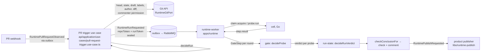

# libs/runtime

The TypeScript side of Kody Runtime. The product API and worker use it to decide and enqueue Runs. The Runtime (`apps/runtime`: worker and hub) uses it to run them and talk to the Go cell (`apps/runtime-cell`). Rules for changing it: [AGENTS.md](./AGENTS.md).

## Flow of one Run



## Sub-libraries

### contracts — `@libs/runtime/contracts`
Shared vocabulary and product↔Runtime contracts, defined once:
- `enums.ts`: `ExposeSchema`, blocker kinds (`security_violation`: the cell saw a claim exfiltrate; its signature, the alert kind, matches `SECURITY_VIOLATION_SIGNATURE`), verdicts, finding kinds and intents, VM health, probe and claim sides, consumers, triggers, check conclusions, cell owners. Every other module derives its types from here.
- `runtime-commands.ts`: product decisions that change Runtime state (fork approved, egress approved, stop and clear, environment setup, cell token issued, cell revoke), with `runtimeCommandOutboxMessage`, which validates each payload against its event's schema.
- `evidence.ts`: evidence keys `{orgId}/{runId}/{side}/{stepId}/{type}` and HMAC URLs, valid for at most 5 minutes. Upload grants (`signUploadGrant`/`verifyUploadGrant`): one per artifact a cell PUTs, bound to the exact key, the type's content type (`EVIDENCE_CONTENT_TYPES`), its byte ceiling (`evidenceUploadLimit`), a nonce and at most 15 minutes; domain-separated from read URLs.
- `sigv4.ts`: AWS Signature V4 (S3), presigned URLs and the Authorization header, node `crypto` only; checked against the AWS examples. `evidence-s3.ts`: evidence in an S3-compatible bucket (`RUNTIME_EVIDENCE_S3_*`): the object and staging keys, the presigned upload grant (content type signed) and the presigned read (attachment, at most 5 minutes).
- `cell-token.ts`: single-use 15-minute cell registration tokens, stored as a hash only.
- `run-plan.ts` and `probe-assertions.ts`: a planned HTTP probe keeps its descriptive `probe.expected` separate from optional closed `assertions` (`kind: http`, integer `status` 100–599, optional literal `bodyIncludes`, at most 2000 characters). The worker evaluates these together; assertions never enter the cell's wire Probe. A nonempty HTTP request body requires one explicit nonempty Content-Type header; the plan checks preserve the declared request unchanged.

- `browser-exploration.ts`: bounded local UI exploration requests/results, separate from probes. Only a base claim with the negotiated `browserExplore` capability offers `browser_explore`; final probes require stable CSS selectors rather than native session refs.

`api/domain/{runtime-commands,evidence,cell-token}.ts` re-export these for older callers.

### protocol — `@libs/runtime/protocol`
The hub↔cell WebSocket protocol (ADR-051).
- `strict-json.ts` decodes before any schema runs. It refuses duplicate keys, nesting deeper than 32, trailing data and the `__proto__` key, and reads numbers whole. A frame two parsers could read differently never reaches a schema.
- `envelope.ts` `decodeFrame`: 1 MiB frame limit, envelope schema, supported versions, then the body schema of its type. Claim-scoped types must carry `claimId`; `ack` and `nack` must carry `re`; `blocked` carries `re` (an answer) or `claimId` (unsolicited, a security violation on that claim). Each refusal has a code, which the hub sends back as a nack.
- `messages.ts`: strict zod body per message type. Repo refs refuse `.`/`..` segments and allow plain http only to local names. Upload paths cannot climb out. `step.result` must match its executor. A diagnostic hold is accepted only on a setup claim. A `security_violation` blocked names the alert kind as its signature.
- Evidence capture (`experiments/kody-runtime/EVIDENCE-CAPTURE-DESIGN.md`): `probe.run`/`exec` `evidence` (what to capture, the upload grants) and the result's `requests[].at`, `probe.evidence` (logs, db, outbound, refs) and `exec.refs`. Each block is a hello feature (`timedRequests`, `serviceLogs`, `dbEffects`, `outboundCalls`, `execCast`) both ways: `evidenceRequestFor` trims what the hub sends to what the cell named, and the cell sends a field only when the hub's ack accepts it. The gate reads none of it.
- `fixtures/*.json`: one frame and its expected outcome (`ok` + type, or the refusal code). Jest runs them in `fixtures.spec.ts`, and Go runs the same files in `apps/runtime-cell/internal/protocol/fixtures_test.go`.
- JSON Schema and Go types:
  ```
  node -r ts-node/register/transpile-only -r tsconfig-paths/register libs/runtime/protocol/scripts/dump-json-schema.ts
  cd apps/runtime-cell && go generate ./internal/protocol/ && go test ./internal/protocol/
  ```
  `fixtures.spec.ts` fails when the checked-in `protocol.schema.json` is stale. zod refinements do not reach the JSON Schema, so Go keeps its own copy of each one. A shared fixture holds both sides to it.

### probe — `@libs/runtime/probe`
`probe.schema.ts`: the typed probes the agent writes.
- `http`, `sql` and `browser` run on the observer, outside the VM, and are the only kinds that decide a verdict (`decidesVerdict`). `shell` runs inside the VM and is internal evidence only.
- Paths never start with `//` and never contain a backslash. Header names are RFC 9110 tokens, and header values contain no CR or LF.
- SQL must start with SELECT/WITH/EXPLAIN/SHOW and be one statement. That is a first filter; the guard is the observer's READ ONLY transaction.
- `ProbeResultSchema` is what the observer returns, bounded in size.
- The compare floor lives in `apps/runtime/src/worker/run/probe-fields.ts`, not here: an http probe always compares `status` and `json`, a sql probe `db_count`, so a narrow `compare` cannot hide a regression.

### gate — `@libs/runtime/gate`
`decideProbe(steps, { pinnedImageId })` is a pure function. It compares the normalized fields of observer steps from base and PR rounds and never reads text as an instruction. It answers either `more_rounds` or a verdict. The defaults are 4 rounds per side and at most 5 masked fields. In order:
1. **Input check.** It returns `inconclusive` when steps come from more than one probe, a side and round repeats, a round is not a positive integer, no image is pinned, or the options cannot be honored (`maxRoundsPerSide < 2`).
2. **Image.** A healthy step on an image other than the pinned one: `inconclusive`.
3. **Both sides needed.** No observer step on one side: `inconclusive`. Internal (vm) steps never decide.
4. **Health.**
   - The PR lost the machine (OOM, crash, unreachable, timeout) in every round, in at least 2 rounds, while the base stayed healthy: `finding` / `pr_destabilizes_machine`.
   - A lost link to the observer is not the PR's doing: more rounds, then `inconclusive`.
   - Any other health failure: `inconclusive`.
5. **Two base rounds** are required before comparing.
6. **Masking.** A field that differs between base rounds is masked.
   - A decisive field (no dot: `status`, `exit`, `db_count`, `dom`, `json`…) varying on the base: `inconclusive`. It is never masked away.
   - More than 5 masked fields, or nothing left but build-identity fields (`sha`, `commit`, `etag`, `build_id`, `asset_hash`): `inconclusive`.
7. **PR rounds disagree** with each other: more rounds, then `inconclusive`.
8. **Same fields on both sides.** `expectedHolds` is read on every round:
   - an unknown expectation on any round: `inconclusive`; legacy HTTP expectations may still prove an exact status or literal body match, but unmatched prose is unknown;
   - it varies within a side, or differs between sides: `inconclusive`;
   - it fails on both: `pre_existing`;
   - it holds on both: `not_reproduced`.
9. **Fields differ.** The PR must repeat (2 rounds). Pixel-only differences return `inconclusive` with a fixed visual question and retained evidence (ADR-017). A stable behavioral difference returns `finding` / `behavior_change`, with `differingFields`.

Anything the gate cannot decide is `inconclusive`. Nothing unknown becomes `not_reproduced`. `markUnbackedClaims` marks what the agent says it proved as `unverified` unless a healthy observer step of that probe, on the pinned image, backs it.

### entry-points — `@libs/runtime/entry-points`
- `extract.ts` `extractEntryPoints`: the entry points of a diff, without an LLM (ADR-044).
  - Next.js routes come from `app/**/route.ts` and `pages/api/**`; a route that exports no method uses method `ALL`.
  - Nest controllers and Express/Fastify calls: a changed line inside one handler maps to that route. Any other line (imports, constructor, a helper) maps to every route in the file.
  - Lockfiles, Dockerfiles, compose files, CI and vendored code are `dependency_surface`. Other code is `unmapped`.
  - The marker path `.kodus-runtime/diff-truncated` becomes `unmapped:diff-truncated`, which no probe can settle.
- `coverage.ts`: coverage comes from the observer's request log on both sides, never from the agent's label (S-32). `routeShapeOf` normalizes ids. `requestMatchesEntryPoint` matches segment by segment, with params and a trailing catch-all. `coveredEntryPoint` returns the backed entry point or `unmapped`. A probe left `unmapped` still carries `exercised` (`probe/exercised.ts`: `METHOD path`, `browser /first-goto` or `SQL on service`, from the typed spec, query dropped, redacted, at most 256 characters), which the comment and the Run page show with "outside this PR's paths". It names what was sent and covers nothing.
- `diff-ref.ts` `diffRefOf`: the diff file a probe's entry point comes from (its `via`, else the extractor's match) and the first added line of its patch; only a file of the diff is ever named. `ProbeVerdict.diffRef` on the Run detail.

### run — `@libs/runtime/run`
- `run-messages.ts`: product↔Runtime messages on the outbox.
  - `RuntimeRunRequested`: the diff is capped at 16 MiB total and carries `diffTruncated`. `repoToken` and `runToken` must be sealed, so a plain token is refused.
  - Also `RuntimeRunCancelRequested`, `RuntimePullRequestObserved` (the webhook event, with optional `commentId`) and `RuntimePublishRequested`.
  - `runtimeOutboxMessage(event, payload, id)` validates the payload against that event's schema and picks the routing key.
- `sealed-secret.ts`: AES-256-GCM, `sealed:v1:` prefix, bound by AAD to the Run id (a setup command's token is bound to the command `key`). `sealSecret`, `openSecret`, `isSealedSecret`, `sealingKeyFrom` (32 bytes, as hex or base64). The product seals with `RUNTIME_SECRET_SEAL_KEY`, and the runtime-worker opens inside the step that uses the token.
- `run-state.ts`: the Run state machine (`canTransition`, `assertTransition`).
  - `decideRunVerdict`: regression > partly_tested > no_regressions. Success needs `not_reproduced` on every entry point, with no inconclusive, blocker or unverified probe on it, and a diff that was not truncated. A `pre_existing` result alone leaves that path partly tested; it does not invalidate another `not_reproduced` result on the same path. Reports preserve `pre_existing` as the cause instead of claiming no probe reached it.
  - `checkConclusionFor` maps state and verdict to the check. A halted Run is never `success`; with `securityViolation` (the cell saw the code exfiltrate) it is a `failure` titled `Security violation · …`.
- `replay-lanes.ts`: per probe, main and the PR on one clock (request → logs → database → outbound → response) from one healthy round each, with the first difference; `ProbeVerdict.lanes` on the Run detail. A block a cell did not capture is `captured: false` ("not captured") and is never compared.
- `response-diff.ts`: per probe, the two answers field by field from the same rounds as the lanes (JSON fields as the gate names them, or the first differing line of a text body); values redacted and cut, header and secret-looking keys always `[redacted]`. `ProbeVerdict.responseDiff` on the Run detail, never in the report.
- `boot-failure.ts`: why the side that decided the Run did not boot (catalog kind, signature, title, the matched error line, the last 40 output lines), redacted; `RuntimeRunProjection.bootFailure` on the Run detail, its error line only as the report's `bootError`. The hub keeps the same tail on the claim's `runtime_claim_blockers` row.
- `run-report.ts`: the structured report and progress the product renders. No agent or app prose reaches the PR through it.
- `run-projection.ts`: `runtime_runs` in Mongo. `RunProjectionReader` (org-scoped `get`, `findLive`, `list` filtered by repository ids, environment and date, `listLive`) and `RunProjectionStore` (adds `upsert`, the runtime-worker only). `adapters/mongo-run-projection.store.ts` holds the store and its indexes.
- `run-stream.ts` + `adapters/pg-run-stream.store.ts`: the Run's Postgres event log, read from an opaque global-sequence offset. A transaction advisory lock per org and Run is acquired before sequence allocation, so a later append cannot commit ahead of an earlier same-stream event (#2460). Other streams stay independent; keyed retries remain idempotent. The file adapter preserves its own opaque event-boundary offsets. No schema or cursor migration is needed; every hub writer must run the ordered append before the guarantee holds, and previously skipped events require rereading from an earlier offset.
- `environment-setup.ts`, `recipe.ts`: the setup record and the part of `.kodus/workspace.yaml` the control plane reads.
- `testing/`: in-memory projection and stream (`@libs/runtime/run/testing`).

### environment — `@libs/runtime/environment`
`environment-runtime.ts`: the one port for "this app up at this SHA": `acquire`, `probe`, `exec`, `reset`, `release`, `bake`. It also defines claim, blocker and error types and the lease and hard-expiry minutes per consumer. The hub client implementing it lives in `apps/runtime`. `fake-environment-runtime.ts` is the in-memory driver (also exported from `testing.ts`).

### Reproduction data — `@libs/runtime/run/reproduction`
`reproductionFor` retains redacted finding inputs in the Run. `reproductionManifest` selects versioned public JSON data for the existing authorized finding endpoint: recorded identities, one external probe and observations. It exports no boot commands or shell script, refuses residual credential patterns anywhere in the response, and omits unresolved image aliases. The browser renders/copies/downloads JSON only and rejects legacy scripts or mismatched cached identities.

This data is for inspection, not execution authority or an exact replay package. The isolated reproduction executor and `runo repro` remain unimplemented; a manifest without recorded image/seed/assertion metadata cannot claim to recreate that state.

### redaction — `@libs/runtime/redaction`
`redactPatterns`: the token-pattern pass of S-51, a curated subset of the gitleaks rules in `gitleaks-rules.json`. That file must stay byte-identical to `apps/runtime-cell/internal/redact/rules/gitleaks-rules.json`, and the spec checks it. The LLM gateway runs it on every prompt.

### telemetry — `@libs/runtime/telemetry`
- Each Run's trace id is derived from its correlationId (`runContext`, `withRunSpan`, `traceHeaders`).
- `RuntimeMetrics` records the §11 metrics. The blocked egress host stays out of metric attributes, because the app under test chooses it.

### planner — `@libs/runtime/planner`
The shared test-planning core: bounded repository reads/search/windows, the planner specification/tools and no-model decisions. It depends on the `RepoReader` and `AgentRunner` contracts; it does not resolve Git credentials, model slots or BYOK keys and imports no API adapters. Existing API entry points re-export the moved modules for compatibility.

This extraction preserves the planner behavior and limits. The active production planner still runs through the API wrapper; moving its loop to `runtime-worker` also requires a gateway contract that carries model tool-call/result turns. The extraction alone does not complete that migration.

### api — `@libs/runtime/api`
The Nest side the product runs. `RuntimeApiModule` (`runtime-api.module.ts`) is imported by `apps/api`. `RuntimeTriggerModule` (`runtime-trigger.module.ts`, the PR trigger consumer) is imported by `apps/worker`.

- `domain/`
  - `ports.ts`: every port and its injection token, all org-scoped.
  - `trigger-rules.ts`: Off / On request / Rules. The glob matcher is linear (no backtracking). `decideRun` reads the PR's facts.
  - `budget.ts`: `planLlmCall`, the per-Run, per-PR and per-org-per-day token budget.
  - `run-token.ts`: the HMAC Run token for the LLM gateway; every claim is validated.
  - `egress.ts`: host normalization and the Kodus denylist, a guardrail on what an admin may approve.
  - `deterministic-id.ts`: derived Run ids.
- `application/`
  - Use cases, one per file under `use-cases/`. The apps/api controllers import them by path.
  - `run-request-builder.service.ts`: the only builder of `RuntimeRunRequested`, shared by the PR trigger, Run again and simulate.
  - `runtime-run-enqueuer.service.ts`: writes the publish target, then the outbox row.
  - `runtime-setup-requester.service.ts`: builds the setup command.
  - `secret-sealer.ts`: `sealForRuntime`; returns 503 without a key.
- `infrastructure/`
  - `code-management-git.adapter.ts`: Git API facts, a diff bounded with `truncated`, post-change contents for route extraction, org membership.
  - Mongo and Postgres readers of Runtime state: read-only, read-only transactions, `RUNTIME_DATABASE_READ_URL` only.
  - TypeORM stores of product tables.
  - `mongo-llm-budget.store.ts`: the gateway's budget in the product Mongo (`runtime_llm_budget` counters, `runtime_llm_reservations` in flight).
  - The BYOK LLM provider.
  - `runtime-reader.guard.ts`: JWT or team key.

**How the PR trigger decides.** The webhook event only says that something happened. The trigger reads every fact from the Git API (ADR-057).
1. A PR the API reports closed cancels its live Runs. A late `closed` on a PR the API reports open cancels nothing. Live Runs on a head other than the API's head are cancelled as superseded.
2. It then requires, in order: the mode is not off; an environment exists; its setup is `active`; the PR exists; it is not a fork (the approval flow does not exist yet).
3. For `@kody runtime` comments, the commenter must be allowed. `writers` needs write access per the Git API. `anyone_in_org` needs org membership per the Git API. An unknown answer denies.
4. For PR events, it skips drafts and heads that already ran, then evaluates `decideRun` on the diff, labels and author.
5. The Run id is derived from what the Run is for, so a redelivered event enqueues the same Run.

**Findings feedback and "intended"** (`use-cases/finding-feedback.use-case.ts`, `finding-intent.use-case.ts`). Any reader of a Run votes 👍/👎 per tested path (`runtime_finding_feedback`). A user with write on Runs of the repo (the "Run again" permission) marks a finding "this change is intended" or clears it (`PUT /runtime/runs/:id/findings/:probeId/intent`, `runtime_finding_intent`, one mark per finding with who and when). The mark is a learning signal shown on the Run page (`intendedBy` in GET /runtime/runs/:id): it never changes the Run, its verdict, its check or the PR comment, and publishes nothing.

**Warm pool size** (`domain/pool.ts`). The plan sets the default and the ceiling per environment (`RUNTIME_POOL_DEFAULT_SIZE`, default 0 = off; `RUNTIME_POOL_MAX_SIZE`, default 4). The org admin may choose a size in `PATCH /runtime/environments/:id/settings` (`poolSize`: 0 to the ceiling, or null for the plan's default; stored in `runtime_environments.pool_size`). Every setup command carries the effective size; a change is sent as `runtime.environment.pool_requested` through the outbox.

**Machine size ceiling** (`domain/machine-size-plan.ts`). The plan names the largest preset an admin may choose (`RUNTIME_MACHINE_SIZE_MAX`: `small`, `medium` or `large`, default `large`). `PATCH /runtime/environments/:id/settings` refuses a `machineSize` above it with a 400, and every setup command asks the saved size under the ceiling read at that moment, so a lowered plan boots at its largest preset instead of the saved one.

**LLM gateway** (`llm-gateway.use-case.ts`, `POST /internal/runtime/llm`):
- Checks the Run token and that the Run is the same org and attempt and still live.
- Redacts the prompt.
- Reserves the budget: a compare-and-swap on the per-day, per-PR and per-Run counters, so concurrent calls of one org never pass a limit together. A call that keeps losing the swap gets 503 `llm_budget_busy`.
- Settles with the reported usage. A provider that reports none keeps the reservation counted.
- The record of each call is its usage span in `observability_telemetry` (route `runtime`, with `runId`, `teamId`, `repositoryId`, `prNumber`, `task`), so Token Usage shows the Runtime's consumption. There is no separate usage table.

## Who imports what

Callers outside this folder import these paths; they must keep resolving:

| path | used by |
|---|---|
| `@libs/runtime/run` | apps/runtime, apps/api, libs/runtime-publish |
| `@libs/runtime/run/testing`, `run/sealed-secret` | apps/runtime |
| `@libs/runtime/run/run-messages` | apps/runtime, the GitHub webhook handler (libs/platform) |
| `@libs/runtime/environment`, `probe`, `protocol`, `gate`, `entry-points` (+ `/extract`, `/coverage`), `telemetry`, `redaction` | apps/runtime |
| `@libs/runtime/contracts` (+ `/enums`, `/runtime-commands`, `/evidence`, `/cell-token`) | apps/runtime |
| `@libs/runtime/api/domain/{runtime-commands,evidence,cell-token,run-token,ports}` | apps/runtime, apps/api (re-exports kept) |
| `@libs/runtime/api/application/**`, `api/infrastructure/runtime-reader.guard`, `api/__tests__/fixtures` | apps/api controllers and their spec, apps/runtime evidence spec |

## Testing

```
API_NODE_ENV=test npx jest libs/runtime                              # every spec here
API_NODE_ENV=test npx jest libs/runtime/gate libs/runtime/protocol   # one area
RUNTIME_IT_MONGO_URL=mongodb://… API_NODE_ENV=test npx jest libs/runtime/api/infrastructure/mongo-llm-budget.store.integration.spec.ts
cd apps/runtime-cell && go test ./internal/protocol/                 # the shared fixtures on the Go side
```
- The budget integration spec skips unless `RUNTIME_IT_MONGO_URL` is set; `SKIP_INTEGRATION=true` skips it as well.
- `api/__tests__/fixtures.ts` holds the shared test doubles, the real RBAC (`realAuthorization`), the test seal key and `openSealed`.
- Type check: `npx tsc --noEmit -p tsconfig.json 2>&1 | grep libs/runtime/`.

## Queues

- Run requests, cancels and setups go on `workflow.jobs.runtime_run.queue`; a cancel stays with the request it cancels. Every other command (stop, stop clear, revoke, egress and fork approvals, cell token, pool size) goes on `workflow.jobs.runtime_control.queue` (`runtimeCommandRoute`), so it never waits behind a backlog of Runs.
